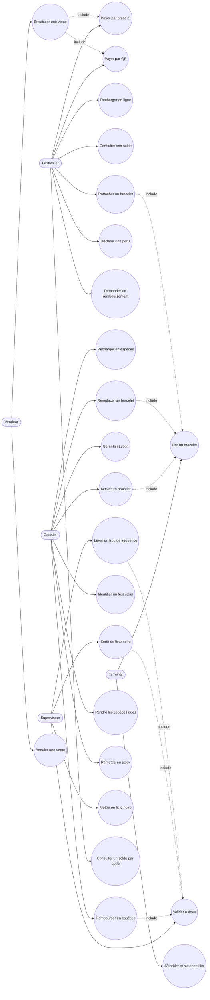
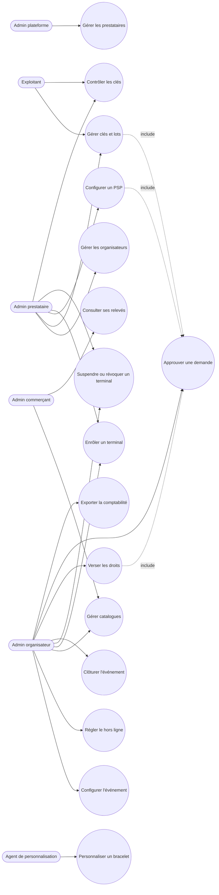

# Diagramme de cas d'utilisation — synthèse globale

> Statut de complétude : voir `06-docs-status.md`. Mermaid n'a pas de notation UML
> "cas d'utilisation" native — on la simule avec un flowchart : acteurs en
> rectangles arrondis (stadium), cas d'usage en ellipses, relations "include" en
> pointillés. Vue globale restée en Mermaid (créée avant l'installation de `/illustre`) ; les diagrammes de mission
> le sont en `/illustre` depuis la mission « Bracelets NFC » (préférence du porteur du 13/10/2026).
> Dernière mise à jour : 12/11/2026 (ligne de la mission 8 recalée à la review, vue globale non redessinée) ; 05/11/2026 (plan de la mission 8 : ligne de détail ajoutée, vue globale non redessinée ; statut de la mission 7 corrigé) ; 05/11/2026 (ligne de la mission 7 recalée à la review, vue globale non redessinée) ; 30/10/2026 (ligne de la mission 7, plan finalisé) ; 29/10/2026 (ligne de la mission 6 recalée à la review, vue globale non redessinée) ; 27/10/2026 (ligne de la mission 6, plan) ; 21/10/2026 (cas d'usage livrés par la mission « Identité et enrôlement des terminaux »,
> mergée le 21/10/2026). Cas d'usage tirés de `SPECIFICATION.md` §3.2, §7, §8, §11, §12.
> Complément du 16/11/2026 : review de la mission 9a (remboursements) : ligne de détail recalée (acteur confirmeur du `FAILED`, cumul du guichet, lien du titulaire), vue globale non redessinée (le cas « Demander un remboursement » y figure déjà).
> Complément du 17/11/2026 (mission 9b, review terminée le 17/11/2026 (14 lots approuvés) puis mergée sur `feat/versements-rapprochements-cloture` (acceptée le 17/11/2026, `15f1a19c` ; squash `b4b81d8c`, 14 lots), dans `main` par la PR #18 le 18/11/2026) : ligne de détail recalée sur le code réel (versements, rapprochements, clôture) ; vue globale non redessinée (aucun cas d'usage global fusionné ni renommé). Routes servies sur la branche de la mission seulement.
> Complément du 18/11/2026 (mission 11a, relue le 19/11/2026, acceptée, dans `main` par la PR #20 le 20/11/2026 (`27d0ec50`)) : aucun cas d'usage nouveau vu des personnes ; les parcours existants (session de vendeur, lots de bracelets, demande de remboursement, lot de versements, inscription de passerelle) gardent leurs réponses ; ce qui change, ce sont les refus opposés à une API compromise. Diagramme local `usecase-durcissements`, recalé le 19/11/2026 (IBAN chiffré, rejeu refusé, option `--ledger` refusée).
> Complément du 23/11/2026 (mission 9c, relue le 23/11/2026, 6 lots approuvés, non fusionnée) : ligne de détail recalée sur le code (cinq cas d'usage livrés, dont le réglage à deux niveaux prestataire et organisateur ; cumul du jour par portefeuille, décision du porteur ADR-233) ; vue globale non redessinée (aucun domaine nouveau).
> Complément du 24/11/2026 (mission 11b, plan finalisé, rien n'est codé) : ligne de détail ajoutée (six cas d'usage prévus) ; vue globale non redessinée (aucun domaine nouveau). **décisions D4, D7, D9, D10 et ajouts au contrat A1 à A6 validés par le porteur le 24/11/2026** (D1 à D3 décidées par lui le 24/11/2026).
> Recalé le 23/11/2026 (mission 10a relue, 11 lots sur 11 approuvés, non fusionnée) : le diagramme local `usecase-festivalier-serveur` est régénéré sur le code réel ; vue globale non redessinée (aucun domaine nouveau).
> Complément du 20/11/2026 (mission 10a, plan finalisé le 20/11/2026) : cas d'usage servis ou ajoutés dans des domaines existants (identifier un festivalier au guichet, révoquer une identification à deux personnes, faire tourner le secret des codes de rattachement et réémettre les codes, recevoir son code par WhatsApp puis SMS, voir numéro imprimé et solde provisoire). Diagramme local `usecase-festivalier-serveur`. Vue globale non redessinée.

## Vue d'ensemble — terrain (festivalier, vendeur, guichet)

## Vue d'ensemble — administration (back-office)

## Détail par mission

| Mission | Cas d'usage propres | Lien vers détail local |
|---|---|---|
| `fondations-grand-livre-01M4AY8M` — Fondations du grand livre et de l'API (✅ mergée le 08/10/2026) | Domaine « Grand livre et moteur d'écritures » : vérifier la base (local, CI), écrire au grand livre par le moteur, rejouer le festival de référence, garanties transverses de l'API. Aucun cas d'usage terrain nouveau | [`kitty-specs/fondations-grand-livre-01M4AY8M/docs/use-case.md`](../kitty-specs/fondations-grand-livre-01M4AY8M/docs/use-case.md) |
| `identite-roles-double-validation-01M4DNDN` — Identité, rôles et double validation (✅ mergée le 09/10/2026 (10/10 WP, acceptée)) | Vue administration : se connecter et agir dans son prestataire, gérer personnes et rôles (sauf retrait d'un `PLATFORM_ADMIN`, sans route), demander / approuver / refuser une action à deux, valider sur place au guichet, amorcer le premier administrateur, vérifier le journal d'audit | [`kitty-specs/identite-roles-double-validation-01M4DNDN/docs/use-case.md`](../kitty-specs/identite-roles-double-validation-01M4DNDN/docs/use-case.md) |
| `configuration-parties-evenements-01M4GCJ9` — Configuration, parties et événements (✅ mergée le 13/10/2026 (13/13 WP, acceptée, squash `d9e3779` ; dans `main` par la PR #2, CI verte)) | Vue administration : gérer les lois par pays, ouvrir un prestataire, ouvrir un organisateur, fixer contrats et frais, créer un événement, inscrire des commerçants, faire avancer l'événement, modifier en cours d'événement (à deux) | [`kitty-specs/configuration-parties-evenements-01M4GCJ9/docs/use-case.md`](../kitty-specs/configuration-parties-evenements-01M4GCJ9/docs/use-case.md) |
| `bracelets-nfc-01M4TD3W` — Bracelets NFC : format, clés, lots, cycle de vie (✅ mergée le 16/10/2026 (20/20 WP, acceptée le 15/10/2026, squash `7b1b8c2` ; dans `main` par la PR #3, CI verte)) | Domaine « Bracelets NFC ». Administration : gérer les clés (à deux), contrôler les clés, gérer un lot et commander ses codes, personnaliser un bracelet (nouvel acteur : agent de personnalisation), mettre en liste noire, sortir de liste noire (à deux). Terrain : lire un bracelet, activer et cautionner, rendre ou remplacer, rendre les espèces dues (`409` sans caisse ouverte), remettre en stock (lot réutilisable), déclarer perdu ou retrouvé, confirmer au guichet, rattacher par code (avec activation depuis l'app si l'événement l'autorise), consulter un solde par code sans compte. Restitution sans enchaînement des étapes (ADR-91, à trancher) | [`kitty-specs/bracelets-nfc-01M4TD3W/docs/use-case.md`](../kitty-specs/bracelets-nfc-01M4TD3W/docs/use-case.md) |
| `identite-enrolement-terminaux-01M52R6H` — Identité et enrôlement des terminaux (✅ mergée le 21/10/2026, 18/18 WP ; dans `main` par la PR #4 le 22/10/2026, CI verte ; correctif post-fusion n° 1 compris) | Domaine « Terminaux ». Administration (`OPERATOR_ADMIN` sur tout le prestataire, `ORGANIZER_ADMIN` sur ses événements, une personne) : émettre un code d'enrôlement (événement et choix « téléphone personnel » obligatoires) et lister les codes, suivre les terminaux, suspendre ou réactiver, révoquer. Terrain : le terminal s'enrôle sans compte (attestation Android 12+ ou App Attest, limites par code et par adresse, tout refus audité), renouvelle son jeton (grâce de 60 s), lit sa configuration et signale sa présence (permis s'il est suspendu), appelle toute route signée (trois preuves ; révoqué : `403 DEVICE_REVOKED`) ; au guichet, la personne passe dans `X-Staff-Authorization` | [`kitty-specs/identite-enrolement-terminaux-01M52R6H/docs/use-case.md`](../kitty-specs/identite-enrolement-terminaux-01M52R6H/docs/use-case.md) |
| `terminaux-paiement-en-ligne-01M52QB9` — Encaissement en ligne (✅ mergée le 26/10/2026 sur `feat/terminaux-paiement-en-ligne`, dans `main` par la PR #6 le 27/10/2026) | Domaine « Terminaux et encaissement ». Vue administration : gérer les vendeurs (`MERCHANT_ADMIN`) et le catalogue (`ORGANIZER_ADMIN`, commerçant si délégué) ; annuler hors fenêtre au back-office : un `SUPERVISOR` ou un `ORGANIZER_ADMIN` demande (`202`), une seconde personne approuve (ADR-122, ADR-129). Vue terrain : ouvrir sa session par PIN (un essai à la fois, 5 échecs bloquent), encaisser par bracelet ou par QR, annuler sa vente (terminal, vendeur, puis fenêtre) ; `SUPERVISOR` hors fenêtre par jeton sur place. Vue festivalier : payer un QR commerçant, créer un QR client (identité réelle en mission 10, faux refusé en production). Enrôlement refusé sur événement clos (OP-N74 levé). Identification au guichet reportée à la mission 10. Détail : [`use-case.md`](../kitty-specs/terminaux-paiement-en-ligne-01M52QB9/docs/use-case.md) |
| `recharges-caisses-psp-01M5YEBA` — Recharges, caisses et PSP (✅ mergée le 29/10/2026 sur `feat/recharges-caisses-psp` (squash `a865462c`), acceptée (`d62258a2`), dans `main` par la PR #8 le 29/10/2026 (CI verte)) | Domaine « Argent réel : PSP, caisses » (et « Bracelets NFC » pour la caution). Vue terrain : ouvrir une session de caisse, compter à l'aveugle, recharger en espèces (caution due prise ensuite), caution et espèces dues par la session (OP-N49), fermer la session (`SUPERVISOR` n'ayant pas compté ; `CASH_DIFF`), demander une recharge Wave, Orange Money ou carte, suivre ou annuler sa recharge. Vue administration : configurer un PSP et l'activer à deux, choisir le PSP de l'événement (à deux pendant `LIVE`), déposer en banque (à deux), débloquer un portefeuille bloqué par une contestation (à deux), accepter une contestation tardive (`ORGANIZER_ADMIN` ou `OPERATOR_ADMIN`, puis seconde personne). Acteur externe : le PSP (notifications, contestations ; faux, refusé en production, OP-N81) | [`kitty-specs/recharges-caisses-psp-01M5YEBA/docs/use-case.md`](../kitty-specs/recharges-caisses-psp-01M5YEBA/docs/use-case.md) |
| `hors-ligne-snapshots-lots-01M645RN` — Hors ligne : snapshots et lots (✅ mergée sur feat (f3bef0c0, 05/11/2026), dans `main` par la PR #10 le 05/11/2026) | Cas d'usage **livrés** par la mission 7. Domaine « Hors ligne et passerelle locale » (côté serveur). Vue administration : régler la politique hors ligne d'un organisateur, d'un événement ou d'un terminal (`ORGANIZER_ADMIN`) sous les plafonds du prestataire (`OPERATOR_ADMIN`, qui peut aussi couper un terminal) ; lire le risque maximal d'un événement et la remontée des terminaux (date limite de synchronisation, terminaux à jour ou non) ; lever à deux un trou de numéros ; importer à deux le journal d'un terminal révoqué. Vue terrain : recevoir un snapshot signé (complet ou delta) et l'accuser ; vendre hors ligne sous plafonds avec la session de vendeur ouverte en ligne (12 h, aucune connexion hors ligne) ; envoyer ses lots au retour du réseau et lire le résultat de chaque opération ; consulter ses numéros ; la part non couverte d'une vente va au compte d'attente avec une anomalie. **Aucune recharge espèces hors ligne** (décision du porteur du 30/10/2026) : un `TOPUP_CASH` dans un lot est rejeté seul, anomalie portant le montant. Sans le rôle voulu, ou pour un objet d'un autre prestataire, le serveur répond `404` neutre. Acteur externe : AWS KMS pour la signature des snapshots, en faux jusqu'à la mission 12b (refusé en production) | [`kitty-specs/hors-ligne-snapshots-lots-01M645RN/docs/use-case.md`](../kitty-specs/hors-ligne-snapshots-lots-01M645RN/docs/use-case.md) (deux diagrammes `/illustre` : back-office et terminal) |
| `passerelle-locale-01M6NM1S` (Passerelle locale de site) (✅ mergée sur feat (9d5e4592, 12/11/2026), dans `main` par la PR #12 le 13/11/2026) | Cas d'usage **livrés** par la mission 8 (dans `main` par la PR #12 le 13/11/2026). Domaine « Hors ligne et passerelle locale » (moitié passerelle). Vue administration : inscrire une passerelle (outil d'administration, hors API publique), demander la bascule vers la passerelle, l'abandonner si elle n'est pas accusée, demander le rendu, lire l'autorité et l'époque (`OPERATOR_ADMIN`), reprise forcée à deux si la passerelle est perdue, purger les secrets du site (deux titulaires de clés de site, ordre versé au central avant la destruction, ou automatique à la clôture), lever `STALE` à deux sur la passerelle, recevoir les alertes. Vue terrain (réseau du site pendant la coupure) : vendre, annuler et lire un solde sur la passerelle (16 opérations `x-edge-available`), recharger en espèces, activer et prendre une caution sur une session de caisse ouverte avant la bascule, renouveler son jeton d'appareil, lire l'accusé du central, envoyer un lot hors ligne, refus des opérations non servies ; une passerelle `STANDBY` refuse tout débit. Vue globale non redessinée | [`kitty-specs/passerelle-locale-01M6NM1S/docs/use-case.md`](../kitty-specs/passerelle-locale-01M6NM1S/docs/use-case.md) |
| `remboursements-01M7AG5V` — Remboursements des festivaliers (✅ **acceptée le 16/11/2026 (`8cd5ae97`), dans `main` par la PR #15 le 16/11/2026**) | Domaines « App festivalier » (demander un remboursement, suivre ses demandes, demander vers un autre numéro), « Argent réel : PSP, caisses, rapprochements, versements » (confirmer ou bloquer par le titulaire (par le lien reçu avec son code), lister et refuser, proposer l'approbation, approuver à deux, confirmer le paiement `PAID` ou `FAILED`, ce dernier refusé à l'auteur et au valideur) et « Bracelets NFC » (restituer et solder au guichet de retour, rendre le solde payé en espèces et les espèces dues, approuver sur place quand le cumul des espèces sorties dépasse le plafond). Acteurs : festivalier, titulaire du numéro vérifié, back-office auteur, valideur et confirmeur, caissier, superviseur. Hors périmètre : demande créée par le back-office et virement (OP-N123), versements et rapprochements (mission 9b). | [`kitty-specs/remboursements-01M7AG5V/docs/use-case.md`](../kitty-specs/remboursements-01M7AG5V/docs/use-case.md) |
| `versements-rapprochements-cloture-01M7JT4G` — Versements, rapprochements et clôture (✅ **mergée sur `feat/versements-rapprochements-cloture` (acceptée le 17/11/2026, `15f1a19c` ; squash `b4b81d8c`, 14 lots), dans `main` par la PR #18 le 18/11/2026**) | Domaines « Argent réel : PSP, caisses, rapprochements, versements » (voir les droits nets, préparer un lot de versements, valider le lot à deux, exporter le CSV, confirmer ou déclarer en échec une ligne, importer un relevé, rapprocher une ligne, créer une demande de remboursement par virement, obtenir son relevé) et « Administration et exploitation » (voir les conditions de passage, aperçu et exécution des sept étapes de clôture, passer l'événement en `CLOSED`, voir les soldes restants, proposer puis valider une réclamation tardive, configurer et exporter la comptabilité). Acteurs : administrateur auteur, administrateur valideur, back-office, second administrateur, superviseur (lecture), partie concernée (commerçant, festivalier, organisateur, prestataire, plateforme), exploitant. Rôle du lot selon le bénéficiaire (décision du porteur du 17/11/2026). Règles tranchées à l'implémentation : réclamation sur grand livre `LOCKED` sans frais, remboursement tardif vers un autre numéro avec seconde personne et preuve, relevé de l'organisateur avec « Ventes internes ». Hors périmètre : paiement envoyé par l'API (manuel), PDF, adaptateurs réels (12b). | [`kitty-specs/versements-rapprochements-cloture-01M7JT4G/docs/use-case.md`](../kitty-specs/versements-rapprochements-cloture-01M7JT4G/docs/use-case.md) |
| `durcissements-serveur-01M7QAJD` — Durcissements serveur hérités (✅ **mergée : acceptée le 19/11/2026, dans `main` par la PR #20 le 20/11/2026 (`27d0ec50`)**) | Domaines « Bracelets NFC : format, clés, lots, cycle de vie », « Argent réel : PSP, caisses, rapprochements, versements » et « Administration et exploitation » : mêmes cas d'usage que les missions 4, 5b, 8 et 9b, avec les refus d'une API compromise (écrire un lot directement, ouvrir une session de vendeur sans PIN, insérer une demande déjà payée). Détail : `kitty-specs/durcissements-serveur-01M7QAJD/docs/use-case.md` |
| `serveur-app-festivalier-01M7WB69` — Serveur de l'app festivalier (🔍 **relue le 23/11/2026, 11 lots approuvés, non fusionnée**) | Domaines « Argent réel : PSP, caisses, rapprochements, versements » (identification au guichet, révocation à deux, plafonds selon le niveau calculé), « Bracelets NFC : format, clés, lots, cycle de vie » (rotation du secret, réémission des codes, numéro imprimé) et « App festivalier » (chaîne d'envoi des codes, avis de solde provisoire) ; un refus : l'agent titulaire ne peut pas identifier son propre compte. Détail : `kitty-specs/serveur-app-festivalier-01M7WB69/docs/use-case.md` |
| `remboursement-partiel-especes-01M84932` — Remboursement partiel en espèces au guichet (🔍 **relue le 23/11/2026, 6 lots approuvés, non fusionnée**) | Domaines « Bracelets NFC : format, clés, lots, cycle de vie » (rendre une partie du solde payé en gardant son bracelet) et « Argent réel : PSP, caisses, rapprochements, versements » (autoriser par le prestataire, activer par l'organisateur, seconde personne sur le cumul du jour du portefeuille). Vue administration : régler `cash_partial_refund_allowed` (prestataire) et `cash_partial_refund_enabled` (événement), refusés par défaut. Vue terrain : rendre une partie du solde payé au guichet, refus avec motif distinct (`REFUND_NOT_ALLOWED`, `AMOUNT_OUT_OF_RANGE`, `INSUFFICIENT_FUNDS`, `WALLET_BLOCKED`, phase), jeton d'une seconde personne au-dessus du seuil. Détail dans [`use-case.md`](../kitty-specs/remboursement-partiel-especes-01M84932/docs/use-case.md). |
| `routes-backoffice-01M86KT6` — Routes serveur du back-office (📐 **plan finalisé le 24/11/2026, rien n'est codé ; D4, D7, D9, D10 et ajouts au contrat validés par le porteur le 24/11/2026**) | Domaines « Administration et exploitation » (profil du personnel et rôles autorisés par opération, lister et ouvrir les ventes, lister et classer les anomalies sans écriture d'argent, retrouver un bracelet ou un portefeuille, chercher un festivalier par numéro exact) et « Terminaux et encaissement » (tenir les modèles de téléphone, niveau NFC sur les terminaux, sans refus d'enrôlement). Acteurs : personnel connecté, administrateurs dans leur portée, superviseur, administrateur plateforme. Détail dans [`use-case.md`](../kitty-specs/routes-backoffice-01M86KT6/docs/use-case.md). |

## Questions de nécessité/complétude posées lors de la dernière révision
- Nécessaire pour ce projet ? Voir `06-docs-status.md`.
- Complet au vu des missions mergées à ce jour ? Voir `06-docs-status.md`.
- Validé par : en attente.
