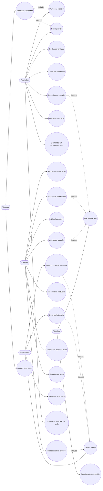
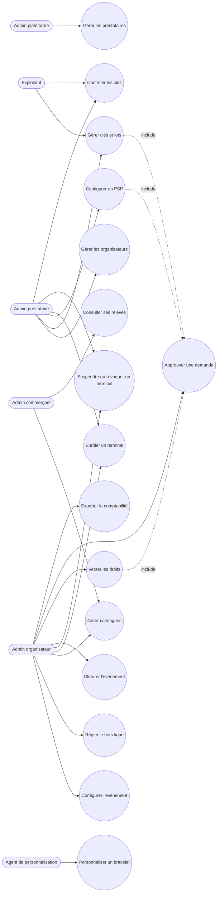

# Diagramme de cas d'utilisation — synthèse globale

> Statut de complétude : voir `06-docs-status.md`. Mermaid n'a pas de notation UML
> "cas d'utilisation" native — on la simule avec un flowchart : acteurs en
> rectangles arrondis (stadium), cas d'usage en ellipses, relations "include" en
> pointillés. Vue globale restée en Mermaid (créée avant l'installation de `/illustre`) ; les diagrammes de mission
> le sont en `/illustre` depuis la mission « Bracelets NFC » (préférence du porteur du 13/10/2026).
> Dernière mise à jour : 21/10/2026 (cas d'usage livrés par la mission « Identité et enrôlement des terminaux »,
> mergée le 21/10/2026). Cas d'usage tirés de `SPECIFICATION.md` §3.2, §7, §8, §11, §12.

## Vue d'ensemble — terrain (festivalier, vendeur, guichet)

## Vue d'ensemble — administration (back-office)

## Détail par mission

| Mission | Cas d'usage propres | Lien vers détail local |
|---|---|---|
| `fondations-grand-livre-01M4AY8M` — Fondations du grand livre et de l'API (✅ mergée le 08/10/2026) | Domaine « Grand livre et moteur d'écritures » : vérifier la base (local, CI), écrire au grand livre par le moteur, rejouer le festival de référence, garanties transverses de l'API. Aucun cas d'usage terrain nouveau | [`kitty-specs/fondations-grand-livre-01M4AY8M/docs/use-case.md`](../kitty-specs/fondations-grand-livre-01M4AY8M/docs/use-case.md) |
| `identite-roles-double-validation-01M4DNDN` — Identité, rôles et double validation (✅ mergée le 09/10/2026 (10/10 WP, acceptée)) | Vue administration : se connecter et agir dans son prestataire, gérer personnes et rôles (sauf retrait d'un `PLATFORM_ADMIN`, sans route), demander / approuver / refuser une action à deux, valider sur place au guichet, amorcer le premier administrateur, vérifier le journal d'audit | [`kitty-specs/identite-roles-double-validation-01M4DNDN/docs/use-case.md`](../kitty-specs/identite-roles-double-validation-01M4DNDN/docs/use-case.md) |
| `configuration-parties-evenements-01M4GCJ9` — Configuration, parties et événements (✅ mergée le 13/10/2026 (13/13 WP, acceptée, squash `d9e3779` ; dans `main` par la PR #2, CI verte)) | Vue administration : gérer les lois par pays, ouvrir un prestataire, ouvrir un organisateur, fixer contrats et frais, créer un événement, inscrire des commerçants, faire avancer l'événement, modifier en cours d'événement (à deux) | [`kitty-specs/configuration-parties-evenements-01M4GCJ9/docs/use-case.md`](../kitty-specs/configuration-parties-evenements-01M4GCJ9/docs/use-case.md) |
| `bracelets-nfc-01M4TD3W` — Bracelets NFC : format, clés, lots, cycle de vie (✅ mergée le 16/10/2026 (20/20 WP, acceptée le 15/10/2026, squash `7b1b8c2` ; dans `main` par la PR #3, CI verte)) | Domaine « Bracelets NFC ». Administration : gérer les clés (à deux), contrôler les clés, gérer un lot et commander ses codes, personnaliser un bracelet (nouvel acteur : agent de personnalisation), mettre en liste noire, sortir de liste noire (à deux). Terrain : lire un bracelet, activer et cautionner, rendre ou remplacer, rendre les espèces dues (`409` sans caisse ouverte), remettre en stock (lot réutilisable), déclarer perdu ou retrouvé, confirmer au guichet, rattacher par code (avec activation depuis l'app si l'événement l'autorise), consulter un solde par code sans compte. Restitution sans enchaînement des étapes (ADR-91, à trancher) | [`kitty-specs/bracelets-nfc-01M4TD3W/docs/use-case.md`](../kitty-specs/bracelets-nfc-01M4TD3W/docs/use-case.md) |
| `identite-enrolement-terminaux-01M52R6H` — Identité et enrôlement des terminaux (✅ mergée le 21/10/2026, 18/18 WP ; dans `main` par la PR #4 le 22/10/2026, CI verte ; correctif post-fusion n° 1 compris) | Domaine « Terminaux ». Administration (`OPERATOR_ADMIN` sur tout le prestataire, `ORGANIZER_ADMIN` sur ses événements, une personne) : émettre un code d'enrôlement (événement et choix « téléphone personnel » obligatoires) et lister les codes, suivre les terminaux, suspendre ou réactiver, révoquer. Terrain : le terminal s'enrôle sans compte (attestation Android 12+ ou App Attest, limites par code et par adresse, tout refus audité), renouvelle son jeton (grâce de 60 s), lit sa configuration et signale sa présence (permis s'il est suspendu), appelle toute route signée (trois preuves ; révoqué : `403 DEVICE_REVOKED`) ; au guichet, la personne passe dans `X-Staff-Authorization` | [`kitty-specs/identite-enrolement-terminaux-01M52R6H/docs/use-case.md`](../kitty-specs/identite-enrolement-terminaux-01M52R6H/docs/use-case.md) |
| `terminaux-paiement-en-ligne-01M52QB9` — Encaissement en ligne (📋 planifiée, plan finalisé le 22/10/2026) | Domaine « Terminaux et encaissement ». Vue administration : gérer les vendeurs (`MERCHANT_ADMIN`) et le catalogue (`ORGANIZER_ADMIN`, commerçant si délégué). Vue terrain : ouvrir sa session par PIN, encaisser par bracelet ou par QR, annuler sa vente ; `SUPERVISOR` hors fenêtre. Vue festivalier : payer un QR (identité réelle en mission 10). Identification au guichet reportée à la mission 10. Détail : [`use-case.md`](../kitty-specs/terminaux-paiement-en-ligne-01M52QB9/docs/use-case.md) |

## Questions de nécessité/complétude posées lors de la dernière révision
- Nécessaire pour ce projet ? Voir `06-docs-status.md`.
- Complet au vu des missions mergées à ce jour ? Voir `06-docs-status.md`.
- Validé par : en attente.
