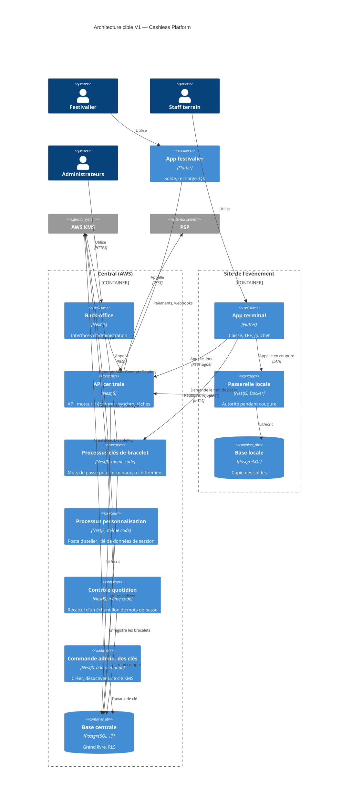

# Diagramme d'architecture globale

> Statut de complétude : voir `06-docs-status.md`. Notation C4 "Conteneur"
> (niveau 2), supportée nativement par Mermaid (`C4Container`). Rendu en repli Mermaid (`excalidraw-diagram-skill` non installé).
> Dernière mise à jour : initialisation du 07/10/2026. **Architecture cible** (`SPECIFICATION.md` §1.2, §2) :
> aucun conteneur n'est encore déployé. Mise à jour du 15/10/2026 : le service des clés de bracelet est découpé en
> processus à droits séparés, comme l'a livré la mission « Bracelets NFC » (approuvée, acceptation et fusion en
> attente).

## Vue d'ensemble (cible V1)

## Organisation du code (monorepo imposé, §2.1)

| Dossier | Contenu |
|---|---|
| `apps/api` | NestJS : API publique, API terminaux, moteur d'écritures, synchronisation, tâches ; depuis la mission « Bracelets NFC », cinq points d'entrée (`main.ts`, `main.tag-keys.ts`, `main.personalization.ts`, `main.tag-check.ts`, `main.key-admin.ts`) dans `src/processes/` |
| `apps/gateway` | Passerelle locale (réutilise les modules de l'API) |
| `apps/backoffice` | Next.js : plateforme, prestataire, organisateur, commerçant |
| `apps/terminal` | Flutter : caisse catalogue, TPE clavier, recharge |
| `apps/customer` | Flutter : app festivalier |
| `packages/contracts` | `openapi.yaml` et types générés (TypeScript, Dart) |
| `packages/ledger-sql` | Schéma, migrations, tests pgTAP et générateurs |
| `packages/tag-format` | Format B, CRC, dérivation, vecteurs de test (TypeScript et Dart) |
| `tools/nfc-bench` | Banc de mesure NFC (prototype) |

## Détail par mission

| Mission | Conteneur(s) concerné(s) | Lien vers détail local |
|---|---|---|
| `fondations-grand-livre-01M4AY8M` (✅ mergée le 08/10/2026) | API centrale (`apps/api` : squelette, moteur d'écritures), base de données (migrations `packages/ledger-sql`), `packages/contracts` (types générés), CI, base locale (`tools/dev-db`) | [`kitty-specs/fondations-grand-livre-01M4AY8M/docs/architecture-notes.md`](../kitty-specs/fondations-grand-livre-01M4AY8M/docs/architecture-notes.md) |
| `identite-roles-double-validation-01M4DNDN` (✅ mergée le 09/10/2026 (10/10 WP, acceptée)) | API centrale (`identity/`, `identity/users/`, `approval/`, `approval/onsite/`, `audit/` ; `TenantTx.identify`/`withoutTenant`), base de données (migrations `0003`-`0006`, `post-roles.sql`, `bootstrap-admin`), contrat (`openapi.yaml`, tag `Personnes`), serveur d'identité OIDC (externe) | [`kitty-specs/identite-roles-double-validation-01M4DNDN/docs/architecture-notes.md`](../kitty-specs/identite-roles-double-validation-01M4DNDN/docs/architecture-notes.md) |
| `configuration-parties-evenements-01M4GCJ9` (✅ mergée le 13/10/2026 (13/13 WP, acceptée, squash `d9e3779` ; dans `main` par la PR #2, CI verte)) | Base de données (migrations `0007`-`0009`, rôle `cashless_platform` dans `post-roles.sql`), API centrale (second pool `PlatformTx`, modules `configuration/`, `organization/`, `events/`, `SqlConfigResolver`), moteur d'écritures (`fee_rule_id` sur les lignes de frais), contrat (48 opérations back-office sur 28 chemins) | [`kitty-specs/configuration-parties-evenements-01M4GCJ9/docs/architecture-notes.md`](../kitty-specs/configuration-parties-evenements-01M4GCJ9/docs/architecture-notes.md) |
| `bracelets-nfc-01M4TD3W` (✅ mergée le 16/10/2026 (20/20 WP, acceptée le 15/10/2026, squash `7b1b8c2` ; dans `main` par la PR #3, CI verte)) | Bibliothèque `packages/tag-format` (TypeScript et Dart), API centrale découpée en quatre processus (API publique, clés de bracelet, personnalisation, contrôle quotidien) et une commande d'administration des clés, module `media/`, ports et faux (`kms/`, `device-identity/`, `customer-identity/`), base de données (migrations `0010`-`0019`, quatre rôles de base de plus dans `post-roles.sql`), contrat (27 opérations ajoutées sur 24 chemins, `x-process` sur 39 opérations, types TypeScript et Dart) | [`kitty-specs/bracelets-nfc-01M4TD3W/docs/architecture-notes.md`](../kitty-specs/bracelets-nfc-01M4TD3W/docs/architecture-notes.md) |

## Pile logicielle

Logiciels, versions et choix d'implémentation : [`08-pile-logicielle.md`](./08-pile-logicielle.md), référence
arrêtée le 09/10/2026 (ADR-78 : l'existant prime). Redis, Fastify, Prisma et Nginx, proposés par le porteur, sont
écartés ; WAF, `@nestjs/throttler`, pino et OpenTelemetry s'ajouteront avec les missions concernées.

## Décisions d'architecture notables
(Décisions déjà prises dans `DECISIONS_ADR.md`, avant toute mission.)

| Décision | Justification | Mission source |
|---|---|---|
| Seule la fonction SQL `post_transaction` écrit le grand livre ; règles métier des bracelets, lots et cautions en fonctions SQL | Un seul point de contrôle des invariants (§2.2) | Spécification (avant missions) |
| Isolation par prestataire via RLS forcée et `set_config('app.operator_id', …, true)` par transaction | Pas de fuite entre requêtes d'un pool de connexions (§2.2, §13.1) | Spécification |
| Comptes chauds sans solde en cache ; comptes commerçants chauds par défaut | Pas d'attente entre ventes simultanées (ADR-62) | Spécification |
| Mot de passe des bracelets dérivé une fois par KMS, stocké chiffré ; terminaux sans clé maître | Pas d'appel KMS par passage ; vol de terminal borné (§7.3, §7.4) | Spécification |
| Une seule autorité de débit par grand livre (central ou passerelle), bascule par époque | Pas de double dépense pendant une coupure (§9.7) | Spécification |
| Scellement chaîné du journal toutes les 5 min, copié hors base | Détection de toute altération (ADR-46) | Spécification |
| Types partagés générés depuis `openapi.yaml` | Pas de divergence entre clients et serveur (§2.2) | Spécification |
| Accès base uniquement par `TenantTx.run` (pool `pg` en `cashless_app` non exporté, sans ORM, `int8` → `BigInt`) ; seule exception `ping()` pour la santé | `set_config` transactionnel garanti, SQLSTATE visibles, aucun flottant ; test d'architecture | `fondations-grand-livre-01M4AY8M` |
| Idempotence applicative en deux transactions (réserver ; travail + réponse ensemble, via `IdempotentTx`) ; 4xx enregistrées, 5xx relâchées ; clé `COMPLETED` jamais réutilisée | Aucune écriture validée sans réponse enregistrée ; requête concurrente → `409 IDEMPOTENCY_KEY_IN_PROGRESS` | `fondations-grand-livre-01M4AY8M` |
| Moteur : idempotence vérifiée **avant** la matrice des statuts et les soldes (verrou consultatif par clé, empreinte de commande dans les métadonnées) ; un seul appel d'écriture par commande | Un rejeu reste un rejeu après la clôture ou un changement de soldes (second rejeu du scénario sur grand livre `LOCKED` : 0 transaction) | `fondations-grand-livre-01M4AY8M` |
| Constructeurs d'écritures purs ; 5 types délégués aux fonctions SQL de la base | Testables sans base ; §5.4 respecté | `fondations-grand-livre-01M4AY8M` |
| Migrations SQL pures (0001 = schéma de référence lu tel quel), `roles.sql` rejoué après chaque série | Pas de dérive avec le schéma normatif ; droits des tables nouvelles alignés | `fondations-grand-livre-01M4AY8M` |
| Base de test locale : cluster PostgreSQL 17 privé (port 5433) avec pgTAP | Ni Docker ni droits admin sur le poste Windows | `fondations-grand-livre-01M4AY8M` |
| Personnes : jeton OIDC vérifié par `jose`, prestataire et rôles lus en base (`identify_person`) | Retrait de rôle immédiat, prestataire jamais tiré du jeton | `identite-roles-double-validation-01M4DNDN` (plan) |
| Approbation : décision et exécution dans une seule transaction (échec dans un point de sauvegarde) | Aucune demande orpheline ni écriture partielle | `identite-roles-double-validation-01M4DNDN` (plan) |
| Journal d'audit chaîné par prestataire et scellé ; `post-roles.sql` après `roles.sql` | Altération détectable ; droits trop larges retirés sans modifier le kit | `identite-roles-double-validation-01M4DNDN` (plan) |
| Administrateur de la plateforme créé par une fonction SECURITY DEFINER (`create_platform_admin`), seule transaction sans prestataire de l'API | Personne de plateforme invisible et non insérable sous RLS ; droit vérifié en base | `identite-roles-double-validation-01M4DNDN` (implémentation) |
| Actions à deux enregistrées par module dynamique `registerApprovalActions(...)` ; jeton sur place consommé dans la transaction métier | Mécanisme générique sans modification par les missions suivantes (SC-005) ; jeton non consommé si le travail échoue | `identite-roles-double-validation-01M4DNDN` (implémentation) |
| Écritures de plateforme par un second rôle de base `cashless_platform` (second pool, politiques RLS nominatives dans `post-roles.sql`) ; coexiste avec la fonction SECURITY DEFINER de la mission 2 | Lettre de §2.2 (choix du porteur) ; le rôle applicatif ne peut plus écrire une donnée de plateforme (politiques restrictives) ; limite acceptée : `EXECUTE` hérité de `PUBLIC` (ADR-80) | `configuration-parties-evenements-01M4GCJ9` (implémentation) |
| Grand livre et comptes d'un événement ouverts à sa création par `open_event_ledger` (SQL, INVOKER) ; statut seulement par `set_event_status`, conditions lisibles par `event_transition_conditions` | Plan de comptes en un seul endroit ; aucun grand livre orphelin ; conditions identiques aux refus de la base | `configuration-parties-evenements-01M4GCJ9` (implémentation) |
| Cascade versionnée : catalogue des réglages en TypeScript, colonnes d'`event` + instantané dans chaque version ; port `ConfigResolver` implémenté en SQL | Bornes et messages centralisés ; `config_version_id` et `fee_rule_id` réels pour chaque écriture ; un réglage par rôle (ADR-81) ; frais du PSP par règle `EVENT` à bénéficiaire `PSP:<canal>` (ADR-82) | `configuration-parties-evenements-01M4GCJ9` (implémentation) |
| Quatre processus pour un seul code, à droits séparés sur le service de clés ; rôles de base distincts (l'API publique ne lit plus les secrets chiffrés) ; commande d'administration séparée pour créer et désactiver une clé | Une faille de l'API publique n'atteint aucune clé de bracelet (§3.2, §13.2) ; deux barrières indépendantes | `bracelets-nfc-01M4TD3W` (implémentation) |
| Mot de passe d'un bracelet jamais transmis en clair (enveloppe pour le terminal ou pour le poste) ; clé de données en mémoire 5 minutes au plus ; empreinte à clé des codes de rattachement | Règle du contrat étendue au poste ; exposition bornée ; un code court ne se retrouve pas par essais | `bracelets-nfc-01M4TD3W` (implémentation) |
| Service de clés, identité du terminal et identité du festivalier derrière des ports, avec un faux pour les tests ; un faux fait refuser le démarrage en production. `NODE_ENV` obligatoire (`production`, `development` ou `test`, sinon aucun processus ne démarre) ; `TAG_WRAPPING_KEY_REF` et `CLAIM_CODE_DOMAIN` exigés en production (correctif post-fusion n° 1) | Avancer sans AWS ni enrôlement réel, sans qu'un raccourci atteigne la production | `bracelets-nfc-01M4TD3W` (implémentation) |
| Travaux de clé en table (`tag_key_job`, aucun secret, contrainte en base) : une action approuvée dans l'API publique est exécutée par le processus qui a le droit. Depuis la migration 0020 (correctif post-fusion n° 1, ADR-102), un travail ne naît que d'une demande approuvée à deux, par deux fonctions `SECURITY DEFINER` (aucun `INSERT` direct pour l'API ni la personnalisation) ; chaque exécutant revérifie la demande avant d'appeler le service de clés, sinon refus audité `TAG_KEY_JOB_REFUSED` | Pas d'appel entre processus ; reprise sans double effet (ADR-83) | `bracelets-nfc-01M4TD3W` (implémentation) |
| Aucun compte de caisse avant la mission des caisses : caution en espèces et espèces dues répondent `409` (ADR-89) ; guichet de retour sans enchaînement, `settle_balance` et `refund_deposit_by` refusés en `422` (ADR-91, proposée, à trancher) | Aucun argent liquide sans session de caisse ; enchaînement renvoyé à la mission 9 par le plan, alors que `openapi.yaml` le décrit | `bracelets-nfc-01M4TD3W` (implémentation) |
| Contrôle quotidien des mots de passe : compte rendu et alerte d'audit, code de sortie 2 sur écart, 3 sur panne ; aucune sorte d'anomalie nouvelle (ADR-92) | Liste des anomalies fermée (§12.2) | `bracelets-nfc-01M4TD3W` (implémentation) |

## Questions de nécessité/complétude posées lors de la dernière révision
- Nécessaire pour ce projet ? Voir `06-docs-status.md`.
- Complet au vu de tous les conteneurs réellement déployés à ce jour ? Voir `06-docs-status.md`.
- Validé par : en attente.
