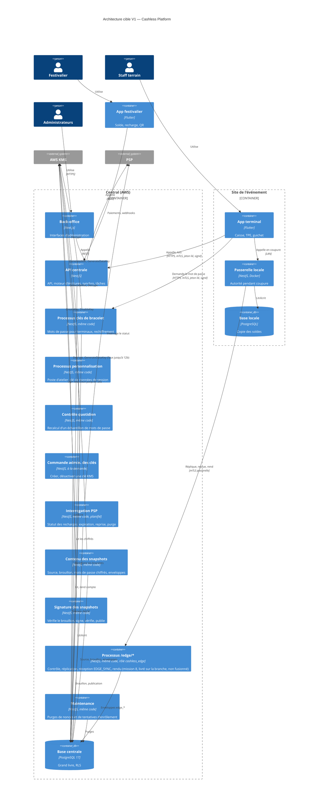

# Diagramme d'architecture globale

> Statut de complétude : voir `06-docs-status.md`. Notation C4 "Conteneur"
> (niveau 2), supportée nativement par Mermaid (`C4Container`). Rendu en repli Mermaid (`excalidraw-diagram-skill` non installé).
> Dernière mise à jour : initialisation du 07/10/2026. Mise à jour du 12/11/2026 (review de la mission 8, 25 lots approuvés ; mission dans `main` par la PR #12 le 13/11/2026 : vue C4 relue et conforme au code, ligne de détail et décisions notables recalées sur le livré). Mise à jour du 05/11/2026 (plan de la mission 8 « Passerelle locale de site », planifiée) : processus central `/edge/*` ajouté à la vue C4, ligne de détail et trois décisions notables ; statut de la mission 7 corrigé (dans `main` par la PR #10). Mise à jour du 05/11/2026 : mission 7 « Hors ligne : snapshots et lots » acceptée puis mergée sur feat (f3bef0c0, 05/11/2026), dans `main` par la PR #10 le 05/11/2026, ligne de détail et décisions notables recalées (vue C4 inchangée). Mise à jour du 30/10/2026 : processus `snapshot-content`, `snapshot-signer` et `maintenance` ajoutés à la vue (plan de la mission 7). Mise à jour du 29/10/2026 : processus `psp-poller` ajouté à la vue (mission « Recharges, caisses et PSP », relue). **Architecture cible** (`SPECIFICATION.md` §1.2, §2) :
> aucun conteneur n'est encore déployé. Mise à jour du 15/10/2026 : le service des clés de bracelet est découpé en
> processus à droits séparés, comme l'a livré la mission « Bracelets NFC » (approuvée, acceptation et fusion en
> attente). Mise à jour du 21/10/2026 : identité réelle des terminaux (HTTPS et mTLS dans les processus, trois
> preuves), livrée par la mission « Identité et enrôlement des terminaux » (mergée le 21/10/2026).

## Vue d'ensemble (cible V1)

## Organisation du code (monorepo imposé, §2.1)

| Dossier | Contenu |
|---|---|
| `apps/api` | NestJS : API publique, API terminaux, moteur d'écritures, synchronisation, tâches ; depuis la mission « Bracelets NFC », cinq points d'entrée (`main.ts`, `main.tag-keys.ts`, `main.personalization.ts`, `main.tag-check.ts`, `main.key-admin.ts`) et, depuis la mission 6, un sixième (`main.psp-poller.ts`) dans `src/processes/` ; **prévus par la mission 7** : trois points d'entrée de plus (`main.snapshot-content.ts`, `main.snapshot-signer.ts`, `main.maintenance.ts`) |
| `apps/gateway` | Passerelle locale : base locale à schéma réduit, règles partagées avec l'API par `packages/shared-rules` ; **livrée par la mission 8** (dans `main` par la PR #12 le 13/11/2026) : un processus, écouteur des terminaux et écouteur d'administration local, base locale `edge-0001` à `edge-0010`, image Docker |
| `apps/backoffice` | Next.js : plateforme, prestataire, organisateur, commerçant |
| `apps/terminal` | Flutter : caisse catalogue, TPE clavier, recharge |
| `apps/customer` | Flutter : app festivalier |
| `packages/contracts` | `openapi.yaml` et types générés (TypeScript, Dart) |
| `packages/ledger-sql` | Schéma, migrations, tests pgTAP et générateurs |
| `packages/tag-format` | Format B, CRC, dérivation, vecteurs de test (TypeScript et Dart) |
| `tools/nfc-bench` | Banc de mesure NFC (prototype) |

## Détail par mission

| Mission | Conteneur(s) concerné(s) | Lien vers détail local |
|---|---|---|
| `fondations-grand-livre-01M4AY8M` (✅ mergée le 08/10/2026) | API centrale (`apps/api` : squelette, moteur d'écritures), base de données (migrations `packages/ledger-sql`), `packages/contracts` (types générés), CI, base locale (`tools/dev-db`) | [`kitty-specs/fondations-grand-livre-01M4AY8M/docs/architecture-notes.md`](../kitty-specs/fondations-grand-livre-01M4AY8M/docs/architecture-notes.md) |
| `identite-roles-double-validation-01M4DNDN` (✅ mergée le 09/10/2026 (10/10 WP, acceptée)) | API centrale (`identity/`, `identity/users/`, `approval/`, `approval/onsite/`, `audit/` ; `TenantTx.identify`/`withoutTenant`), base de données (migrations `0003`-`0006`, `post-roles.sql`, `bootstrap-admin`), contrat (`openapi.yaml`, tag `Personnes`), serveur d'identité OIDC (externe) | [`kitty-specs/identite-roles-double-validation-01M4DNDN/docs/architecture-notes.md`](../kitty-specs/identite-roles-double-validation-01M4DNDN/docs/architecture-notes.md) |
| `configuration-parties-evenements-01M4GCJ9` (✅ mergée le 13/10/2026 (13/13 WP, acceptée, squash `d9e3779` ; dans `main` par la PR #2, CI verte)) | Base de données (migrations `0007`-`0009`, rôle `cashless_platform` dans `post-roles.sql`), API centrale (second pool `PlatformTx`, modules `configuration/`, `organization/`, `events/`, `SqlConfigResolver`), moteur d'écritures (`fee_rule_id` sur les lignes de frais), contrat (48 opérations back-office sur 28 chemins) | [`kitty-specs/configuration-parties-evenements-01M4GCJ9/docs/architecture-notes.md`](../kitty-specs/configuration-parties-evenements-01M4GCJ9/docs/architecture-notes.md) |
| `bracelets-nfc-01M4TD3W` (✅ mergée le 16/10/2026 (20/20 WP, acceptée le 15/10/2026, squash `7b1b8c2` ; dans `main` par la PR #3, CI verte)) | Bibliothèque `packages/tag-format` (TypeScript et Dart), API centrale découpée en quatre processus (API publique, clés de bracelet, personnalisation, contrôle quotidien) et une commande d'administration des clés, module `media/`, ports et faux (`kms/`, `device-identity/`, `customer-identity/`), base de données (migrations `0010`-`0019`, quatre rôles de base de plus dans `post-roles.sql`), contrat (27 opérations ajoutées sur 24 chemins, `x-process` sur 39 opérations, types TypeScript et Dart) | [`kitty-specs/bracelets-nfc-01M4TD3W/docs/architecture-notes.md`](../kitty-specs/bracelets-nfc-01M4TD3W/docs/architecture-notes.md) |
| `identite-enrolement-terminaux-01M52R6H` (✅ mergée le 21/10/2026, 18/18 WP ; dans `main` par la PR #4 le 22/10/2026, CI verte ; correctif post-fusion n° 1 compris) | API publique et processus des clés de bracelet en HTTPS (TLS 1.3) avec certificat client vérifié dans le processus ; identité réelle du terminal (`device-identity/`), autorité des terminaux et signataire des jetons derrière des ports (faux seulement, OP-N73), vérificateurs d'attestation (`attestation/`), routes `devices/`, idempotence à clé (`request-hash.ts`) ; base de données (migrations `0021`-`0027`, `0029`, `0030`, `post-roles.sql` rôle par rôle, `gen_tests.py`, `migrate.ts`) ; contrat (trois preuves, `staffBearer`, six opérations back-office ; 136 chemins, 165 opérations) ; CI (`ledger-tests.yml`) | [`kitty-specs/identite-enrolement-terminaux-01M52R6H/docs/architecture-notes.md`](../kitty-specs/identite-enrolement-terminaux-01M52R6H/docs/architecture-notes.md) |
| `terminaux-paiement-en-ligne-01M52QB9` (✅ mergée le 26/10/2026 sur `feat/terminaux-paiement-en-ligne`, dans `main` par la PR #6 le 27/10/2026) | API publique : modules `vendors/` (PIN argon2id avec secret hors base, sessions liées au terminal, verrou d'essai), `vendor-pin/`, `catalog/`, `payments/`, `reversals/`, `payment-requests/`, variante terminal de l'approbation sur place ; options d'idempotence `deviceSeq: 'when-device'` et `keyUuid: 'without-device'` ; dépendance `argon2@0.44.0`, secrets `VENDOR_PIN_SECRET` et `VENDOR_PIN_IDEMPOTENCY_SECRET`. Base : migrations `0031` à `0035` (S2, S18, attribution, QR, OP-N74 levé), 12 tables, écritures par fonctions SECURITY DEFINER, une seule annulation garantie par la base, registre des numéros des terminaux. Contrat : 15 opérations ajoutées (184 au total) et 8 servies. Détail : [`architecture-notes.md`](../kitty-specs/terminaux-paiement-en-ligne-01M52QB9/docs/architecture-notes.md) |
| `recharges-caisses-psp-01M5YEBA` (✅ mergée le 29/10/2026 sur `feat/recharges-caisses-psp` (squash `a865462c`), acceptée (`d62258a2`), dans `main` par la PR #8 le 29/10/2026 (CI verte)) | API publique : modules `cash-sessions/`, `topups/cash/`, `topups/psp/` (initiation et annulation en trois temps, dernière transaction sous `IdempotentTx`), `psp-configurations/`, `webhooks/`, `chargebacks/`, ports `PspAdapter` et `PspSecretStore` avec faux seulement ; nouveau processus `psp-poller` (`main.psp-poller.ts`, `--once` par l'ordonnanceur : interrogation, expiration, reprise, purge des corps bruts à 400 jours). Base : migrations `0036` à `0042` (10 tables : sessions de caisse, configurations PSP, recharges, notifications, contestations ; `0039` à `0042` hors plan : cause d'un blocage de portefeuille, ordre des verrous de fermeture, caution sans compte libre), garde de caisse sur `posting`, écritures par fonctions SECURITY DEFINER, aucune nouvelle dépendance. Contrat : 12 opérations ajoutées (192 au total). Détail : [`architecture-notes.md`](../kitty-specs/recharges-caisses-psp-01M5YEBA/docs/architecture-notes.md) |
| `hors-ligne-snapshots-lots-01M645RN` (✅ mergée sur feat (f3bef0c0, 05/11/2026), dans `main` par la PR #10 le 05/11/2026) | **Livré.** Trois processus nouveaux, même code, rôles de base distincts : `snapshot-content` (rôle `cashless_snapcontent` ; ports `Decrypt` et `DataKey` ; prépare le contenu, chiffre les mots de passe sous une clé par version, enveloppe pour chaque terminal), `snapshot-signer` (rôle `cashless_snapsign` ; port `Sign` seul ; vérifie le brouillon, signe, vérifie sa signature contre la clé publique, publie ; un signataire par grand livre ; alerte des trous et des numéros à réessayer) ; le travailleur `snapshot-key-admin` du processus `key-admin` fait tourner la clé de signature et `maintenance` (rôle `cashless_maint` ; purges de nonces et de tentatives d'enrôlement, levant OP-N75 ; refus au démarrage en production d'un `DATABASE_URL_MAINT` vers le propriétaire ou un superutilisateur). API publique : modules `offline/` (politique et risque, service des snapshots en lecture seule, lots, règles pures de conformité et de conflit, levée de trou, import de journal, écrivain d'anomalies, `seq-status` et `device-sync-status`) et `kms/` (`SignPort`, faux), toujours sans aucun secret. Base : migrations `0043` à `0057` (`0050` à `0057` hors plan : annulation d'un import, enveloppe de la remontée des terminaux, exposition bornée, lecture des changements de snapshot, index ; 10 tables nouvelles, fonctions SECURITY DEFINER pour chaque écriture, retraits de droits à `cashless_app`, défaut global sans `EXECUTE` pour `PUBLIC`), `post-roles.sql`. Pool dédié aux lots (`OFFLINE_BATCH_POOL_SIZE`). Contrat : 10 opérations ajoutées (167 chemins, 202 opérations), 8 existantes servies ou corrigées | [`kitty-specs/hors-ligne-snapshots-lots-01M645RN/plan.md`](../kitty-specs/hors-ligne-snapshots-lots-01M645RN/plan.md) |
| `passerelle-locale-01M6NM1S` (✅ mergée sur feat (9d5e4592, 12/11/2026), dans `main` par la PR #12 le 13/11/2026) | **Livré** (branche `feat/passerelle-locale`, dans `main` par la PR #12 le 13/11/2026). Nouveau conteneur : passerelle (`apps/gateway`, NestJS 11, image Docker, PostgreSQL 17 local à schéma réduit, série `edge-NNNN`) avec ses modules `authority/`, `replication/`, `queue/`, `operations/`, `device-proofs/`, `staff/`, `key-store/`, `snapshots/`. Au central : processus dédié aux routes `/edge/*` (rôle de base `cashless_edge`, garde `edgeMtls` sur une autorité de passerelles distincte de celle des terminaux), module `debit-authority/` de l'API publique, migrations `0058` à `0072` (fonctions S12 et S13 exposées, 8 tables : `edge_reference_change`, `edge_sync_batch*`, `edge_platform_setting`, `edge_pwd_pack*`, `edge_staff_token_audit`, `edge_replication_horizon` ; correctifs de WP25 `0070` à `0072`), travailleur de colis dans le processus `tag-keys`, job CI `gateway-e2e` avec balayage Trivy, `CODEOWNERS`, paquet `packages/shared-rules`, outil `tools/edge-admin` hors API publique, contrat : ajouts facultatifs sous `/edge/*` et sur `Problem`, 167 chemins et 202 opérations inchangés. Aucune dépendance nouvelle. Dettes OP-N100 à OP-N119 (N117 et N119 levés), ADR-155 à ADR-187 | [`kitty-specs/passerelle-locale-01M6NM1S/docs/architecture-notes.md`](../kitty-specs/passerelle-locale-01M6NM1S/docs/architecture-notes.md) |

## Pile logicielle

Logiciels, versions et choix d'implémentation : [`08-pile-logicielle.md`](./08-pile-logicielle.md), référence
arrêtée le 09/10/2026 (ADR-78 : l'existant prime). Redis, Fastify, Prisma et Nginx, proposés par le porteur, sont
écartés ; WAF, `@nestjs/throttler`, pino et OpenTelemetry s'ajouteront avec les missions concernées.

## Décisions d'architecture notables
(Décisions déjà prises dans `DECISIONS_ADR.md`, avant toute mission.)

| Décision | Justification | Mission source |
|---|---|---|
| Seule la fonction SQL `post_transaction` écrit le grand livre ; règles métier des bracelets, lots et cautions en fonctions SQL | Un seul point de contrôle des invariants (§2.2) | Spécification (avant missions) |
| Isolation par prestataire via RLS forcée et `set_config('app.operator_id', …, true)` par transaction | Pas de fuite entre requêtes d'un pool de connexions (§2.2, §13.1) | Spécification |
| Comptes chauds sans solde en cache ; comptes commerçants chauds par défaut | Pas d'attente entre ventes simultanées (ADR-62) | Spécification |
| Mot de passe des bracelets dérivé une fois par KMS, stocké chiffré ; terminaux sans clé maître | Pas d'appel KMS par passage ; vol de terminal borné (§7.3, §7.4) | Spécification |
| Une seule autorité de débit par grand livre (central ou passerelle), bascule par époque | Pas de double dépense pendant une coupure (§9.7) | Spécification |
| Scellement chaîné du journal toutes les 5 min, copié hors base | Détection de toute altération (ADR-46) | Spécification |
| Types partagés générés depuis `openapi.yaml` | Pas de divergence entre clients et serveur (§2.2) | Spécification |
| Accès base uniquement par `TenantTx.run` (pool `pg` en `cashless_app` non exporté, sans ORM, `int8` → `BigInt`) ; seule exception `ping()` pour la santé | `set_config` transactionnel garanti, SQLSTATE visibles, aucun flottant ; test d'architecture | `fondations-grand-livre-01M4AY8M` |
| Idempotence applicative en deux transactions (réserver ; travail + réponse ensemble, via `IdempotentTx`) ; 4xx enregistrées, 5xx relâchées ; clé `COMPLETED` jamais réutilisée | Aucune écriture validée sans réponse enregistrée ; requête concurrente → `409 IDEMPOTENCY_KEY_IN_PROGRESS` | `fondations-grand-livre-01M4AY8M` |
| Moteur : idempotence vérifiée **avant** la matrice des statuts et les soldes (verrou consultatif par clé, empreinte de commande dans les métadonnées) ; un seul appel d'écriture par commande | Un rejeu reste un rejeu après la clôture ou un changement de soldes (second rejeu du scénario sur grand livre `LOCKED` : 0 transaction) | `fondations-grand-livre-01M4AY8M` |
| Constructeurs d'écritures purs ; 5 types délégués aux fonctions SQL de la base | Testables sans base ; §5.4 respecté | `fondations-grand-livre-01M4AY8M` |
| Migrations SQL pures (0001 = schéma de référence lu tel quel), `roles.sql` rejoué après chaque série | Pas de dérive avec le schéma normatif ; droits des tables nouvelles alignés | `fondations-grand-livre-01M4AY8M` |
| Base de test locale : cluster PostgreSQL 17 privé (port 5433) avec pgTAP | Ni Docker ni droits admin sur le poste Windows | `fondations-grand-livre-01M4AY8M` |
| Personnes : jeton OIDC vérifié par `jose`, prestataire et rôles lus en base (`identify_person`) | Retrait de rôle immédiat, prestataire jamais tiré du jeton | `identite-roles-double-validation-01M4DNDN` (plan) |
| Approbation : décision et exécution dans une seule transaction (échec dans un point de sauvegarde) | Aucune demande orpheline ni écriture partielle | `identite-roles-double-validation-01M4DNDN` (plan) |
| Journal d'audit chaîné par prestataire et scellé ; `post-roles.sql` après `roles.sql` | Altération détectable ; droits trop larges retirés sans modifier le kit | `identite-roles-double-validation-01M4DNDN` (plan) |
| Administrateur de la plateforme créé par une fonction SECURITY DEFINER (`create_platform_admin`), seule transaction sans prestataire de l'API | Personne de plateforme invisible et non insérable sous RLS ; droit vérifié en base | `identite-roles-double-validation-01M4DNDN` (implémentation) |
| Actions à deux enregistrées par module dynamique `registerApprovalActions(...)` ; jeton sur place consommé dans la transaction métier | Mécanisme générique sans modification par les missions suivantes (SC-005) ; jeton non consommé si le travail échoue | `identite-roles-double-validation-01M4DNDN` (implémentation) |
| Écritures de plateforme par un second rôle de base `cashless_platform` (second pool, politiques RLS nominatives dans `post-roles.sql`) ; coexiste avec la fonction SECURITY DEFINER de la mission 2 | Lettre de §2.2 (choix du porteur) ; le rôle applicatif ne peut plus écrire une donnée de plateforme (politiques restrictives) ; limite acceptée : `EXECUTE` hérité de `PUBLIC` (ADR-80) | `configuration-parties-evenements-01M4GCJ9` (implémentation) |
| Grand livre et comptes d'un événement ouverts à sa création par `open_event_ledger` (SQL, INVOKER) ; statut seulement par `set_event_status`, conditions lisibles par `event_transition_conditions` | Plan de comptes en un seul endroit ; aucun grand livre orphelin ; conditions identiques aux refus de la base | `configuration-parties-evenements-01M4GCJ9` (implémentation) |
| Cascade versionnée : catalogue des réglages en TypeScript, colonnes d'`event` + instantané dans chaque version ; port `ConfigResolver` implémenté en SQL | Bornes et messages centralisés ; `config_version_id` et `fee_rule_id` réels pour chaque écriture ; un réglage par rôle (ADR-81) ; frais du PSP par règle `EVENT` à bénéficiaire `PSP:<canal>` (ADR-82) | `configuration-parties-evenements-01M4GCJ9` (implémentation) |
| Quatre processus pour un seul code, à droits séparés sur le service de clés ; rôles de base distincts (l'API publique ne lit plus les secrets chiffrés) ; commande d'administration séparée pour créer et désactiver une clé | Une faille de l'API publique n'atteint aucune clé de bracelet (§3.2, §13.2) ; deux barrières indépendantes | `bracelets-nfc-01M4TD3W` (implémentation) |
| Mot de passe d'un bracelet jamais transmis en clair (enveloppe pour le terminal ou pour le poste) ; clé de données en mémoire 5 minutes au plus ; empreinte à clé des codes de rattachement | Règle du contrat étendue au poste ; exposition bornée ; un code court ne se retrouve pas par essais | `bracelets-nfc-01M4TD3W` (implémentation) |
| Service de clés, identité du terminal et identité du festivalier derrière des ports, avec un faux pour les tests ; un faux fait refuser le démarrage en production. `NODE_ENV` obligatoire (`production`, `development` ou `test`, sinon aucun processus ne démarre) ; `TAG_WRAPPING_KEY_REF` et `CLAIM_CODE_DOMAIN` exigés en production (correctif post-fusion n° 1) | Avancer sans AWS ni enrôlement réel, sans qu'un raccourci atteigne la production | `bracelets-nfc-01M4TD3W` (implémentation) |
| Travaux de clé en table (`tag_key_job`, aucun secret, contrainte en base) : une action approuvée dans l'API publique est exécutée par le processus qui a le droit. Depuis la migration 0020 (correctif post-fusion n° 1, ADR-102), un travail ne naît que d'une demande approuvée à deux, par deux fonctions `SECURITY DEFINER` (aucun `INSERT` direct pour l'API ni la personnalisation) ; chaque exécutant revérifie la demande avant d'appeler le service de clés, sinon refus audité `TAG_KEY_JOB_REFUSED` | Pas d'appel entre processus ; reprise sans double effet (ADR-83) | `bracelets-nfc-01M4TD3W` (implémentation) |
| Aucun compte de caisse avant la mission des caisses : caution en espèces et espèces dues répondent `409` (ADR-89) ; guichet de retour sans enchaînement, `settle_balance` et `refund_deposit_by` refusés en `422` (ADR-91, proposée, à trancher) | Aucun argent liquide sans session de caisse ; enchaînement renvoyé à la mission 9 par le plan, alors que `openapi.yaml` le décrit | `bracelets-nfc-01M4TD3W` (implémentation) |
| Contrôle quotidien des mots de passe : compte rendu et alerte d'audit, code de sortie 2 sur écart, 3 sur panne ; aucune sorte d'anomalie nouvelle (ADR-92) | Liste des anomalies fermée (§12.2) | `bracelets-nfc-01M4TD3W` (implémentation) |
| Terminaux : jeton lié, mTLS et signature de chaque requête exigés ensemble (ADR-107), sur les deux processus qui servent des routes de terminal ; mTLS vérifié dans les processus Node (TLS 1.3), répartiteur en passage TCP, `TRUST_PROXY_HOPS = 0` exigé ; nonces en base à l'heure de la base ; autorités signées listées (`DEVICE_REQUEST_AUTHORITIES`, obligatoire en production) ; révocation sans liste, par relecture en base, `403 DEVICE_REVOKED` après preuves valides (ADR-115) ; jeton d'appareil de 15 min au plus en production, refus de démarrer au-delà (correctif post-fusion, DRIFT-2) | Aucune preuve volée seule ne suffit ; aucun en-tête de répartiteur cru ; rejeu refusé sur toutes les instances | `identite-enrolement-terminaux-01M52R6H` (implémentation) |
| Autorité des terminaux et signataire des jetons derrière des ports, faux seulement et refusés en production (dette OP-N73, ADR-119, levée en mission 12b avec le KMS — reportée le 29/10/2026) ; attestation Android 12+ (deux clés ; identité de l'app lue dans la liste logicielle, OP-N67) et App Attest (limite OP-N64) ; `serial` unique par prestataire (ADR-109) | Clés de signature hors du code (§13.2) ; cloisonnement entre prestataires | `identite-enrolement-terminaux-01M52R6H` (implémentation) |
| Droits de la base rôle par rôle (`EXECUTE` retiré à `PUBLIC`, OP-N44 ; `TEMPORARY` retiré ; toute fonction SECURITY DEFINER en `search_path = public, pg_temp`, OP-N59) ; clés du terminal écrites par `enroll_device` seulement (OP-N63) ; empreinte des codes d'enrôlement (`code_hash`) illisible par l'API publique (correctif post-fusion, SEC-2, ADR-105) ; purges par l'API publique, bornées par test (ADR-114) | Une connexion de l'API compromise n'appelle que ce que son rôle exige ; aucune table temporaire ne détourne une fonction privilégiée | `identite-enrolement-terminaux-01M52R6H` (implémentation) |
| Idempotence : empreinte à clé HMAC (OP-N54) sur le chemin concret et l'appelant (ADR-116) ; enrôlement : limites sur les refus, atomiques en base, /64 en IPv6, tout refus audité (ADR-117) | Aucun rejeu sur une autre ressource ni entre personnes ; aucun oracle d'existence d'un code ; écritures bornées sur une route sans compte | `identite-enrolement-terminaux-01M52R6H` (implémentation) |
| PIN des vendeurs vérifié par le serveur (argon2id + secret hors base, essai compté d'abord, blocage au 5e échec) ; session de vendeur liée au terminal, vente attribuée par la base ; limite OP-N76 / ADR-121 ; un seul essai de PIN à la fois par terminal ; PIN dans l'empreinte d'idempotence sous un dérivé argon2 à secret propre (ADR-126) ; pool du verrou non mesuré (OP-N80 / ADR-130) | Aucune empreinte de PIN sur le terminal ; relevés par vendeur fiables ; un PIN ne se retrouve pas depuis la base d'idempotence | `terminaux-paiement-en-ligne-01M52QB9` (implémentation) |
| Catalogue en versions immuables, prix de la version courante ou de la dernière servie au terminal ; paiement tout ou rien en une transaction, ordre global des verrous ; fenêtre d'annulation à l'heure de la base ; une seule annulation garantie par la base ; annulation au back-office par demande `SALE_REVERSAL` à deux personnes (`202`, ADR-129) ; refus uniques sans oracle (jeton QR, ADR-123) | Pas de prix inventé, pas de double annulation, pas de fenêtre réglée par le terminal ; aucun jeton QR en clair | `terminaux-paiement-en-ligne-01M52QB9` (implémentation) |
| Garde de caisse en base (aucune espèce sans session `OPEN`), comptage à l'aveugle (vue du caissier sans anomalie d'écart), fermeture par une personne qui n'a pas compté, verrous de fermeture dans l'ordre terminal, session, solde (`0040`), sessions tenues depuis le terminal ; recharge espèces en ligne refusée au-delà du plafond ; plus de fonction de caution à compte libre pour `cashless_app` (`0041`, OP-N84 levé) | Aucune espèce hors contrôle de fermeture ; pas de réglage du compté sur le théorique ; pas d'interblocage fermeture / recharge | `recharges-caisses-psp-01M5YEBA` (implémentation) |
| Notification PSP : vérifiée (temps constant, ±300 s, 64 Kio), conservée brute si authentifiée, traitée une seule fois sous verrou ; refus signalés sans écriture ; paiement non créditable : aucune écriture, anomalie portant le montant ; PSP et coffre en faux refusés en production (OP-N81, ADR-131) | Aucun crédit sans preuve du PSP, aucun faux en production, pas de recharge en ligne en production avant la mission des adaptateurs réels ; un blocage de portefeuille par contestation ne lève jamais un blocage d'une autre cause (`wallet.other_block`, `0039`, `0042`, OP-N83 / ADR-134) ; reprise des cautions `DUE` limitée (OP-N85) | `recharges-caisses-psp-01M5YEBA` (implémentation) |
| **Mission 7 (plan du 30/10/2026, recalé à la review)** : deux processus de snapshots à droits séparés : `snapshot-content` (Decrypt + DataKey, sans Sign) et `snapshot-signer` (Sign seul, sans Decrypt) ; l'API publique ne détient aucun secret ; version de snapshot calculée par la base ; signataire par grand livre et signature vérifiée avant publication ; exemption étroite de la garde des noms secrets pour `pwd_pack_enc` (ADR-150, OP-N97) | Aucun processus ne cumule le contenu en clair et la signature ; une faille de l'API n'atteint ni clé ni signature (OP-N57) | `hors-ligne-snapshots-lots-01M645RN` (review) |
| **Mission 7** : aucune recharge espèces hors ligne (`cash_topup_offline` interdit en base, `TOPUP_CASH` d'un lot rejeté seul avec anomalie portant le montant) ; garde de caisse inchangée ; exposition = ventes non acquittées (strict) | Une espèce hors ligne ne peut être reliée à une session de caisse couvrante (décision du porteur du 30/10/2026) | `hors-ligne-snapshots-lots-01M645RN` (review) |
| **Mission 7** : lot traité une transaction par opération, registre des numéros, reprise après panne ; écritures sensibles (anomalies, politiques, clés de signature) par fonctions SECURITY DEFINER seulement ; faux de signature refusé en production (dette nommée jusqu'à 12b) ; `404` neutre pour la levée de trou et l'import sans le rôle voulu (ADR-149) ; enveloppes DEFINER étroites pour `device-sync-status` (0051) ; trace `RETRY` pour le rejet réessayable (écart à I2 accepté, alerte à 24 h) | Aucune double écriture, aucun numéro perdu en silence ; cinq dettes de droits levées (OP-N57, N58, N68, N69, N75) ; limites ouvertes OP-N89 à OP-N98 | `hors-ligne-snapshots-lots-01M645RN` (review) |
| **Mission 8 (plan du 05/11/2026)** : une seule autorité de débit, bascule demandée par un admin avec le lien et jamais prise par la passerelle ; rôle de base `cashless_edge` et processus dédié aux routes `/edge/*` ; `EDGE_SYNC` refusée à `cashless_app` ; seules les fonctions S12 existantes changent l'autorité (`set_debit_authority` jamais appelée) ; `RELEASING` persisté avant toute vérification et sans retour | Aucun double débit ; une faille de l'API publique n'atteint pas les routes de la passerelle | `passerelle-locale-01M6NM1S` (relue) |
| **Mission 8** : « mêmes modules » au lieu de « même moteur » (base locale à schéma réduit, règles pures partagées, le central seul tient la comptabilité) ; contrat stable pour les équipes clientes (ajouts facultatifs sous `/edge/*`, inscription hors API publique) ; clés derrière un port de stockage matériel dont le faux est refusé en production (ADR-155, OP-N100) | Pas de schéma central complet sur le site ; aucun changement pour les équipes clientes ; aucun faux en production | `passerelle-locale-01M6NM1S` (relue le 12/11/2026) |
| **Mission 8** : écarts de sécurité acceptés et bornés, chacun avec test de borne : jetons d'appareil signés par la clé propre de la passerelle, sans rotation (ADR-156, ADR-157) ; jeton de personne expiré toléré 12 h, audité (ADR-158) ; ventes `EDGE_ONLINE` bornées au rejeu, 50 000 XOF par vente et 500 000 XOF par terminal et par heure (ADR-159) ; inscription par une personne avec alerte et délai de 30 min (ADR-160) ; purge des secrets (ADR-161) ; pas de rejeu automatique d'une passerelle perdue (ADR-162) ; recharge espèces jamais rejetée pour un plafond (ADR-163) ; `STALE` si confirmé ou plausible (ADR-165) | Garder le site en service sans affaiblir le central ; chaque limite a une mission qui la lève (12b, 13) | `passerelle-locale-01M6NM1S` (relue le 12/11/2026) |
| **Mission 8 (review du 12/11/2026)** : purge manuelle versée au central avant la destruction (lot d'ordres seuls, ADR-187, levé) ; clé d'origine de la voie passerelle alignée sur `deviceKey` (`0070`) ; droits étroits `SECURITY DEFINER` de `cashless_edge` (`0066`, `0067`) ; délai de garde des colis appliqué au dépôt (`0072`) ; image par condensat, balayage Trivy bloquant HIGH et CRITICAL corrigeables, `CODEOWNERS` (décisions 48, 52, 56, 57) | Une purge connue du central ; aucune opération reçue de deux voies sans doublon reconnu ; aucun droit de table pour la passerelle ; limites WAL et clé TLS client consignées (OP-N118, OP-N113) | `passerelle-locale-01M6NM1S` (relue le 12/11/2026) |

## Questions de nécessité/complétude posées lors de la dernière révision
- Nécessaire pour ce projet ? Voir `06-docs-status.md`.
- Complet au vu de tous les conteneurs réellement déployés à ce jour ? Voir `06-docs-status.md`.
- Validé par : en attente.
