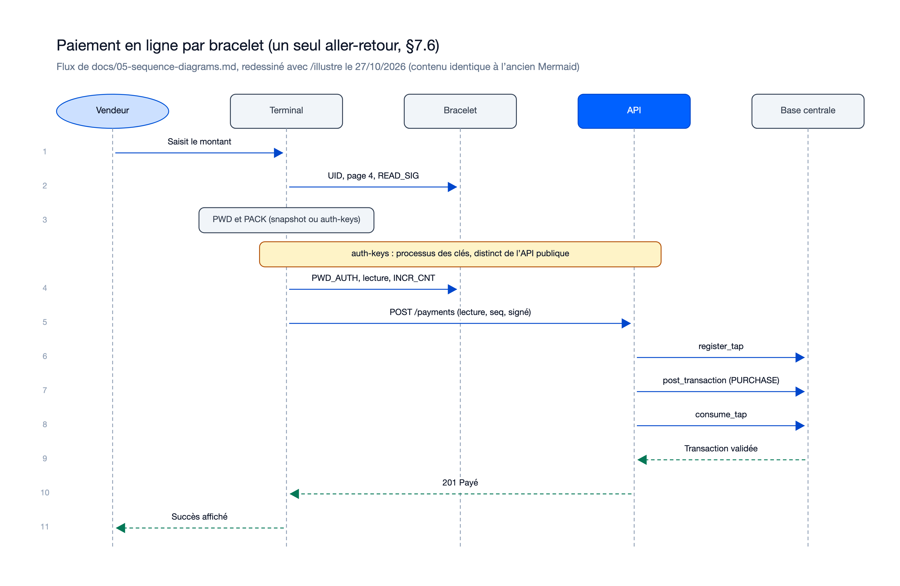
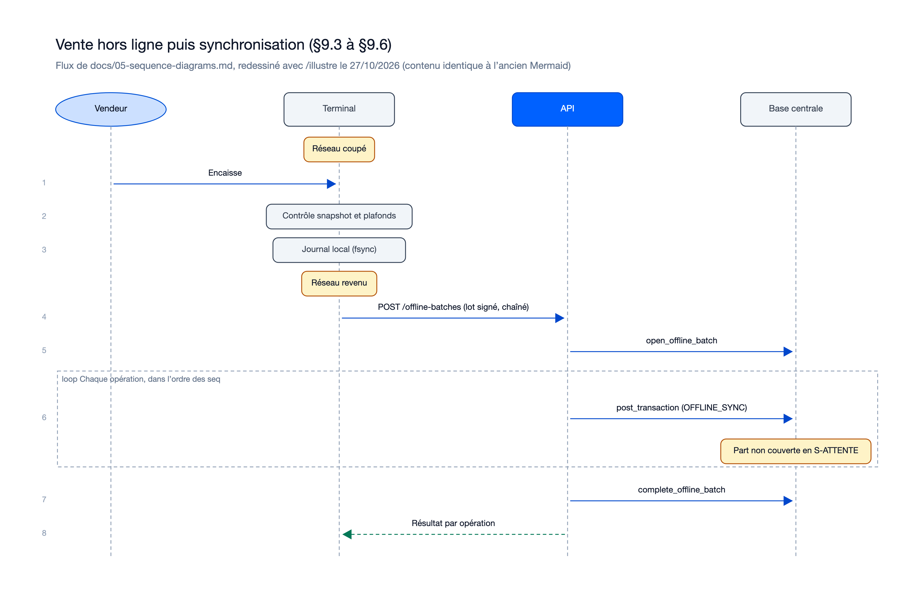
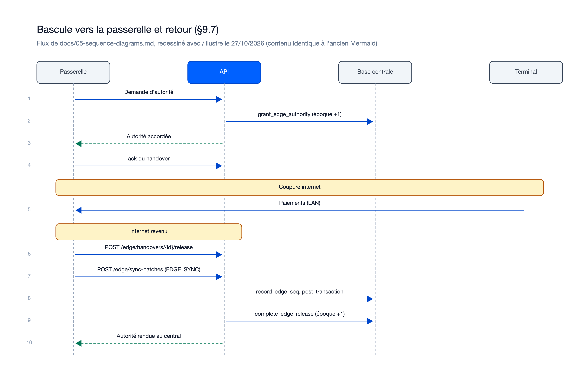
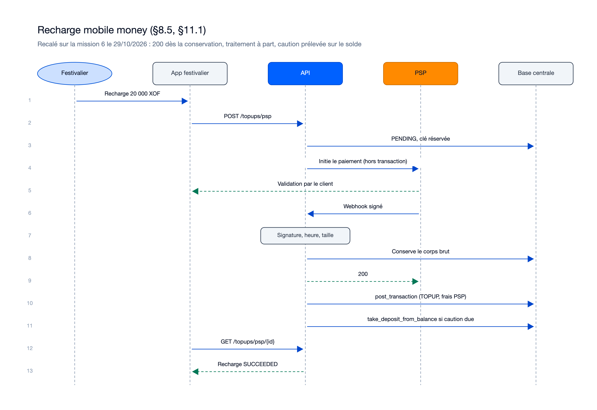
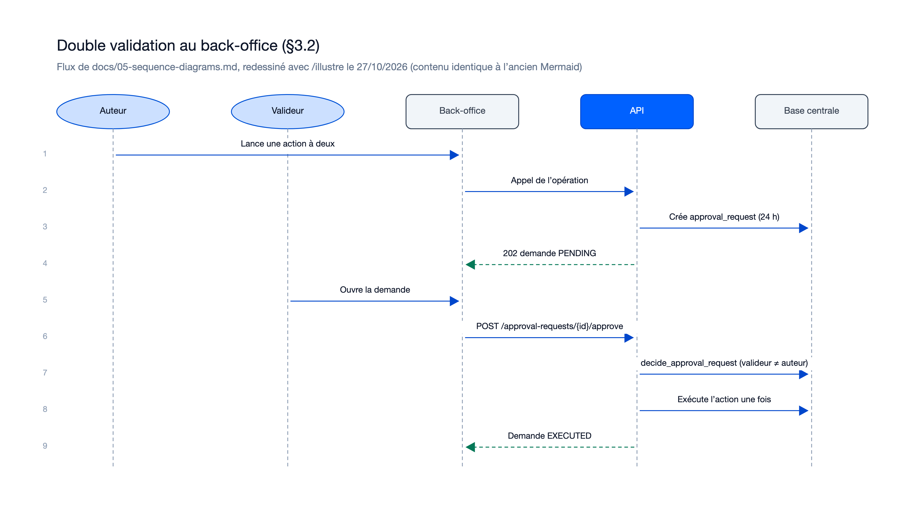
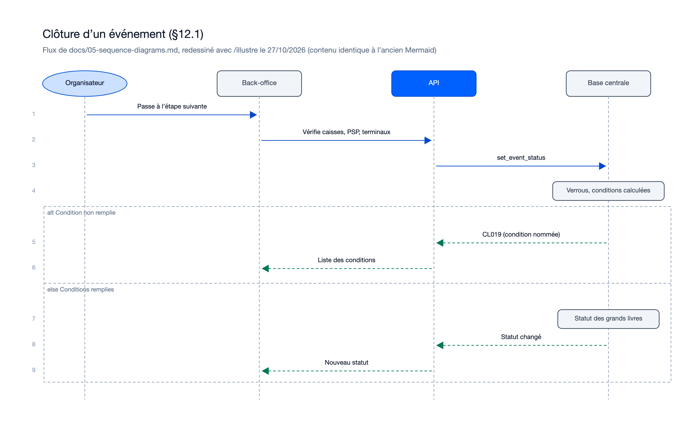

# Diagrammes de séquence (message) — flux transverses clés

> Statut de complétude : voir `06-docs-status.md`. Un diagramme par flux critique
> qui traverse plusieurs composants (les flux internes à un seul composant vivent
> dans le détail local de la mission concernée). Tous les flux sont désormais en `/illustre` (préférence du porteur du 13/10/2026 ;
> les six flux des missions 1 à 3, d'abord en Mermaid, ont été redessinés et uniformisés le 27/10/2026, décision du
> porteur), sources dans [`diagrams/`](diagrams/).
> Dernière mise à jour : 29/10/2026 (lignes de la mission 6 recalées à la review, aucun flux global redessiné) ; 21/10/2026 (flux « Enrôlement et requête signée d'un terminal », mission « Identité et
> enrôlement des terminaux », mergée le 21/10/2026).
> Flux **cibles**, tirés de `SPECIFICATION.md` et `sync_protocol.md`.

## Flux : Paiement en ligne par bracelet (un seul aller-retour, §7.6)

Sources : [`sequence-paiement-en-ligne.excalidraw`](diagrams/sequence-paiement-en-ligne.excalidraw), [`sequence-paiement-en-ligne.svg`](diagrams/sequence-paiement-en-ligne.svg), produits par [`diagrams/generate.py`](diagrams/generate.py).

## Flux : Enrôlement et requête signée d'un terminal (§8.1, §8.2, §10.3 ; `sync_protocol.md` §3.1)

Sources : [`sequence-terminal-transverse.excalidraw`](diagrams/sequence-terminal-transverse.excalidraw),
[`sequence-terminal-transverse.svg`](diagrams/sequence-terminal-transverse.svg), produits par
[`diagrams/generate.py`](diagrams/generate.py). Implémenté (mission « Identité et enrôlement des terminaux ») :
code d'enrôlement émis par un administrateur, enrôlement sans compte (attestation, certificat client, jetons), puis
chaque requête du terminal avec ses trois preuves. Les flux détaillés (limites et refus audités, ordre des contrôles,
rafraîchissement avec grâce de 60 s, révocation) sont dans le `sequence.md` de la mission. Autorité des terminaux et
signataire des jetons : faux seulement, refusés en production (OP-N73).

## Flux : Vente hors ligne puis synchronisation (§9.3 à §9.6)

Sources : [`sequence-vente-hors-ligne.excalidraw`](diagrams/sequence-vente-hors-ligne.excalidraw), [`sequence-vente-hors-ligne.svg`](diagrams/sequence-vente-hors-ligne.svg), produits par [`diagrams/generate.py`](diagrams/generate.py).

## Flux : Bascule vers la passerelle et retour (§9.7)

Sources : [`sequence-bascule-passerelle.excalidraw`](diagrams/sequence-bascule-passerelle.excalidraw), [`sequence-bascule-passerelle.svg`](diagrams/sequence-bascule-passerelle.svg), produits par [`diagrams/generate.py`](diagrams/generate.py).

## Flux : Recharge mobile money (§8.5, §11.1)

Sources : [`sequence-recharge-mobile-money.excalidraw`](diagrams/sequence-recharge-mobile-money.excalidraw), [`sequence-recharge-mobile-money.svg`](diagrams/sequence-recharge-mobile-money.svg), produits par [`diagrams/generate.py`](diagrams/generate.py).

## Flux : Double validation au back-office (§3.2)

Sources : [`sequence-double-validation.excalidraw`](diagrams/sequence-double-validation.excalidraw), [`sequence-double-validation.svg`](diagrams/sequence-double-validation.svg), produits par [`diagrams/generate.py`](diagrams/generate.py).

## Flux : Clôture d'un événement (§12.1)

Sources : [`sequence-cloture-evenement.excalidraw`](diagrams/sequence-cloture-evenement.excalidraw), [`sequence-cloture-evenement.svg`](diagrams/sequence-cloture-evenement.svg), produits par [`diagrams/generate.py`](diagrams/generate.py).

## Flux : Annulation d'une vente, au terminal et au back-office (mission « Encaissement en ligne » ; ADR-122, ADR-123, ADR-129)

Au terminal, les contrôles se font dans l'ordre terminal, vendeur, puis fenêtre (heure de la base) : l'autre vendeur
reçoit `422 REVERSAL_NOT_ALLOWED` sans connaître l'âge de la vente. Hors fenêtre, un `SUPERVISOR` donne un jeton sur place,
lié à la vente et à usage unique.

Au back-office, `reversePayment` ne touche pas au grand livre : il crée une demande `SALE_REVERSAL` (`202`) qu'une seconde
personne distincte approuve, ce qui exécute l'annulation.

Sources et autres flux de la mission (session de vendeur, paiement par bracelet, QR commerçant, QR client) :
[`sequence.md`](../kitty-specs/terminaux-paiement-en-ligne-01M52QB9/docs/sequence.md).

## Index des flux couverts

| Flux | Domaines traversés | Mission(s) source |
|---|---|---|
| Paiement en ligne par bracelet | Terminal, bracelets, API, grand livre | `bracelets-nfc-01M4TD3W` (✅ mergée le 16/10/2026, dans `main` par la PR #3 : demande de mot de passe au processus des clés et lecture `POST /taps` servies ; lecture embarquée dans une opération, avec lecture suspecte persistée malgré l'échec ; le paiement lui-même vient en mission 5) ; `terminaux-paiement-en-ligne-01M52QB9` (✅ mergée le 26/10/2026 sur `feat/terminaux-paiement-en-ligne`, dans `main` par la PR #6 le 27/10/2026) : vente attribuée au vendeur, lignes, annulation à deux voies, QR commerçant et client — flux remonté dans la section « Annulation d'une vente » ci-dessus, six flux locaux dans [`sequence.md`](../kitty-specs/terminaux-paiement-en-ligne-01M52QB9/docs/sequence.md)) |
| Enrôlement et requête signée d'un terminal | Back-office, terminal, API, autorité des terminaux, attestation, base | `identite-enrolement-terminaux-01M52R6H` (✅ mergée le 21/10/2026, dans `main` par la PR #4 : flux remonté ici, détail dans [`sequence.md`](../kitty-specs/identite-enrolement-terminaux-01M52R6H/docs/sequence.md) ; la demande de mot de passe et la lecture du flux « Paiement en ligne par bracelet » passent par les trois preuves) |
| Vente hors ligne puis synchronisation | Terminal, synchronisation, grand livre | à définir |
| Bascule vers la passerelle et retour | Passerelle, API, grand livre | à définir |
| Recharge mobile money | App festivalier, PSP, API, grand livre | `recharges-caisses-psp-01M5YEBA` (✅ mergée le 29/10/2026 sur `feat/recharges-caisses-psp` (squash `a865462c`), acceptée (`d62258a2`), dans `main` par la PR #8 le 29/10/2026 (CI verte)) : demande, notification conservée puis traitée, interrogation planifiée, notification refusée, contestation carte — flux locaux dans [`sequence.md`](../kitty-specs/recharges-caisses-psp-01M5YEBA/docs/sequence.md) ; flux global ci-dessus recalé le 29/10/2026 (200 dès la conservation du corps brut, traitement à part, `take_deposit_from_balance`) |
| Session de caisse et recharge en espèces | Terminal, back-office, API, moteur, base | `recharges-caisses-psp-01M5YEBA` (✅ mergée le 29/10/2026 sur `feat/recharges-caisses-psp` (squash `a865462c`), acceptée (`d62258a2`), dans `main` par la PR #8 le 29/10/2026 (CI verte)) : ouverture, comptage, fermeture, recharge espèces et caution due — flux locaux dans [`sequence.md`](../kitty-specs/recharges-caisses-psp-01M5YEBA/docs/sequence.md) |
| Double validation au back-office | Back-office, API, base | `terminaux-paiement-en-ligne-01M52QB9` (annulation d'une vente `SALE_REVERSAL`, ADR-129 : demande `202` puis approbation par une seconde personne) ; `identite-roles-double-validation-01M4DNDN` (✅ mergée le 09/10/2026 (10/10 WP, acceptée) : mécanisme générique livré et prouvé par une action de démonstration ; actions branchées par les missions suivantes) ; `configuration-parties-evenements-01M4GCJ9` (✅ mergée le 13/10/2026 : huit actions de configuration, dont deux de niveau plateforme) ; `bracelets-nfc-01M4TD3W` (✅ mergée le 16/10/2026, dans `main` par la PR #3 : trois actions de clé `TAG_KEY_CREATE`, `TAG_DEK_ROTATE`, `TAG_KEY_RETIRE`, exécutées par un travail de clé, et sortie de liste noire `REINSTATE_MEDIA`) |
| Clôture d'un événement | Back-office, API, base | `fondations-grand-livre-01M4AY8M` (passages de statut exercés par le rejeu du scénario, tous acceptés sans `CL019` ; pas encore de back-office) ; `configuration-parties-evenements-01M4GCJ9` (✅ mergée le 13/10/2026 : conditions et passages de statut servis par l'API, `LIVE` à deux par `EVENT_GO_LIVE`) |

## Questions de nécessité/complétude posées lors de la dernière révision
- Nécessaire pour ce projet ? Voir `06-docs-status.md`.
- Complet au vu des flux transverses réellement implémentés à ce jour ? Voir `06-docs-status.md`.
- Validé par : en attente.
