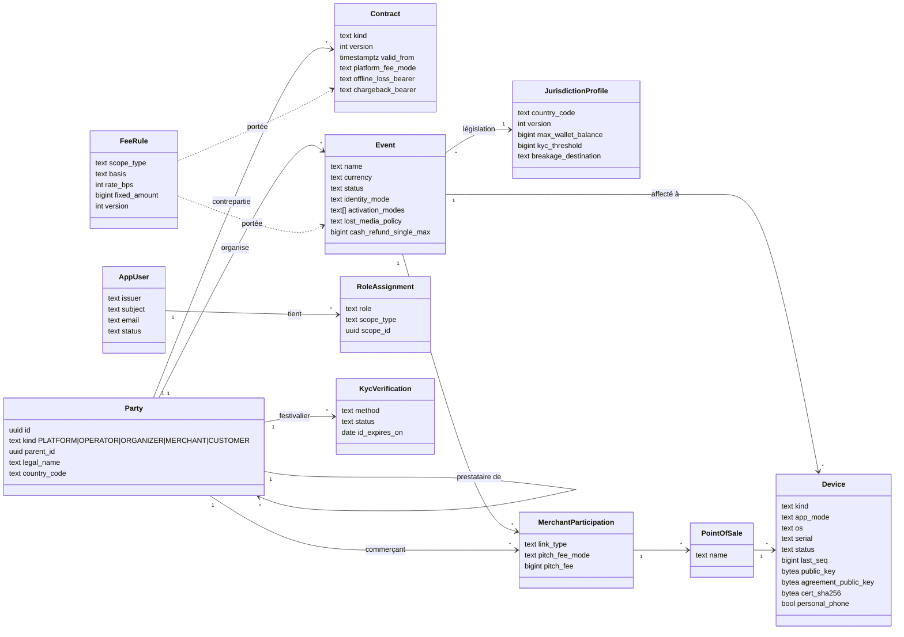
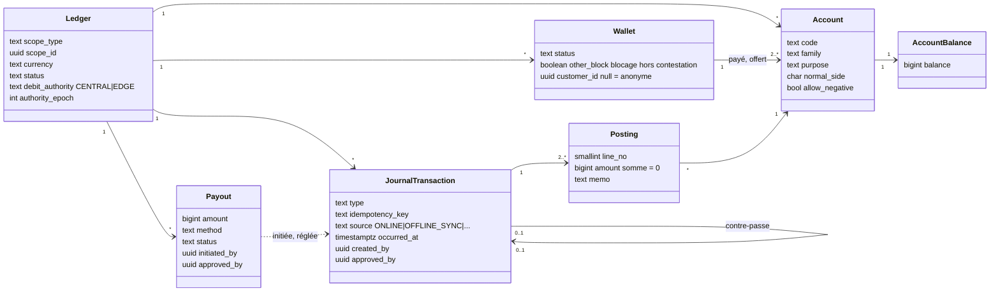
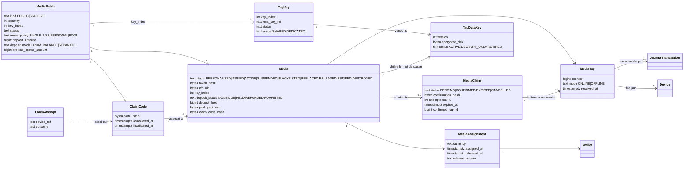
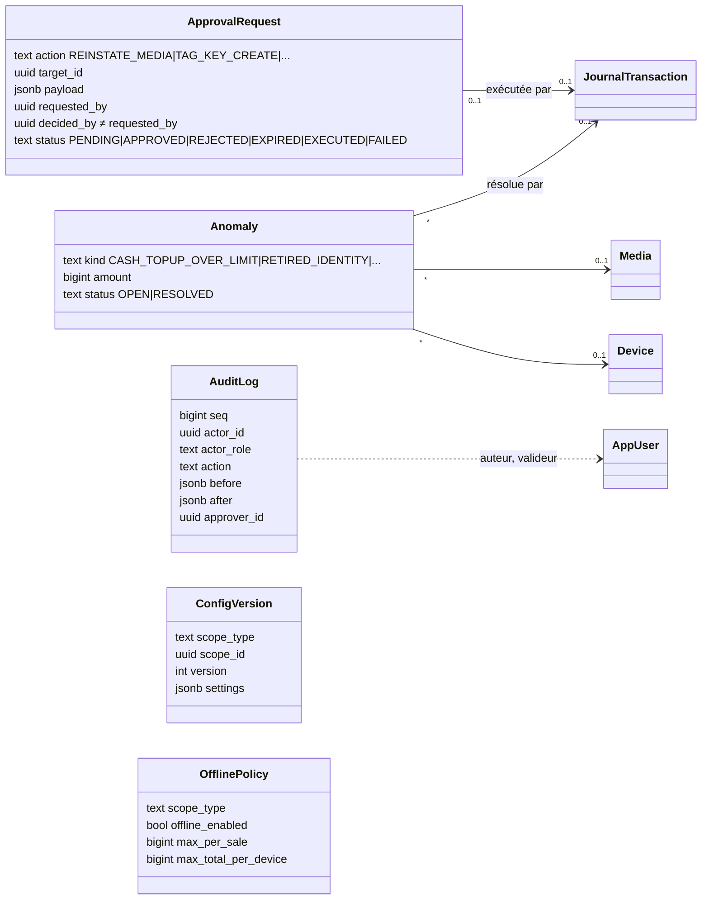
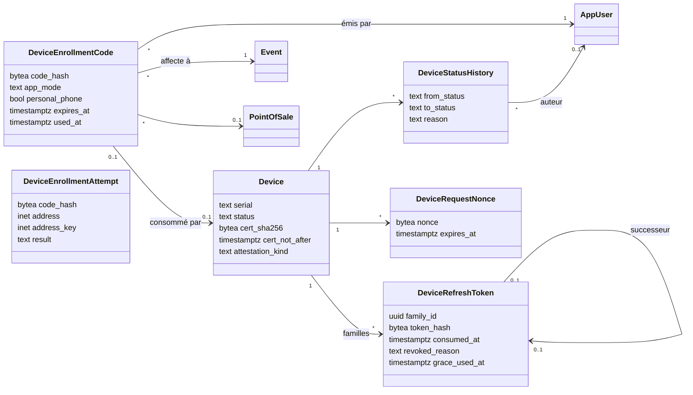
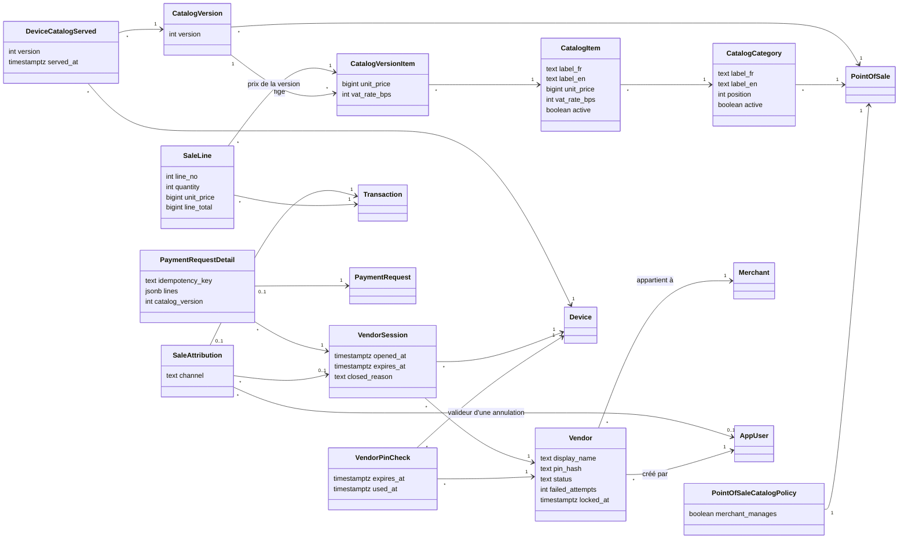
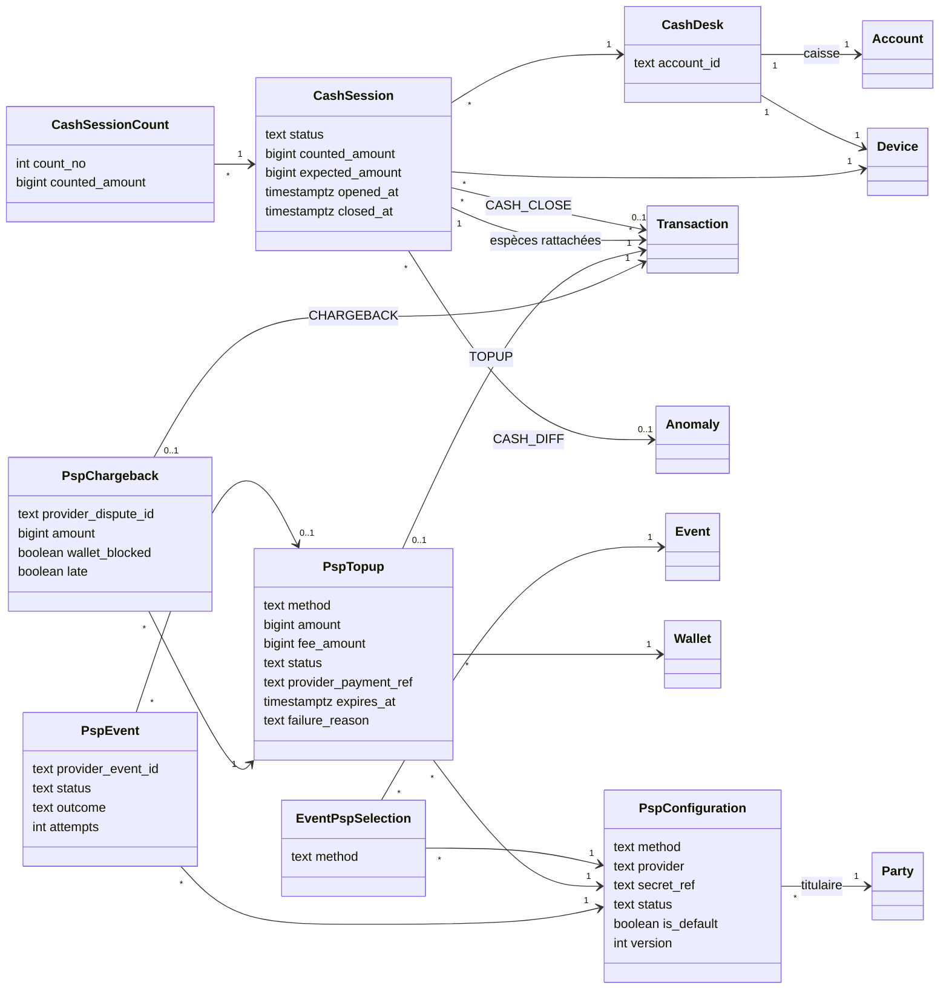

# Diagramme de classes — modèle du domaine

> Modèle des entités métier tel qu'il est **réellement** dans le schéma SQL (source normative, SPECIFICATION §0.3) :
> `packages/ledger-sql/schema_grand_livre_cashless.sql` et les migrations 0002 à 0020 (missions 1 à 4, état du
> 16/10/2026, correctif post-fusion n° 1 compris ; mission 4 mergée le 16/10/2026, dans `main` par la PR #3).
> Complément du 21/10/2026 : migrations 0021 à 0027, 0029 et 0030 de la mission « Identité et enrôlement des
> terminaux » (mergée, dans `main` par la PR #4 le 22/10/2026), section 4 bis. Seuls les attributs utiles à la compréhension sont montrés ; les
> colonnes techniques (horodatages de création, empreintes de chaîne, compteurs internes) sont omises.
>
> Conventions : chaque table porte `operator_id` (cloisonnement par prestataire, RLS) — non répété sur chaque classe.
> Montants en unités entières (`bigint`, XOF sans décimales). Les secrets n'apparaissent jamais en clair : seules des
> empreintes (`*_hash`) ou des chiffrés (`*_enc`) sont stockés.
>
> Rendu : Mermaid (aperçu Markdown de VS Code, GitHub). Aucun outil de diagramme de classes n'est prévu dans
> `.docmeta/diagram-style-routing.md` ; Mermaid y est le repli par défaut.

## 1. Organisation, événements et identité

`Party` est une table unique pour tous les acteurs ; son `kind` distingue plateforme, prestataire, organisateur,
commerçant et festivalier. Un prestataire (`OPERATOR`) possède tout ce qui suit.

## 2. Grand livre

Un grand livre par événement (et par devise). Toute écriture est une `JournalTransaction` équilibrée : la somme de
ses `Posting` vaut zéro. Les soldes en cache (`AccountBalance`) sont recalculables depuis les lignes.

## 3. Bracelets (mission 4)

Un bracelet appartient à un lot ; il est rattaché à un portefeuille par devise (`MediaAssignment`, historisé). Le mot
de passe de la puce n'est stocké que chiffré sous une clé de données (`TagDataKey`), elle-même chiffrée par le KMS.
Le code imprimé n'est connu que par son empreinte.

## 4. Contrôle : approbations, anomalies, audit, configuration

Les opérations sensibles passent par une demande d'approbation à deux personnes (auteur ≠ valideur, contrôlé par la
base). Le journal d'audit est chaîné (chaque ligne porte l'empreinte de la précédente) et scellé.

## 4 bis. Terminaux : enrôlement, jetons et nonces (mission « Identité et enrôlement des terminaux »)

Un code d'enrôlement (empreinte HMAC seulement) est consommé par un seul terminal ; chaque terminal a des familles de
jetons de rafraîchissement (empreinte SHA-256, rotation, grâce), un historique de statuts en ajout seul et des nonces
de requête. Les essais d'enrôlement servent aux limites et ne sont pas liés au terminal. Depuis la migration 0022,
`device` porte aussi la version de l'app, le type et le niveau d'attestation, la fin du certificat, le code consommé
et le motif du dernier statut ; `serial` est unique par prestataire parmi les terminaux non révoqués.

## 4 ter. Encaissement en ligne : vendeurs, catalogue, ventes attribuées (mission « Encaissement en ligne »)

Un vendeur appartient à un commerçant ; son PIN n'existe qu'en empreinte argon2id. Chaque essai est compté dans un
registre éphémère (30 s) avant la vérification ; une session de vendeur (12 h) est liée à un terminal, une seule ouverte
par terminal. Le catalogue d'un point de vente est modifié en place puis figé en versions immuables ; le terminal reçoit
une version et la base garde laquelle (`device_catalog_served`). Chaque vente a ses lignes (copie du libellé et du prix
de la version) et une attribution (vendeur, session, terminal, moyen) écrite par la base. Une demande de paiement QR
garde dans une table de détail sa session de vendeur, ses lignes et sa clé d'idempotence ; le jeton lui-même n'est
jamais gardé (empreinte seule dans `payment_request`).

## 4 quater. Caisses, recharges et PSP (mission « Recharges, caisses et PSP », 🔎 relue, 14 lots approuvés le 29/10/2026 ; accept/merge à venir)

> Tables créées par les migrations `0036` à `0038` de la mission (10 tables, comme prévu par
> `kitty-specs/recharges-caisses-psp-01M5YEBA/data-model.md`). Les migrations `0039` à `0042`, hors plan, ne créent aucune
> table : `0042` ajoute la colonne `wallet.other_block` et le déclencheur `wallet_block_cause_guard`. Recalé sur le code de la
> lane le 29/10/2026 ; le SQL fait foi.

Une caisse est le compte `A-CAISSE-<série>` d'un terminal `TOPUP_DESK`, inscrit dans `cash_desk` ; une garde sur
`posting` refuse toute écriture de ce compte sans session `OPEN`. Une session reçoit des comptages (à l'aveugle) et ses
transactions d'espèces ; sa fermeture écrit `CASH_CLOSE` et, si l'écart n'est pas nul, ouvre une anomalie `CASH_DIFF`.
Une configuration PSP est propre à un organisateur, un moyen et un fournisseur, au nom du détenteur des fonds ; elle ne
garde qu'une référence de secret. Un événement choisit une configuration par moyen. Une recharge PSP garde la
configuration d'origine ; chaque notification authentifiée est conservée brute ; une contestation est rattachée à la
recharge d'origine.

## 5. Description des tables

Toutes les tables du schéma (58 jusqu'à la mission 4, 63 avec la mission « Identité et enrôlement des terminaux », 75 avec la mission « Encaissement en ligne », 85 avec la mission « Recharges, caisses et PSP »),
groupées par domaine. Colonne « Origine » : schéma de référence (`réf.`) ou
migration qui l'a créée. Les descriptions reprennent les commentaires du schéma SQL ; en cas d'écart, le SQL fait foi.

### Organisation, événements, configuration

| Table | Rôle | Origine |
|---|---|---|
| `party` | Tout acteur : plateforme, prestataire, organisateur, commerçant, festivalier (`kind`). Le prestataire est le locataire (`operator_id`) de tout le reste. | réf. |
| `contract` | Contrats plateforme–prestataire et prestataire–organisateur : valeurs contractuelles versionnées (mode de redevance, porteur des pertes hors ligne, des écarts de caisse, des contestations, part de casse). | réf. |
| `jurisdiction_profile` | Règles d'un pays, versionnées : plafonds de solde et de recharge mensuelle, seuil d'identification, délai minimal de remboursement, destination de la casse. Sans RLS (référence commune). | réf. |
| `currency_exponent` | Devises connues et leur exposant ISO 4217 (unités mineures). Référence commune, sans RLS. | 0007 |
| `event` | Événement d'un organisateur : devise, fuseau, statut, législation, réglages (modes d'activation, identification exigée, politique des bracelets perdus, seuils de remboursement en espèces, délais des terminaux). | réf. |
| `event_status_transition` | Passages de statut permis pour un événement (`set_event_status` est le seul moyen de changer le statut). | réf. |
| `event_status_history` | Historique des statuts d'un événement : qui, quand, pourquoi. | réf. |
| `config_version` | Configuration en cascade et versionnée (plateforme > prestataire > organisateur > événement > participation). | réf. |
| `merchant_participation` | Participation d'un commerçant à un événement : type de lien, bénéficiaire des versements, droit de place. | réf. |
| `point_of_sale` | Point de vente d'un commerçant dans un événement. | réf. |
| `fee_rule` | Règles de frais et de taxes : portée, payeur, bénéficiaire, assiette, taux, montant fixe, déclencheur, validité. | réf. |

### Identité et droits

| Table | Rôle | Origine |
|---|---|---|
| `app_user` | Personne du personnel connue par son fournisseur d'identité (émetteur, sujet), rattachée à un prestataire ou à la plateforme. | 0003 |
| `role_assignment` | Rôle tenu par une personne sur une portée (plateforme, prestataire, organisateur, événement, commerçant), avec qui l'a accordé ou retiré ; rôle `PERSONALIZER` ajouté par 0011. | 0003 (+0011) |
| `kyc_verification` | Identification d'un festivalier (pièce vérifiée au guichet) : fait passer son niveau à « vérifié » tant qu'elle n'est ni expirée ni révoquée. | réf. |

### Grand livre

| Table | Rôle | Origine |
|---|---|---|
| `ledger` | Grand livre d'une portée (un par événement) et d'une devise : émetteur, détenteur des fonds, statut, autorité de débit (central ou passerelle) et son époque. | réf. |
| `account` | Compte du plan de comptes d'un grand livre : code, famille, usage (`purpose` : caisse, portefeuille payé, offert, espèces à rendre…), sens normal, découvert permis ou non. | réf. |
| `account_balance` | Solde en cache d'un compte, tenu par les écritures ; recalculable depuis les lignes (contrôle `balance_drift`). | réf. |
| `wallet` | Portefeuille d'un festivalier dans un grand livre ; anonyme tant que `customer_id` est nul. Ses fonds sont deux comptes : crédits payés et crédits offerts. `other_block` : une cause de blocage autre que la contestation est active (déclencheur, 0042). | réf. (+0042) |
| `journal_transaction` | Écriture comptable : type, clé d'idempotence, source (en ligne, hors ligne…), date, terminal, bracelet, auteur et valideur, écriture contre-passée. | réf. |
| `posting` | Ligne d'une écriture : compte et montant ; la somme des lignes d'une écriture vaut zéro. | réf. |
| `ledger_seal` | Scellement périodique de la chaîne des écritures d'un grand livre (empreinte figée, copie externe). | réf. |
| `payout` | Versement à un bénéficiaire en deux temps (initié puis confirmé ou échoué), validé par une seconde personne. | réf. |
| `external_statement_line` | Ligne de relevé externe (PSP, banque, mobile money) pour le rapprochement. | réf. |
| `payment_request` | Paiement par QR, toujours en ligne : QR du commerçant scanné par l'app, ou QR à usage unique du festivalier lu par le terminal. | réf. |

### Terminaux, hors ligne et passerelle

| Table | Rôle | Origine |
|---|---|---|
| `device` | Terminal (Android ou iOS) : mode d'application, numéro de série, clés publiques, statut, événement et point de vente, numérotation et chaînage de ses opérations. | réf. |
| `device_seq_registry` | Registre des numéros de séquence de chaque terminal : idempotence des lots et détection des trous ; écrit avec l'écriture comptable. | réf. |
| `device_config_served` | Configuration figée servie à un terminal (politique effective, époque, plancher de séquence), citée par chaque opération hors ligne ; écrite par `record_config_served`, qui refuse un terminal révoqué et une version d'un autre prestataire (0029). | réf. (+0029) |
| `device_enrollment_code` | Code d'enrôlement à usage unique : empreinte HMAC seulement, événement obligatoire, point de vente et mode facultatifs, téléphone personnel (KEYPAD_TPE seulement), durée de 5 min à 7 jours, terminal qui l'a consommé. | 0022 |
| `device_refresh_token` | Jeton de rafraîchissement d'un terminal (empreinte SHA-256) : famille, consommation, successeur, grâce de 60 s, révocation et motif (réutilisation, terminal révoqué, ré-enrôlement). | 0022 (+0023) |
| `device_status_history` | Historique des statuts d'un terminal, en ajout seul : de, vers, motif, auteur (aucun à l'enrôlement) ; `REVOKED` définitif. | 0022 |
| `device_enrollment_attempt` | Essai d'enrôlement (empreinte de tout code bien formé, adresse, clé d'adresse /64, résultat) ; sert aux limites, purgé à 24 h. | 0022 (+0027, 0030) |
| `device_request_nonce` | Nonce d'une requête signée d'un terminal, gardé jusqu'à la fin de la fenêtre de rejeu (heure de la base) ; ajout seul sauf la purge. | 0023 |
| `offline_policy` | Politique hors ligne par portée (organisateur, événement, terminal, plafonds du prestataire) : activation et plafonds par vente, par bracelet, par terminal. | réf. |
| `offline_policy_history` | Historique des politiques hors ligne : une opération est jugée sur les plafonds en vigueur quand elle a été faite. | réf. |
| `offline_snapshot` | Instantané signé envoyé aux terminaux pour autoriser hors ligne (soldes, bracelets bloqués, mots de passe chiffrés). | réf. |
| `snapshot_signing_key` | Clés de signature des instantanés : clé du KMS (central) ou clé propre d'une passerelle. | réf. |
| `offline_batch` | Lot d'opérations hors ligne d'un terminal : numéros continus, signé et chaîné ; un seul lot en cours par terminal. | réf. |
| `edge_gateway` | Passerelle locale de site (optionnelle). | réf. |
| `debit_authority_handover` | Bascule de l'autorité de débit vers une passerelle et retour : accordée, active, rendue, forcée ou échouée. | réf. |
| `handover_transition` | Passages permis d'une bascule d'autorité. | réf. |
| `edge_sync_registry` | Registre des décisions prises par la passerelle, reçues dans l'ordre par le central qui recalcule et compare la chaîne. | réf. |

### Encaissement en ligne (mission 5b)

| Table | Rôle | Origine |
|---|---|---|
| `vendor` | Vendeur d'un commerçant : nom, empreinte argon2id du PIN (jamais le PIN), statut, échecs consécutifs (blocage au 5e), auteur ; écrit par fonctions seulement. | 0031 |
| `vendor_pin_check` | Essai de PIN compté avant la vérification (vie de 30 s, usage unique) : preuve qu'une session ne s'ouvre qu'après un essai compté ; purgée à 24 h par la purge des essais. | 0031 |
| `vendor_session` | Session d'un vendeur sur un terminal : 12 h, une seule ouverte par terminal, motif de fermeture (déconnexion, remplacement, blocage, suspension, révocation, nouveau PIN). | 0031 (+0033) |
| `point_of_sale_catalog_policy` | Qui gère le catalogue d'un point de vente : l'organisateur ou, par délégation, le commerçant. | 0032 |
| `catalog_category` | Catégorie du catalogue d'un point de vente : libellés FR/EN, rang, active ; jamais supprimée. | 0032 |
| `catalog_item` | Article : libellés FR/EN, prix TTC fixe, taux de TVA en points de base, active ; rattaché à une catégorie du même point de vente (clé composite). | 0032 |
| `catalog_version` | Version immuable du catalogue d'un point de vente, créée à chaque modification. | 0032 |
| `catalog_version_item` | Contenu figé d'une version : libellés, catégorie, prix et taux de chaque article. | 0032 |
| `device_catalog_served` | Version du catalogue servie à un terminal pour un point de vente (clé terminal, point de vente, version) : bornes du prix accepté. | 0032 |
| `sale_line` | Ligne d'une vente : article, version du catalogue, libellés, quantité, prix, total ; liée à la version nommée. | 0032 |
| `sale_attribution` | Vendeur, session, terminal et moyen (NFC, QR commerçant, QR client) d'une vente ou d'une annulation ; écrite par la base d'après la session, sans écriture directe de l'API. | 0033 |
| `payment_request_detail` | Détail d'une demande de paiement QR : session de vendeur, lignes, version du catalogue, clé d'idempotence unique par prestataire. | 0034 |

### Caisses, recharges et PSP (mission 6, relue)

| Table | Rôle | Origine |
|---|---|---|
| `cash_desk` | Caisses inscrites (compte `A-CAISSE-<série>`, terminal, grand livre) : seules soumises à la garde de caisse ; remplie par `open_cash_session`. | 0036 |
| `cash_session` | Session de caisse d'un terminal : `OPEN`, `CLOSING`, `CLOSED` ; compté et théorique figés à la fermeture ; écriture `CASH_CLOSE` et anomalie `CASH_DIFF` ; une seule session ouverte par caisse et par terminal. | 0036 |
| `cash_session_count` | Comptage à l'aveugle (au plus 10 par session) : montant, auteur, date. | 0036 |
| `cash_session_tx` | Transactions d'espèces rattachées à leur session. | 0036 |
| `psp_configuration` | Configuration d'un fournisseur pour un organisateur et un moyen : titulaire = détenteur des fonds, `secret_ref` (jamais un secret), statut, défaut unique, version, activation à deux. | 0037 |
| `event_psp_selection` | Configuration retenue par un événement et par moyen ; la base contrôle organisateur, statut et titulaire. | 0037 |
| `psp_topup` | Recharge PSP : configuration figée, montant, frais, statut (`PENDING`, `SUCCEEDED`, `FAILED`, `EXPIRED`, `CANCELLED`), référence de paiement, échéance, carte (empreinte, 3-D Secure), transaction `TOPUP`. | 0038 |
| `psp_event` | Notification authentifiée conservée brute (64 Kio au plus, purgée à 400 jours), état de traitement et issue. | 0038 |
| `psp_webhook_rejection` | Compteur par minute des notifications refusées, sans corps. | 0038 |
| `psp_chargeback` | Contestation d'une recharge carte : unique par configuration et identifiant, plafonnée au montant de la recharge, transaction `CHARGEBACK` (vide tant qu'une contestation tardive attend son approbation). | 0038 |

Extensions de tables existantes : `fee_rule.scope_type` + `PSP_CONFIGURATION` ; `anomaly.kind` + `PSP_TOPUP_NOT_CREDITED` ; `approval_request.action` + `WALLET_UNBLOCK`, `CASH_DEPOSIT` (0038) ; comptes `A-PSP-WAVE`, `A-PSP-OM`, `A-PSP-CARTE` (fonction `open_psp_accounts`) ; **`wallet.other_block`** (boolean, faux par défaut : une cause de blocage autre que la contestation est active ; tenu par le déclencheur `wallet_block_cause_guard`, que `cashless_app` n'écrit pas) (0042).

### Bracelets

| Table | Rôle | Origine |
|---|---|---|
| `media_batch` | Lot de bracelets : type, quantité, index de clé, statut, politique de réutilisation, caution et préchargement ; événement nul = lot réutilisable pour tous les événements de l'organisateur ; date de commande des codes imprimés. | réf. (+0010) |
| `media_batch_transition` | Passages de statut permis pour un lot. | réf. |
| `media_batch_status_history` | Historique des statuts d'un lot. | réf. |
| `media` | Bracelet (MIFARE Ultralight EV1) : identité opaque (empreinte), UID, statut, caution, mot de passe chiffré, empreinte du code imprimé. Le bracelet ne porte aucun montant. | réf. (+0010) |
| `media_transition` | Passages de statut permis pour un bracelet. | réf. |
| `media_status_history` | Historique des statuts d'un bracelet : qui, quand, pourquoi, validé par qui. | réf. |
| `media_assignment` | Rattachement d'un bracelet à un portefeuille, par devise ; historisé (un bracelet réattribuable en a plusieurs). | réf. |
| `media_identity_history` | Anciennes identités d'un bracelet réattribuable : toute lecture qui en présente une est une copie. | réf. |
| `media_tap` | Lecture d'un bracelet par un terminal : compteur de la puce (deux lectures au même compteur = deux puces), consommée par une seule écriture. | réf. |
| `tag_key` | Clé maître de dérivation des mots de passe (HMAC dans le KMS, jamais extraite), une par prestataire et par index. | réf. |
| `tag_data_key` | Clé de données qui chiffre les mots de passe stockés ; stockée chiffrée par une autre clé du KMS ; versionnée (active, déchiffrement seul, retirée). | réf. |
| `tag_key_job` | Travail de clé inscrit par une approbation (création, rotation, retrait) et exécuté par le processus qui a le droit : commande d'administration (création, désactivation dans le KMS), personnalisation (nouvelle clé de données, retrait), clés de bracelet (rechiffrement). Aucun secret (contrainte). Ne naît que d'une demande approuvée à deux (travail racine) ou d'un travail parent en cours (rechiffrement, désactivation), un seul par demande ou par parent. | 0012 (+0014, +0020) |
| `tag_key_check_run` | Compte rendu du contrôle quotidien des mots de passe stockés. | 0012 |
| `claim_code` | Code imprimé d'un bracelet (empreinte seulement) : tiré à la commande du lot, associé à une puce, invalidé à la clôture s'il ne l'a jamais été. | 0010 |
| `media_claim` | Demande de rattachement d'un bracelet approvisionné, à confirmer au guichet : 24 h, 5 essais, lecture consommée. | 0010 (+0016) |
| `claim_attempt` | Trace de chaque essai de code (rattachement ou consultation anonyme), en ajout seul ; sert aux limites d'essais. | 0010 |

### Contrôle, approbations, audit, API

| Table | Rôle | Origine |
|---|---|---|
| `approval_request` | Demande d'action à deux personnes : action et paramètres figés, auteur, décision par une autre personne, exécution (écriture ou résultat) ou échec ; actions de clé de bracelet ajoutées par 0011. | réf. (+0011) |
| `approval_token_use` | Jetons d'approbation sur place déjà consommés (usage unique). | 0005 |
| `anomaly` | Anomalie ouverte par un contrôle (copie de bracelet, espèces dues, écart de caisse, trou de séquence…), avec montant et écriture de résolution. | réf. |
| `audit_log` | Journal d'audit chaîné : auteur, rôle, action, objet, avant et après, valideur, origine. | 0004 |
| `audit_seal` | Scellement périodique de la tête de chaîne du journal d'audit. | 0004 |
| `api_idempotency` | Registre d'idempotence de l'API : clé, empreinte de la requête, réponse enregistrée et rejouée. | 0002 |

## Mise à jour

Ce document décrit le schéma à une date donnée. À régénérer quand une migration ajoute ou modifie une table du
domaine (prochaine : mission 7, hors ligne). Section 4 quater (mission 6 caisses et PSP) ajoutée au plan le 27/10/2026, recalée le 29/10/2026 : 10 tables (`0036` à `0038`) et la colonne `wallet.other_block` (`0042`). Section 4 ter et tables du domaine « Encaissement en ligne » ajoutées le 26/10/2026 (mission 5b, migrations `0031` à `0034`). Le bloc de chaque diagramme reste du texte :
une modification se relit dans la revue de code comme le reste.
