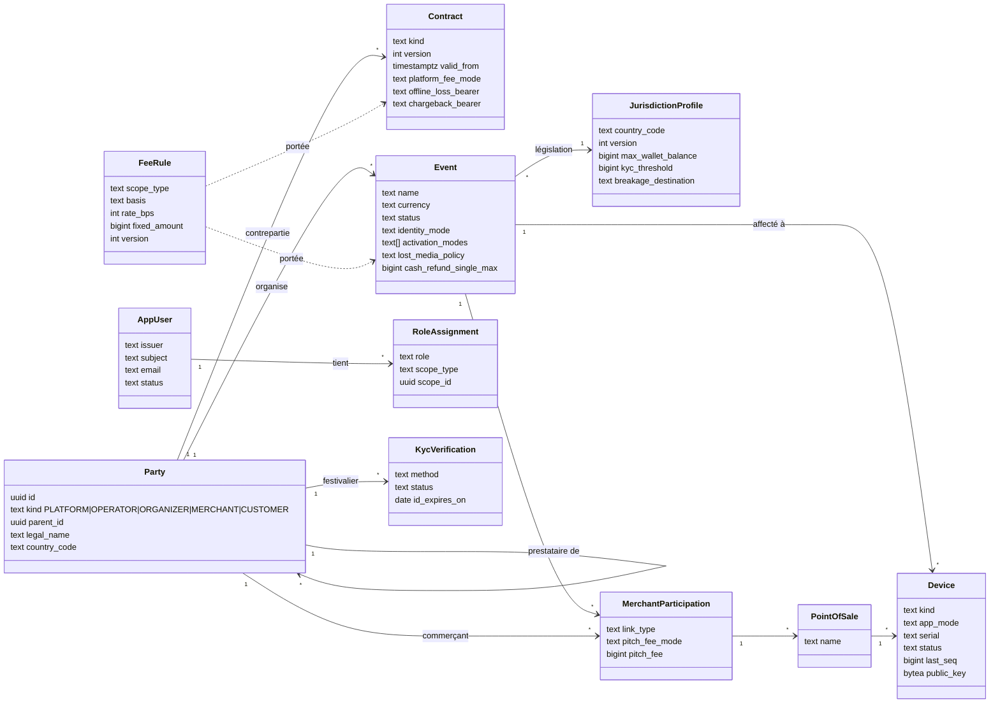
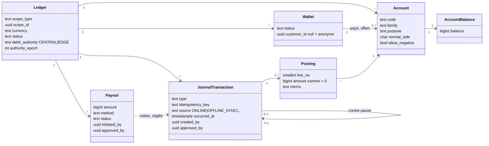
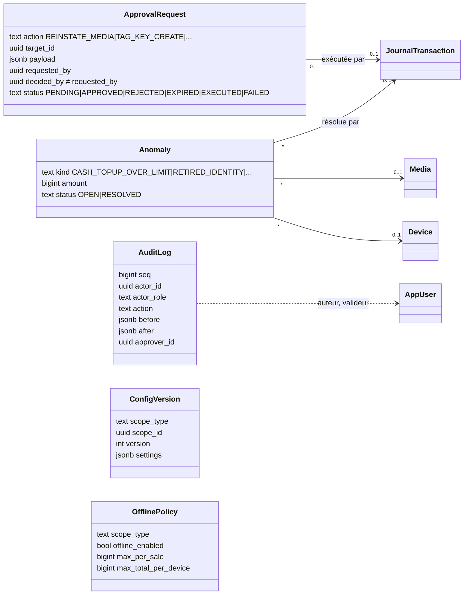

# Diagramme de classes — modèle du domaine

> Modèle des entités métier tel qu'il est **réellement** dans le schéma SQL (source normative, SPECIFICATION §0.3) :
> `packages/ledger-sql/schema_grand_livre_cashless.sql` et les migrations 0002 à 0020 (missions 1 à 4, état du
> 16/10/2026, correctif post-fusion n° 1 compris ; mission 4 mergée le 16/10/2026 dans `feat/bracelets-nfc`). Seuls les attributs utiles à la compréhension sont montrés ; les
> colonnes techniques (horodatages de création, empreintes de chaîne, compteurs internes) sont omises.
>
> Conventions : chaque table porte `operator_id` (cloisonnement par prestataire, RLS) — non répété sur chaque classe.
> Montants en unités entières (`bigint`, XOF sans décimales). Les secrets n'apparaissent jamais en clair : seules des
> empreintes (`*_hash`) ou des chiffrés (`*_enc`) sont stockés.
>
> Rendu : Mermaid (aperçu Markdown de VS Code, GitHub). Aucun outil de diagramme de classes n'est prévu dans
> `.docmeta/diagram-style-routing.md` ; Mermaid y est le repli par défaut.

## 1. Organisation, événements et identité

`Party` est une table unique pour tous les acteurs ; son `kind` distingue plateforme, prestataire, organisateur,
commerçant et festivalier. Un prestataire (`OPERATOR`) possède tout ce qui suit.

## 2. Grand livre

Un grand livre par événement (et par devise). Toute écriture est une `JournalTransaction` équilibrée : la somme de
ses `Posting` vaut zéro. Les soldes en cache (`AccountBalance`) sont recalculables depuis les lignes.

## 3. Bracelets (mission 4)

Un bracelet appartient à un lot ; il est rattaché à un portefeuille par devise (`MediaAssignment`, historisé). Le mot
de passe de la puce n'est stocké que chiffré sous une clé de données (`TagDataKey`), elle-même chiffrée par le KMS.
Le code imprimé n'est connu que par son empreinte.

## 4. Contrôle : approbations, anomalies, audit, configuration

Les opérations sensibles passent par une demande d'approbation à deux personnes (auteur ≠ valideur, contrôlé par la
base). Le journal d'audit est chaîné (chaque ligne porte l'empreinte de la précédente) et scellé.

## 5. Description des tables

Toutes les tables du schéma (58), groupées par domaine. Colonne « Origine » : schéma de référence (`réf.`) ou
migration qui l'a créée. Les descriptions reprennent les commentaires du schéma SQL ; en cas d'écart, le SQL fait foi.

### Organisation, événements, configuration

| Table | Rôle | Origine |
|---|---|---|
| `party` | Tout acteur : plateforme, prestataire, organisateur, commerçant, festivalier (`kind`). Le prestataire est le locataire (`operator_id`) de tout le reste. | réf. |
| `contract` | Contrats plateforme–prestataire et prestataire–organisateur : valeurs contractuelles versionnées (mode de redevance, porteur des pertes hors ligne, des écarts de caisse, des contestations, part de casse). | réf. |
| `jurisdiction_profile` | Règles d'un pays, versionnées : plafonds de solde et de recharge mensuelle, seuil d'identification, délai minimal de remboursement, destination de la casse. Sans RLS (référence commune). | réf. |
| `currency_exponent` | Devises connues et leur exposant ISO 4217 (unités mineures). Référence commune, sans RLS. | 0007 |
| `event` | Événement d'un organisateur : devise, fuseau, statut, législation, réglages (modes d'activation, identification exigée, politique des bracelets perdus, seuils de remboursement en espèces, délais des terminaux). | réf. |
| `event_status_transition` | Passages de statut permis pour un événement (`set_event_status` est le seul moyen de changer le statut). | réf. |
| `event_status_history` | Historique des statuts d'un événement : qui, quand, pourquoi. | réf. |
| `config_version` | Configuration en cascade et versionnée (plateforme > prestataire > organisateur > événement > participation). | réf. |
| `merchant_participation` | Participation d'un commerçant à un événement : type de lien, bénéficiaire des versements, droit de place. | réf. |
| `point_of_sale` | Point de vente d'un commerçant dans un événement. | réf. |
| `fee_rule` | Règles de frais et de taxes : portée, payeur, bénéficiaire, assiette, taux, montant fixe, déclencheur, validité. | réf. |

### Identité et droits

| Table | Rôle | Origine |
|---|---|---|
| `app_user` | Personne du personnel connue par son fournisseur d'identité (émetteur, sujet), rattachée à un prestataire ou à la plateforme. | 0003 |
| `role_assignment` | Rôle tenu par une personne sur une portée (plateforme, prestataire, organisateur, événement, commerçant), avec qui l'a accordé ou retiré ; rôle `PERSONALIZER` ajouté par 0011. | 0003 (+0011) |
| `kyc_verification` | Identification d'un festivalier (pièce vérifiée au guichet) : fait passer son niveau à « vérifié » tant qu'elle n'est ni expirée ni révoquée. | réf. |

### Grand livre

| Table | Rôle | Origine |
|---|---|---|
| `ledger` | Grand livre d'une portée (un par événement) et d'une devise : émetteur, détenteur des fonds, statut, autorité de débit (central ou passerelle) et son époque. | réf. |
| `account` | Compte du plan de comptes d'un grand livre : code, famille, usage (`purpose` : caisse, portefeuille payé, offert, espèces à rendre…), sens normal, découvert permis ou non. | réf. |
| `account_balance` | Solde en cache d'un compte, tenu par les écritures ; recalculable depuis les lignes (contrôle `balance_drift`). | réf. |
| `wallet` | Portefeuille d'un festivalier dans un grand livre ; anonyme tant que `customer_id` est nul. Ses fonds sont deux comptes : crédits payés et crédits offerts. | réf. |
| `journal_transaction` | Écriture comptable : type, clé d'idempotence, source (en ligne, hors ligne…), date, terminal, bracelet, auteur et valideur, écriture contre-passée. | réf. |
| `posting` | Ligne d'une écriture : compte et montant ; la somme des lignes d'une écriture vaut zéro. | réf. |
| `ledger_seal` | Scellement périodique de la chaîne des écritures d'un grand livre (empreinte figée, copie externe). | réf. |
| `payout` | Versement à un bénéficiaire en deux temps (initié puis confirmé ou échoué), validé par une seconde personne. | réf. |
| `external_statement_line` | Ligne de relevé externe (PSP, banque, mobile money) pour le rapprochement. | réf. |
| `payment_request` | Paiement par QR, toujours en ligne : QR du commerçant scanné par l'app, ou QR à usage unique du festivalier lu par le terminal. | réf. |

### Terminaux, hors ligne et passerelle

| Table | Rôle | Origine |
|---|---|---|
| `device` | Terminal (Android ou iOS) : mode d'application, numéro de série, clés publiques, statut, événement et point de vente, numérotation et chaînage de ses opérations. | réf. |
| `device_seq_registry` | Registre des numéros de séquence de chaque terminal : idempotence des lots et détection des trous ; écrit avec l'écriture comptable. | réf. |
| `device_config_served` | Configuration figée servie à un terminal (politique effective, époque, plancher de séquence), citée par chaque opération hors ligne. | réf. |
| `offline_policy` | Politique hors ligne par portée (organisateur, événement, terminal, plafonds du prestataire) : activation et plafonds par vente, par bracelet, par terminal. | réf. |
| `offline_policy_history` | Historique des politiques hors ligne : une opération est jugée sur les plafonds en vigueur quand elle a été faite. | réf. |
| `offline_snapshot` | Instantané signé envoyé aux terminaux pour autoriser hors ligne (soldes, bracelets bloqués, mots de passe chiffrés). | réf. |
| `snapshot_signing_key` | Clés de signature des instantanés : clé du KMS (central) ou clé propre d'une passerelle. | réf. |
| `offline_batch` | Lot d'opérations hors ligne d'un terminal : numéros continus, signé et chaîné ; un seul lot en cours par terminal. | réf. |
| `edge_gateway` | Passerelle locale de site (optionnelle). | réf. |
| `debit_authority_handover` | Bascule de l'autorité de débit vers une passerelle et retour : accordée, active, rendue, forcée ou échouée. | réf. |
| `handover_transition` | Passages permis d'une bascule d'autorité. | réf. |
| `edge_sync_registry` | Registre des décisions prises par la passerelle, reçues dans l'ordre par le central qui recalcule et compare la chaîne. | réf. |

### Bracelets

| Table | Rôle | Origine |
|---|---|---|
| `media_batch` | Lot de bracelets : type, quantité, index de clé, statut, politique de réutilisation, caution et préchargement ; événement nul = lot réutilisable pour tous les événements de l'organisateur ; date de commande des codes imprimés. | réf. (+0010) |
| `media_batch_transition` | Passages de statut permis pour un lot. | réf. |
| `media_batch_status_history` | Historique des statuts d'un lot. | réf. |
| `media` | Bracelet (MIFARE Ultralight EV1) : identité opaque (empreinte), UID, statut, caution, mot de passe chiffré, empreinte du code imprimé. Le bracelet ne porte aucun montant. | réf. (+0010) |
| `media_transition` | Passages de statut permis pour un bracelet. | réf. |
| `media_status_history` | Historique des statuts d'un bracelet : qui, quand, pourquoi, validé par qui. | réf. |
| `media_assignment` | Rattachement d'un bracelet à un portefeuille, par devise ; historisé (un bracelet réattribuable en a plusieurs). | réf. |
| `media_identity_history` | Anciennes identités d'un bracelet réattribuable : toute lecture qui en présente une est une copie. | réf. |
| `media_tap` | Lecture d'un bracelet par un terminal : compteur de la puce (deux lectures au même compteur = deux puces), consommée par une seule écriture. | réf. |
| `tag_key` | Clé maître de dérivation des mots de passe (HMAC dans le KMS, jamais extraite), une par prestataire et par index. | réf. |
| `tag_data_key` | Clé de données qui chiffre les mots de passe stockés ; stockée chiffrée par une autre clé du KMS ; versionnée (active, déchiffrement seul, retirée). | réf. |
| `tag_key_job` | Travail de clé inscrit par une approbation (création, rotation, retrait) et exécuté par le processus qui a le droit : commande d'administration (création, désactivation dans le KMS), personnalisation (nouvelle clé de données, retrait), clés de bracelet (rechiffrement). Aucun secret (contrainte). Ne naît que d'une demande approuvée à deux (travail racine) ou d'un travail parent en cours (rechiffrement, désactivation), un seul par demande ou par parent. | 0012 (+0014, +0020) |
| `tag_key_check_run` | Compte rendu du contrôle quotidien des mots de passe stockés. | 0012 |
| `claim_code` | Code imprimé d'un bracelet (empreinte seulement) : tiré à la commande du lot, associé à une puce, invalidé à la clôture s'il ne l'a jamais été. | 0010 |
| `media_claim` | Demande de rattachement d'un bracelet approvisionné, à confirmer au guichet : 24 h, 5 essais, lecture consommée. | 0010 (+0016) |
| `claim_attempt` | Trace de chaque essai de code (rattachement ou consultation anonyme), en ajout seul ; sert aux limites d'essais. | 0010 |

### Contrôle, approbations, audit, API

| Table | Rôle | Origine |
|---|---|---|
| `approval_request` | Demande d'action à deux personnes : action et paramètres figés, auteur, décision par une autre personne, exécution (écriture ou résultat) ou échec ; actions de clé de bracelet ajoutées par 0011. | réf. (+0011) |
| `approval_token_use` | Jetons d'approbation sur place déjà consommés (usage unique). | 0005 |
| `anomaly` | Anomalie ouverte par un contrôle (copie de bracelet, espèces dues, écart de caisse, trou de séquence…), avec montant et écriture de résolution. | réf. |
| `audit_log` | Journal d'audit chaîné : auteur, rôle, action, objet, avant et après, valideur, origine. | 0004 |
| `audit_seal` | Scellement périodique de la tête de chaîne du journal d'audit. | 0004 |
| `api_idempotency` | Registre d'idempotence de l'API : clé, empreinte de la requête, réponse enregistrée et rejouée. | 0002 |

## Mise à jour

Ce document décrit le schéma à une date donnée. À régénérer quand une migration ajoute ou modifie une table du
domaine (prochaines : mission 5 terminaux, mission 6 caisses et PSP). Le bloc de chaque diagramme reste du texte :
une modification se relit dans la revue de code comme le reste.
