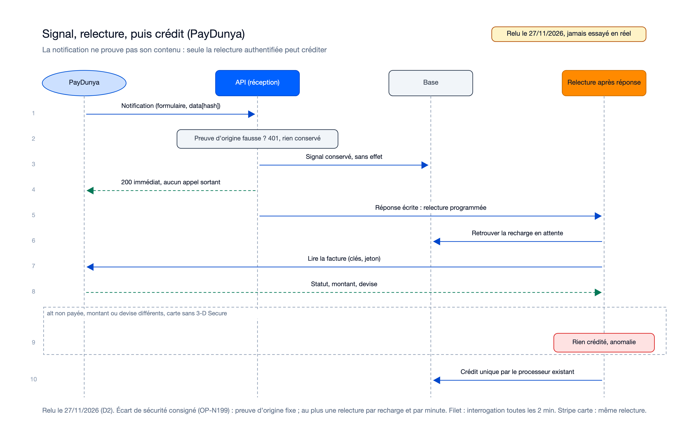

# Séquences : mission adaptateurs-fournisseurs-choisis-01M8BXJA

> État : **review du 27/11/2026, recalé sur le code livré (13 lots approuvés, non accepté, non fusionné)**. Diagramme `/illustre` régénéré (la doc du plan suivait la version initiale du plan, relecture par le travailleur ; le plan révisé R-07 et le code la font lancer par la réception), police sans empattement, rendu relu en image, source et générateur dans [`diagrams/`](diagrams/) (`generate.py`).

## Flux internes propres à cette mission

### Signal, relecture, puis crédit (PayDunya ; Stripe carte pour la relecture)

Sources : [`sequence-signal-relecture-credit.excalidraw`](diagrams/sequence-signal-relecture-credit.excalidraw), [`sequence-signal-relecture-credit.svg`](diagrams/sequence-signal-relecture-credit.svg).
PayDunya envoie sa notification en formulaire ; l'API ne lit que `data[hash]` avant de le comparer, à temps constant, au `sha512` de la clé maître (faux : `401`, rien conservé). Un signal valide est conservé dans `psp_event` (nature `UNKNOWN`, sans corps brut, marqué traité sans effet) et l'API répond `200` sans appel sortant. **Une fois la réponse écrite (`finish`, ou `close` si la connexion est coupée avant), la réception lance la relecture** : `PspStatusConfirmer` retrouve la recharge en attente de cette configuration, lit la facture par `checkout-invoice/confirm/{token}` avec les clés du coffre, hors transaction, puis le processeur existant crédite une seule fois, au montant confirmé et à la devise de la configuration. Non payée, montant ou devise différents, carte sans preuve 3-D Secure : rien n'est crédité, anomalie. Au plus une relecture par recharge et par minute et par processus (borne posée seulement après une relecture aboutie ; en mémoire, OP-N205) ; le travailleur d'interrogation, toutes les 2 minutes, reste le filet (même confirmateur). Stripe : `checkout.session.completed` est « à relire » (ni 3-D Secure ni empreinte dans l'événement) ; même relecture, par `getStatus`, 3-D Secure strict.

Restent en texte : Wave (notification signée dont le contenu suffit, crédit par le chemin existant ; création jamais rejouée à l'aveugle, recherche par `client_reference` d'abord, OP-N204) ; litige Stripe (`charge.dispute.created` : relu pour retrouver la recharge hors requête, sinon `UNMATCHED`, nouvelles tentatives, anomalie à 24 h) ; lecture d'un secret (coffre, cache de 60 s) ; garde de production et commande d'essai (refus de démarrer en nommant le service pour KMS et copie ; PSP et coffre indisponibles) ; écriture S3 verrouillée (`IfNoneMatch: *`, 412 : relecture et comparaison de l'empreinte).

## Flux transverses auxquels cette mission participe (référence, pas dupliqué)

Voir `docs/05-sequence-diagrams.md`, flux : « Recharge mobile money » (le flux global reste juste pour Wave ; le parcours du signal PayDunya est ajouté en complément, livré, non essayé en réel).

## Nécessaire pour cette mission ? Oui : une interaction inter-composants nouvelle et sensible (signal puis relecture avant tout crédit), dont le déclencheur a été revu par le plan révisé (R-07) après l'addendum du plan (proposition de l'Agent à la review du 27/11/2026, en attente de confirmation du porteur).
## Complet ? Oui à la review (27/11/2026) : le flux PayDunya est redessiné d'après le code ; Wave, litige Stripe, coffre, essai et S3 en texte (proposition de l'Agent, en attente de confirmation du porteur).
## Validé par : plan : proposition de l'Agent le 26/11/2026, confirmée par le porteur le 26/11/2026 ; review : proposition de l'Agent le 27/11/2026, en attente de confirmation du porteur.
