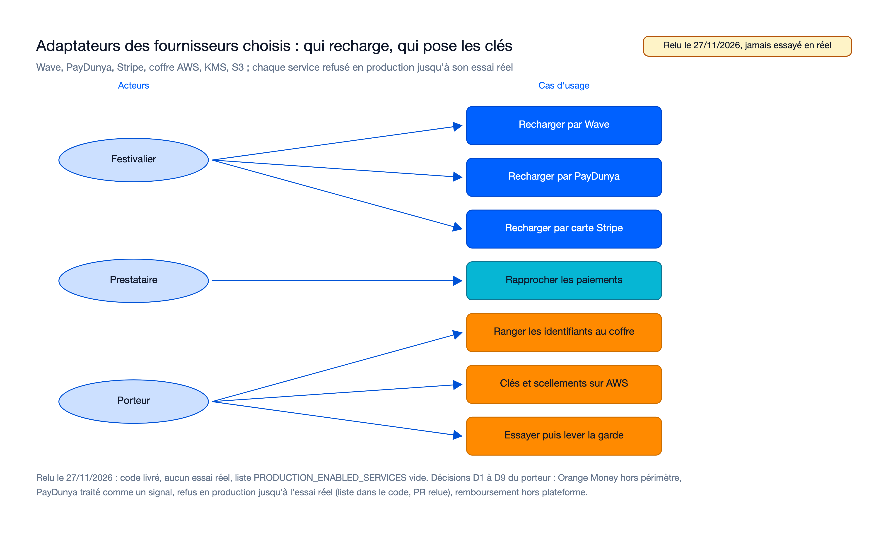

# Cas d'usage : mission adaptateurs-fournisseurs-choisis-01M8BXJA

> État : **review du 27/11/2026 : 13 lots sur 13 approuvés, recalé sur le code livré (lane m), non accepté, non fusionné** (plan du 26/11/2026, `64a7f01c`). **Aucun service n'a été essayé contre le vrai service et `PRODUCTION_ENABLED_SERVICES` est vide** : aucune recharge en ligne n'est servie en production. Décisions D1 à D9 du porteur du 26/11/2026 et décisions prises aux relectures.
> Diagramme `/illustre` (police sans empattement, rendu relu le 27/11/2026, bandeau et note recalés), source et générateur dans [`diagrams/`](diagrams/) (`generate.py`).

## Cas d'usage propres à cette mission

Sources : [`usecase-adaptateurs-fournisseurs.excalidraw`](diagrams/usecase-adaptateurs-fournisseurs.excalidraw), [`usecase-adaptateurs-fournisseurs.svg`](diagrams/usecase-adaptateurs-fournisseurs.svg).

| Cas d'usage | Acteur | Règle livrée | Opération concernée |
|---|---|---|---|
| Recharger par Wave | Festivalier | Session Wave au montant exact en XOF, référence de la recharge, adresses de retour (`WAVE_DEFAULT_SUCCESS_URL`, `WAVE_DEFAULT_ERROR_URL`) ; création jamais rejouée à l'aveugle (pas de clé d'idempotence, OP-N204) : recherche par `client_reference` d'abord ; notification `Wave-Signature` (`t` + corps sans séparateur) acceptée si une signature `v1` est valide (plusieurs pendant une rotation), dans les 300 s ; crédit unique | `POST /topups/psp` (`initiatePspTopup`, existante), `receivePspWebhook` (`wave`) |
| Recharger par PayDunya | Festivalier | Facture PayDunya ; la notification n'est qu'un **signal** (D2) : preuve d'origine vérifiée, rien n'est crédité avant la relecture authentifiée de la facture, au montant et à la devise confirmés ; carte sans preuve 3-D Secure : reçue, non créditée, anomalie (D7, OP-N200) ; la preuve d'origine fixe est un écart de sécurité consigné (OP-N199, ADR-238) ; relecture lancée après l'écriture de la réponse, au plus une par recharge et par minute | `receivePspWebhook` (`paydunya`, corps en formulaire, D9) |
| Recharger par carte avec Stripe | Festivalier | Session Stripe hébergée ; 3-D Secure strict : seul `authenticated` vaut un succès, `attempt_acknowledged` n'est pas crédité ; session `open` après un refus : reste en attente (le payeur peut réessayer) ; notification `Stripe-Signature` à relire (la carte n'est pas dans l'événement) ; litige `charge.dispute.created` rattaché à la recharge par relecture, sinon voie « sans correspondance » (`UNMATCHED`, anomalie à 24 h) ; éligibilité Sénégal à vérifier par le porteur (D4) | `receivePspWebhook` (`stripe`) |
| Rapprocher les paiements | Prestataire | Relevé Wave par jour, mouvements de solde Stripe par période ; PayDunya : aucun relevé documenté (`readStatement` rend une liste vide), rapprochement manuel (OP-N201) | lecture du relevé (existante) |
| Ranger les identifiants des PSP dans le coffre | Porteur | Un secret JSON par configuration, sous `psp/<holder_party_id>/<nom>`, valeur courante et précédente à échéance ; un détenteur ne lit jamais les secrets d'un autre (contrôle du préfixe avant tout appel) ; PayDunya : `notification` différent de `credentials.master_key` refusé | coffre AWS Secrets Manager |
| Faire tourner clés des bracelets, signature des snapshots et copie des scellements sur AWS | Porteur | Cinq ports KMS (MAC, clé de données, déchiffrement, signature, administration) ; copie S3 Object Lock en mode conformité, 10 ans (D8) ; droits par processus inchangés | KMS, S3 |
| Essayer un service puis le passer en production | Porteur | Commande d'essai contre le vrai service, compte rendu sans secret sous `docs/essais/<service>.json` (aucun n'existe : rien n'a été essayé) ; liste `PRODUCTION_ENABLED_SERVICES` vide ; règle I1 : réglage absent = réel, faux refusé, réel non listé : PSP et coffre indisponibles (démarrage permis), KMS et copie des scellements refusent de démarrer ; levée service par service par une PR relue (D3, D6) | `npm run essai -w @cashless/api -- <service>` (services `psp.wave`, `psp.paydunya`, `psp.stripe`, `psp.secrets`, `kms`, `seal-copy` ; `--sandbox`, `--retention-days`) |

Hors périmètre : Orange Money (D1, documentation derrière un compte Sonatel), remboursement d'un paiement non crédité (D5, OP-N82, hors plateforme), fournisseurs non décidés (SMS, WhatsApp, OIDC, matériel de la passerelle, banque).

## Lien avec la synthèse globale

Contribue à : `docs/02-use-case-diagram.md`, domaine « Argent réel : PSP, caisses, rapprochements, versements » (recharges Wave, PayDunya, Stripe, rapprochement) ; aucun domaine nouveau, aucun renommage ni fusion de cas d'usage globaux. Les cas « ranger les identifiants » et « essayer puis passer en production » sont des actions du porteur, décrites dans `docs/SERVICES-EXTERNES.md`.

## Nécessaire pour cette mission ? Oui : sept cas d'usage de recharge, de coffre et de mise en production, dont un parcours (le signal) qui diffère des autres PSP ; confirmé par le code livré (proposition de l'Agent à la review du 27/11/2026, en attente de confirmation du porteur).
## Complet ? Oui à la review (27/11/2026) : sept cas d'usage recalés sur le code (3-D Secure strict, litige relu, session `open`, règle I1, commandes d'essai), acteurs inchangés, hors périmètre listé ; diagramme relu en image, bandeau et note corrigés ; le service n'étant essayé nulle part, la colonne « règle livrée » est celle de la documentation, pas du réel (proposition de l'Agent, en attente de confirmation du porteur).
## Validé par : plan : proposition de l'Agent le 26/11/2026, confirmée par le porteur le 26/11/2026 ; review : proposition de l'Agent le 27/11/2026, en attente de confirmation du porteur.
