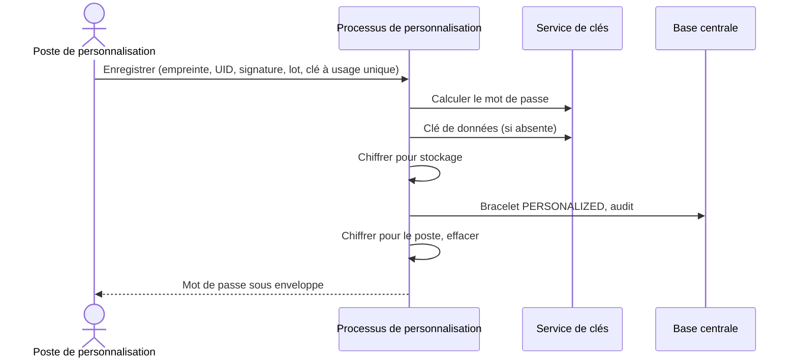
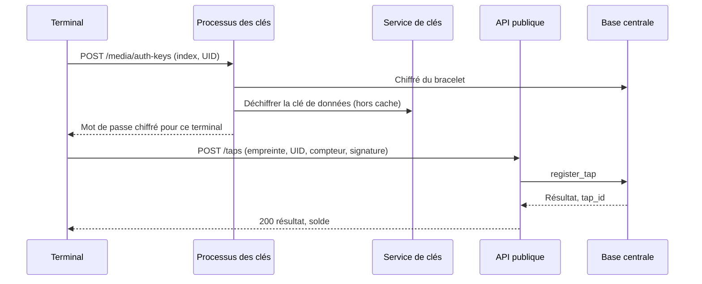
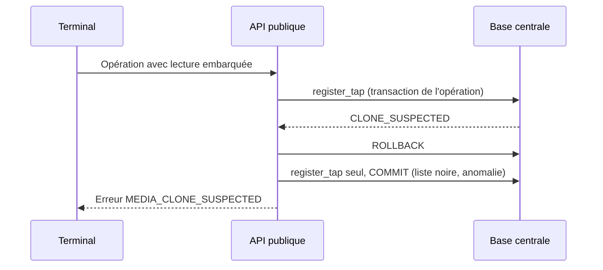
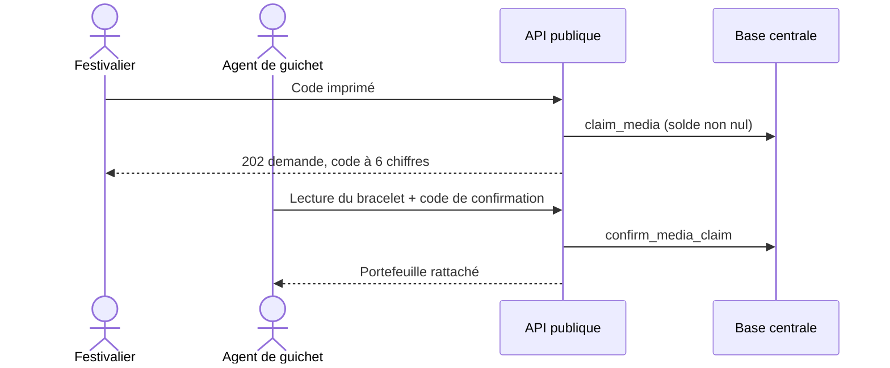
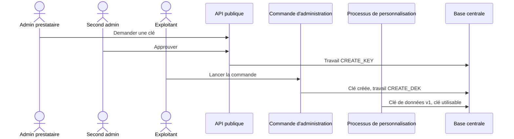

# Séquences — mission bracelets-nfc-01M4TD3W

> État : **plan finalisé** (2026-10-13).

## Flux internes propres à cette mission

### Personnalisation d'un bracelet

### Lecture d'un bracelet par un terminal

### Lecture suspecte dans une opération

### Rattachement d'un bracelet approvisionné

### Création d'une clé, à deux

## Lien avec la synthèse globale
Contribue à : `docs/05-sequence-diagrams.md`, flux « Paiement en ligne par bracelet » (la lecture et la demande de mot de
passe) et « Double validation au back-office » (actions de clé et sortie de liste noire).

## Nécessaire pour cette mission ? Oui — interactions entre terminal, poste, quatre processus, service de clés et base.
## Complet ? Oui au stade du plan.
## Validé par : Agent, par délégation du porteur (13/10/2026) — diagrammes en repli Mermaid (voir registre)
