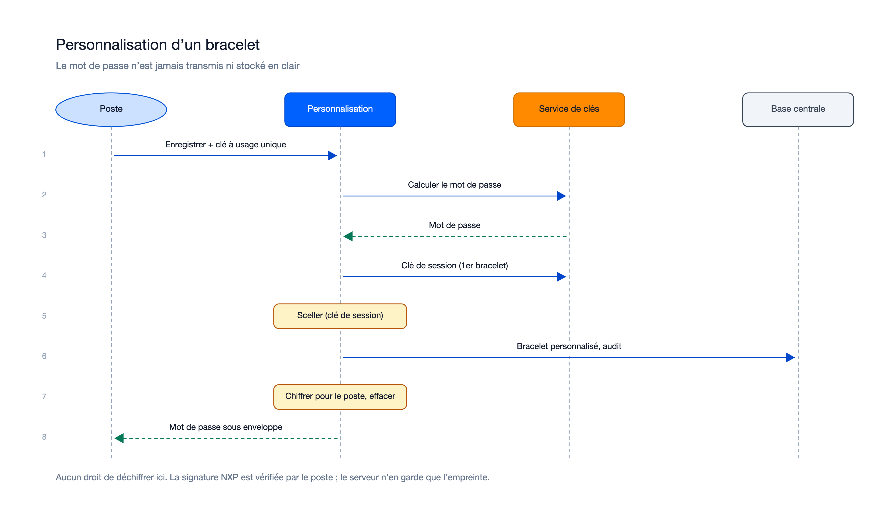
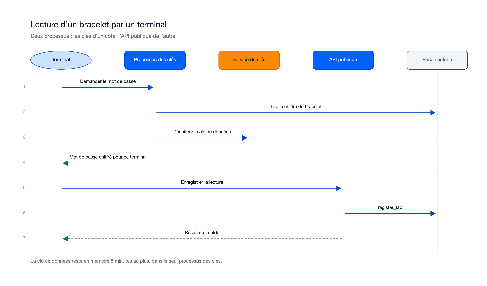
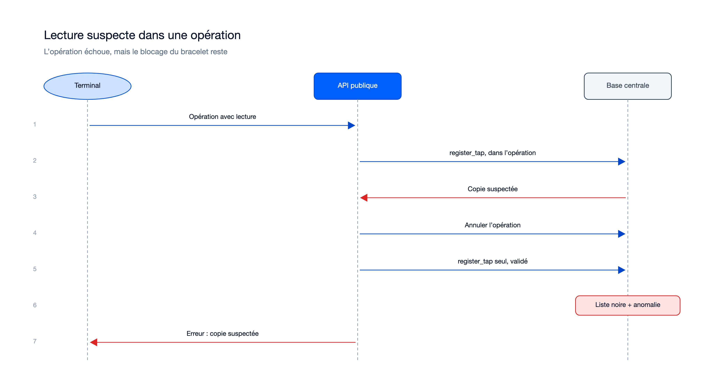
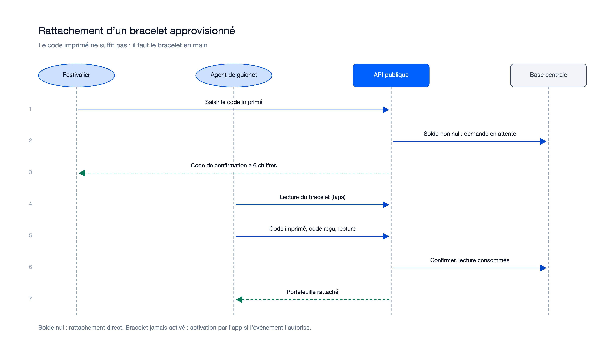
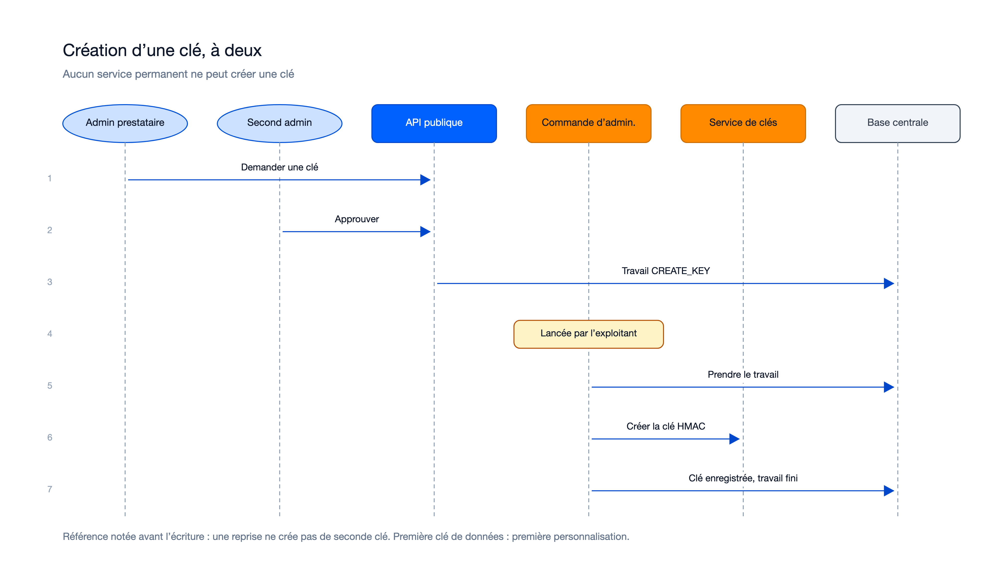
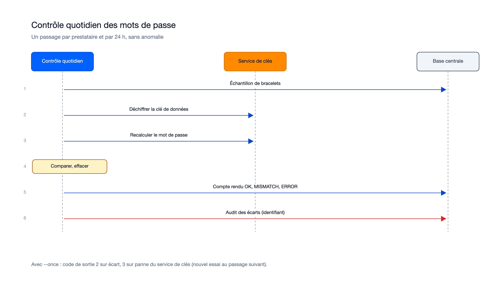

# Séquences — mission bracelets-nfc-01M4TD3W

> État : **approuvée** (20 lots relus, 15/10/2026) ; acceptée le 15/10/2026, **mergée le 16/10/2026** dans `feat/bracelets-nfc` (squash `7b1b8c2`).

## Flux internes propres à cette mission

### Personnalisation d'un bracelet

Sources : [`sequence-personnalisation.excalidraw`](diagrams/sequence-personnalisation.excalidraw), [`sequence-personnalisation.svg`](diagrams/sequence-personnalisation.svg).

Recalé : la clé de données de session est obtenue du service de clés (`GenerateDataKey`) au premier bracelet d'une
série, puis gardée en mémoire tant que la série dure (5 minutes au plus sans usage).

### Lecture d'un bracelet par un terminal

Sources : [`sequence-lecture.excalidraw`](diagrams/sequence-lecture.excalidraw), [`sequence-lecture.svg`](diagrams/sequence-lecture.svg).

### Lecture suspecte dans une opération

Sources : [`sequence-lecture-suspecte.excalidraw`](diagrams/sequence-lecture-suspecte.excalidraw), [`sequence-lecture-suspecte.svg`](diagrams/sequence-lecture-suspecte.svg).

### Rattachement d'un bracelet approvisionné

Sources : [`sequence-rattachement.excalidraw`](diagrams/sequence-rattachement.excalidraw), [`sequence-rattachement.svg`](diagrams/sequence-rattachement.svg).

Recalé : le guichet enregistre d'abord une lecture (`POST /taps`), puis envoie le code imprimé, le code de
confirmation et l'identifiant de la lecture ; la lecture doit être récente (fenêtre de l'événement) et elle est
consommée par la demande confirmée (`consume_tap_for_claim`, migration 0016).

### Création d'une clé, à deux

Sources : [`sequence-creation-cle.excalidraw`](diagrams/sequence-creation-cle.excalidraw), [`sequence-creation-cle.svg`](diagrams/sequence-creation-cle.svg).

Recalé : l'appel au service de clés par la commande d'administration est montré ; sa référence est notée dans le
travail avant l'écriture de la clé, pour qu'une reprise n'en crée pas une seconde.

### Contrôle quotidien des mots de passe (ajouté au recalage)

Sources : [`sequence-controle-quotidien.excalidraw`](diagrams/sequence-controle-quotidien.excalidraw), [`sequence-controle-quotidien.svg`](diagrams/sequence-controle-quotidien.svg).

Une clé du service de clés désactivée ou inconnue donne un écart pour ses bracelets, pas un arrêt du passage
(correction du cycle 2 de la relecture du lot 20).

Les diagrammes se régénèrent par `python3 diagrams/generate.py <dossier de sortie> <chemin de render_excalidraw.py du skill illustre>`.

## Flux transverses auxquels cette mission participe (référence, pas dupliqué)
Voir `docs/05-sequence-diagrams.md`, flux « Paiement en ligne par bracelet » (la demande de mot de passe et la lecture)
et « Double validation au back-office » (actions de clé et sortie de liste noire).

## Nécessaire pour cette mission ? Oui — interactions entre terminal, poste, quatre processus, commande d'administration, service de clés et base.
## Complet ? Oui, recalé sur l'implémentation. Le guichet de retour n'a pas de diagramme : il dépend de la décision attendue sur ADR-91.
## Validé par : Agent, par délégation du porteur (13/10/2026 ; recalage du 15/10/2026) — diagrammes générés par `/illustre` (préférence du porteur, 13/10/2026), police sans empattement, rendu relu
