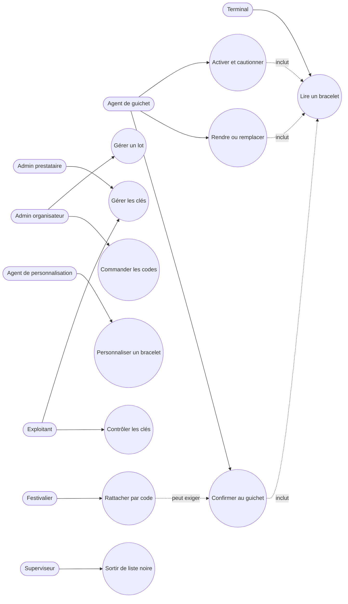

# Cas d'usage — mission bracelets-nfc-01M4TD3W

> État : **plan finalisé** (2026-10-13) ; à recaler sur le code livré après la review.

## Cas d'usage propres à cette mission

Les clés (création, rotation, retrait) et la sortie de liste noire passent par deux personnes. La création et la
désactivation d'une clé dans le service de clés sont faites par l'exploitant, avec une commande séparée.

## Lien avec la synthèse globale
Contribue à : `docs/02-use-case-diagram.md`, cas d'usage « Gérer clés et lots », « Activer un bracelet », « Gérer la
caution », « Remplacer un bracelet », « Rattacher un bracelet », « Sortir de liste noire » et, pour sa partie lecture,
« Payer par bracelet ».

## Nécessaire pour cette mission ? Oui — la mission introduit onze cas d'usage et un nouvel acteur (agent de personnalisation).
## Complet ? Oui au stade du plan ; à recaler après la review.
## Validé par : Agent, par délégation du porteur (13/10/2026) — diagramme en repli Mermaid (voir registre)
