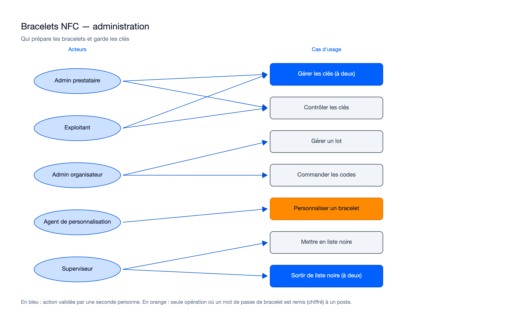
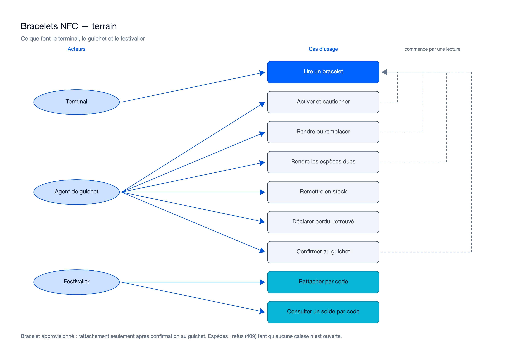

# Cas d'usage — mission bracelets-nfc-01M4TD3W

> État : **approuvée** (20 lots relus, WP20 au cycle 2, 15/10/2026) ; acceptée le 15/10/2026, **mergée le 16/10/2026** (squash `7b1b8c2`). Recalé sur le
> code de la lane `kitty/mission-bracelets-nfc-01M4TD3W-lane-t` (addendum après review, 15/10/2026).

## Cas d'usage propres à cette mission

### Administration

Sources : [`usecase-administration.excalidraw`](diagrams/usecase-administration.excalidraw), [`usecase-administration.svg`](diagrams/usecase-administration.svg).

### Terrain

Sources : [`usecase-terrain.excalidraw`](diagrams/usecase-terrain.excalidraw), [`usecase-terrain.svg`](diagrams/usecase-terrain.svg).

Les clés (création, rotation de la clé de données, retrait) et la sortie de liste noire passent par deux personnes.
La création et la désactivation d'une clé dans le service de clés sont faites par l'exploitant, avec une commande
séparée. Rôles réellement exigés par le contrat :

| Cas d'usage | Rôle | Remarque sur ce qui a été livré |
|---|---|---|
| Gérer les clés (à deux), contrôler les clés (comptes rendus, relance d'un travail) | `OPERATOR_ADMIN` | Travaux de clé visibles et relançables au back-office |
| Gérer un lot, commander les codes, importer le fichier de l'imprimeur, clore, rattraper le préchargement | `ORGANIZER_ADMIN` | Fichier de commande remis une seule fois, jamais réémis (OP-N48) |
| Personnaliser un bracelet, associer son code imprimé | `PERSONALIZER` | Signature NXP vérifiée par le poste seulement (OP-N46) |
| Mettre en liste noire ; demander la sortie (à deux) | `SUPERVISOR` | Demande liée à l'épisode de liste noire, une seule en attente |
| Activer, cautionner, rendre, remplacer, rendre les espèces dues, remettre en stock, déclarer perdu ou retrouvé, confirmer un rattachement | `CASHIER` ou `SUPERVISOR`, avec le terminal du guichet | Espèces : `409` tant qu'aucune caisse n'est ouverte (ADR-89) ; restitution sans enchaînement (ADR-91, à trancher) |
| Lire un bracelet | Terminal (identité par un faux jusqu'à la mission 5, OP-N42) | — |
| Rattacher par code (y compris activation depuis l'app si l'événement l'autorise) ; consulter un solde par code, sans compte | Festivalier (identité par un faux jusqu'à la mission 10, OP-N43) ; consultation anonyme | Consultation réduite à devise, solde, statut et 10 derniers mouvements (décision n° 11) |

Ajouts par rapport au plan : « Mettre en liste noire » (route `blacklistMedia`), « Rendre les espèces dues »,
« Remettre en stock » (route `reassignPoolMedia`, ajoutée au contrat pendant le lot 16), « Déclarer perdu, retrouvé »,
« Consulter un solde par code » et l'activation depuis l'app (décision n° 13).

## Lien avec la synthèse globale
Contribue à : `docs/02-use-case-diagram.md`, domaine « Bracelets NFC » (cas d'usage « Gérer clés et lots »,
« Activer un bracelet », « Gérer la caution », « Remplacer un bracelet », « Rattacher un bracelet », « Sortir de liste
noire » et, pour sa partie lecture, « Payer par bracelet »).

## Nécessaire pour cette mission ? Oui — la mission introduit seize cas d'usage et un nouvel acteur (agent de personnalisation).
## Complet ? Oui, recalé sur l'implémentation. Le guichet de retour reste provisoire (ADR-91) : le diagramme montrera l'enchaînement si le porteur le confie à la mission 9.
## Validé par : Agent, par délégation du porteur (13/10/2026 ; recalage du 15/10/2026) — diagrammes générés par `/illustre` (préférence du porteur, 13/10/2026), police sans empattement, rendu relu
