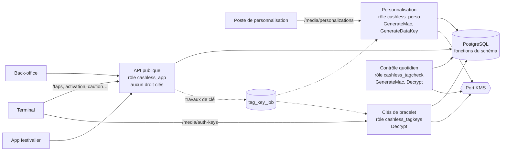

# Implementation Plan: Bracelets NFC (format, clés, lots, cycle de vie)

**Branch**: `feat/bracelets-nfc` | **Date**: 2026-10-13 | **Spec**: [spec.md](spec.md)
**Input**: `kitty-specs/bracelets-nfc-01M4TD3W/spec.md`
**Base** : missions `fondations-grand-livre-01M4AY8M` (NestJS 11, `TenantTx`, idempotence, problem+json, moteur
d'écritures, migrations, CI `ledger-tests`), `identite-roles-double-validation-01M4DNDN` (personnes, rôles et portées,
audit chaîné, registre d'actions à deux, `post-roles.sql`) et `configuration-parties-evenements-01M4GCJ9` (second pool
`PlatformTx`, rôle de base `cashless_platform`, événements et grand livre, cascade de configuration).

**Contrat de branche** : branche courante, de planification et de fusion `feat/bracelets-nfc` ; elle correspond à la
cible (`branch_matches_target = true`).

## Summary

La mission livre la bibliothèque de format des bracelets en TypeScript et en Dart, conforme aux vecteurs du kit, puis
tout ce que le serveur fait d'un bracelet : clés, lots, personnalisation, codes de rattachement, lecture, activation,
caution, restitution, remplacement, liste noire.

Approche : les règles restent dans les fonctions de la base (schéma de référence) ; l'API les appelle. Les secrets des
bracelets sont isolés par deux barrières, décidées avec le porteur le 13/10/2026 :

1. **Quatre processus pour un seul code** : API publique (aucun droit sur le service de clés), clés de bracelet
   (`POST /media/auth-keys`, déchiffrement), personnalisation (calcul du mot de passe, création de clé de données),
   contrôle quotidien (calcul et déchiffrement). S'y ajoute une commande d'administration lancée à la demande, seule
   à pouvoir créer ou désactiver une clé du KMS.
2. **Des rôles de base distincts** : seuls les processus des clés lisent les mots de passe chiffrés et les clés de
   données chiffrées ; l'API publique en perd la lecture.

Un mot de passe de bracelet n'est jamais transmis en clair : il est chiffré pour le terminal (règle du contrat) ou pour
une clé à usage unique du poste de personnalisation. Les identités du terminal et du festivalier et le service de clés
sont des ports avec un faux pour les tests ; un faux fait refuser le démarrage en production.



## Technical Context

**Language/Version**: TypeScript 5.x sur Node.js 22 (API et bibliothèque) ; Dart 3.8 (bibliothèque et types) ; SQL PostgreSQL 17 (migrations, pgTAP)
**Primary Dependencies**: NestJS 11, `pg`, `jose` (existants) ; cryptographie par `node:crypto` seulement côté TypeScript (AES-256-GCM, HMAC, ECDH P-256, HKDF, `zlib.crc32`) ; côté Dart `pointycastle` (AES-GCM, HMAC, SHA-256) et `test` ; générateur de types Dart depuis `openapi.yaml` (choix arrêté en R-10)
**Storage**: PostgreSQL 17 — schéma de référence inchangé ; migrations `0010` à `0013` ; quatre nouveaux rôles de base dans `post-roles.sql`
**Testing**: pgTAP (nouvelles suites par migration), Jest (unitaires, intégration HTTP sur vraie base, architecture), `dart test` ; vecteurs du kit rejoués dans les deux langages ; CI `ledger-tests` étendue (pas Dart, quatre démarrages)
**Target Platform**: serveur Linux (quatre processus Node) ; la bibliothèque Dart vise Flutter/Android (missions 10 et 12)
**Project Type**: monorepo npm (`apps/api`, `packages/contracts`, `packages/ledger-sql`, `packages/tag-format`) plus un paquet Dart
**Performance Goals**: demande de mot de passe et lecture p95 ≤ 200 ms, p99 ≤ 500 ms sur 100 000 bracelets ; activation p95 ≤ 500 ms (NFR-006)
**Constraints**: aucun secret en clair au repos ni dans les journaux (NFR-002) ; au plus un déchiffrement de clé de données par requête et effacement en mémoire (NFR-003) ; aucun faux en production (NFR-010) ; fichiers `.sql` générés du kit jamais modifiés (C-002) ; tout écart qui affaiblit la sécurité soumis au porteur (C-011)
**Scale/Scope**: lots jusqu'à 5 000 bracelets traités par tranches de 500 (NFR-008) ; environ 30 opérations de contrat (dont une vingtaine nouvelles) ; 36 FR, 10 NFR, 12 contraintes

## Charter Check

Aucune charte dans le projet (`.kittify/charter/charter.yaml` absent) : section sans objet. Les règles qui en tiennent
lieu sont `CLAUDE.md` (sources normatives, §0.3, fichiers générés, écarts de sécurité) et `docs/SPECIFICATION.md`.

Contrôle après conception : aucune décision du plan ne contredit ces règles. Les points où la spécification est muette
sont listés en R-12 et soumis au porteur quand ils touchent à la sécurité.

## Project Structure

### Documentation (this mission)

```
kitty-specs/bracelets-nfc-01M4TD3W/
├── plan.md
├── research.md
├── data-model.md
├── quickstart.md
├── contracts/
│   ├── tag-format.md            # API des deux bibliothèques, vecteurs
│   ├── key-services.md          # ports KMS, processus, rôles de base, travaux de clé
│   ├── identity-ports.md        # ports terminal et festivalier, garde de production
│   ├── media-lifecycle.md       # routes de terminal et de guichet, frontières de transaction
│   ├── claim-codes.md           # codes, demandes en attente, limites
│   └── openapi-additions.md     # routes back-office ajoutées au contrat
└── tasks.md                     # créé par /spec-kitty.tasks
```

### Source Code (repository root)

```
packages/tag-format/
├── vecteurs_test_bracelet.py            # kit, inchangé
├── package.json, tsconfig.json          # workspace @cashless/tag-format
├── src/{format-b,kdf,envelope,device-envelope,claim-code,index}.ts
├── test/*.spec.ts                       # vecteurs du kit, propriétés
├── vectors/vectors.json                 # sortie figée du script du kit + cas croisés
└── dart/                                # paquet cashless_tag_format
    ├── pubspec.yaml
    ├── lib/{format_b,kdf,envelope,claim_code}.dart
    └── test/*_test.dart                 # mêmes vecteurs (vectors.json)

packages/contracts/
├── openapi.yaml                         # routes back-office ajoutées, rôle PERSONALIZER
├── generated/                           # types TypeScript régénérés
└── dart/                                # types Dart générés

packages/ledger-sql/
├── migrations/0010_media_claims.sql     # S19 : claim_code, media_claim, claim_attempt, colonnes de media
├── migrations/0011_personalizer_role.sql# rôle PERSONALIZER, actions à deux, portée
├── migrations/0012_tag_key_jobs.sql     # tag_key_job, tag_key_check_run
├── migrations/0013_media_api.sql        # fonctions d'appui (personnalisation, statut de lot, liste noire, perte)
├── post-roles.sql                       # rôles cashless_tagkeys, cashless_perso, cashless_tagcheck, cashless_keyadmin ; retraits à cashless_app
└── tests/tests_{media_claims,personalizer_role,tag_key_jobs,media_api,media_roles}.sql

apps/api/src/
├── main.ts                              # API publique
├── main.tag-keys.ts                     # processus des clés de bracelet
├── main.personalization.ts              # processus de personnalisation
├── main.tag-check.ts                    # contrôle quotidien (sans route métier)
├── main.key-admin.ts                    # commande d'administration des clés (à la demande, sans route)
├── processes/{public,tag-keys,personalization,tag-check,key-admin}.module.ts
├── kms/{kms.ports,fake-kms,kms.module,production-guard}.ts
├── device-identity/{device-identity.port,fake-device-identity,device.guard}.ts
├── customer-identity/{customer-identity.port,fake-customer-identity,customer.guard}.ts
├── media/
│   ├── keys/                            # clés, travaux, rotation, retrait (API publique : demandes ; processus : exécution)
│   ├── auth-keys/                       # POST /media/auth-keys (processus des clés)
│   ├── personalization/                 # enregistrement, association des codes (processus de personnalisation)
│   ├── batches/                         # lots, cycle de vie, inventaire, fichier de commande
│   ├── taps/                            # POST /taps, effets de sécurité
│   ├── lifecycle/                       # activation, caution, restitution, remplacement, perte, espèces dues
│   ├── claims/                          # rattachement par code, demandes, confirmation, consultation anonyme
│   ├── blacklist/                       # liste noire, sortie à deux
│   └── daily-check/                     # contrôle quotidien
└── db/                                  # pools des nouveaux rôles

apps/api/test/
├── unit/{architecture,production-guard,...}.spec.ts
├── integration/media/*.spec.ts
└── integration/end-to-end/{media-journey,media-isolation,media-secrets,media-latency}.spec.ts
```

**Structure Decision** : on garde `apps/api` comme unique application et on y ajoute trois points d'entrée ; chaque
point d'entrée charge un module racine différent. La bibliothèque de format devient un workspace npm avec un paquet
Dart voisin, les deux lisant le même `vectors.json`.

## Complexity Tracking

| Écart à la simplicité | Pourquoi | Alternative plus simple écartée |
|---|---|---|
| Quatre processus | §3.2 et §13.2 : droits KMS séparés ; une faille de l'API publique ne doit atteindre aucune clé | Un seul processus avec séparation logique : écart qui affaiblit la sécurité, refusé par le porteur |
| Commande d'administration des clés | Aucun service permanent ne doit pouvoir créer ni désactiver une clé (décision du porteur) | Droit donné au processus de personnalisation, exposé aux postes d'atelier |
| Quatre rôles de base de plus | Seconde barrière : l'API publique ne lit plus les secrets chiffrés | Rôle unique : conforme à la lettre, une défense en moins |
| Table de travaux `tag_key_job` | Une action de clé approuvée dans l'API publique doit s'exécuter dans un processus qui a le droit KMS | Exécution dans l'API publique : lui donnerait des droits KMS |
| Deux implémentations de la bibliothèque | Demande du porteur et de la spécification (serveur en TypeScript, apps en Dart) | Dart reporté : exigence non tenue |
| Neuvième rôle humain `PERSONALIZER` | Moindre privilège sur l'opération la plus sensible | `OPERATOR_ADMIN` : jeton d'administrateur sur un poste d'atelier |

## Implementation Concern Map

### IC-01 — Bibliothèque de format en TypeScript

- **Purpose**: fournir au serveur le format B 1.0, le message de dérivation, l'enveloppe du mot de passe, l'enveloppe pour un appareil et le code de rattachement, conformes aux vecteurs du kit.
- **Relevant requirements**: FR-001, FR-002, FR-003, FR-004, FR-005, NFR-001
- **Affected surfaces**: `packages/tag-format/{package.json,src,test,vectors}`, `package.json` racine (workspace), CI
- **Sequencing/depends-on**: none
- **Risks**: `vectors.json` doit être produit par le script du kit, pas recopié à la main ; un écart entre script et spécification est signalé (C-003).

### IC-02 — Bibliothèque de format en Dart

- **Purpose**: fournir aux apps la même bibliothèque, prouvée sur les mêmes vecteurs.
- **Relevant requirements**: FR-001 à FR-005, NFR-001, SC-001
- **Affected surfaces**: `packages/tag-format/dart/`, `.github/workflows/ledger-tests.yml` (pas Dart)
- **Sequencing/depends-on**: IC-01 (vecteurs figés)
- **Risks**: dépendance `pointycastle` à épingler et à examiner (R-11) ; l'enveloppe pour un appareil n'est pas portée en Dart ici (mission 12).

### IC-03 — Schéma : S19, rôle PERSONALIZER, travaux de clé, fonctions d'appui

- **Purpose**: ajouter à la base ce que le schéma de référence annonce sans le fournir, sans toucher aux fichiers générés.
- **Relevant requirements**: FR-007 à FR-010, FR-015, FR-017, FR-029 à FR-032, FR-035, C-001, C-002
- **Affected surfaces**: `packages/ledger-sql/migrations/0010`–`0013`, `tests/tests_*.sql`
- **Sequencing/depends-on**: none
- **Risks**: l'élargissement de la contrainte des rôles (mission 2) doit garder ses tests verts ; les nouvelles tables portent RLS dès leur création.

### IC-04 — Rôles de base des processus et retraits à l'API publique

- **Purpose**: faire que seuls les processus des clés lisent `media.pwd_pack_enc` et `tag_data_key.encrypted_dek`.
- **Relevant requirements**: NFR-004, NFR-005, C-002, décision de plan 2
- **Affected surfaces**: `packages/ledger-sql/post-roles.sql`, `src/migrate.ts` (mots de passe des rôles), `tests/tests_media_roles.sql`, `.github/workflows/ledger-tests.yml`, `tools/dev-db/env.sh`
- **Sequencing/depends-on**: IC-03
- **Risks**: `roles.sql` (kit) redonne tous les droits à `cashless_app` à chaque rejeu ; les retraits se font après, par colonnes. La vue `offline_snapshot_rows` expose le chiffré : elle est retirée à `cashless_app`. Si un test de référence exigeait l'accès de `cashless_app`, il primerait et la limite serait soumise au porteur (R-02 : aucun cas trouvé).

### IC-05 — Ports, faux et garde de production

- **Purpose**: isoler le service de clés, l'identité du terminal et celle du festivalier derrière des ports, et interdire tout faux en production.
- **Relevant requirements**: FR-006, FR-034, NFR-005, NFR-010, C-004, C-005, C-012, SC-008
- **Affected surfaces**: `apps/api/src/{kms,device-identity,customer-identity}`, `config/config.ts`, `test/unit/{architecture,production-guard}.spec.ts`, `docs/POINTS_OUVERTS.md`, `docs/DECISIONS_ADR.md`
- **Sequencing/depends-on**: IC-01
- **Risks**: le port KMS est découpé par capacité (calcul, création de clé de données, déchiffrement, désactivation) ; chaque processus ne reçoit que les siennes. Les quatre dettes de sécurité connues sont écrites ici.

### IC-06 — Quatre processus et la commande d'administration des clés

- **Purpose**: donner à chaque service son point d'entrée, ses modules, son rôle de base et ses capacités ; la commande d'administration est la seule à recevoir le droit de créer et de désactiver une clé.
- **Relevant requirements**: NFR-005, décision de plan 1
- **Affected surfaces**: `apps/api/src/{main*.ts,processes/,db/}`, `config/config.ts`, `package.json` (scripts de démarrage), CI
- **Sequencing/depends-on**: IC-04, IC-05
- **Risks**: le test d'architecture doit prouver, par le graphe des modules, qu'aucune route de l'API publique n'atteint une capacité KMS ; le routage par chemin devant les processus relève de l'exploitation (consigné).

### IC-07 — Contrat d'API et types

- **Purpose**: décrire au contrat les routes back-office manquantes et régénérer les types TypeScript et Dart.
- **Relevant requirements**: FR-036, C-008
- **Affected surfaces**: `packages/contracts/{openapi.yaml,generated,dart}`
- **Sequencing/depends-on**: none
- **Risks**: les routes de terminal et de festivalier existantes ne sont pas modifiées ; toute contradiction relevée est signalée (R-12).

### IC-08 — Clés : création, rotation, retrait

- **Purpose**: faire vivre les clés par des demandes à deux dans l'API publique, exécutées par les processus qui en ont le droit.
- **Relevant requirements**: FR-007, FR-008, FR-009, FR-035, NFR-008, SC-007
- **Affected surfaces**: `apps/api/src/media/keys/`, travaux `tag_key_job`
- **Sequencing/depends-on**: IC-03, IC-05, IC-06, IC-07
- **Risks**: un travail interrompu doit reprendre sans double effet ; la création et la désactivation d'une clé du KMS attendent le passage de la commande d'administration, et cet état d'attente doit être visible de l'administrateur.

### IC-09 — Personnalisation et association des codes

- **Purpose**: enregistrer un bracelet, calculer et stocker son mot de passe, le rendre chiffré au poste, associer le code imprimé.
- **Relevant requirements**: FR-016, FR-017, NFR-002, NFR-003, décisions de plan 3 et 4
- **Affected surfaces**: `apps/api/src/media/personalization/`
- **Sequencing/depends-on**: IC-06, IC-07, IC-08
- **Risks**: la réponse porte un secret chiffré : elle n'est pas conservée par le registre d'idempotence, elle est recalculée au rejeu.

### IC-10 — Lots, codes à la commande, inventaire, clôture

- **Purpose**: gérer les lots et leur cycle de vie, produire une seule fois le fichier de commande.
- **Relevant requirements**: FR-011 à FR-015, NFR-008
- **Affected surfaces**: `apps/api/src/media/batches/`
- **Sequencing/depends-on**: IC-03, IC-07
- **Risks**: le fichier de commande contient des codes en clair : il n'est ni journalisé ni rejouable.

### IC-11 — Mot de passe pour un terminal et lecture

- **Purpose**: servir `POST /media/auth-keys` (processus des clés) et `POST /taps` (API publique), avec les effets de sécurité durables.
- **Relevant requirements**: FR-018, FR-019, FR-020, NFR-003, NFR-006, SC-003
- **Affected surfaces**: `apps/api/src/media/{auth-keys,taps}/`
- **Sequencing/depends-on**: IC-06, IC-09
- **Risks**: délai constant pour un bracelet inconnu ; la liste noire d'une lecture suspecte est validée dans une transaction séparée ; cache de la clé de données de 5 minutes au plus, effacé à l'expiration et à l'arrêt (R-05).

### IC-12 — Cycle de vie au guichet

- **Purpose**: activation, caution, consultation, restitution, réattribution, remplacement, perte, espèces dues.
- **Relevant requirements**: FR-021 à FR-028
- **Affected surfaces**: `apps/api/src/media/lifecycle/`
- **Sequencing/depends-on**: IC-11
- **Risks**: lecture embarquée et opération dans la même transaction ; traduction des résultats de `register_tap` en erreurs `MEDIA_*`.

### IC-13 — Rattachement par code et confirmation au guichet

- **Purpose**: rattachement par le festivalier, demandes en attente, limites d'essais, consultation anonyme.
- **Relevant requirements**: FR-030 à FR-033, NFR-007, SC-006
- **Affected surfaces**: `apps/api/src/media/claims/`
- **Sequencing/depends-on**: IC-03, IC-05, IC-10, IC-12
- **Risks**: empreintes à clé avec un secret hors de la base (R-06) ; réponses indistinguables.

### IC-14 — Liste noire et sortie à deux

- **Purpose**: mise en liste noire manuelle et sortie après validation d'une seconde personne.
- **Relevant requirements**: FR-029, SC-007
- **Affected surfaces**: `apps/api/src/media/blacklist/`
- **Sequencing/depends-on**: IC-11
- **Risks**: `reinstate_media` refuse déjà auteur = valideur ; l'action à deux de la mission 2 est réutilisée.

### IC-15 — Contrôle quotidien

- **Purpose**: recalculer un échantillon de mots de passe et alerter sur un écart.
- **Relevant requirements**: FR-010
- **Affected surfaces**: `apps/api/src/media/daily-check/`, `main.tag-check.ts`
- **Sequencing/depends-on**: IC-06, IC-09
- **Risks**: l'ordonnancement en production est hors mission ; l'opération est déclenchable et testée.

### IC-16 — Preuves de bout en bout, sécurité, CI et documentation

- **Purpose**: prouver le parcours complet, l'absence de secret au repos, l'isolation et la latence ; consigner les dettes.
- **Relevant requirements**: NFR-002, NFR-004, NFR-006, NFR-009, C-012, SC-002, SC-004, SC-005, SC-009
- **Affected surfaces**: `apps/api/test/integration/end-to-end/media-*.spec.ts`, `.github/CI.md`, `docs/DECISIONS_ADR.md`, `docs/POINTS_OUVERTS.md`
- **Sequencing/depends-on**: toutes les autres
- **Risks**: la mesure de latence tourne seule en CI, sans nouvel essai (leçon de la mission 3).
