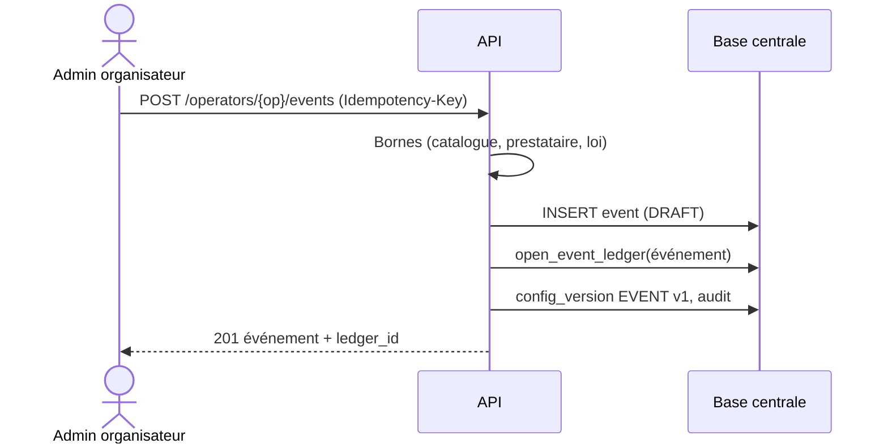
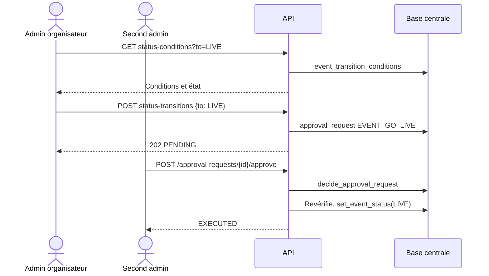
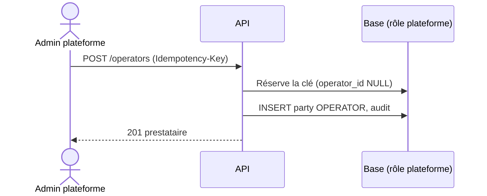

# Séquences — mission configuration-parties-evenements-01M4GCJ9

> État : **mergée** (2026-10-13, squash `d9e3779`) — 13/13 WP ; recalé sur le code livré à la review du 2026-10-12.

## Flux internes propres à cette mission

### Création d'un événement

### Passage en LIVE à deux

### Écriture de plateforme

## Flux transverses auxquels cette mission participe (référence, pas dupliqué)
Voir `docs/05-sequence-diagrams.md`, flux : « Double validation au back-office » (actions de configuration branchées),
« Clôture d'un événement » (passages de statut exposés par l'API).

## Nécessaire pour cette mission ? Oui — interactions back-office, API, base (deux rôles).
## Complet ? Oui — flux conformes au code livré. Précisions : la date d'effet d'une version est posée par l'horloge
de la base ; deux écritures concurrentes d'une même portée donnent 409 à la perdante ; `LIVE` passe par l'action à
deux `EVENT_GO_LIVE`, qui échoue (`FAILED`) si la configuration a changé depuis la demande.
## Validé par : Agent, par délégation du porteur (12/10/2026, « ok tu peux continuer par toi mm maintenant »)
