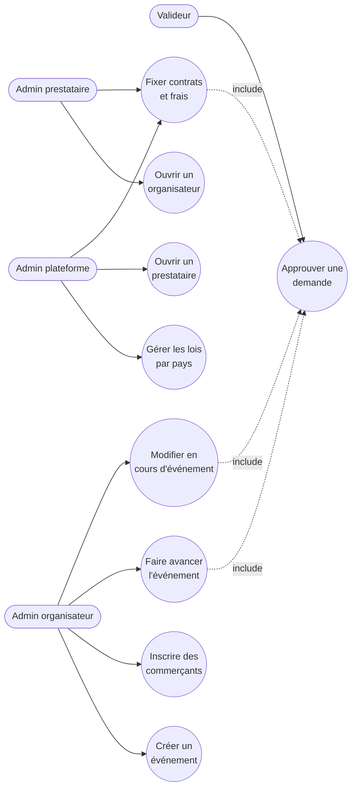

# Cas d'usage — mission configuration-parties-evenements-01M4GCJ9

> État : **plan finalisé** (2026-10-09) ; à recaler sur le code livré après la review.

## Cas d'usage propres à cette mission

| Cas d'usage | Ce qui le prouvera |
|---|---|
| Gérer les lois par pays | Profil `SN` créé avec valeurs provisoires signalées ; changement de plafond à deux (`JURISDICTION_LIMITS_CHANGE`) ; prestataires en lecture seule |
| Ouvrir un prestataire | Prestataire créé par le rôle de base de la plateforme ; le rôle applicatif ne peut pas le faire (pgTAP) |
| Ouvrir un organisateur | Rattaché au prestataire de la personne connectée ; invisible d'un autre prestataire |
| Fixer contrats et frais | Contrats versionnés, nouvelle version à deux ; règles de frais des quatre flux, remplacées jamais modifiées |
| Créer un événement | `DRAFT`, détenteur des fonds obligatoire, grand livre et comptes créés ; réglage hors bornes refusé avec la règle citée |
| Inscrire des commerçants | Participation `INTERNAL`/`EXTERNAL`, droit de place, compte commerçant ; points de vente |
| Faire avancer l'événement | Conditions visibles ; `LIVE` à deux ; autres passages par `set_event_status` ; refus nommant la condition |
| Modifier en cours d'événement | `202` pendant `LIVE`, nouvelle version après approbation ; configuration résolue à une date |
| Approuver une demande | Mécanisme de la mission 2, y compris au niveau plateforme |

## Lien avec la synthèse globale
Contribue à : `docs/02-use-case-diagram.md`, section « Vue d'ensemble — administration (back-office) » (domaines
« Gérer les prestataires », « Gérer les organisateurs », « Configurer l'événement »).

## Nécessaire pour cette mission ? Oui — la mission introduit neuf cas d'usage d'administration.
## Complet ? Oui au stade du plan ; à recaler après la review.
## Validé par : Agent, par délégation du porteur (09/10/2026)
