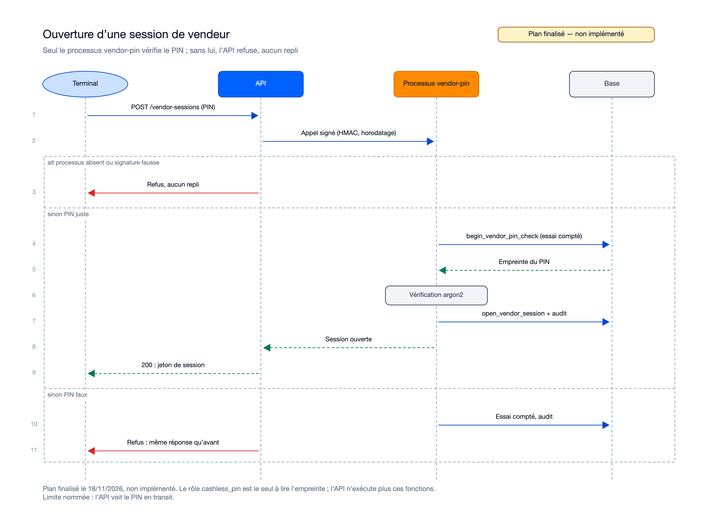
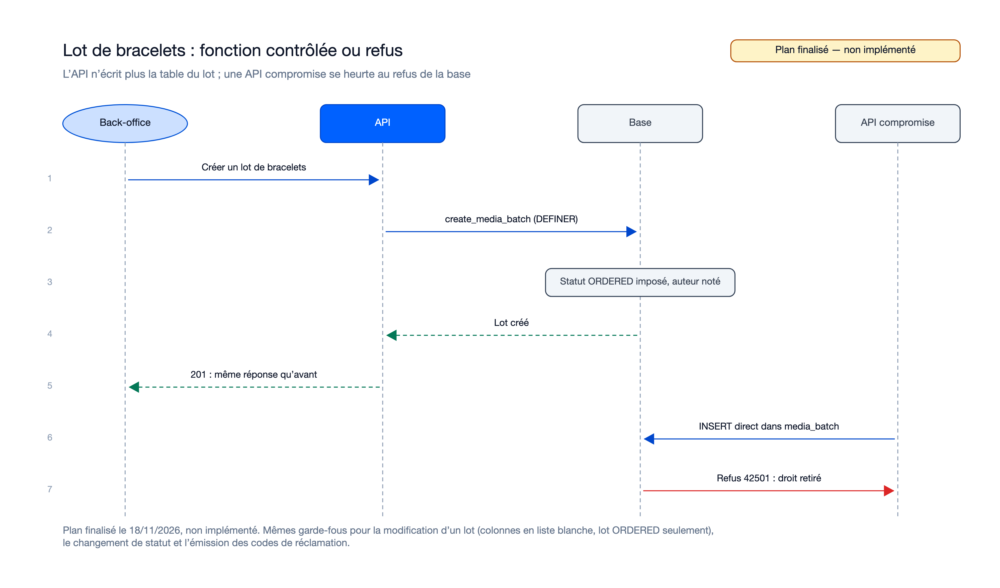

# Séquences : mission durcissements-serveur-01M7QAJD

> État : **plan finalisé le 18/11/2026**, non implémenté (mission 11a). Deux diagrammes `/illustre`, rendus relus ; sources dans [`diagrams/`](diagrams/) (`generate.py`).

## Flux internes propres à cette mission

### Ouverture d'une session de vendeur

Sources : [`sequence-pin-vendeur.excalidraw`](diagrams/sequence-pin-vendeur.excalidraw), [`sequence-pin-vendeur.svg`](diagrams/sequence-pin-vendeur.svg).
Le terminal appelle `POST /vendor-sessions` ; l'API appelle le processus `vendor-pin` par un appel signé. Sans processus ou avec une signature fausse : refus, aucun repli. Sinon le processus compte l'essai (`begin_vendor_pin_check`), vérifie l'argon2, puis ouvre la session (`open_vendor_session`) et audite ; PIN faux : essai compté et audit, même réponse qu'aujourd'hui. Limite nommée : l'API voit le PIN en transit.

### Lot de bracelets : fonction ou refus

Sources : [`sequence-lot-bracelets.excalidraw`](diagrams/sequence-lot-bracelets.excalidraw), [`sequence-lot-bracelets.svg`](diagrams/sequence-lot-bracelets.svg).
Le back-office crée un lot ; l'API appelle `create_media_batch` (`DEFINER`, statut `ORDERED` imposé, auteur noté), même réponse qu'avant. Une API compromise qui tente un `INSERT` direct reçoit `42501`.

## Flux transverses auxquels cette mission participe (référence, pas dupliqué)
Voir `docs/05-sequence-diagrams.md`, flux : « Enrôlement et requête signée d'un terminal » (session de vendeur, côté terminal), « Double validation au back-office » (décision de lot de versements) et « Versements, rapprochements et clôture » (lot, régularisation). Le flux « Paiement en ligne par bracelet » n'est pas modifié.

## Nécessaire pour cette mission ? Oui : un premier appel inter-processus et un refus de base sont introduits (réponse proposée par l'agent).
## Complet ? Oui pour le plan ; les flux IBAN et App Attest attendent les décisions 1 et 3 (réponse proposée par l'agent).
## Validé par : en attente de validation humaine (porteur indisponible le 18/11/2026), réponses proposées par l'agent.
