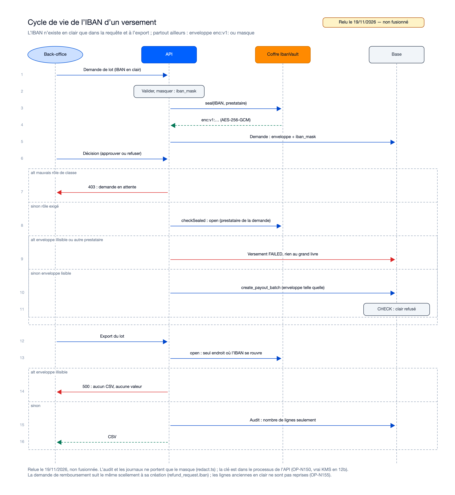

# Séquences : mission durcissements-serveur-01M7QAJD

> État : **relue le 19/11/2026**, non acceptée, non fusionnée. Trois diagrammes `/illustre` (deux recalés, un ajouté le 19/11/2026) relus ; sources dans [`diagrams/`](diagrams/) (`generate.py`). Les flux App Attest et inscription de passerelle sont décrits en prose, sans diagramme ; le cycle de vie de l'IBAN a le sien.

## Flux internes propres à cette mission

### Ouverture d'une session de vendeur

Sources : [`sequence-pin-vendeur.excalidraw`](diagrams/sequence-pin-vendeur.excalidraw), [`sequence-pin-vendeur.svg`](diagrams/sequence-pin-vendeur.svg).
Le terminal appelle `POST /vendor-sessions` ; l'API appelle le processus `vendor-pin` (loopback, port 3003) par un appel signé (HMAC, `x-pin-ts` en millisecondes, fenêtre de 30 s). Sans processus, avec une signature fausse ou un corps sans `rawBody` : refus, aucun repli. **Signature déjà vue : rejeu refusé en 401** (cache de 20 000 entrées ; plein = 401), ajout du 19/11/2026 absent du plan. Sinon le processus compte l'essai (`begin_vendor_pin_check`), vérifie l'argon2, puis ouvre la session (`open_vendor_session`) et audite ; PIN faux : essai compté et audit, même réponse qu'avant. Limites nommées : l'API voit le PIN en transit (OP-N151) ; la session est ouverte hors de la transaction de l'API, donc un renvoi de la clé d'idempotence après une API tombée rend 409 et le nouvel essai est compté (OP-N158). Latence mesurée : p95 211 ms (NFR-001 : 300 ms).

### Lot de bracelets : fonction ou refus

Sources : [`sequence-lot-bracelets.excalidraw`](diagrams/sequence-lot-bracelets.excalidraw), [`sequence-lot-bracelets.svg`](diagrams/sequence-lot-bracelets.svg).
Le back-office crée un lot ; l'API appelle `create_media_batch` (`DEFINER`, statut `ORDERED` imposé, auteur obligatoire), même réponse qu'avant. Le `PATCH` d'un lot prend un verrou consultatif, avant le contrôle `RLS` (OP-N161). Une API compromise qui tente un `INSERT` direct reçoit `42501`.

### Cycle de vie de l'IBAN d'un versement

Sources : [`sequence-iban.excalidraw`](diagrams/sequence-iban.excalidraw), [`sequence-iban.svg`](diagrams/sequence-iban.svg). Rendu `/illustre`, relu.
Saisie : l'API valide l'IBAN, calcule `iban_mask`, puis `IbanVault.seal` le chiffre (`enc:v1:`) ; la charge ne porte que l'enveloppe et le masque. Décision : `guardDecision` exige le rôle de classe, approbation comme refus. Exécution : `checkSealed` ouvre chaque enveloppe pour le prestataire de la demande ; illisible ou d'un autre prestataire, le versement passe `FAILED`, rien au grand livre. Écriture : `create_payout_batch` écrit l'enveloppe telle quelle, le `CHECK enc:v1:` refuse le clair. Export : seul endroit où l'enveloppe est rouverte ; illisible, 500 sans CSV ni valeur (OP-N160). Audit et journaux : le masque seulement.

### IBAN, résumé (prose)
L'API normalise l'IBAN, le chiffre avec le coffre (`enc:v1:<kid>:…`, lié au prestataire) avant toute écriture, aux trois emplacements ; la base refuse une écriture en clair (`CHECK … NOT VALID`, donc sans effet sur les lignes anciennes, OP-N155). Le déchiffrement n'a lieu que pour l'export du lot de virements ; une enveloppe altérée ou d'un autre prestataire fait échouer le versement (`FAILED`, rien au grand livre) ou l'export (500 sans valeur, OP-N160). Au journal, `redact.ts` masque IBAN et numéros de mobile money.

### Inscription d'une passerelle (prose)
`edge-admin register` appelle `register_edge_gateway`, qui rend `(gateway_id, ledger_id)` ; zéro ou plusieurs grands livres : `CL058`. L'option `--ledger` est refusée.

### Compteur App Attest (prose, non branché)
Le vérificateur d'assertions interne appelle `advance_app_attest_counter` (vrai si le compteur augmente ; appareil d'un autre prestataire ou révoqué : `CL059`). Aucun appelant en production : borne iOS gardée.

## Flux transverses auxquels cette mission participe (référence, pas dupliqué)
Voir `docs/05-sequence-diagrams.md`, flux : « Enrôlement et requête signée d'un terminal » (session de vendeur, côté terminal), « Double validation au back-office » (décision de lot de versements) et « Versements, rapprochements et clôture » (lot, régularisation). Le flux « Paiement en ligne par bracelet » n'est pas modifié.

## Nécessaire pour cette mission ? Oui : un premier appel inter-processus et un refus de base sont introduits (réponse du porteur, 19/11/2026).
## Complet ? Oui avec le diagramme du cycle de vie de l'IBAN ; passerelle et App Attest restent en prose, décision du porteur du 19/11/2026.
## Validé par : le porteur, 19/11/2026.
