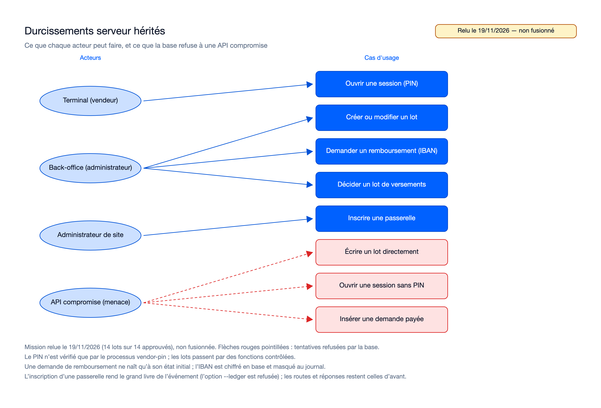

# Cas d'usage : mission durcissements-serveur-01M7QAJD

> État : **relue le 19/11/2026** (14 lots sur 14 approuvés), non acceptée, non fusionnée (mission 11a « Durcissements serveur hérités »).
> Source : `spec.md`, `plan.md`, `interfaces.md`, code de la lane `n`. Diagramme `/illustre` (police sans empattement, rendu relu le 19/11/2026) ; source et générateur dans [`diagrams/`](diagrams/) (`generate.py`).

## Cas d'usage propres à cette mission

Sources : [`usecase-durcissements.excalidraw`](diagrams/usecase-durcissements.excalidraw), [`usecase-durcissements.svg`](diagrams/usecase-durcissements.svg).

| Cas d'usage | Acteur | Règle réalisée | Point ouvert |
|---|---|---|---|
| Ouvrir une session de vendeur (PIN) | Terminal (vendeur) | Le PIN n'est vérifié que par le processus `vendor-pin` (appel signé, rejeu refusé en 401) ; mêmes réponses, même décompte d'essais, même audit | OP-N76 levé ; limites OP-N151, N154, N157 à N159 |
| Créer ou modifier un lot de bracelets | Back-office (administrateur) | Par `create_media_batch` / `update_media_batch` seulement ; lot `ORDERED` imposé, acteur obligatoire ; mêmes réponses de route | OP-N60 levé ; OP-N161 |
| Créer une demande de remboursement avec IBAN | Back-office (administrateur) | La demande naît à son état initial ; IBAN chiffré (`enc:v1:`) en base, masqué au journal | OP-N145, OP-N140 levés ; OP-N150, N153, N155 |
| Décider un lot de versements | Back-office (administrateur) | Rôle de classe exigé aussi au refus ; auto-approbation : `409 APPROVAL_INVALID` ; rejeu de confirmation audité ; plafond de la régularisation ; export illisible : 500 sans valeur | OP-N137, OP-N141 levés ; OP-N160 |
| Inscrire une passerelle | Administrateur de site | `register_edge_gateway` rend `(gateway_id, ledger_id)` ; l'option `--ledger` est refusée, même vide ou identique | OP-N116 levé ; OP-N162 |
| Écrire un lot directement (refusé) | API compromise (menace) | `INSERT`/`UPDATE` retirés : refus `42501` | OP-N60 |
| Ouvrir une session sans PIN (refusé) | API compromise (menace) | `cashless_app` n'exécute plus la lecture d'empreinte ni l'ouverture de session ; aucun repli | OP-N76 |
| Insérer une demande payée (refusé) | API compromise (menace) | Déclencheur `BEFORE INSERT` : état initial imposé aux membres de `cashless_app` | OP-N145 |

Hors diagramme (sans cas d'usage utilisateur) : vendeur dans la clé de session (OP-N79, levé) ; App Attest côté serveur (OP-N64 : clé gardée à l'enrôlement, vérificateur sans appelant en production, borne iOS gardée, **non levé**, compteur `advance_app_attest_counter` exécutable par `cashless_app`, OP-N152) ; masquage du numéro de mobile money au journal (OP-N156 levé).

## Lien avec la synthèse globale

Contribue à : `docs/02-use-case-diagram.md`, domaines « Bracelets NFC : format, clés, lots, cycle de vie » (lots), « Argent réel : PSP, caisses, rapprochements, versements » (demande de remboursement, décision de lot) et « Administration et exploitation » (inscription d'une passerelle, session de vendeur). Aucun domaine « Sécurité du serveur central » n'existe dans ce fichier ; les rattachements ci-dessus suffisent, sauf avis contraire du porteur. Pas de renommage ni de fusion de cas d'usage globaux. Références par nom de domaine, jamais par numéro.

## Nécessaire pour cette mission ? Oui : cinq cas d'usage conservés (garanties changées) et trois tentatives refusées par la menace « API compromise » (réponse proposée par l'agent le 19/11/2026, à confirmer).
## Complet ? Oui, recalé sur la réalisation ; OP-N79 et OP-N64 restent hors diagramme faute de cas d'usage utilisateur (réponse proposée par l'agent, à confirmer).
## Validé par : en attente de validation humaine, réponses proposées par l'agent.
