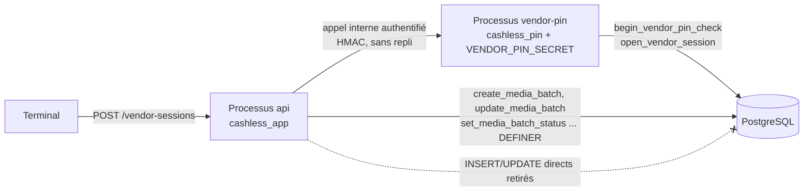

# Implementation Plan: Durcissements serveur hérités

**Branch**: `feat/durcissements-serveur` | **Date**: 2026-11-18 | **Spec**: [spec.md](spec.md)
**Input**: Mission specification from `kitty-specs/durcissements-serveur-01M7QAJD/spec.md`

## Summary

Lever huit dettes de sécurité serveur héritées (OP-N60, OP-N76, OP-N79, OP-N116, OP-N137, OP-N140, OP-N141,
OP-N145) et préparer OP-N64 côté serveur, sans changer le comportement d'aucune route du contrat. Le fil commun :
une connexion de l'API compromise (`cashless_app`) perd les écritures directes et les secrets qu'elle n'a pas besoin
de détenir. Les écritures directes sur des tables passent par des fonctions `SECURITY DEFINER` étroites ; la
vérification du PIN des vendeurs passe dans un processus dédié ; la base impose ce que seule une fonction garantissait
(vendeur d'une vente, état initial d'une demande de remboursement) ; l'IBAN sort des journaux et, selon la décision du
porteur, est chiffré au repos.

Recherches détaillées (code, droits, appelants, tests à inverser) : `research/R-N60-lots-bracelets.md`,
`research/R-N76-N79-pin-vendeurs.md`, `research/R-9b-iban-remboursements-versements.md`,
`research/R-N64-N116-app-attest-passerelles.md` ; synthèse et décisions : [research.md](research.md).

Plan préparé en l'absence du porteur (consigne du 18/11/2026 : « continue en auto »). Les choix d'ingénierie sont
pris par l'agent et consignés dans `research.md` (« proposés par l'agent, à confirmer »). Trois choix qui touchent la
sécurité ou s'écartent d'une décision du porteur sont **différés** (Decision Moments ci-dessous) : les lots qui en
dépendent ne sont pas codés avant sa réponse (règle du 13/10/2026) ; le reste avance.

## Technical Context

**Language/Version**: TypeScript 5.9.3, Node.js 22 LTS (`engines: >=22 <23`), SQL PostgreSQL 17
**Primary Dependencies**: NestJS 11 (`@nestjs/core` 11.2.7), `pg`, `argon2`, `cbor2` 2.3.0, `node:crypto` ; tous déjà
épinglés (`docs/08-pile-logicielle.md`, ADR-78). **Aucune dépendance nouvelle** (DIRECTIVE_051 sans objet).
**Storage**: PostgreSQL 17 au central ; nouvelles migrations `0090` à `0095` ; sections nouvelles de `post-roles.sql` ;
les migrations existantes, le schéma de référence et les `.sql` générés ne sont pas modifiés (C-004).
**Testing**: pgTAP (droits par rôle et par colonne, liste figée des `EXECUTE`, gardes, contraintes, tests de borne
inversés) ; Jest intégration sur base recréée (parcours inchangés : lots, PIN, remboursements, versements ; refus depuis
`cashless_app`) ; Jest unitaire (masque, coffre d'IBAN, plafond, assertions) ; tests de l'outil `tools/edge-admin` ;
mesure NFR-001 dans une suite isolée (`SKIP_LATENCY`). Chaque levée a une mutation vérifiée (NFR-004).
**Target Platform**: API centrale (processus `api`), nouveau processus `vendor-pin`, outil `edge-admin` (Linux) ; CI
GitHub Actions (jobs `ledger` et `gateway-e2e`) ; preuves locales sur macOS.
**Project Type**: monorepo npm (`apps/`, `packages/`, `tools/`).
**Performance Goals**:
- ouverture de session de vendeur p95 ≤ 300 ms, p99 ≤ 600 ms, processus dédié compris (NFR-001) ;
- export d'un lot de 500 virements en moins de 2 s, déchiffrement compris (NFR-002).

**Constraints**:
- C-001 à C-008 de la spec ; NFR-003 précisé (voir « Amendements de la spec ») ;
- contrat `openapi.yaml` inchangé : la vérification des assertions App Attest est une capacité interne, branchée sur
  aucune route (mission 12) ; aucune entrée à ajouter à `contract-baseline.json` ;
- un rôle par processus ; le processus `vendor-pin` a son rôle `cashless_pin` ;
- écarts de sécurité soumis avant d'être codés (trois décisions différées ci-dessous).

**Scale/Scope**: 21 FR, 5 NFR, 8 contraintes ; 9 points ouverts ; 6 migrations ; 1 processus nouveau ; 0 route ajoutée.

## Charter Check

*GATE: Must pass before Phase 0 research. Re-check after Phase 1 design.*

Charte absente (`.kittify/charter/charter.yaml` introuvable) : contrôle sauté. Les règles normatives du projet
s'appliquent à la place : `CLAUDE.md` (règle du porteur du 13/10/2026 sur les écarts de sécurité, sources normatives),
`docs/SPECIFICATION.md` §0.3, ADR-78 (pile).

### Décisions du porteur

- 18/11/2026, specify : OP-N64 côté serveur prêt (keyId gardé, assertions vérifiées, borne iOS gardée) ; OP-N140 masque
  et chiffrement au repos ; OP-N116 grand livre rendu par l'inscription.

### Décisions différées le 18/11/2026, tranchées par le porteur à son retour le même jour

1. **Clé de chiffrement de l'IBAN (OP-N140).** La décision de la spec supposait le service de clés existant ; or le
   processus public n'en a aucun port (`test/unit/architecture.spec.ts:158-170` l'interdit), seul un faux existe, et
   l'export CSV qui doit rendre l'IBAN est servi par ce processus (`x-process: public`). Proposition : chiffrement
   AES-256-GCM avec un anneau de clés lu en configuration de l'API, démarrage refusé en production sans clé, aux trois
   emplacements de l'IBAN (`refund_request.iban`, `payout.iban`, `approval_request.payload`). Limite résiduelle : la clé
   est dans le processus public (gain : base, sauvegardes, réplicas, autres rôles, injection SQL en lecture). Alternative :
   masque seul, chiffrement reporté au vrai KMS (12b). Le masque dans les journaux (FR-009) n'en dépend pas et avance.
   **Tranché par le porteur le 18/11/2026 : clé de configuration dans l'API** (aux trois emplacements ; limite résiduelle consignée).
2. **Ancienne signature `refund_deposit(uuid, uuid)` (OP-N145).** Elle est appelée par `refund_deposit_from_balance`
   (0041), par le générateur `gen_tests.py` (l. 407 et 918) et définie dans le schéma de référence ; elle n'est
   exécutable par aucun rôle applicatif. La retirer impose de modifier le générateur et le schéma de référence.
   Proposition : la garder interne (écart à FR-012, neutre pour la sécurité, consigné) ; `refund_deposit_for_session(uuid, uuid)`,
   seule accordée à l'API et appelée par aucun code TypeScript, est retirée.
   **Tranché par le porteur le 18/11/2026 : la garder interne**, exécutable par aucun rôle (test), écart à FR-012 consigné.
3. **Droits pour App Attest (OP-N64).** Garder la clé à l'enrôlement se fait dans une nouvelle version
   d'`enroll_device` (même droit qu'aujourd'hui). Faire avancer le compteur exige un `EXECUTE` nouveau pour
   `cashless_app` sur une fonction étroite (`advance_app_attest_counter` : mise à jour seulement si le compteur
   croît). Risque : une API compromise peut faire avancer un compteur (déni de service des assertions de cet appareil,
   aucun accès gagné). Alternative : reporter tout OP-N64 côté serveur à la mission 12.
   **Tranché par le porteur le 18/11/2026 : oui**, un seul `EXECUTE` nouveau et étroit, figé ; risque de déni de service consigné.

### Écarts de sécurité

| Écart | Sens | Traitement |
|---|---|---|
| `EXECUTE` de `cashless_app` sur `create_media_batch` et `update_media_batch` | Renforcement : remplacent `INSERT`/`UPDATE` directs retirés | Fait puis consigné (ADR) ; liste figée de `tests_execute_grants.sql` |
| `set_media_batch_status`, `media_set_status`, `issue_claim_codes` passent `SECURITY DEFINER` (corps identique) | Renforcement : permettent de retirer `UPDATE (status)` sur `media` et `UPDATE` sur `media_batch` | Fait puis consigné |
| `media_set_status` limité à `SUSPENDED` et `BLACKLISTED` | Renforcement | Fait puis consigné |
| L'API voit toujours le PIN en transit (OP-N76) ; création et changement de PIN restent appelés par l'API | Limite résiduelle, inchangée | Nommée dans l'ADR de levée |
| Clé de l'IBAN dans le processus public | Écart à la décision initiale du porteur | Accepté par le porteur (décision 1) : OP, ADR, test de borne |
| `refund_deposit(uuid, uuid)` gardée | Écart à FR-012, neutre | Accepté par le porteur (décision 2) : ADR, test « exécutable par personne » |
| `EXECUTE` nouveau pour le compteur App Attest | Capacité nouvelle, étroite | Accepté par le porteur (décision 3) : OP, ADR, liste figée |

### Amendements de la spec (faits avec ce plan)

- **NFR-003** : « 0 droit de table ou de colonne ajouté à `cashless_app` ; les seuls `EXECUTE` ajoutés portent sur des
  fonctions `SECURITY DEFINER` qui remplacent un droit retiré ou contrôlent elles-mêmes l'écriture, listés au plan et
  figés dans `tests_execute_grants.sql` ». La formulation d'origine (« 0 droit d'exécution ») contredisait OP-N60, dont
  la condition de levée est précisément « par des fonctions ».
- **FR-016** : l'auto-approbation rend aujourd'hui `409 APPROVAL_INVALID` (`CL023`), pas `403`. Rendre `403` changerait
  le comportement d'une route (C-002) : le test exige exactement `409 APPROVAL_INVALID`.
- **FR-010** : l'IBAN est en clair à trois endroits, pas un (`refund_request.iban`, `payout.iban`,
  `approval_request.payload`) ; le chiffrement, s'il est retenu, couvre les trois.

## Project Structure

### Documentation (this mission)

```
kitty-specs/durcissements-serveur-01M7QAJD/
├── spec.md
├── plan.md              # ce fichier
├── research.md          # synthèse, décisions d'ingénierie
├── research/            # quatre recherches détaillées
├── data-model.md        # tables, colonnes, fonctions, droits touchés
├── quickstart.md        # comment prouver chaque levée
├── decisions/           # Decision Moments
├── checklists/
└── tasks/               # créé par /spec-kitty.tasks
```

### Source Code (repository root)

```
packages/ledger-sql/
├── migrations/
│   ├── 0090_sale_attribution_vendor_key.sql     # OP-N79
│   ├── 0091_media_batch_functions.sql           # OP-N60
│   ├── 0092_refund_request_insert_guard.sql     # OP-N145
│   ├── 0093_iban_sealed.sql                     # OP-N140 (si décision 1 = chiffrement)
│   ├── 0094_register_edge_gateway_ledger.sql    # OP-N116
│   └── 0095_device_app_attest_key.sql           # OP-N64 (si décision 3 = oui)
├── post-roles.sql                               # sections nouvelles (cashless_pin, retraits, EXECUTE)
├── roles.sql                                    # rôle cashless_pin
└── tests/                                       # pgTAP nouveaux et inversés
apps/api/src/
├── main.vendor-pin.ts, processes/vendor-pin.module.ts, vendor-pin/   # OP-N76 (processus)
├── vendors/ (client interne, hacheur scindé)                         # OP-N76 (API)
├── media/batches/batches.service.ts                                  # OP-N60
├── approval/ (crochet guardDecision), payouts/                       # OP-N137
├── closing/ (fees.ts)                                                # OP-N141
├── errors/redact.ts, common/iban-vault.ts                            # OP-N140
├── attestation/, devices/ ou enrollment/                             # OP-N64
└── config/config.ts                                                  # secrets et clés nouveaux
apps/api/test/                                    # Jest unitaire et intégration
tools/edge-admin/src/ (commands.ts, db.ts)        # OP-N116
tools/dev-db/env.sh, .github/workflows/*.yml      # rôle et URL du processus du PIN
```

**Structure Decision**: même découpage que les missions précédentes (C-007). Les numéros de migration suivent l'ordre
des lots ; ils peuvent glisser si une décision différée retire une migration, sans trou laissé dans la série livrée.

### Architecture



## Complexity Tracking

| Choix | Pourquoi | Alternative plus simple écartée |
|---|---|---|
| Processus `vendor-pin` nouveau | Condition de levée d'OP-N76 : un détenteur du secret autre que l'API | Preuve signée par le terminal : exige l'app (mission 12) |
| Appel interne API → processus, nouveau dans le projet | Le terminal parle à l'API ; router la route vers le processus changerait `x-process` du contrat | Router directement : changement de contrat |
| `update_media_batch` à liste blanche de colonnes | L'API modifie six colonnes d'un lot `ORDERED` (`batches.service.ts:154`) | Une fonction par colonne : six fonctions pour rien |

## Implementation Concern Map

### IC-01 — Vendeur dans la clé de session (OP-N79)

- **Exigences** : FR-008, SC-001.
- **Contenu** : migration `0090` : contrôle de cohérence (`DO`), `UNIQUE (id, vendor_id)` sur `vendor_session`, clé
  étrangère `(vendor_session_id, vendor_id)` depuis `sale_attribution` (la clé existante vers `(id, device_id,
  operator_id)` reste). Aucun droit changé.
- **Preuves** : pgTAP attribution incohérente refusée (23503) avec contrôle positif ; existence des contraintes ;
  inversion de la borne de `tests_payment_rights.sql`.
- **Dépend de** : rien.

### IC-02 — Lots et statut des bracelets par fonctions (OP-N60)

- **Exigences** : FR-001 à FR-004, SC-001, SC-002, NFR-003.
- **Contenu** : migration `0091` : `create_media_batch` (pas de paramètre de statut, `ORDERED` imposé, organisateur et
  événement du prestataire de session), `update_media_batch` (liste blanche de six colonnes, lot `ORDERED` seulement,
  `quantity` refusée après émission des codes), `set_media_batch_status`, `media_set_status` et `issue_claim_codes`
  passés `SECURITY DEFINER` à corps identique (`search_path` fixé), `media_set_status` limité à `SUSPENDED` et
  `BLACKLISTED` ; `post-roles.sql` : `REVOKE INSERT, UPDATE ON media_batch`, `UPDATE` de `media` réduit à
  `(claim_code_used_at, claim_attempts)`. API : `batches.service.ts` appelle les fonctions ; `row()` perd son
  `FOR UPDATE` (exige `UPDATE`) ; l'auteur est posé dans l'historique de création du lot.
- **Preuves** : `tests_definer_trigger_writers.sql` §4 et chaîne des écrivains ; `tests_media_roles.sql` ;
  `tests_media_api.sql` ; `tests_media_reinstate.sql` ; `tests_execute_grants.sql` ; Jest `blacklist.spec.ts` réécrit ;
  parcours de lot inchangés.
- **Dépend de** : rien.

### IC-03 — Processus du PIN des vendeurs (OP-N76)

- **Exigences** : FR-005 à FR-007, NFR-001, C-006, C-008.
- **Contenu** : rôle `cashless_pin` (`roles.sql`, `post-roles.sql`, `migrate.ts`, `env.sh`, workflows, `test/support/db.ts`,
  `process-db.module.ts`) ; `EXECUTE` de `begin_vendor_pin_check` et `open_vendor_session` déplacé de `cashless_app` à
  `cashless_pin` ; processus `vendor-pin` (`main.vendor-pin.ts`, sur le modèle de `tag-keys` : pool et rôle uniques,
  `DenyUnmarkedRoutesGuard`, audit, refus de démarrer sans secret ni sans clé d'appel) avec deux routes internes
  (ouvrir une session : essai, argon2, ouverture, audits ; hacher un PIN pour création et changement) ;
  `VENDOR_PIN_SECRET` lu par ce seul processus ; hacheur scindé (le dérivé d'idempotence reste dans l'API) ; client
  interne de l'API authentifié par HMAC sur le corps et l'horodatage, refus sans repli si le processus est absent ;
  route `POST /vendor-sessions` aux mêmes réponses.
- **Preuves** : pgTAP `cashless_app` sans `EXECUTE` sur les deux fonctions, seul `cashless_pin` les exécute (liste
  figée) ; Jest : parcours PIN juste et faux inchangés, refus processus arrêté, appel interne sans signature refusé,
  l'API ne lit plus `VENDOR_PIN_SECRET` (test d'architecture et de configuration) ; mesure NFR-001.
- **Dépend de** : rien.

### IC-04 — Demande de remboursement née à son état initial (OP-N145)

- **Exigences** : FR-011, FR-012, SC-001.
- **Contenu** : migration `0092` : `INSERT` de `cashless_app` sur `refund_request` limité aux 16 colonnes écrites par
  l'API ; déclencheur `BEFORE INSERT` pour les sessions `cashless_app` (état initial seulement, colonnes de transition
  nulles) ; retrait de `refund_deposit_for_session(uuid, uuid)` ; sort de `refund_deposit(uuid, uuid)` selon la
  décision 2.
- **Preuves** : `limits-9b.spec.ts` inversé (`INSERT` en `PAID` ou `CANCELLED` refusé) ; pgTAP nouveaux ; références
  pgTAP écrites à la main de l'ancienne signature mises à jour.
- **Dépend de** : décision 2 pour `refund_deposit(uuid, uuid)` seulement.

### IC-05 — Décision de lot de versements gardée (OP-N137)

- **Exigences** : FR-013 à FR-016.
- **Contenu** : crochet facultatif `guardDecision` dans `ApprovalActionDefinition`, appelé avant `decide` pour approuver
  et pour refuser (rôle de la classe de bénéficiaire) ; le contrôle d'`execute` reste en défense en profondeur ; audit
  `PAYOUT_CONFIRM_REPLAYED` sur un `confirm` rejoué sans écriture ; test d'auto-approbation exactement
  `409 APPROVAL_INVALID`. Aucune migration, aucun changement de contrat (`AuditAction` est une union TypeScript).
- **Preuves** : `payout-batch.spec.ts` (mauvais rôle : `403`, demande `PENDING`, puis approuvée par un valideur qui a
  les deux rôles), `payout-confirm.spec.ts`.
- **Dépend de** : rien.

### IC-06 — Plafond de la régularisation des frais (OP-N141)

- **Exigences** : FR-017.
- **Contenu** : `buildOperatorFee` (`closing/fees.ts`) refuse un écart supérieur aux frais bruts calculés par la même
  arithmétique que `feeTotal` (factorisée) ; les bases brutes sont déjà dans la commande.
- **Preuves** : unitaires `amount = brut` accepté, `brut + 1` refusé ; `closing-variants.spec.ts` inchangé.
- **Dépend de** : rien.

### IC-07 — IBAN : masque et chiffrement (OP-N140)

- **Exigences** : FR-009, FR-010, NFR-002, NFR-005, SC-003.
- **Contenu, partie A (avance)** : `redact.ts` masque le champ `iban` et tout IBAN reconnu par sa forme, espaces compris,
  avant les passes par champ.
- **Contenu, partie B (selon la décision 1)** : coffre `common/iban-vault.ts` (AES-256-GCM, format
  `enc:v1:<kid>:<base64url>`, données associées liées au prestataire, rotation par `kid`) ; anneau en configuration,
  production refusée sans anneau ; chiffrement à l'écriture aux trois emplacements, `iban_mask` à côté dans le payload
  pour l'affichage masqué ; déchiffrement pour le seul export CSV ; migration `0093` : `CHECK (iban IS NULL OR iban LIKE
  'enc:v1:%') NOT VALID` sur `refund_request` et `payout`. Aucune donnée réelle avant la production : pas de reprise des
  lignes existantes (bases de développement recréées), le `CHECK` `NOT VALID` empêche toute écriture en clair.
- **Preuves** : unitaires du masque et du coffre ; `payment-data-exposure.spec.ts`, `payout-export.spec.ts`,
  `late-claim.spec.ts`, `create-backoffice.spec.ts` étendus (aucun IBAN en clair en base ni au journal, CSV exact) ;
  pgTAP `INSERT` en clair refusé ; production sans anneau refusée.
- **Dépend de** : décision 1 pour la partie B.

### IC-08 — Grand livre rendu par l'inscription d'une passerelle (OP-N116)

- **Exigences** : FR-020.
- **Contenu** : migration `0094` : `DROP FUNCTION` puis `CREATE` de `register_edge_gateway` (mêmes arguments, retour
  `TABLE(gateway_id, ledger_id)`), le grand livre lu sous le verrou de l'événement, refus s'il n'y en a aucun ou
  plusieurs ; `tools/edge-admin` : `--ledger` refusé avec un message, `ledger_id` rendu écrit dans le fichier
  d'enrôlement ; `docs/procedure-site-passerelle.md` §2.
- **Preuves** : `tests_edge_gateway.sql`, `tests_edge_rights.sql`, `tests_execute_grants.sql` (signature d'arguments
  inchangée), `register.spec.ts` de l'outil.
- **Dépend de** : rien.

### IC-09 — App Attest côté serveur (OP-N64)

- **Exigences** : FR-018, FR-019.
- **Contenu** : migration `0095` : table `device_app_attest_key` (RLS forcée : appareil, keyId, clé publique, dernier
  compteur), écrite par une nouvelle version d'`enroll_device` et par `advance_app_attest_counter` (mise à jour
  conditionnelle `WHERE counter < nouveau`) ; `ios-app-attest.ts` rend la clé attestée et le keyId ; service interne
  `IosAppAttestAssertionVerifier` (CBOR `cbor2`, nonce = SHA-256(authenticatorData ‖ clientDataHash), signature par la
  clé attestée, `rpIdHash`, compteur strictement croissant), importé par aucun contrôleur (test d'architecture) ; borne
  iOS inchangée.
- **Preuves** : unitaires (assertion valide, autre clé, autre requête, compteur égal ou inférieur) avec vecteurs
  générés localement ; intégration (concurrence sur le compteur, autre prestataire, appareil révoqué) ; pgTAP droits ;
  `device-auth-matrix.spec.ts` et `media-port-swap.spec.ts` inchangés. Limite : sans vecteur réel d'Apple, une erreur
  de double hachage resterait invisible : vecteur réel exigé avant la mission 12, consigné.
- **Dépend de** : décision 3.

### IC-10 — Consignation, documentation et preuves

- **Exigences** : FR-021, NFR-004, SC-004.
- **Contenu** : fiches de `POINTS_OUVERTS.md` (levées, OP-N64 « côté serveur prêt », limites résiduelles), ADR de levée
  et des renforcements, reports dans `PROMPTS-A-ENVOYER.md` et `PRD.md`, liste des fichiers à faire relire par une
  personne, matrice d'acceptation tenue au fil des lots, mutation de chaque levée consignée.
- **Dépend de** : tous les autres.
