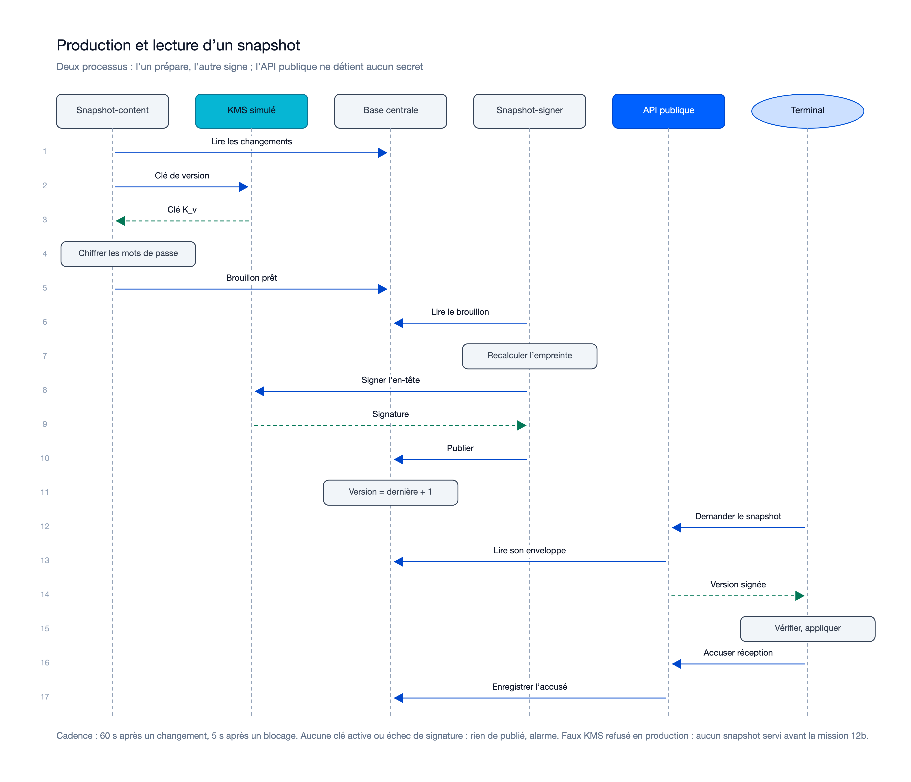
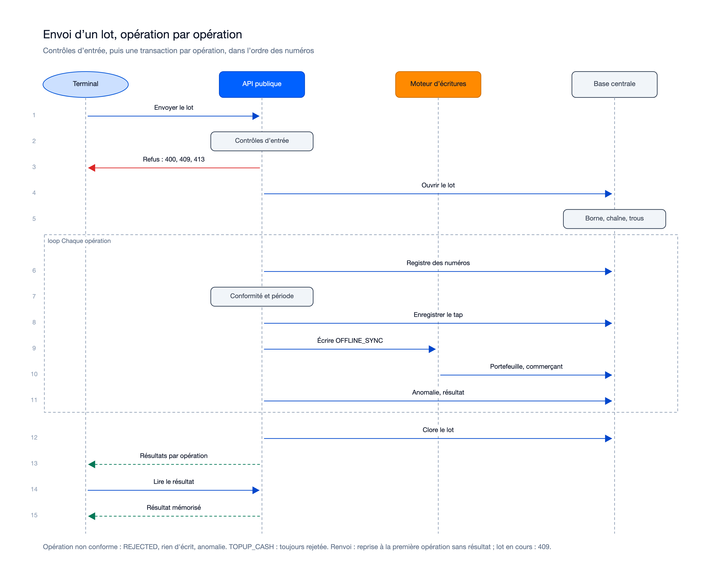
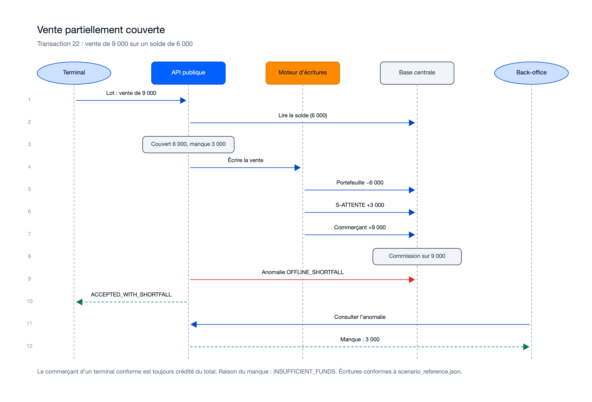
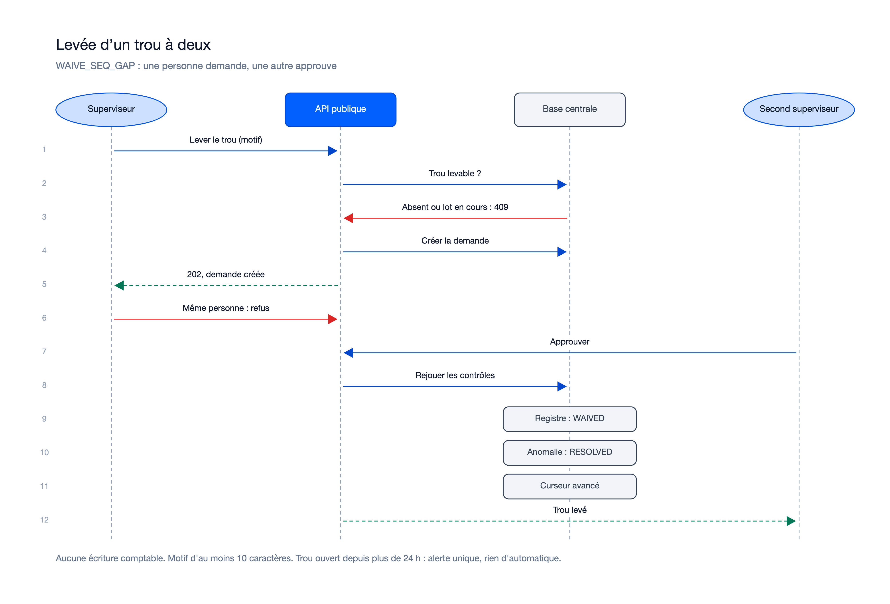

# Séquences — mission hors-ligne-snapshots-lots-01M645RN

> État : **plan finalisé le 30/10/2026** (`research.md` R-05, R-08, R-10, R-11, R-16, R-18, R-30.8, R-30.11). Flux
> **prévus**, pas encore implémentés.

## Flux internes propres à cette mission

### Production et lecture d'un snapshot

Sources : [`sequence-snapshot.excalidraw`](diagrams/sequence-snapshot.excalidraw), [`sequence-snapshot.svg`](diagrams/sequence-snapshot.svg).

### Envoi d'un lot, opération par opération

Sources : [`sequence-lot.excalidraw`](diagrams/sequence-lot.excalidraw), [`sequence-lot.svg`](diagrams/sequence-lot.svg).

### Vente partiellement couverte (transaction 22)

Sources : [`sequence-vente-partielle.excalidraw`](diagrams/sequence-vente-partielle.excalidraw), [`sequence-vente-partielle.svg`](diagrams/sequence-vente-partielle.svg).

### Levée d'un trou à deux

Sources : [`sequence-trou.excalidraw`](diagrams/sequence-trou.excalidraw), [`sequence-trou.svg`](diagrams/sequence-trou.svg).

### Points à retenir
- Snapshot : `snapshot-content` n'a aucun droit de publication ; `snapshot-signer` ne détient que le port de signature ;
  la version est calculée par la base à la publication. L'API publique ne lit que l'enveloppe du terminal appelant.
- Lot : une transaction par opération, dans l'ordre. Au quatrième échec de solde (`CL007`), rejet réessayable avec trace
  `offline_batch_retry`. Renvoi d'un lot en cours : reprise sous verrou, ou `409 BATCH_IN_PROGRESS`.
- Vente partielle : le commerçant d'un terminal conforme est crédité du total ; la commission porte sur 9 000.
- Trou : la demande et l'approbation viennent de deux `SUPERVISOR` différents ; les contrôles sont rejoués à l'approbation.
- Non dessinés : import du journal d'un terminal révoqué (même schéma que la levée de trou, avec un travailleur
  `journal-import`), alerte d'un trou de plus de 24 h (travailleur `seq-gap-age`).

## Flux transverses auxquels cette mission participe (référence, pas dupliqué)
Voir `docs/05-sequence-diagrams.md`, flux : « Vente hors ligne puis synchronisation » (§9.3 à §9.6). La mission prévoit
la partie serveur de ce flux : snapshot, lot, réconciliation. Aucune recharge espèces hors ligne dans ce flux (décision
du 30/10/2026 à reporter dans le flux global).

## Nécessaire pour cette mission ? Oui — la mission introduit des échanges entre processus (contenu, signature), KMS simulé, API, moteur d'écritures, base et terminal.
## Complet ? Oui pour le plan du 30/10/2026 (4 diagrammes relus) ; à recaler à la review sur le code livré, et à compléter par l'import de journal si le porteur le demande.
## Validé par : proposition de l'Agent, à confirmer par le porteur, le 30/10/2026
