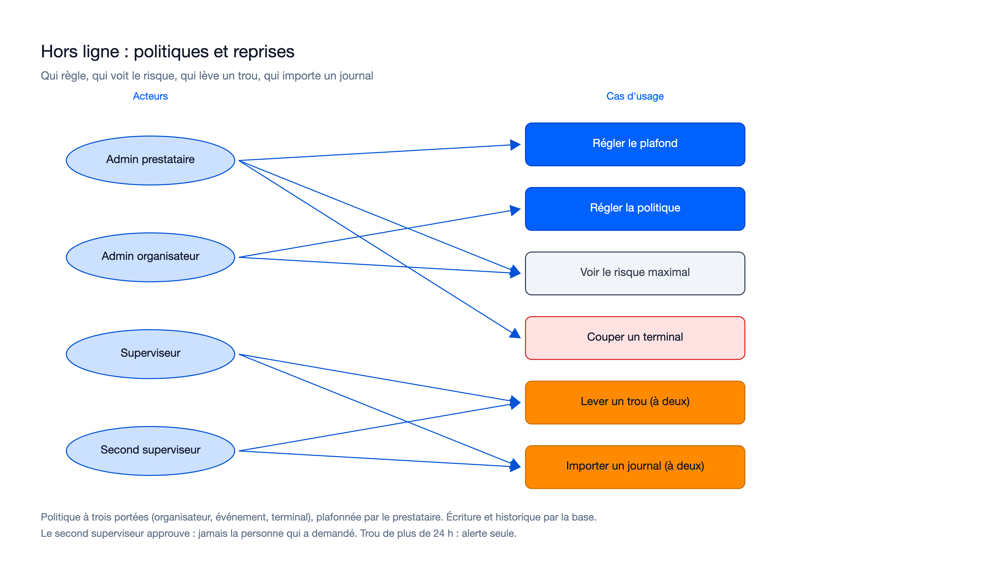
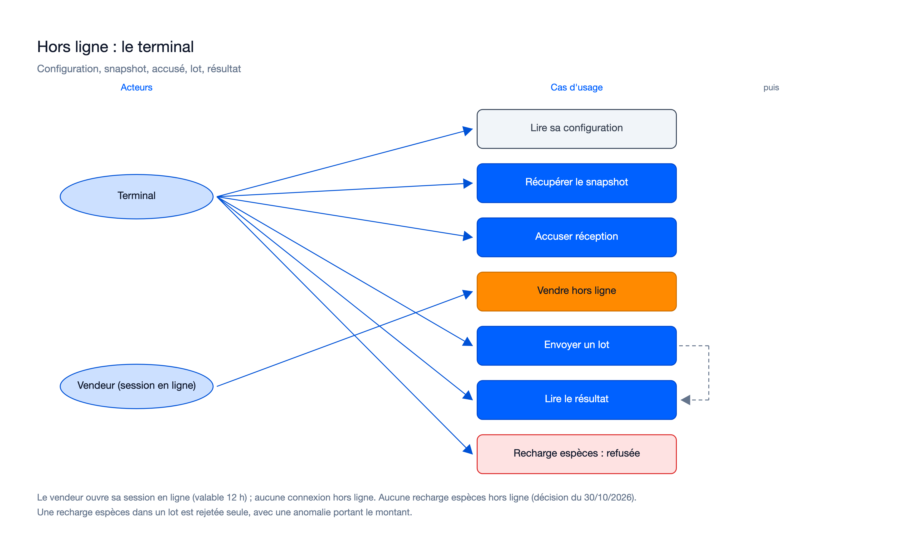

# Cas d'usage — mission hors-ligne-snapshots-lots-01M645RN

> État : **plan finalisé le 30/10/2026** (`plan.md` : `e38c1ce0` ; `research.md`, contrats et décisions du porteur :
> `8fd1e037`). Mission **prévue** par le plan, pas encore implémentée : tout ce qui suit décrit ce qui est prévu, pas
> ce qui est livré. `research.md` R-30 fait foi sur le reste.

## Cas d'usage propres à cette mission

### Back-office : politiques, plafonds, risque, reprises

Sources : [`usecase-backoffice.excalidraw`](diagrams/usecase-backoffice.excalidraw), [`usecase-backoffice.svg`](diagrams/usecase-backoffice.svg).

### Terminal : configuration, snapshot, lot, résultat

Sources : [`usecase-terminal.excalidraw`](diagrams/usecase-terminal.excalidraw), [`usecase-terminal.svg`](diagrams/usecase-terminal.svg).

| Cas d'usage | Acteur | Règle principale (prévue) | Route |
|---|---|---|---|
| Régler le plafond du prestataire | `OPERATOR_ADMIN` | Plafonne tous les niveaux ; écriture par fonction de base, historique tenu par la base (lève OP-N58) | `GET`/`PUT /operators/{operator_id}/offline-ceiling` (`contracts/openapi-additions.md`) |
| Régler la politique hors ligne | `ORGANIZER_ADMIN` (écriture), `OPERATOR_ADMIN` (lecture) | Trois portées : organisateur, événement, terminal ; version attendue (`409` sinon) ; niveau vide = hérite ; `cash_topup_offline` à vrai refusé (`422`) | `GET`/`PUT /organizers/{id}/offline-policy`, `/events/{id}/offline-policy`, `/devices/{id}/offline-policy` |
| Couper un terminal hors ligne | `OPERATOR_ADMIN` | Désactive le hors ligne d'un terminal ; effet à la prochaine configuration servie | `PUT /devices/{device_id}/offline-policy` |
| Voir le risque maximal | `ORGANIZER_ADMIN`, `OPERATOR_ADMIN` | Somme des plafonds des terminaux hors ligne de l'événement, calculée par la base | `GET /events/{event_id}/offline-risk` |
| Lire sa configuration | Terminal | Politique effective et clés de signature des snapshots (au plus deux, ECDSA P-256) | configuration du terminal (`DeviceConfig`, `contracts/snapshots.md`) |
| Récupérer le snapshot | Terminal | `FULL` ou `DELTA` de la version précédente ; mots de passe chiffrés pour ce seul terminal ; `403` si hors ligne interdit, `409` + `Retry-After` si pas prêt | `GET /offline-snapshots/current` (`contracts/snapshots.md`) |
| Accuser réception | Terminal | Version servie à ce terminal et empreinte égale, sinon `409 SNAPSHOT_VERSION_UNKNOWN` ; idempotent, ne recule jamais (lève OP-N69) | `POST /offline-snapshots/ack` |
| Vendre hors ligne | Vendeur sur terminal | Session ouverte **en ligne**, valable 12 h ; aucune connexion hors ligne ; le terminal contrôle sur sa configuration détenue | (côté terminal, mission 11a) |
| Envoyer un lot | Terminal | Jusqu'à 500 opérations et 1 Mio ; signé et chaîné ; contrôles d'entrée complets ; une transaction par opération ; un lot en vol | `POST /offline-batches` (`contracts/batches.md`) |
| Lire le résultat | Terminal | `200` terminé, `202` + `Retry-After` en cours ; résultats mémorisés rendus à l'identique | `GET /offline-batches/{batch_id}` |
| Recharge espèces hors ligne | Terminal | **Retirée** (porteur, 30/10/2026) : `TOPUP_CASH` d'un lot rejeté par opération (`OFFLINE_NOT_ALLOWED`) avec anomalie `NON_COMPLIANT_OPERATION` portant le montant ; les autres opérations passent ; garde de caisse inchangée | `POST /offline-batches` |
| Lever un trou de numéros | `SUPERVISOR` (demande), autre `SUPERVISOR` (approbation) | Motif d'au moins 10 caractères ; demande `WAIVE_SEQ_GAP` ; contrôles rejoués à l'approbation ; aucune écriture comptable ; trou de plus de 24 h : alerte seule | `POST /devices/{device_id}/seq-gaps/{seq}/waive`, puis `POST /approval-requests/{id}/approve` |
| Importer le journal d'un terminal révoqué | `SUPERVISOR` (demande), autre `SUPERVISOR` (approbation) | Terminal `REVOKED` seulement ; jusqu'à 20 lots ; signatures, empreintes et chaîne vérifiées à la demande et à l'approbation ; opération datée après la révocation rejetée | `POST /devices/{device_id}/journal-imports` (`contracts/batches.md`) |

Dettes héritées que la mission prévoit de lever : OP-N57 (version de snapshot calculée par la base), OP-N58 (politique
écrite par fonction), OP-N68, OP-N69, OP-N75, chacune avec son test de borne. Dette nommée ouverte : faux KMS jusqu'à la
mission 12b (aucun snapshot servi en production avant).

## Lien avec la synthèse globale
Contribue à : `docs/02-use-case-diagram.md`, domaine « Hors ligne » (vue terrain : « Vendre hors ligne », « Synchroniser
un lot » ; vue administration : « Régler la politique hors ligne », « Lever un trou de numéros », « Importer un journal »).

## Nécessaire pour cette mission ? Oui — la mission introduit la politique hors ligne, les snapshots, les lots, la levée de trou et l'import de journal, tous visibles par un acteur.
## Complet ? Oui pour le plan du 30/10/2026 ; à recaler à la review sur les routes et rôles réellement livrés (notamment l'accord de l'import et de la levée de trou).
## Validé par : proposition de l'Agent, à confirmer par le porteur, le 30/10/2026
