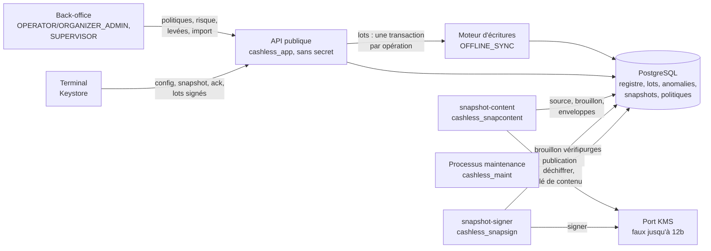

# Implementation Plan: Hors ligne : snapshots et lots

**Branch**: `feat/hors-ligne-snapshots-lots` | **Date**: 2026-10-30 | **Spec**: [spec.md](spec.md)
**Input**: `kitty-specs/hors-ligne-snapshots-lots-01M645RN/spec.md`
**Base** : `main` après les PR #8 (mission 6) et #9 (documentation), `382f188f`. Migrations jusqu'à `0042`.

**Contrat de branche** : branche courante, de planification et de fusion `feat/hors-ligne-snapshots-lots`
(`branch_matches_target = true`) ; la mission rejoint ensuite `main` par une PR, comme la 6.

## Summary

Les terminaux continuent d'encaisser sans réseau, et le serveur réconcilie leurs opérations sans double écriture ni
perte silencieuse.

- **Politique** : réglée par l'organisateur à trois portées, plafonnée par le prestataire ; risque maximal affiché ;
  écriture et historique par la base (OP-N58). **Aucune recharge espèces hors ligne** (porteur, 30/10/2026).
- **Snapshots** : préparés par le processus `snapshot-content` (ports `Decrypt` + `DataKey`) et signés par le processus
  `snapshot-signer` (port `Sign` seul) (porteur, 30/10/2026),
  une version signée par pas (`FULL` ou `DELTA` de la version précédente), 60 s / 5 s après un blocage, mots de passe
  chiffrés sous une clé par version enveloppée pour chaque terminal ; version calculée par la base (OP-N57) ; l'API
  publique ne détient aucun secret. Signature par un faux KMS refusé en production (adaptateur en 12b).
- **Lots** : contrôles d'entrée complets (signature, continuité, empreintes et chaîne recalculées), une transaction
  par opération, registre des numéros, conformité sur la configuration détenue, table de conflit, `S-ATTENTE` et
  `OFFLINE_SHORTFALL`, période, horloge, reprise après panne, trous levés à deux, import du journal d'un terminal
  révoqué.
- **Dettes levées** : OP-N57, OP-N58, OP-N68, OP-N69, OP-N75, chacune avec son test de borne.



## Technical Context

**Language/Version**: TypeScript 5.9 sur Node.js 22 LTS (API et processus, document 08) ; SQL PostgreSQL 17 (migrations, pgTAP)
**Primary Dependencies**: NestJS 11, `pg`, `canonicalize` (RFC 8785), `@cashless/tag-format` (enveloppe ECDH-ES), `node:crypto` (ECDSA P-256, AES-256-GCM, SHA-256) — tous existants ; aucune nouvelle dépendance (R-22)
**Storage**: PostgreSQL 17 — migrations `0043` à `0049` (numérotation : `contracts/interfaces.md` § 1), `post-roles.sql` ; schéma de référence et `.sql` générés inchangés
**Testing**: pgTAP (une suite par migration, droits et bornes des cinq dettes, concurrence d'inscription) ; Jest (unitaires purs : table de conflit, conformité, horloge, chaîne, empreintes avec vecteurs fixes ; intégration avec le terminal de test et la vraie base ; parcours complet ; tests minimaux §13 ; isolation ; balayage des secrets avec canari ; garde de production ; mesures sous `SKIP_LATENCY`, lancées seules) ; tests en série (base partagée)
**Target Platform**: serveur Linux ; processus nouveaux `snapshot-content`, `snapshot-signer`, `maintenance` (plus l'API publique et les existants)
**Project Type**: monorepo npm (`apps/api`, `packages/contracts`, `packages/ledger-sql`, `packages/tag-format`)
**Performance Goals**: lot de 500 opérations ≤ 60 s p95 (NFR-003) ; `FULL` de 50 000 bracelets ≤ 30 s, `DELTA` servi ≤ 2 s p95 (NFR-004) ; version ≤ 5 s après un blocage, ≤ 60 s sinon (NFR-005)
**Constraints**: aucune double écriture (NFR-001) ; tout ou rien par opération (NFR-011) ; aucune perte silencieuse (NFR-012) ; aucun secret exposé (NFR-007) ; aucun faux en production (NFR-008) ; droits (NFR-009) ; garde de caisse inchangée ; fichiers `.sql` générés jamais modifiés (C-002)
**Scale/Scope**: 44 FR, 15 NFR, 13 contraintes ; 6 opérations existantes du contrat servies et corrigées, 9 ajoutées ; 3 rôles et 3 processus nouveaux ; 5 dettes levées, 2 écarts nommés (faux de signature jusqu'à 12b ; trace `RETRY`)

## Charter Check

Aucune charte (`.kittify/charter/charter.yaml` absent) : section sans objet. En tiennent lieu `CLAUDE.md` et
`docs/SPECIFICATION.md`.

Contrôle après conception :

- **Décisions du porteur** : recharge espèces hors ligne retirée (30/10, R-02) ; exposition « non acquittée » stricte
  (30/10, R-12) ; seuils de performance confirmés (29/10) ; KMS simulé jusqu'à 12b (29/10) ; cinq dettes levées (29/10) ;
  trou de plus de 24 h = alerte seule (29/10) ; deux processus de snapshots (30/10, R-30.8) ; trace `RETRY` pour le rejet
  réessayable (30/10, R-30.11).
- **Dette nommée** (règle 3) : faux `SignPort` et clés de contenu sous faux KMS jusqu'à la mission 12b → entrée
  `POINTS_OUVERTS` (« snapshots non servis en production avant 12b »), ADR, test de borne (démarrage refusé en
  production), reports PROMPTS/PRD ; OP-N41 et OP-N73 restent ouverts. **Trace `RETRY`** (numéro sans résultat final
  admis à la clôture d'un lot, écart à I2 accepté par le porteur) : ADR, entrée `POINTS_OUVERTS`, test de borne,
  alerte à 24 h.
- **Renforcements, faits puis consignés** : empreintes et chaîne recalculées par le serveur (R-10) ; `config_id` et
  snapshot cités servis AVANT l'opération (R-12) ; numéros > 2^53−1 refusés, borne en ligne abaissée (R-14) ; deux
  clés de signature au plus (R-07) ; anomalies et clés de signature écrites par fonctions seulement (R-07, R-17) ;
  `cash_topup_offline` interdit en base (R-02) ; `CONFIRMED` exempté seulement si la transaction existe, configuration
  et snapshot cités datés et non périmés, enveloppes aux seuls terminaux `ACTIVE`, `pwd_pack_sha256` signé, tables
  nouvelles fermées et cloisonnées (R-30).
- **Contradictions signalées (§0.3)** : R-23 (12 points) et les 8 de la spec, dont la recharge espèces hors ligne
  (protocole et SPECIFICATION à mettre en accord) et la chaîne de versions de snapshot.
- **Fichiers à faire relire par une personne** (règle 4) : `post-roles.sql`, migrations 0044, 0045 et 0048, `kms/`
  (`SignPort`, faux), `snapshot-content` (chiffrement, enveloppes), `snapshot-signer`, `wrap_offline_snapshot_key`,
  `complete_offline_batch` et `offline_batch_retry`, fonction d'import.
- **Passe contradictoire** : `research-adversarial.md` (33 constats, tous suivis) ; corrections en R-30, qui font foi.
- Hors les deux écarts nommés ci-dessus, soumis au porteur, aucune décision du plan ne retire, n'élargit ni ne reporte
  un contrôle.

## Project Structure

### Documentation (this mission)

```
kitty-specs/hors-ligne-snapshots-lots-01M645RN/
├── plan.md
├── research.md
├── research-adversarial.md   # passe contradictoire
├── data-model.md
├── quickstart.md
├── contracts/
│   ├── snapshots.md          # production, en-tête, contenu, enveloppe, service, accusé
│   ├── batches.md            # contrôles d'entrée, traitement, reprise, trous, import
│   ├── compliance.md         # conformité, période, temps, table de conflit
│   ├── database-rights.md    # retraits, accords, rôles nouveaux
│   └── openapi-additions.md  # opérations ajoutées et corrections
└── tasks.md                  # créé par /spec-kitty.tasks
```

### Source Code (repository root)

```
packages/ledger-sql/
├── migrations/0043 à 0049                    # numérotation et contenu : contracts/interfaces.md § 1
├── post-roles.sql                           # retraits, rôles cashless_snapcontent, cashless_snapsign, cashless_maint, défaut global
└── tests/tests_offline_policy.sql, tests_offline_snapshots.sql, tests_offline_batches.sql,
    tests_offline_anomalies.sql, tests_offline_rights.sql, _grants_for_tests.sql (+ suites existantes adaptées)

packages/contracts/openapi.yaml, src/, dart/
packages/tag-format/src/device-envelope.ts   # AAD CASHLESS/SNAPKEY/v1, vecteurs

apps/api/src/
├── offline/policy/          # routes de politique, risque
├── offline/snapshots/       # service et accusé (lecture seule)
├── offline/batches/         # contrôleur, contrôles d'entrée, signature, chaîne, processeur d'opération, reprise
├── offline/rules/           # conformité, exposition, période, horloge, table de conflit (fonctions pures)
├── offline/seq/             # WAIVE_SEQ_GAP, route de levée
├── offline/journal/         # DEVICE_JOURNAL_IMPORT
├── offline/anomalies/       # écrivain d'anomalies (fonction de la base)
├── snapshots-content/       # contenu, chiffrement, enveloppes (processus snapshot-content)
├── snapshots-signer/        # vérification, signature, publication ; alerte des trous (processus snapshot-signer)
├── kms/                     # SignPort, faux, capacité sign
├── payments/device-seq-registry.ts, idempotency/device-key.ts, media/taps/tap.service.ts,
│   reversals/, ledger/ (coveredCap, shortfall), devices/config/, devices/heartbeat/
├── device-identity/device-maintenance.ts → processus maintenance
├── offline/journal/ (travailleur journal-import de l'API)
├── main.snapshot-content.ts, main.snapshot-signer.ts, main.maintenance.ts, processes/*.module.ts
└── config/config.ts         # DATABASE_URL_SNAPCONTENT, DATABASE_URL_SNAPSIGN, DATABASE_URL_MAINT, OFFLINE_BATCH_POOL_SIZE

apps/api/test/
├── unit/offline/            # table de conflit, conformité, exposition, horloge, chaîne, empreintes (vecteurs)
├── integration/offline/     # politiques, snapshots, lots, trous, import, droits
└── integration/end-to-end/  # offline-journey, offline-isolation, offline-secrets, offline-latency,
                             # snapshot-latency, offline-concurrency, offline-protocol-minimal (§13)
```

**Structure Decision**: monorepo existant ; un dossier `offline/` dans l'API pour les routes, un dossier
`snapshots-content/` et `snapshots-signer/` pour les deux processus, une migration par thème.

## Complexity Tracking

| Écart à la simplicité | Pourquoi | Alternative plus simple écartée |
|---|---|---|
| Deux processus et rôles dédiés aux snapshots | L'API publique ne lit ni ne signe ; aucun processus ne cumule déchiffrement et signature (porteur) | Production dans l'API publique ; un seul processus |
| Versions en chaîne (une par pas) | Un artefact signé par version sans port de signature dans l'API | `DELTA` composé à la demande |
| Clé de contenu par version, enveloppée par terminal à la production | « Propre à la version », aucun secret dans l'API | Une clé par grand livre |
| Journal des bracelets par version | Juger une opération sur le snapshot qu'elle cite | Juger sur l'état courant |
| Verrou consultatif de session (pool dédié) pour la reprise d'un lot | Reprise sans attendre l'abandon de 15 min | Attendre l'abandon |
| Trace `RETRY` en base | Rejet réessayable du protocole sans perdre la trace d'un numéro (porteur) | Absence de ligne |
| Rôle de maintenance | OP-N75 | Purges par l'API publique |

## Implementation Concern Map

### IC-01 — Politique hors ligne (base)

- **Purpose**: écriture contrôlée des politiques et plafonds, historique par la base, espèces hors ligne interdites,
  risque maximal.
- **Relevant requirements**: FR-001 à FR-005, FR-027, OP-N58 (FR-041), NFR-009, NFR-010, NFR-014
- **Affected surfaces**: `migrations/0043_offline_policy.sql`, `post-roles.sql`, `tests/tests_offline_policy.sql`,
  `tests_definer_trigger_writers.sql`
- **Sequencing/depends-on**: none
- **Risks**: lignes existantes avec `cash_topup_offline = true` (migration les remet à faux avant la contrainte, et le
  dit) ; `log_offline_policy` DEFINER ne contourne pas la RLS de la ligne source.

### IC-02 — Politique hors ligne (API et contrat)

- **Purpose**: neuf opérations du contrat (plafond, trois portées, risque), rôles, `422` espèces, concurrence
  optimiste, configuration servie (`snapshot_keys`, `latest_snapshot_version`).
- **Relevant requirements**: FR-001 à FR-005, FR-042, FR-043, NFR-010
- **Affected surfaces**: `apps/api/src/offline/policy/`, `devices/config/`, `devices/heartbeat/`, `packages/contracts/`
- **Sequencing/depends-on**: IC-01, IC-13
- **Risks**: cloisonnement prestataire/organisateur (`404` neutre) ; `capped` limité aux montants.

### IC-03 — Snapshots (base)

- **Purpose**: inscription par la base (version calculée, chaîne), contenu, état, journal des bracelets, enveloppes,
  rotation et borne des clés de signature, lectures pour le terminal.
- **Relevant requirements**: FR-006, FR-007, FR-009 à FR-011, OP-N57, NFR-006, NFR-009
- **Affected surfaces**: `migrations/0044_offline_snapshots.sql`, `tests/tests_offline_snapshots.sql`
- **Sequencing/depends-on**: none
- **Risks**: verrou consultatif avant la lecture du maximum ; en-tête recalculé identique à celui signé ; purge sans
  casser un `DELTA` servi ; volume de `offline_snapshot_entry`.

### IC-04 — Port de signature et faux

- **Purpose**: `SignPort`, capacité `sign`, clé `ECC_NIST_P256`, faux déterministe, garde de production, rotation par
  `key-admin`.
- **Relevant requirements**: FR-009, FR-037, NFR-008
- **Affected surfaces**: `apps/api/src/kms/`, `processes/bootstrap.ts`, `main.key-admin.ts`, tests de garde
- **Sequencing/depends-on**: none
- **Risks**: même clé vue par `key-admin` et `snapshots` (faux déterministe) ; signature DER.

### IC-05 — Contenu des snapshots (processus `snapshot-content`)

- **Purpose**: processus `snapshot-content` (rôle `cashless_snapcontent`, `DecryptPort` + `DataKeyPort`), boucle 1 s,
  détection incrémentale avec recouvrement, `FULL`/`DELTA`/version de maintien, chiffrement par version,
  `pwd_pack_sha256`, enveloppes (`ACTIVE`, empreinte de clé d'accord), brouillon non signé, purge du contenu.
- **Relevant requirements**: FR-007, FR-008, FR-010, NFR-004, NFR-005, NFR-007, NFR-010, FR-043
- **Affected surfaces**: `apps/api/src/snapshots-content/`, `main.snapshot-content.ts`, `processes/`,
  `config/config.ts`, `packages/tag-format/src/device-envelope.ts`
- **Sequencing/depends-on**: IC-03, IC-04, IC-08 (historique du portefeuille)
- **Risks**: effacement des clés en mémoire ; aucun mot de passe en clair dans les journaux ; calcul hors transaction,
  inscription par paquets ; tous les prestataires (une transaction par prestataire) ; mesures 30 s / 5 s.

### IC-15 — Signature et publication (processus `snapshot-signer`)

- **Purpose**: processus `snapshot-signer` (rôle `cashless_snapsign`, `SignPort` seul) : relit le brouillon,
  recalcule l'empreinte, signe, publie par `publish_offline_snapshot` ; alarme sans clé `ACTIVE` ; travailleur
  `seq-gap-age` (trous et numéros `RETRY` de plus de 24 h).
- **Relevant requirements**: FR-006, FR-009, FR-034, FR-037, NFR-006, NFR-008, FR-043
- **Affected surfaces**: `apps/api/src/snapshots-signer/`, `main.snapshot-signer.ts`, `processes/`
- **Sequencing/depends-on**: IC-03, IC-04, IC-05
- **Risks**: le signataire ne signe jamais un brouillon dont l'empreinte ne se recalcule pas ; budget 5 s partagé
  entre les deux processus.

### IC-06 — Service des snapshots (API)

- **Purpose**: `getOfflineSnapshot` (chaîne de versions, enveloppe du seul appelant, `403`, `409` pas prêt, gzip),
  `ackOfflineSnapshot`.
- **Relevant requirements**: FR-011, FR-012 (aucun secret de vendeur), NFR-004, NFR-007, NFR-010, FR-043
- **Affected surfaces**: `apps/api/src/offline/snapshots/`
- **Sequencing/depends-on**: IC-03, IC-10
- **Risks**: corps mis en cache par version, enveloppe hors cache ; terminal révoqué, suspendu ou interdit ; `403
  SNAPSHOTS_UNAVAILABLE` sans clé `ACTIVE`.

### IC-07 — Lots : réception, chaîne, reprise

- **Purpose**: contrôleur, lecture brute et numéros, contrôles d'entrée, signature, empreintes et chaîne recalculées,
  `open_offline_batch`/`complete_offline_batch` (migration), verrou de reprise, lecture du résultat.
- **Relevant requirements**: FR-013 à FR-017, FR-029, FR-030, FR-033, FR-043, NFR-001, NFR-002, NFR-010, NFR-013
- **Affected surfaces**: `apps/api/src/offline/batches/`, `payments/device-seq-registry.ts`, `idempotency/device-key.ts`,
  `migrations/0045_offline_batches.sql`, `test/support/test-terminal.ts`
- **Sequencing/depends-on**: IC-03 (snapshot cité), IC-13
- **Risks**: `complete_offline_batch` (relecture humaine) ; reprise sans double traitement ; vecteurs 5b inchangés.

### IC-08 — Anomalies, historique du portefeuille

- **Purpose**: colonnes d'anomalie, `open_offline_anomaly`, `reduce_offline_shortfall`, alerte marquée,
  `wallet_status_history`, retrait de l'`INSERT` direct (chemin `CLOCK_SKEW` en ligne adapté).
- **Relevant requirements**: FR-020, FR-021, FR-023, FR-031, FR-034, FR-043
- **Affected surfaces**: `migrations/0046_offline_anomalies.sql`, `apps/api/src/offline/anomalies/`,
  `payments/payments.service.ts`
- **Sequencing/depends-on**: none
- **Risks**: idempotence des anomalies sur rejeu ; déclencheur sur `wallet` (table chaude).

### IC-09 — Traitement des opérations : conformité, conflit, écritures

- **Purpose**: processeur d'opération (§7.1), conformité sur la configuration détenue, exposition, période, horloge,
  table de conflit, moteur (`coveredCap`, `shortfall`), annulation hors ligne, `TOPUP_CASH` rejeté, `CL007`, sonde.
- **Relevant requirements**: FR-016, FR-018 à FR-026, FR-028, FR-036, FR-044, NFR-010, NFR-011, NFR-012, NFR-014
- **Affected surfaces**: `apps/api/src/offline/rules/`, `offline/batches/offline-operation.processor.ts`, `ledger/`,
  `reversals/`, `media/taps/tap.service.ts`
- **Sequencing/depends-on**: IC-07, IC-08, IC-10
- **Risks**: transaction 22 identique au scénario ; ordre des verrous (terminal d'abord) ; aucune réponse `409` HTTP
  pour une opération.

### IC-10 — Terminal et vendeur datés (base)

- **Purpose**: `ack_offline_snapshot`, `set_device_station_name`, `device_status_at`, `assert_vendor_session_at`,
  `record_sale_attribution_at`, `offline_media_state_at`.
- **Relevant requirements**: FR-011, FR-012, FR-022, FR-039
- **Affected surfaces**: `migrations/0047_offline_device_vendor.sql`, tests
- **Sequencing/depends-on**: IC-03
- **Risks**: verrou du terminal pris en premier (règle de 0023).

### IC-11 — Trous et import de journal

- **Purpose**: `WAIVE_SEQ_GAP` (pré-contrôle, action, route), `DEVICE_JOURNAL_IMPORT` (création vérifiée, table,
  approbation, traitement par le processeur).
- **Relevant requirements**: FR-031 à FR-033, FR-035, FR-043, NFR-010
- **Affected surfaces**: `apps/api/src/offline/seq/`, `offline/journal/`, `migrations/0045_offline_batches.sql`
- **Sequencing/depends-on**: IC-07, IC-09
- **Risks**: import une seule fois ; pas d'élargissement de droits ; taille bornée.

### IC-12 — Droits hérités et rôles

- **Purpose**: défaut global (OP-N68) et adaptation des 34 suites, `UPDATE` de `device` retiré (OP-N69), rôle et
  processus `maintenance` (OP-N75), rôles `cashless_snapcontent` et `cashless_snapsign`, listes figées.
- **Relevant requirements**: FR-038 à FR-041, NFR-009, C-006
- **Affected surfaces**: `post-roles.sql`, `migrations/0048_rights_hardening.sql`, `tests/*.sql`,
  `apps/api/src/device-identity/device-maintenance.ts`, `main.maintenance.ts`, `config/config.ts`
- **Sequencing/depends-on**: IC-01, IC-03 (listes de fonctions) ; à faire tôt pour le défaut global
- **Risks**: suites pgTAP cassées par le défaut global ; secret de connexion de plus (ADR-125).

### IC-13 — Contrat d'API

- **Purpose**: opérations ajoutées, corrections, types régénérés, messages.
- **Relevant requirements**: FR-042
- **Affected surfaces**: `packages/contracts/openapi.yaml`, `src/`, `dart/`, `apps/api/src/http/messages.*.json`
- **Sequencing/depends-on**: none
- **Risks**: cohérence TS/Dart générés.

### IC-14 — Preuves de bout en bout, CI et consignation

- **Purpose**: parcours complet, tests minimaux §13, isolation, balayage des secrets avec canari, concurrence (100
  rejeux, 50 lots concurrents), mesures ; CI ; levée des cinq dettes, dette du faux de signature, ADR, reports
  PROMPTS/PRD (recharge espèces hors ligne retirée), documentation. Tests §13-4 et §13-5 (bascule `EDGE`) reportés en
  mission 8.
- **Relevant requirements**: SC-001 à SC-012, NFR-001 à NFR-015, FR-041, FR-044
- **Affected surfaces**: `apps/api/test/integration/end-to-end/`, `.github/workflows/`, `apps/api/jest.config.cjs`,
  `docs/`
- **Sequencing/depends-on**: tous les autres
- **Risks**: base partagée (tests en série) ; horloge Docker (aucune comparaison d'horloge Node/base) ; jeu de 50 000
  bracelets généré en SQL.
