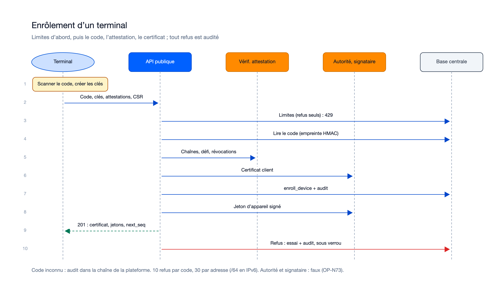
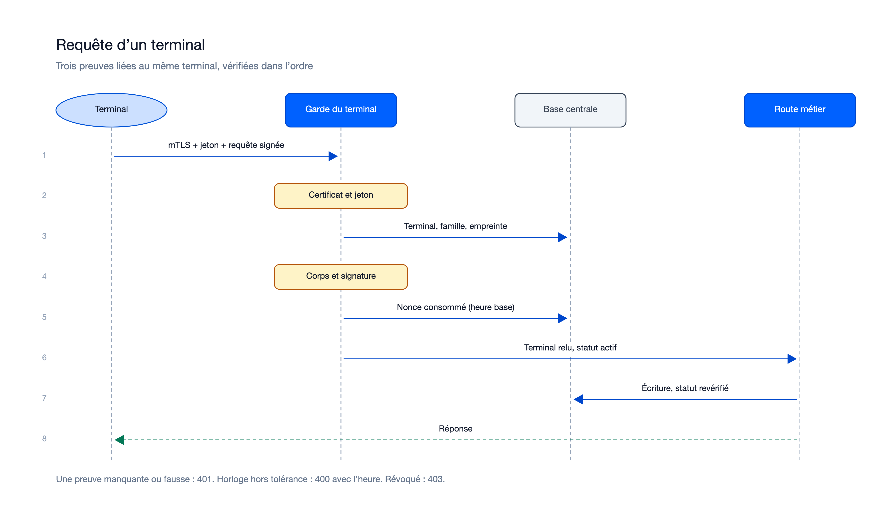
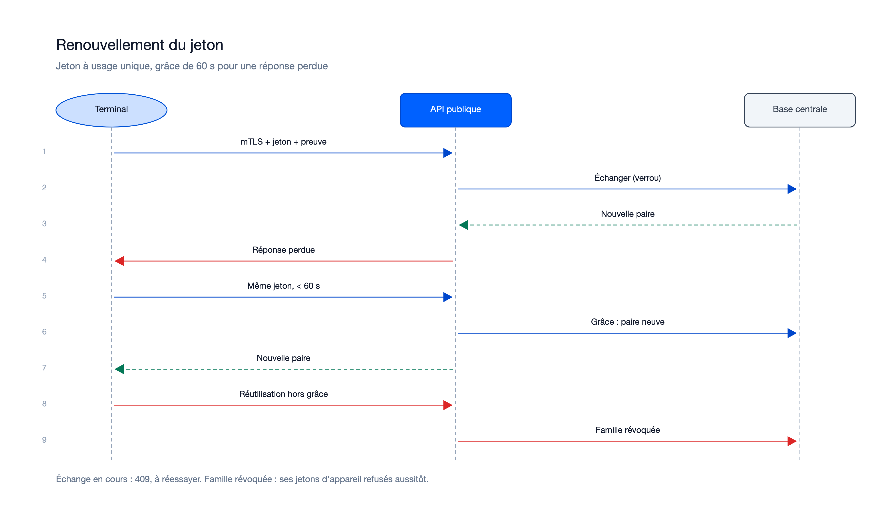
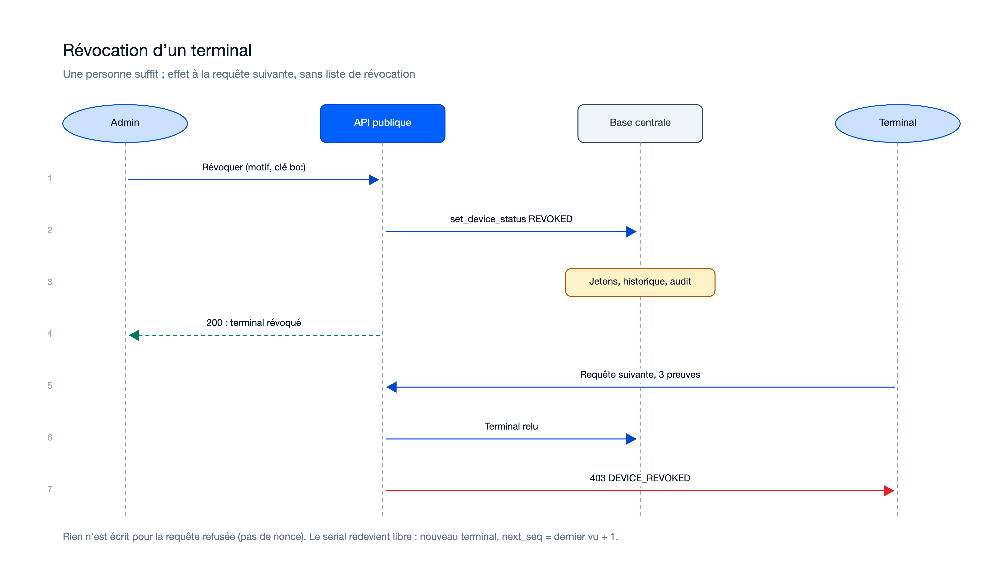

# Séquences — mission identite-enrolement-terminaux-01M52R6H

> État : **mergée** le 21/10/2026 (18/18 lots ; acceptée et fusionnée dans `feat/identite-enrolement-terminaux`). Diagrammes refaits le
> 21/10/2026 d'après le code livré (`enrollment.service.ts`, `real-device-identity.ts`, `refresh.service.ts`,
> `device-admin.controller.ts`).

## Flux internes propres à cette mission

### Enrôlement d'un terminal

Sources : [`sequence-enrolement.excalidraw`](diagrams/sequence-enrolement.excalidraw), [`sequence-enrolement.svg`](diagrams/sequence-enrolement.svg).

Changé depuis le plan : les limites sont lues avant tout (un corps invalide au-delà reçoit aussi `429`) ; tout refus
écrit son essai et son audit ensemble, sous verrou, hors de la transaction annulée (0027, 0030) ; une réussite écrit
`DEVICE_ENROLLED` dans la transaction de l'enrôlement ; le jeton d'appareil est signé avant la validation.

### Requête d'un terminal (trois preuves)

Sources : [`sequence-requete-terminal.excalidraw`](diagrams/sequence-requete-terminal.excalidraw), [`sequence-requete-terminal.svg`](diagrams/sequence-requete-terminal.svg).

Changé depuis le plan : étape 6 bis (révoqué → `403 DEVICE_REVOKED` sans nonce, ADR-115) ; `@authority` contrôlée
(`DEVICE_REQUEST_AUTHORITIES`) ; suspendu refusé après le nonce, sauf configuration et présence (`allowSuspended`).

### Renouvellement du jeton

Sources : [`sequence-rafraichissement.excalidraw`](diagrams/sequence-rafraichissement.excalidraw), [`sequence-rafraichissement.svg`](diagrams/sequence-rafraichissement.svg).

Changé depuis le plan : ni compte ni jeton d'appareil ; terminal retrouvé par son `serial` et l'empreinte du
certificat présenté ; nonce consommé avant l'échange ; `403` pour un terminal suspendu ou révoqué.

### Révocation d'un terminal

Sources : [`sequence-revocation.excalidraw`](diagrams/sequence-revocation.excalidraw), [`sequence-revocation.svg`](diagrams/sequence-revocation.svg).

Diagrammes produits par [`diagrams/generate.py`](diagrams/generate.py) (rendu du skill `/illustre`, police sans-serif),
relus après rendu.

## Flux transverses auxquels cette mission participe (référence, pas dupliqué)
Voir `docs/05-sequence-diagrams.md`, flux « Enrôlement et requête signée d'un terminal » (vue d'ensemble) et
« Paiement en ligne par bracelet » : la demande de mot de passe et la lecture passent désormais par les trois preuves.

## Nécessaire pour cette mission ? Oui — enrôlement, authentification de chaque requête, rafraîchissement et révocation sont des échanges entre terminal, API, base et ports.
## Complet ? Oui — les quatre flux suivent l'ordre des contrôles du code livré.
## Validé par : Agent, par délégation du porteur (21/10/2026)
