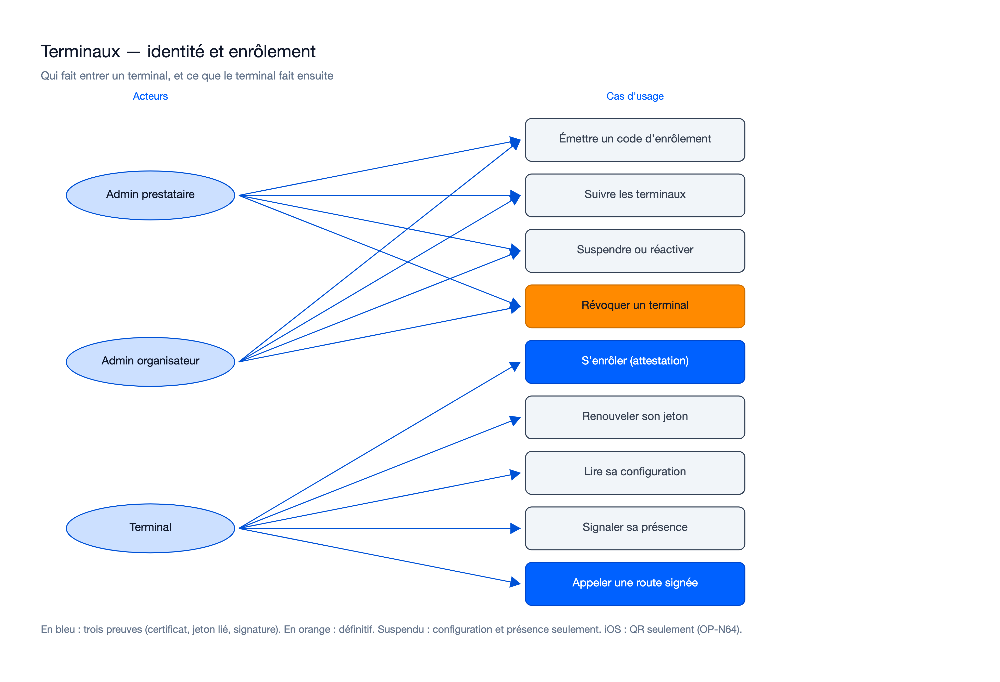

# Cas d'usage — mission identite-enrolement-terminaux-01M52R6H

> État : **mergée** le 21/10/2026 (18/18 lots ; acceptée et fusionnée dans `feat/identite-enrolement-terminaux`). Rédigé au plan le
> 19/10/2026, recalé le 21/10/2026 sur le code de la lane finale (`lane-r`, WP01 à WP18).

## Cas d'usage propres à cette mission

Sources : [`usecase-terminaux.excalidraw`](diagrams/usecase-terminaux.excalidraw), [`usecase-terminaux.svg`](diagrams/usecase-terminaux.svg).

| Cas d'usage | Acteur | Règle principale (telle que livrée) | Route |
|---|---|---|---|
| Émettre un code d'enrôlement | `OPERATOR_ADMIN` (tout le prestataire), `ORGANIZER_ADMIN` (événements de ses organisateurs) | Événement obligatoire ; choix « téléphone personnel » obligatoire (KEYPAD_TPE seulement) ; `PAIRED_TPE` refusé ; 24 h par défaut (5 min à 7 jours) ; code affiché une seule fois (rejeu de la clé : `409` sans le code) | `POST /device-enrollment-codes` |
| Lister les codes en cours | idem | Aucun code ni empreinte dans la réponse | `GET /device-enrollment-codes` |
| Suivre les terminaux | idem ; « tout le prestataire » exige un `OPERATOR_ADMIN` de portée prestataire | Liste filtrée et fiche avec historique des statuts, sans aucun secret | `GET /devices`, `GET /devices/{id}` |
| Suspendre ou réactiver | idem, une seule personne | Motif obligatoire, idempotent (`bo:`), historique et audit ; suspendu : configuration et présence seulement | `POST /devices/{id}/suspend`, `…/reactivate` |
| Révoquer un terminal | idem, une seule personne | Définitif ; familles de jetons révoquées ; requête suivante → `403 DEVICE_REVOKED` (ADR-115) ; `serial` libre | `POST /devices/{id}/revoke` |
| S'enrôler (attestation) | Terminal | Sans compte ; limites lues d'abord (10 refus par code, 30 par adresse ou /64, par heure) ; Android 12+ (deux clés attestées) ; iOS par App Attest (clé de signature non attestée, OP-N64) ; tout refus audité (ADR-117) | `POST /device-enrollments` |
| Renouveler son jeton | Terminal | Certificat client + jeton de rafraîchissement + preuve signée ; usage unique, grâce de 60 s (OP-N65) ; `409` pendant un échange ; suspendu ou révoqué : `403` | `POST /device-tokens/refresh` |
| Lire sa configuration | Terminal | Trois preuves ; permis à un terminal suspendu ; `ETag` (JCS hors `server_time`), `304` | `GET /device/config` |
| Signaler sa présence | Terminal | Trois preuves ; permis à un terminal suspendu ; aucun numéro de séquence consommé | `POST /device/heartbeat` |
| Appeler une route signée | Terminal (et personne au guichet) | Certificat, jeton lié et signature ensemble sur toute route de terminal, dont celles de la mission 4 ; au guichet, jeton de la personne dans `X-Staff-Authorization` (ADR-113) | toutes les routes `deviceMtls` |

Les dettes de base héritées de la mission 4 (OP-N44, N50, N54, N59, N62, N63) n'introduisent pas de cas d'usage :
elles durcissent ceux qui existent. Elles sont levées, ainsi qu'OP-N42, OP-N70 et OP-N71.

Écarts au plan visibles côté cas d'usage :
- événement obligatoire sur un code (décision du 19/10, analyse U1) ; la story 1 de `spec.md` dit encore
  « éventuellement lié à un événement », contre FR-001 et son scénario 5 (le code suit FR-001) ;
- route de liste des codes servie (prévue au contrat, absente du tableau du plan) ;
- terminal révoqué : `403 DEVICE_REVOKED` après des preuves valides, et non `401` (ADR-115) ;
- guichet : jeton de la personne dans `X-Staff-Authorization` (ADR-113) ;
- une autre personne qui reprend la même clé d'idempotence reçoit `409` (ADR-116).

## Lien avec la synthèse globale
Contribue à : `docs/02-use-case-diagram.md`, domaine « Terminaux » (vue administration : « Enrôler un terminal »,
« Suspendre ou révoquer un terminal » ; vue terrain : « S'enrôler et s'authentifier »).

## Nécessaire pour cette mission ? Oui — la mission introduit l'enrôlement, le cycle de vie d'un terminal et ses appels authentifiés.
## Complet ? Oui — recalé sur les 8 routes servies et les décisions ADR-113, ADR-115 à ADR-117.
## Validé par : Agent, par délégation du porteur (21/10/2026)
