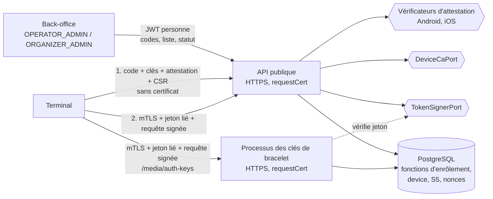

# Implementation Plan: Identité et enrôlement des terminaux

**Branch**: `feat/identite-enrolement-terminaux` | **Date**: 2026-10-19 | **Spec**: [spec.md](spec.md)
**Input**: `kitty-specs/identite-enrolement-terminaux-01M52R6H/spec.md`
**Base** : missions `fondations-grand-livre-01M4AY8M` (NestJS 11, `TenantTx`, idempotence et routes `transient`,
problem+json, migrations, CI `ledger-tests`), `identite-roles-double-validation-01M4DNDN` (personnes, rôles et portées,
audit chaîné, `post-roles.sql`), `configuration-parties-evenements-01M4GCJ9` (événements, points de vente,
`terminal_settings`, `effective_offline_policy`) et `bracelets-nfc-01M4TD3W` (`DeviceIdentityPort`, `DeviceGuard`,
`@DeviceAuth()`, quatre processus, ports KMS, garde « aucun faux en production », migrations jusqu'à `0020`).

**Contrat de branche** : branche courante, de planification et de fusion `feat/identite-enrolement-terminaux` ; elle
correspond à la cible (`branch_matches_target = true`).

## Summary

La mission donne au terminal une identité réelle et lève les dettes de sécurité de la base héritées de la mission 4.

Un terminal entre par un code d'enrôlement à usage unique. Il prouve par attestation (Android Key Attestation, iOS App
Attest) que son app est intacte et que ses clés publiques sont les siennes. Il reçoit alors un certificat client signé
par l'autorité des terminaux, un jeton d'appareil lié à sa clé et un jeton de rafraîchissement à rotation. Ensuite,
**chaque requête de terminal porte trois preuves liées au même terminal** (décision du porteur, 19/10/2026) :

1. le certificat client, vérifié **dans le processus Node** (décision du porteur au plan : aucun en-tête de répartiteur
   n'est cru) et égal à l'empreinte enregistrée ;
2. le jeton d'appareil (JWT ES256, 15 min, claim `cnf` = empreinte de la clé de signature) ;
3. la signature du contenu de la requête (profil restreint de RFC 9421, ECDSA P-256), avec horodatage et nonce à
   usage unique.

L'implémentation réelle remplace le faux derrière le port `DeviceIdentityPort` de la mission 4 : aucune route de
terminal existante ne change (SC-007). Le statut, le prestataire et l'affectation restent relus en base à chaque
requête, ce qui rend la suspension et la révocation immédiates sans liste de révocation.

La clé de l'autorité des terminaux et la clé de signature des jetons sont derrière des ports, avec des faux pour les
tests ; comme pour le KMS (OP-N11), la garde refuse le démarrage en production tant que les adaptateurs réels manquent.

Côté base, les règles d'enrôlement (code consommé une fois, `serial` unique parmi les non révoqués, `next_seq`, clé
d'accord écrite une seule fois) sont dans des fonctions `SECURITY DEFINER` ; les six dettes de base sont levées par
migrations, générateur de la suite de référence et `post-roles.sql`.



## Technical Context

**Language/Version**: TypeScript 5.x sur Node.js 22 (API) ; SQL PostgreSQL 17 (migrations, pgTAP) ; Python 3 (générateur `gen_tests.py` de la suite de référence)
**Primary Dependencies**: NestJS 11, `pg`, `jose` 6 (existants : JWT ES256, JWK thumbprint) ; `node:crypto` et `node:https` (X.509, ECDSA, TLS client) ; nouvelles, épinglées : `@peculiar/x509@2.1.0` (CSR, émission de certificats), `@peculiar/asn1-android@2.10.0` (extension KeyDescription) avec chaque `@peculiar/asn1-*` fixé en `2.10.0` et `asn1js@3.0.10` par `overrides`, `cbor2@2.3.0` (objet d'attestation App Attest), `structured-headers@2.1.0` (RFC 8941) — examen en R-12, passe contradictoire en R-15
**Storage**: PostgreSQL 17 — schéma de référence inchangé (index du `serial` remplacé par migration, ADR-109) ; migrations `0021` à `0025` ; `post-roles.sql` (OP-N44, OP-N59, OP-N63) ; suite de référence régénérée par `gen_tests.py`
**Testing**: pgTAP (nouvelles suites par migration, bornes inversées de `tests_definer_trigger_writers.sql` §4, `tests_tag_key_job_approval.sql` §6 et §7, `tests_media_claim_tap.sql`), Jest (unitaires, intégration HTTPS réelle avec mTLS sur vraie base, architecture, garde de production) ; terminal de test (`apps/api/test/support/test-terminal.ts`) qui produit clés, attestations Android et iOS de test, CSR et requêtes signées ; tests en série (base partagée)
**Target Platform**: serveur Linux ; processus HTTP en TLS de bout en bout (répartiteur en passage TCP en production) ; terminaux Android 12+ (KeyMint : clés de signature et d'accord matérielles et attestées, décision du porteur) et iOS 14+ (App Attest)
**Project Type**: monorepo npm (`apps/api`, `packages/contracts`, `packages/ledger-sql`, `packages/tag-format`)
**Performance Goals**: vérification des trois preuves ≤ 20 ms ajoutés au p95 ; enrôlement p95 ≤ 1 s ; configuration et battement de cœur p95 ≤ 200 ms (NFR-009)
**Constraints**: aucune preuve seule ne suffit (NFR-002) ; révocation effective à la requête suivante (NFR-003) ; aucun rejeu (NFR-004) ; aucun code ni jeton en clair au repos (NFR-005) ; aucun faux en production (NFR-001) ; fichiers `.sql` générés du kit jamais modifiés à la main (C-002) ; tout écart qui affaiblit la sécurité soumis au porteur (C-011)
**Scale/Scope**: 26 FR, 11 NFR, 12 contraintes ; 5 opérations de contrat existantes servies, 6 ajoutées (back-office des terminaux) ; 7 dettes levées (OP-N42, N44, N50, N54, N59, N62, N63), 2 limites nouvelles consignées (OP-N64/ADR-106, OP-N65/ADR-108)

## Charter Check

Aucune charte dans le projet (`.kittify/charter/charter.yaml` absent) : section sans objet. Les règles qui en tiennent
lieu sont `CLAUDE.md` (sources normatives, §0.3, fichiers générés, écarts de sécurité) et `docs/SPECIFICATION.md`.

Contrôle après conception :

- Contradiction signalée (§0.3) : §10.3 et `openapi.yaml` disent « jeton OU mTLS » ; la mission exige les trois preuves
  (OP-N42, décision du porteur). C'est un renforcement : le contrat est mis à jour (R-02), consigné en ADR-107.
- Écart qui affaiblit la sécurité, soumis au porteur et accepté le 19/10/2026 : sur iOS, la non-exportabilité de la clé
  de signature n'est pas prouvée (R-06). Consigné : OP-N64, ADR-106, test de borne (iOS sans NFC ni mot de passe de
  bracelet), report dans `PROMPTS-A-ENVOYER.md` et `PRD.md` (mission 12).
- Écart qui affaiblit légèrement la sécurité, soumis au porteur et accepté le 19/10/2026 : grâce de 60 s pour un jeton
  de rafraîchissement représenté par le même terminal (R-07). Consigné : OP-N65, ADR-108, test de borne (seconde
  représentation, plus de 60 s ou autre certificat → famille révoquée).
- Écart au schéma de référence, renforcement décidé par le porteur : `serial` unique par prestataire (R-11, ADR-109),
  signalé selon §0.3.
- Passe contradictoire faite (R-15) : 3 constats bloquants et 10 importants corrigés dans la recherche et les contrats.
- Aucune autre décision du plan ne retire, n'élargit ni ne reporte un contrôle.

## Project Structure

### Documentation (this mission)

```
kitty-specs/identite-enrolement-terminaux-01M52R6H/
├── plan.md
├── research.md
├── data-model.md
├── quickstart.md
├── contracts/
│   ├── device-authentication.md   # trois preuves, profil de signature, garde, ordre des contrôles
│   ├── enrollment.md              # codes, défi, attestation Android et iOS, CSR, fonction d'enrôlement
│   ├── device-tokens.md           # jeton d'appareil, rafraîchissement à rotation, familles
│   ├── device-lifecycle.md        # suspension, réactivation, révocation, configuration, battement de cœur
│   ├── database-debts.md          # OP-N44, N50, N54, N59, N62, N63 : correction et test de chacune
│   └── openapi-additions.md       # routes et schémas ajoutés ou modifiés au contrat
└── tasks.md                       # créé par /spec-kitty.tasks
```

### Source Code (repository root)

```
packages/ledger-sql/
├── migrations/0021_definer_search_path.sql   # OP-N59 : search_path = public, pg_temp sur toutes les SECURITY DEFINER
├── migrations/0022_device_enrollment.sql     # S5 : device_enrollment_code, device_refresh_token, device_request_nonce,
│                                             #      device_status_history, colonnes de device, enroll_device, set_device_status
├── migrations/0023_consume_tap_claim.sql     # OP-N50 : consume_tap refuse une lecture de rattachement
├── migrations/0024_tag_key_retire_guard.sql  # OP-N62 : retrait de clé et demandes périmées
├── migrations/0025_device_agreement_key.sql  # OP-N63 : clé d'accord écrite par enroll_device seulement
├── gen_tests.py                              # OP-N44 : plus d'EXECUTE attendu pour PUBLIC (droit accordé à app_probe)
├── tests_grand_livre_cashless.sql            # régénéré par gen_tests.py (jamais édité à la main)
├── post-roles.sql                            # REVOKE EXECUTE … FROM PUBLIC ; GRANT rôle par rôle ; REVOKE TEMPORARY ;
│                                             # retrait de UPDATE (agreement_public_key) à cashless_app
└── tests/tests_{device_enrollment,device_tokens,definer_search_path,execute_grants,consume_tap_claim}.sql
          + bornes inversées dans tests_definer_trigger_writers.sql, tests_tag_key_job_approval.sql, tests_media_claim_tap.sql

packages/contracts/
├── openapi.yaml                              # trois preuves, routes back-office des terminaux, en-têtes de signature
└── generated/                                # types TypeScript (et Dart) régénérés

apps/api/src/
├── processes/bootstrap.ts                    # serveur HTTPS (requestCert, rejectUnauthorized: false) pour les processus HTTP
├── config/config.ts                          # TLS, autorité des terminaux, racines d'attestation, identité de l'app,
│                                             # IDEMPOTENCY_HMAC_KEY, durées de vie
├── device-identity/
│   ├── device-identity.port.ts               # inchangé (port de la mission 4)
│   ├── real-device-identity.ts               # trois preuves → DeviceClaims
│   ├── request-signature.ts                  # profil RFC 9421 : base de signature, vérification, Content-Digest
│   ├── nonce-store.ts                        # nonces à usage unique (table device_request_nonce)
│   ├── device-identity.module.ts             # réel par défaut ; faux seulement si DEVICE_IDENTITY_FAKE hors production
│   └── fake-device-identity.ts               # gardé pour les tests
├── device-ca/{device-ca.port,fake-device-ca}.ts          # émission de certificats à partir du CSR
├── device-tokens/{token-signer.port,fake-token-signer,device-token.service,refresh.service}.ts
├── attestation/{attestation.port,android-key-attestation,ios-app-attest,fake-attestation,google-revocation-cache}.ts
├── devices/
│   ├── enrollment-codes/                     # POST /device-enrollment-codes (route transient)
│   ├── enrollment/                           # POST /device-enrollments
│   ├── tokens/                               # POST /device-tokens/refresh
│   ├── config/                               # GET /device/config (ETag)
│   ├── heartbeat/                            # POST /device/heartbeat
│   └── admin/                                # liste, consultation, suspension, réactivation, révocation
├── idempotency/request-hash.ts               # OP-N54 : HMAC-SHA256 à clé hors base
└── kms/production-guard.ts                   # + autorité des terminaux, signataire des jetons, attestation, terminal de test

apps/api/test/
├── support/test-terminal.ts                  # terminal de test (clés, attestations de test, CSR, signature, agent mTLS)
├── unit/{request-signature,android-attestation,ios-app-attest,device-token,production-guard}.spec.ts
├── integration/devices/*.spec.ts             # codes, enrôlement, rafraîchissement, statut, configuration, battement
└── integration/end-to-end/{device-journey,device-auth-matrix,device-isolation,device-secrets,device-latency,media-port-swap}.spec.ts
```

**Structure Decision** : on garde `apps/api` et ses points d'entrée ; aucun processus nouveau. Les routes d'enrôlement,
de jeton, de configuration et de battement de cœur vont à l'API publique ; le processus des clés de bracelet garde
`POST /media/auth-keys` et reçoit la même identité réelle (sa propre lecture de `device`, son rôle de base).

## Complexity Tracking

| Écart à la simplicité | Pourquoi | Alternative plus simple écartée |
|---|---|---|
| Trois preuves sur chaque requête | Décision du porteur (OP-N42) : aucune preuve volée seule ne suffit | Jeton OU mTLS (§10.3) : une défense en moins |
| mTLS terminé dans Node | Décision du porteur : aucun en-tête de répartiteur cru | Terminaison au répartiteur : le mTLS ne vaut que ce que vaut le réglage du répartiteur |
| Table des nonces en base | Plusieurs processus et plusieurs instances partagent le refus du rejeu | Cache en mémoire : rejeu possible sur une autre instance |
| Deux vérificateurs d'attestation | Décision du porteur : Android et iOS dès la 5a | Android seul : enrôlement iOS refusé, écart |
| Deux ports de plus (autorité des terminaux, signataire des jetons) | Clés de signature hors du code et de l'environnement (§13.2), adaptateur réel après OP-N11 | Clés dans l'environnement : contraire à §13.2 |
| Trois dépendances nouvelles | Analyse ASN.1 (KeyDescription, CSR, X.509) et CBOR : écrire ces analyseurs à la main est plus risqué | Analyseurs maison : surface d'erreur plus grande sur du code de sécurité |

## Implementation Concern Map

### IC-01 — OP-N59 : fonctions privilégiées sans `pg_temp`

- **Purpose**: aucune table temporaire ne peut masquer une table lue par une fonction `SECURITY DEFINER`.
- **Relevant requirements**: FR-020, NFR-010, C-002
- **Affected surfaces**: `packages/ledger-sql/migrations/0021_definer_search_path.sql`, `post-roles.sql` (`REVOKE TEMPORARY ON DATABASE … FROM PUBLIC`, rôles `cashless_*`), `tests/tests_definer_search_path.sql`, `tests/tests_definer_trigger_writers.sql` §4
- **Sequencing/depends-on**: none
- **Risks**: les fonctions du schéma de référence et des migrations 0001–0020 sont toutes visées ; la migration les parcourt par le catalogue (`pg_proc.prosecdef`) plutôt que par une liste figée, et un test échoue si une fonction `SECURITY DEFINER` future n'a pas `pg_temp` en dernier. Le retrait de `TEMPORARY` doit laisser verte la suite de référence (elle crée des tables temporaires comme propriétaire seulement : à vérifier en R-09).

### IC-02 — OP-N44 : droits d'exécution rôle par rôle

- **Purpose**: `PUBLIC` n'exécute plus les fonctions d'API ; chaque rôle de base n'exécute que les siennes.
- **Relevant requirements**: FR-021, NFR-010, NFR-011, C-002
- **Affected surfaces**: `packages/ledger-sql/gen_tests.py` (droit d'`app_probe` accordé explicitement), `tests_grand_livre_cashless.sql` (régénéré), `post-roles.sql`, `tests/tests_execute_grants.sql`, `tests/tests_media_roles.sql`
- **Sequencing/depends-on**: IC-01
- **Risks**: `roles.sql` (kit) redonne `EXECUTE` à chaque rejeu : les retraits se font dans `post-roles.sql`, après. Une fonction utilisée par l'API mais non accordée à `cashless_app` casse une route : la liste des droits est dérivée des appels réels (test d'architecture qui recense les fonctions appelées par chaque processus).

### IC-03 — Schéma S5 et fonctions d'enrôlement

- **Purpose**: tables S5, nonces, historique des statuts et fonctions `create_device_enrollment_code`, `enroll_device`, `set_device_status`, `rotate_device_refresh_token`, `revoke_device_token_family`, `record_device_heartbeat`.
- **Relevant requirements**: FR-001 à FR-004, FR-007, FR-011, FR-015, FR-016, FR-019, FR-025, NFR-007, NFR-008, C-001, C-002
- **Affected surfaces**: `packages/ledger-sql/migrations/0022_device_enrollment.sql`, `tests/tests_device_enrollment.sql`, `tests/tests_device_tokens.sql`, `post-roles.sql`
- **Sequencing/depends-on**: IC-01
- **Risks**: index du `serial` par prestataire (ADR-109) ; le ré-enrôlement d'un `serial` révoqué lit `max_seen_seq` des terminaux de ce `serial` **dans le prestataire du code** ; `cashless_app` perd toute écriture directe sur `device` et les tables S5 (R-11) ; limites de débit de l'enrôlement (R-16) ; `PAIRED_TPE` n'existe pas dans le `CHECK` de `device.app_mode` : le refus `DEVICE_MODE_NOT_ALLOWED` est fait par la fonction, avant le `CHECK`. Concurrence : `FOR UPDATE` sur le code, index unique `device_serial_active`.

### IC-04 — OP-N63 : clé d'accord écrite à l'enrôlement seulement

- **Purpose**: `cashless_app` perd `UPDATE (agreement_public_key)` ; seule `enroll_device` écrit la clé.
- **Relevant requirements**: FR-008, NFR-010
- **Affected surfaces**: `migrations/0025_device_agreement_key.sql`, `post-roles.sql`, `tests/tests_tag_key_job_approval.sql` §7 (borne inversée), `apps/api/test/support/fake-device.ts` (insère par la fonction)
- **Sequencing/depends-on**: IC-03
- **Risks**: les fixtures de test de la mission 4 écrivent `device` directement ; elles passent par la fonction ou par le propriétaire. Les retraits couvrent aussi `status`, `public_key`, `cert_sha256` (R-11).

### IC-05 — OP-N50 et OP-N62 : `consume_tap`, retrait de clé, demandes périmées

- **Purpose**: une lecture de rattachement ne sert plus à `consume_tap` ; `retire_dedicated_key` exige un travail `RETIRE_KEY` `RUNNING` issu d'une demande exécutée ; `enqueue_tag_key_job` refuse une demande `APPROVED` expirée (`CL023`).
- **Relevant requirements**: FR-022, FR-024, NFR-010, C-010
- **Affected surfaces**: `migrations/0023_consume_tap_claim.sql`, `migrations/0024_tag_key_retire_guard.sql`, `tests/tests_media_claim_tap.sql`, `tests/tests_tag_key_job_approval.sql` §6, `tests/tests_consume_tap_claim.sql`
- **Sequencing/depends-on**: IC-01
- **Risks**: `consume_tap` vient du schéma de référence : la correction se fait par migration (`CREATE OR REPLACE` d'une enveloppe ou garde dans `consume_tap_for_claim` qui marque la lecture), jamais dans le fichier généré ; si la suite de référence attend le comportement actuel, la contradiction est signalée (§0.3) avant de choisir. Pas de réouverture d'`INSERT` sur `tag_key_job`.

### IC-06 — OP-N54 : empreinte de requête à clé

- **Purpose**: l'empreinte du registre d'idempotence est un HMAC-SHA256 dont la clé (`IDEMPOTENCY_HMAC_KEY`, 32 octets au moins) est hors de la base.
- **Relevant requirements**: FR-023, NFR-005
- **Affected surfaces**: `apps/api/src/idempotency/request-hash.ts`, `config/config.ts`, `test/unit/idempotency-*.spec.ts`, `tools/dev-db/env.sh`, CI
- **Sequencing/depends-on**: none
- **Risks**: changement d'empreinte = registre existant illisible pour un rejeu ; aucune donnée de production encore : pas de transition. La clé est obligatoire en production (démarrage refusé sinon).

### IC-07 — Transport HTTPS et mTLS dans les processus

- **Purpose**: les processus HTTP écoutent en TLS, demandent un certificat client sans l'imposer, et exposent au port d'identité le certificat présenté et le résultat de sa vérification contre l'autorité des terminaux.
- **Relevant requirements**: FR-009, FR-012, NFR-002, décision du porteur (mTLS dans les processus)
- **Affected surfaces**: `processes/bootstrap.ts`, `config/config.ts` (certificat serveur, autorité des terminaux), `test/support/app.ts` (serveur HTTPS de test), `tools/dev-db/env.sh`
- **Sequencing/depends-on**: IC-08
- **Risks**: TLS 1.3 minimum, `getPeerX509Certificate()`, `validTo` revérifié par requête ; `rawBody: true` pour `Content-Digest` ; garde de production : `TRUST_PROXY_HOPS = 0` exigé quand le processus sert TLS (R-03). Les tests d'intégration existants utilisent `supertest(app.getHttpServer())` en clair ; ils gardent ce mode (personnes) et les tests de terminal passent par un serveur HTTPS réel. Une renégociation TLS ne doit pas être permise ; en production, aucune écoute en clair.

### IC-08 — Autorité des terminaux et signataire des jetons

- **Purpose**: ports `DeviceCaPort` (émettre un certificat à partir d'un CSR vérifié) et `TokenSignerPort` (signer et vérifier un JWT ES256), faux pour les tests, refusés en production.
- **Relevant requirements**: FR-009, FR-010, NFR-001, C-004
- **Affected surfaces**: `apps/api/src/device-ca/`, `apps/api/src/device-tokens/`, `kms/production-guard.ts`, `processes/bootstrap.ts`, `test/unit/production-guard.spec.ts`
- **Sequencing/depends-on**: none
- **Risks**: le faux ne doit être atteignable par aucun réglage d'exécution en production ; la clé publique de vérification des jetons est la même dans les deux processus HTTP.

### IC-09 — Vérification d'attestation Android et iOS

- **Purpose**: vérifier la chaîne Android Key Attestation (racines Google, liste de révocation en cache, KeyDescription) et l'objet App Attest (racine Apple, identifiant d'app, nonce), le défi étant dérivé du code d'enrôlement.
- **Relevant requirements**: FR-005, FR-006, NFR-001, décision du porteur (Android et iOS ; limite iOS consignée)
- **Affected surfaces**: `apps/api/src/attestation/`, `config/config.ts` (racines, paquet, empreinte du certificat de l'app, identifiant d'équipe et d'app), `test/support/test-terminal.ts` (chaînes de test signées par une racine de test), `package.json` (dépendances, `overrides`), `.npmrc`
- **Sequencing/depends-on**: none
- **Risks**: défi par plateforme et clés générées après le scan du code (R-08) ; seconde chaîne d'attestation pour la clé d'accord Android ; contrôles lus dans les listes matérielles, `origin = GENERATED` (R-05) ; `appattestdevelop` refusé en production (R-06) ; les racines de test ne doivent jamais être acceptées en production (garde) ; la liste de révocation Google est un appel sortant : en cache, et un cache trop vieux (plus de 24 h) fait refuser l'enrôlement Android plutôt que l'accepter. Voir R-05, R-06, R-12.

### IC-10 — Enrôlement et codes

- **Purpose**: routes `createDeviceEnrollmentCode` (route `transient` : le code n'est jamais gardé dans le registre d'idempotence) et `enrollDevice` (ordre des contrôles, CSR, attestation, fonction de base, réponse).
- **Relevant requirements**: FR-001 à FR-009, FR-025, NFR-005, NFR-006, NFR-008
- **Affected surfaces**: `apps/api/src/devices/enrollment-codes/`, `apps/api/src/devices/enrollment/`, `test/integration/devices/`
- **Sequencing/depends-on**: IC-03, IC-08, IC-09, IC-11
- **Risks**: `personal_phone` obligatoire sans défaut (R-17) ; limites de débit et audit des refus hors de la transaction annulée (R-16) ; un enrôlement refusé ne consomme pas le code (FR-004) ; réponses identiques pour code inconnu et déjà utilisé, à temps comparable (NFR-006).

### IC-11 — Contrat d'API et types

- **Purpose**: trois preuves exigées sur les routes de terminal ; `csr_pem` et `certificate_pem` obligatoires ; en-têtes `Signature`, `Signature-Input`, `Content-Digest` ; code `DEVICE_SIGNATURE_INVALID` ; routes back-office des terminaux ; types régénérés.
- **Relevant requirements**: FR-026, C-003, C-008
- **Affected surfaces**: `packages/contracts/openapi.yaml`, `packages/contracts/generated/`, types Dart
- **Sequencing/depends-on**: none (à faire en premier : C-008)
- **Risks**: changer `security` des routes de terminal en `[{deviceMtls, deviceToken, deviceSignature}]` (et non deux entrées, qui voudraient dire « ou ») ; contradiction avec §10.3 consignée en ADR-107.

### IC-12 — Identité réelle derrière le port et garde

- **Purpose**: `RealDeviceIdentity` vérifie les trois preuves dans l'ordre fixé (contrat `device-authentication.md`), le rejeu et la tolérance d'horloge ; le module la branche par défaut ; le faux ne se construit que hors production.
- **Relevant requirements**: FR-012, FR-013, FR-014, NFR-002, NFR-003, NFR-004, SC-007
- **Affected surfaces**: `apps/api/src/device-identity/`, `processes/{public,tag-keys}.module.ts`, `test/integration/end-to-end/{device-auth-matrix,media-port-swap}.spec.ts`
- **Sequencing/depends-on**: IC-07, IC-08, IC-03
- **Risks**: ordre des contrôles fixé, nonce inséré après les trois preuves, une seule horloge (celle de la base), `400 CLOCK_SKEW_TOO_LARGE` (R-04) ; famille `fid` vérifiée ; statut relu dans la transaction métier (R-14) ; le processus des clés de bracelet a son propre rôle de base : il lit `device` et écrit `device_request_nonce` sous ce rôle (droit à accorder). Les routes de la mission 4 ne changent pas d'une ligne (SC-007).

### IC-13 — Jetons : rafraîchissement à rotation

- **Purpose**: `refreshDeviceToken` : preuve de possession, rotation, réutilisation → famille révoquée et tracée, statut vérifié.
- **Relevant requirements**: FR-010, FR-011, NFR-008
- **Affected surfaces**: `apps/api/src/devices/tokens/`, `device-tokens/refresh.service.ts`, `test/integration/devices/refresh.spec.ts`
- **Sequencing/depends-on**: IC-03, IC-08
- **Risks**: la route est sans certificat dans le contrat (`security: []`) ; elle exige le mTLS aussi (renforcement) ; échange en cours → `409` ; grâce de 60 s pour le même terminal (OP-N65) — voir R-07.

### IC-14 — Cycle de vie : back-office des terminaux

- **Purpose**: liste, consultation, suspension, réactivation, révocation, avec historique et audit.
- **Relevant requirements**: FR-015, FR-016, FR-017, FR-025, NFR-003, NFR-007
- **Affected surfaces**: `apps/api/src/devices/admin/`, `test/integration/devices/admin.spec.ts`
- **Sequencing/depends-on**: IC-03, IC-11
- **Risks**: un `ORGANIZER_ADMIN` ne voit que les terminaux affectés à ses événements ; la révocation révoque les familles de jetons dans la même transaction.

### IC-15 — Configuration et battement de cœur

- **Purpose**: `getDeviceConfig` (`DeviceConfig` du contrat, `config_id`, ETag, parties ultérieures sous forme minimale) et `postDeviceHeartbeat` (`last_seen_at`, sans numéro de séquence).
- **Relevant requirements**: FR-018, FR-019, NFR-009
- **Affected surfaces**: `apps/api/src/devices/config/`, `apps/api/src/devices/heartbeat/`, `test/integration/devices/{config,heartbeat}.spec.ts`
- **Sequencing/depends-on**: IC-12
- **Risks**: les champs requis du schéma (`snapshot_keys`, `debit_authority`, catalogue) doivent être servis sous une forme valide et vide ; une valeur inventée serait pire qu'une valeur vide (R-10).

### IC-16 — Preuves de bout en bout, sécurité, CI et documentation

- **Purpose**: parcours complet, matrice des preuves, isolation (dont même `serial` chez deux prestataires), secrets, latence, garde de production ; consignation (OP-N42, N44, N50, N54, N59, N62, N63 clos ; OP-N64/ADR-106 et OP-N65/ADR-108 ouverts ; ADR-107, ADR-109) ; CI.
- **Relevant requirements**: NFR-001 à NFR-011, SC-001 à SC-008, C-011, C-012
- **Affected surfaces**: `apps/api/test/integration/end-to-end/`, `.github/workflows/ledger-tests.yml`, `docs/POINTS_OUVERTS.md`, `docs/DECISIONS_ADR.md`, `PROMPTS-A-ENVOYER.md`, `PRD.md`
- **Sequencing/depends-on**: IC-01 à IC-15
- **Risks**: les fichiers à faire relire par une personne (cryptographie, droits de la base) sont listés au porteur à la revue (règle 4 de `CLAUDE.md`).
