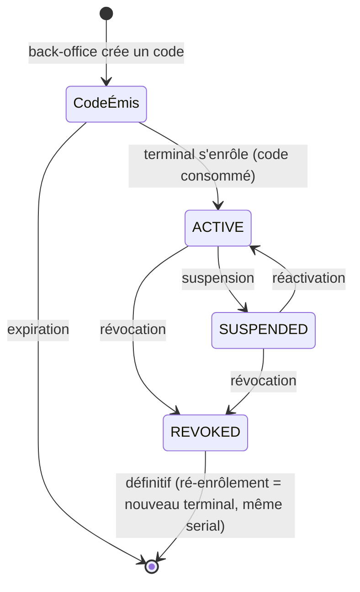

# Mission Specification: Identité et enrôlement des terminaux

**Mission Branch**: `feat/identite-enrolement-terminaux`
**Created**: 2026-10-19
**Status**: Draft
**Input**: User description: "Identité et enrôlement des terminaux (SPECIFICATION §8.1, §8.2, §10.3, §13.2, §13.4, §14.2 S5, `docs/sync_protocol.md` §3.1, ADR-69, ADR-88). Codes d'enrôlement à usage unique (portée événement, point de vente, mode ; empreinte, expiration ; `PAIRED_TPE` refusé `422 DEVICE_MODE_NOT_ALLOWED`), enrôlement avec clés ECDSA et ECDH P-256 (clé d'accord écrite à l'enrôlement seulement, OP-N63), unicité du `serial` parmi les terminaux non révoqués, jeton d'appareil et rafraîchissement (`device_refresh_token`), requêtes signées par la clé du terminal et mTLS (OP-N42 : faux d'identité retiré hors des tests), suspension et révocation, configuration servie (`DeviceConfig`, `config_id`, `terminal_settings`), battement de cœur. Dettes de sécurité héritées de la mission 4 : OP-N59, OP-N44, OP-N50, OP-N54, OP-N62, OP-N63."

**Sources normatives** : `docs/SPECIFICATION.md` (§3.2, §8.1, §8.2, §10.3, §13.1, §13.2, §13.4, §14.2 S5), `docs/sync_protocol.md` (§3.1), `docs/DECISIONS_ADR.md` (ADR-43, ADR-69, ADR-88, ADR-96, ADR-99, ADR-101, ADR-102, ADR-105), `docs/POINTS_OUVERTS.md` (OP-N42, OP-N44, OP-N50, OP-N54, OP-N59, OP-N62, OP-N63), `packages/ledger-sql/schema_grand_livre_cashless.sql` (table `device`, index `device_serial_active`), `packages/contracts/openapi.yaml` (tag « Terminaux » : `createDeviceEnrollmentCode`, `enrollDevice`, `refreshDeviceToken`, `getDeviceConfig`, `postDeviceHeartbeat` ; schémas de sécurité `deviceToken`, `deviceMtls`). En cas de contradiction, la règle de priorité de SPECIFICATION §0.3 s'applique et la contradiction est signalée.

**Dépend de** : missions `fondations-grand-livre-01M4AY8M` (idempotence, erreurs normalisées), `identite-roles-double-validation-01M4DNDN` (personnes, rôles, audit), `configuration-parties-evenements-01M4GCJ9` (événements, points de vente, réglages `terminal_settings`, `offline_policy`) et `bracelets-nfc-01M4TD3W` (port `DeviceIdentityPort` et son faux, ports KMS, processus des clés de bracelet, garde de démarrage en production).

## Contexte

Un terminal n'encaisse que s'il est enrôlé et reconnu. Depuis la mission 4, les routes appelées par un terminal (lecture d'un bracelet, mot de passe d'un bracelet) reçoivent l'identité du terminal d'un port, servi pour l'instant par un faux qui croit des en-têtes (OP-N42) : en l'état, quiconque se dit terminal obtient le mot de passe d'un bracelet. Cette mission donne au terminal une identité réelle et vérifiée, le fait entrer dans le système par un code d'enrôlement à usage unique, permet de le suspendre ou de le révoquer, et lui sert sa configuration et son battement de cœur.

Elle lève aussi les dettes de sécurité de la base héritées de la mission 4, dont deux bloquent la production (OP-N59 : fonctions privilégiées sans `pg_temp` ; OP-N63 : clé d'accord du terminal réécrivable par l'API).

L'encaissement en ligne (vendeurs, catalogue, paiement par bracelet et par QR, annulation) est la mission 5b ; le snapshot hors ligne, les lots hors ligne et l'application du terminal viennent dans d'autres missions.

Décisions de cadrage prises avec le porteur (voir « Decisions ») : la mission 5 est scindée en 5a puis 5b ; chaque requête de terminal est authentifiée par trois preuves à la fois (jeton lié, mTLS, signature de la requête) ; l'attestation est vérifiée sur Android et sur iOS ; OP-N50 est levée ici.

## Domain Language

| Terme canonique | Sens | À éviter |
|---|---|---|
| Terminal | Appareil Android ou iOS qui exécute l'app d'encaissement (`device`) | « TPE » seul (qui désigne un mode), « appareil » dans les textes destinés aux personnes |
| Code d'enrôlement | Code à usage unique affiché en QR par le back-office, qui autorise un terminal à s'enregistrer (`device_enrollment_code`) | « code d'activation », « code de rattachement » (qui concerne un bracelet) |
| Enrôlement | Enregistrement d'un terminal auprès du serveur avec ses clés publiques et son attestation | « inscription », « appairage » |
| Clé de signature | Paire ECDSA P-256 du terminal, non exportable, créée dans le matériel sécurisé | « clé privée » sans précision |
| Clé d'accord | Paire ECDH P-256 du terminal, sous laquelle on lui chiffre des secrets (mots de passe, snapshot) | « clé de chiffrement » |
| Attestation | Preuve fournie par le système (Android Key Attestation, iOS App Attest) que la clé est dans le matériel sécurisé et que l'app est intacte | « certificat » |
| Certificat client | Certificat délivré à l'enrôlement par l'autorité des terminaux, présenté en mTLS | « attestation » |
| Jeton d'appareil | Jeton court (15 min) lié à la clé de signature du terminal | « jeton » seul quand il peut s'agir d'un jeton de personne |
| Jeton de rafraîchissement | Jeton à usage unique qui permet d'obtenir un nouveau jeton d'appareil (`device_refresh_token`) | « refresh » |
| Requête signée | Requête dont le contenu est signé par la clé de signature du terminal | « lot signé » (qui concerne le hors ligne) |
| Suspension | Statut `SUSPENDED` : le terminal remonte encore ses lots mais n'autorise plus rien | « blocage » |
| Révocation | Statut `REVOKED`, définitif : le terminal est refusé partout | « suppression », « désactivation » |
| Battement de cœur | Signal de vie périodique du terminal (`postDeviceHeartbeat`) | « ping » |

## User Scenarios & Testing *(mandatory)*

### User Story 1 - L'administrateur émet un code d'enrôlement (Priority: P1)

Un `OPERATOR_ADMIN` ou un `ORGANIZER_ADMIN` crée, depuis le back-office, un code d'enrôlement à usage unique, éventuellement lié à un événement, un point de vente et un mode d'application, et l'affiche en QR.

**Why this priority**: sans code, aucun terminal n'entre dans le système.

**Independent Test**: créer un code par l'API, vérifier la réponse (code affiché une fois, expiration), puis vérifier que la base n'en garde que l'empreinte.

**Acceptance Scenarios**:

1. **Given** un `ORGANIZER_ADMIN` d'un événement, **When** il crée un code lié à cet événement, à un point de vente et au mode `CATALOG_POS`, **Then** il reçoit le code une seule fois avec sa date d'expiration (24 h par défaut), et la base n'en garde que l'empreinte.
2. **Given** une demande de code en mode `PAIRED_TPE`, **When** elle est envoyée, **Then** elle est refusée `422 DEVICE_MODE_NOT_ALLOWED`.
3. **Given** une personne sans l'un des deux rôles, ou d'un autre prestataire, **When** elle demande un code ou vise un événement d'un autre prestataire, **Then** elle est refusée (`403`, ou `404` neutre pour l'objet d'un autre prestataire).
4. **Given** une durée de vie demandée hors des bornes permises, **When** le code est demandé, **Then** il est refusé.

---

### User Story 2 - Un terminal s'enrôle (Priority: P1)

À la première ouverture, l'app scanne le code, puis crée sa clé de signature et sa clé d'accord dans le matériel sécurisé (l'attestation Android lie chaque clé au code), et s'enregistre avec ses clés publiques, son attestation et une demande de certificat. Elle reçoit son certificat client, son jeton d'appareil, son jeton de rafraîchissement et le premier numéro de séquence à utiliser.

**Why this priority**: c'est l'entrée du terminal ; tout le reste en dépend.

**Independent Test**: avec un terminal de test (clés et attestation de test), enrôler un terminal et vérifier la réponse, la ligne `device`, la consommation du code et l'audit.

**Acceptance Scenarios**:

1. **Given** un code valide et une attestation Android 12 ou plus récent conforme pour ses deux clés (clés générées dans le matériel sécurisé, bootloader verrouillé, app signée et intacte), **When** le terminal s'enrôle, **Then** il est créé `ACTIVE` avec ses clés publiques, l'empreinte de son certificat et l'affectation du code ; il reçoit certificat, jeton d'appareil, jeton de rafraîchissement et `next_seq = 1`.
2. **Given** un code valide et une attestation iOS App Attest conforme, **When** un iPhone s'enrôle, **Then** il est créé sans NFC (QR seulement).
3. **Given** un code déjà utilisé ou inconnu, **When** un terminal s'enrôle, **Then** la réponse est `422 ENROLLMENT_CODE_INVALID`, identique dans les deux cas ; un code expiré donne `422 ENROLLMENT_CODE_EXPIRED`.
4. **Given** une attestation absente, invalide, d'une clé hors du matériel sécurisé ou importée, d'un appareil déverrouillé, d'une app altérée, ou d'un Android antérieur à la version 12, **When** le terminal s'enrôle, **Then** la réponse est `422 ATTESTATION_FAILED`, rien n'est créé et le code reste utilisable.
5. **Given** deux enrôlements simultanés avec le même code, **When** ils arrivent ensemble, **Then** un seul réussit.
6. **Given** un `serial` déjà porté par un terminal non révoqué du même prestataire, **When** un autre terminal s'enrôle avec ce `serial`, **Then** il est refusé ; chez un autre prestataire, le même `serial` est accepté et rien ne révèle l'autre terminal.
7. **Given** un terminal révoqué dont le plus grand numéro vu est 88, **When** un nouveau terminal s'enrôle avec le même `serial`, **Then** il est créé comme un nouveau terminal et reçoit `next_seq = 89`.
8. **Given** un code émis pour un téléphone personnel (choix obligatoire de l'administrateur à l'émission), **When** le téléphone s'enrôle, **Then** sa politique effective n'a jamais le hors ligne.

---

### User Story 3 - Le serveur reconnaît chaque requête du terminal (Priority: P1)

Toute route appelée par un terminal (configuration, battement de cœur, lecture d'un bracelet, mot de passe d'un bracelet, et toutes celles des missions suivantes) n'est servie que si la requête porte un certificat client valide, un jeton d'appareil valide lié à la clé du terminal, et une signature valide du contenu de la requête par cette clé. Le faux d'identité de la mission 4 n'est plus branché hors des tests.

**Why this priority**: c'est la dette OP-N42, qui bloque la production : sans elle, un tiers se fait passer pour un terminal.

**Independent Test**: rejouer les routes de terminal de la mission 4 et de cette mission avec l'identité réelle, en retirant une preuve à la fois.

**Acceptance Scenarios**:

1. **Given** un terminal `ACTIVE` qui présente les trois preuves, **When** il appelle une route de terminal, **Then** la requête est servie avec le prestataire, l'événement et le point de vente tirés de la base, jamais de la requête.
2. **Given** une requête sans certificat client, avec un certificat d'un autre terminal, ou avec un certificat expiré, **When** elle arrive, **Then** elle est refusée `401`.
3. **Given** une requête sans jeton, avec un jeton expiré, ou avec un jeton lié à une autre clé, **When** elle arrive, **Then** elle est refusée `401`.
4. **Given** une requête dont la signature manque, est fausse, porte sur un autre contenu, ou rejoue une requête déjà vue, **When** elle arrive, **Then** elle est refusée `401`.
5. **Given** les trois preuves valides mais de deux terminaux différents, **When** la requête arrive, **Then** elle est refusée `401`.
6. **Given** l'API en configuration de production, **When** le faux d'identité du terminal est branché, **Then** elle refuse de démarrer.

---

### User Story 4 - Le terminal renouvelle son jeton (Priority: P1)

Le terminal échange son jeton de rafraîchissement, avec une preuve de possession de sa clé, contre un nouveau jeton d'appareil et un nouveau jeton de rafraîchissement.

**Why this priority**: le jeton d'appareil dure 15 minutes ; sans renouvellement, le terminal s'arrête.

**Independent Test**: rafraîchir, puis réutiliser l'ancien jeton de rafraîchissement.

**Acceptance Scenarios**:

1. **Given** un jeton de rafraîchissement valide et une preuve de possession valide, **When** le terminal rafraîchit, **Then** il reçoit une nouvelle paire et l'ancien jeton de rafraîchissement est consommé.
2. **Given** un jeton de rafraîchissement déjà consommé, **When** il est présenté de nouveau une seconde fois, après 60 s ou par un autre certificat, **Then** la demande est refusée et toute la famille de jetons du terminal est révoquée (vol présumé), avec une trace d'audit ; une seule représentation dans les 60 s par le même terminal (réponse perdue) donne une nouvelle paire (décision du porteur, OP-N65).
3. **Given** une preuve de possession absente ou fausse, **When** le terminal rafraîchit, **Then** la demande est refusée.
4. **Given** un terminal `SUSPENDED` ou `REVOKED`, **When** il rafraîchit, **Then** la réponse est `403 DEVICE_SUSPENDED` ou `403 DEVICE_REVOKED`.

---

### User Story 5 - L'administrateur suspend, réactive ou révoque un terminal (Priority: P1)

Un `OPERATOR_ADMIN` ou un `ORGANIZER_ADMIN` liste les terminaux de son périmètre, en consulte un, le suspend, le réactive, ou le révoque définitivement (perte, vol, appareil compromis).

**Why this priority**: sans effacement à distance (pas de MDM, ADR-69), la révocation est la seule défense contre un terminal perdu ou volé.

**Independent Test**: suspendre puis réactiver un terminal, révoquer un terminal, et vérifier ce que chacun peut encore faire.

**Acceptance Scenarios**:

1. **Given** un terminal `ACTIVE`, **When** il est suspendu avec un motif, **Then** il n'autorise plus aucune opération ni aucune lecture de bracelet, mais peut encore remonter ses lots, envoyer son battement de cœur et lire sa configuration.
2. **Given** un terminal `SUSPENDED`, **When** il est réactivé, **Then** il retrouve ses droits sans nouvel enrôlement.
3. **Given** un terminal `ACTIVE` ou `SUSPENDED`, **When** il est révoqué avec un motif, **Then** toute requête qu'il envoie est refusée `403 DEVICE_REVOKED`, ses jetons de rafraîchissement sont révoqués, son certificat n'est plus accepté, et son `serial` redevient disponible pour un ré-enrôlement.
4. **Given** un terminal `REVOKED`, **When** on tente de le réactiver ou de le suspendre, **Then** c'est refusé : la révocation est définitive.
5. **Given** chaque changement de statut, **When** il est fait, **Then** il est tracé au journal d'audit (auteur, rôle, motif, avant, après).
6. **Given** un administrateur d'un autre prestataire ou d'un autre organisateur, **When** il vise ce terminal, **Then** la réponse est `404` neutre.

---

### User Story 6 - Le terminal reçoit sa configuration et envoie son battement de cœur (Priority: P2)

Le terminal lit sa configuration (affectation, mode, réglages de fonctionnement de l'événement, politique hors ligne effective, numéro de séquence plancher, heure serveur) et envoie régulièrement un battement de cœur qui met à jour sa dernière présence.

**Why this priority**: nécessaire au fonctionnement du terminal ; les contenus qui dépendent des missions suivantes (catalogue, clés du snapshot, autorité de débit) sont servis sous la forme minimale que le contrat permet.

**Independent Test**: lire la configuration deux fois avec l'ETag, envoyer un battement de cœur et vérifier `last_seen_at`.

**Acceptance Scenarios**:

1. **Given** un terminal enrôlé, **When** il lit sa configuration, **Then** il reçoit un `DeviceConfig` conforme au contrat, avec un `config_id` et un ETag.
2. **Given** l'ETag de la configuration courante, **When** le terminal la relit avec `If-None-Match`, **Then** la réponse est `304` ; après un changement de réglage de l'événement, la réponse est `200` avec un nouvel ETag.
3. **Given** un terminal `ACTIVE` ou `SUSPENDED`, **When** il envoie un battement de cœur, **Then** `last_seen_at` est mis à jour et il reçoit l'heure serveur et l'ETag de configuration.
4. **Given** un battement de cœur, **When** il est reçu, **Then** il ne consomme aucun numéro de séquence.

---

### User Story 7 - Les dettes de sécurité de la base sont levées (Priority: P1)

Le responsable de la sécurité obtient la fermeture, chacune avec son test, des dettes héritées de la mission 4 : OP-N59, OP-N44, OP-N50, OP-N54, OP-N62 et OP-N63.

**Why this priority**: OP-N59 et OP-N63 bloquent la production ; les autres ont été confiées à cette mission par le porteur.

**Independent Test**: chaque dette a un test en base ou d'API qui échouait avant la mission et passe après ; la borne ancienne de chaque test est inversée.

**Acceptance Scenarios**:

1. **Given** une session d'un rôle applicatif, **When** elle crée une table temporaire du même nom qu'une table de la base puis appelle une fonction privilégiée qui la lit (par exemple un `tenant_of_*`), **Then** la table temporaire est sans effet, ou sa création est refusée (OP-N59).
2. **Given** chaque rôle de base des processus des clés, **When** il tente d'exécuter une fonction d'API qui n'est pas la sienne, **Then** c'est refusé : chaque rôle n'exécute que ses fonctions (OP-N44).
3. **Given** une lecture de bracelet qui a servi à confirmer une demande de rattachement, **When** `consume_tap` est appelée avec cette lecture, **Then** elle est refusée (OP-N50).
4. **Given** une écriture idempotente dont le corps contient un secret (code imprimé, code d'enrôlement), **When** son empreinte est enregistrée, **Then** elle ne peut pas être recalculée à partir de la requête seule (OP-N54).
5. **Given** la personnalisation, **When** elle appelle le retrait d'une clé dédiée sans travail `RETIRE_KEY` en cours issu d'une demande exécutée, **Then** c'est refusé ; une demande de clé `APPROVED` mais expirée est refusée (`CL023`) (OP-N62).
6. **Given** le rôle de l'API publique, **When** il tente de réécrire la clé d'accord d'un terminal, **Then** c'est refusé ; la clé ne s'écrit qu'à l'enrôlement, par une fonction de la base (OP-N63).

---

### Edge Cases

- Code d'enrôlement présenté deux fois en même temps : un seul enrôlement réussit.
- Code qui fuit (QR photographié) : essais limités par code et par adresse ; seul un appareil attesté de l'app attendue peut l'utiliser, une fois.
- Enrôlement refusé pour attestation : le code n'est pas consommé (un terminal compromis ne doit pas pouvoir brûler les codes d'un autre, et un vrai terminal peut réessayer).
- Code lié à un événement clos ou annulé, ou à un point de vente supprimé entre l'émission et l'enrôlement : enrôlement refusé.
- Code lié à un mode non permis pour l'appareil (`TOPUP_DESK` ou NFC sur iOS ; recharge, caution ou hors ligne sur téléphone personnel) : `422 DEVICE_MODE_NOT_ALLOWED`.
- Clé publique de signature ou d'accord mal formée (pas un point P-256 valide) : enrôlement refusé.
- Demande de certificat (CSR) non signée par la clé de signature annoncée : enrôlement refusé.
- Requête signée rejouée dans la fenêtre de validité : refusée.
- Horloge du terminal décalée : la tolérance est celle de la configuration (`clock_tolerance_seconds`) ; au-delà, refus qui nomme l'écart, et le terminal recale son heure sur l'heure serveur.
- Révocation pendant qu'une requête du terminal est en cours : les requêtes suivantes sont refusées ; aucune écriture n'est acceptée après l'enregistrement de la révocation.
- Terminal suspendu : remonte ses lots, mais une lecture de bracelet ou une demande de mot de passe est refusée `403 DEVICE_SUSPENDED`.
- Réutilisation d'un jeton de rafraîchissement par un voleur après que le vrai terminal l'a déjà utilisé : toute la famille est révoquée, le vrai terminal doit être ré-enrôlé.
- Certificat client valide mais jeton d'un autre terminal du même prestataire : refusé.

## Requirements *(mandatory)*

### Functional Requirements

| ID | Title | User Story | Priority | Status |
|----|-------|------------|----------|--------|
| FR-001 | Code d'enrôlement | En tant qu'`OPERATOR_ADMIN` ou `ORGANIZER_ADMIN`, je veux créer un code d'enrôlement à usage unique, lié à mon prestataire et éventuellement à un événement, un point de vente et un mode, en indiquant obligatoirement s'il s'agit d'un téléphone personnel, avec une durée de vie bornée (24 h par défaut), affiché une seule fois et dont le serveur ne garde que l'empreinte, afin d'autoriser l'enrôlement d'un terminal précis. | High | Open |
| FR-002 | Refus du mode `PAIRED_TPE` | En tant que porteur du projet, je veux que toute création de code et tout enrôlement en mode `PAIRED_TPE` soient refusés `422 DEVICE_MODE_NOT_ALLOWED`, afin que la V2 n'entre pas par cette porte (ADR-43). | High | Open |
| FR-003 | Enrôlement | En tant que terminal, je veux m'enregistrer avec un code valide, mon `serial`, mon système, la version de l'app, mes clés publiques de signature et d'accord (P-256), ma chaîne d'attestation et une demande de certificat signée par ma clé, et recevoir mon identifiant, un certificat client, un jeton d'appareil, un jeton de rafraîchissement et `next_seq`, afin d'être reconnu. | High | Open |
| FR-004 | Consommation atomique du code | En tant que responsable de la sécurité, je veux qu'un code ne serve qu'à un seul enrôlement réussi, même sous enrôlements simultanés, qu'il ne soit consommé que par un enrôlement réussi, et qu'un code inconnu ou déjà utilisé donne la même réponse, afin qu'un code ne puisse ni servir deux fois ni être deviné par les réponses. | High | Open |
| FR-005 | Attestation Android | En tant que responsable de la sécurité, je veux que l'enrôlement d'un terminal Android (version 12 au moins) vérifie les chaînes Android Key Attestation de ses deux clés jusqu'à une racine de confiance (clés générées dans le matériel sécurisé, bootloader verrouillé, app attendue signée et intacte, défi lié à l'enrôlement) et refuse sinon `422 ATTESTATION_FAILED`, afin qu'une clé copiable ou une app altérée n'entre pas. | High | Open |
| FR-006 | Attestation iOS | En tant que responsable de la sécurité, je veux que l'enrôlement d'un terminal iOS vérifie l'attestation App Attest (app attendue et intacte, défi qui lie les clés publiques du terminal à l'instance attestée) et refuse sinon `422 ATTESTATION_FAILED`, afin d'appliquer aux iPhone l'exigence que la plateforme permet ; la clé de signature iOS n'étant pas attestable, la limite est consignée (OP-N64, ADR-106). | High | Open |
| FR-007 | Unicité du `serial` et ré-enrôlement | En tant que porteur du projet, je veux qu'un `serial` ne soit jamais porté par deux terminaux non révoqués d'un même prestataire (sans rien révéler d'un autre prestataire), et qu'un ré-enrôlement après révocation crée un nouveau terminal qui reçoit `next_seq = max_seen_seq + 1` pour ce `serial` dans le prestataire, afin que les numéros de séquence ne soient jamais réutilisés (sync_protocol §3.1). | High | Open |
| FR-008 | Clé d'accord écrite à l'enrôlement seulement | En tant que responsable de la sécurité, je veux que la clé d'accord d'un terminal ne s'écrive qu'à l'enrôlement, par une fonction de la base, et que le rôle de l'API perde le droit de la modifier, afin qu'on ne puisse pas faire chiffrer le mot de passe d'un bracelet pour une clé choisie (OP-N63). | High | Open |
| FR-009 | Certificat client des terminaux | En tant que porteur du projet, je veux qu'une autorité des terminaux délivre à l'enrôlement un certificat client lié à la clé de signature du terminal, à durée bornée, dont l'empreinte est enregistrée sur le terminal, la clé de l'autorité restant derrière un port avec un faux pour les tests seulement, afin de prouver l'identité du terminal au niveau du transport. | High | Open |
| FR-010 | Jeton d'appareil lié | En tant que terminal, je veux un jeton d'appareil de 15 minutes lié à ma clé de signature, afin de m'authentifier sans secret partagé. | High | Open |
| FR-011 | Rafraîchissement à rotation | En tant que terminal, je veux échanger mon jeton de rafraîchissement, avec une preuve de possession de ma clé, contre une nouvelle paire ; le jeton présenté est consommé, une seule représentation dans les 60 s par le même terminal est tolérée, toute autre réutilisation révoque toute la famille (et ses jetons d'appareil) et est tracée, et un terminal suspendu ou révoqué est refusé, afin qu'un jeton volé ne serve qu'une fois au plus. | High | Open |
| FR-012 | Trois preuves sur chaque requête | En tant que responsable de la sécurité, je veux que toute route de terminal exige ensemble un certificat client valide, un jeton d'appareil valide et une signature valide du contenu de la requête par la clé du terminal, les trois liées au même terminal, avec refus d'une requête rejouée, afin qu'aucune preuve seule ne suffise (décision du porteur, OP-N42). | High | Open |
| FR-013 | Identité réelle derrière le port existant | En tant que porteur du projet, je veux que le port d'identité du terminal livré par la mission 4 soit servi par l'implémentation réelle, sans modification des routes qui l'utilisent, et que le faux ne soit plus branché hors des tests, afin de lever OP-N42. | High | Open |
| FR-014 | Statut lu à chaque requête | En tant que responsable de la sécurité, je veux que le statut, le prestataire et l'affectation du terminal soient relus en base à chaque requête, jamais tirés du jeton ou du certificat, afin qu'une suspension ou une révocation prenne effet immédiatement. | High | Open |
| FR-015 | Suspension et réactivation | En tant qu'`OPERATOR_ADMIN` ou `ORGANIZER_ADMIN`, je veux suspendre un terminal avec un motif (il remonte ses lots, lit sa configuration et envoie son battement de cœur, mais n'autorise plus rien) et le réactiver, afin de mettre un terminal de côté sans le perdre. | High | Open |
| FR-016 | Révocation | En tant qu'`OPERATOR_ADMIN` ou `ORGANIZER_ADMIN`, je veux révoquer définitivement un terminal avec un motif : toute requête refusée `403 DEVICE_REVOKED`, jetons de rafraîchissement révoqués, certificat refusé, `serial` libéré pour un ré-enrôlement, afin de neutraliser un terminal perdu, volé ou compromis. | High | Open |
| FR-017 | Liste et consultation des terminaux | En tant qu'`OPERATOR_ADMIN` ou `ORGANIZER_ADMIN`, je veux lister (filtres : événement, point de vente, statut, mode ; pagination par curseur) et consulter les terminaux de mon périmètre (statut, affectation, système, version de l'app, dernière présence, historique des statuts), sans jamais voir de secret, afin de suivre ma flotte. | Medium | Open |
| FR-018 | Configuration servie | En tant que terminal, je veux lire ma configuration conforme au schéma `DeviceConfig` du contrat (affectation, mode, `terminal_settings`, politique hors ligne effective, plancher de séquence, heure serveur, tolérance d'horloge), avec `config_id` et ETag, les parties qui dépendent de missions ultérieures étant servies sous la forme minimale que le contrat permet, afin de fonctionner selon les réglages de mon événement. | Medium | Open |
| FR-019 | Battement de cœur | En tant que terminal, je veux envoyer un battement de cœur qui met à jour ma dernière présence et me renvoie l'heure serveur et l'ETag de configuration, sans consommer de numéro de séquence, afin que le back-office sache que je suis en vie. | Medium | Open |
| FR-020 | Fonctions privilégiées protégées (OP-N59) | En tant que responsable de la sécurité, je veux qu'aucune table temporaire d'une session applicative ne puisse masquer une table lue par une fonction privilégiée de la base, afin que le cloisonnement entre prestataires ne puisse pas être contourné. | High | Open |
| FR-021 | Droits d'exécution rôle par rôle (OP-N44) | En tant que responsable de la sécurité, je veux que les fonctions d'API de la base ne soient plus exécutables par `PUBLIC` et que chaque rôle de base n'exécute que ses fonctions, la suite de référence étant adaptée par son générateur, afin qu'un processus des clés compromis n'ait pas plus de droits que son rôle. | High | Open |
| FR-022 | Lecture de rattachement non réutilisable (OP-N50) | En tant que responsable de la fraude, je veux qu'une lecture qui a confirmé une demande de rattachement ne puisse plus servir à une écriture par `consume_tap`, afin qu'une lecture ne serve qu'à une seule chose. | High | Open |
| FR-023 | Empreinte de requête à clé (OP-N54) | En tant que responsable de la sécurité, je veux que l'empreinte enregistrée au registre d'idempotence ne puisse pas être recalculée à partir de la requête seule (empreinte à clé dont le secret est hors de la base, ou champs secrets exclus), afin qu'une fuite de la base ne permette pas de retrouver un code imprimé ou un code d'enrôlement. | High | Open |
| FR-024 | Retrait de clé et demandes périmées (OP-N62) | En tant que responsable de la sécurité, je veux que le retrait d'une clé dédiée ne soit appelable qu'avec un travail `RETIRE_KEY` en cours issu d'une demande exécutée, et qu'une demande de clé approuvée mais expirée soit refusée (`CL023`), afin de fermer les limites résiduelles d'ADR-102. | High | Open |
| FR-025 | Audit | En tant que contrôleur, je veux une ligne d'audit pour chaque création de code, enrôlement réussi ou refusé, changement de statut d'un terminal et révocation d'une famille de jetons (acteur ou terminal, rôle, motif, avant, après, date, adresse), afin de reconstituer la vie d'un terminal. | High | Open |
| FR-026 | Contrat d'API et types générés | En tant que développeur des apps, je veux que le contrat d'API décrive les routes de la mission (celles déjà présentes servies telles quelles, celles du back-office des terminaux ajoutées avec les mêmes conventions, la signature des requêtes décrite) et exige les trois preuves sur les routes de terminal, et que les types TypeScript et Dart en soient régénérés, afin de coder l'app du terminal contre un contrat à jour. | High | Open |

### Non-Functional Requirements

| ID | Title | Requirement | Category | Priority | Status |
|----|-------|-------------|----------|----------|--------|
| NFR-001 | Aucun faux en production | En configuration de production, l'API refuse de démarrer si le faux d'identité du terminal, le faux de l'autorité des terminaux, le faux vérificateur d'attestation ou le terminal de test est branché : 0 démarrage réussi sur les 4 cas, vérifié par un test par faux ; aucun faux n'est atteignable par une route ou un réglage d'exécution. | Security | High | Open |
| NFR-002 | Aucune preuve seule ne suffit | Pour chaque route de terminal, 100 % des requêtes à qui il manque une seule des trois preuves, ou dont une preuve est fausse, expirée ou d'un autre terminal, sont refusées ; vérifié par une matrice de tests (route × preuve retirée ou altérée). | Security | High | Open |
| NFR-003 | Effet immédiat de la révocation | Après l'enregistrement d'une suspension ou d'une révocation, 0 requête du terminal autorisée qui ne lui est plus permise, y compris avec un jeton d'appareil encore valide ; vérifié par un test qui révoque entre deux requêtes. | Security | High | Open |
| NFR-004 | Pas de rejeu | 0 requête signée acceptée deux fois ; une requête dont l'horodatage sort de la tolérance d'horloge est refusée ; vérifié par un test de rejeu. | Security | High | Open |
| NFR-005 | Aucun secret en clair au repos | 0 code d'enrôlement, 0 jeton de rafraîchissement et 0 jeton d'appareil en clair dans la base, les journaux, le journal d'audit et les réponses d'erreur ; vérifié par un test qui recherche les valeurs de test après un parcours complet. | Security | High | Open |
| NFR-006 | Pas d'énumération des codes | Pour un code d'enrôlement inconnu et un code déjà utilisé : même statut, même corps, et un écart de temps de réponse médian inférieur à 20 ms sur 200 essais de chaque sorte. | Security | Medium | Open |
| NFR-007 | Isolation entre prestataires | 0 terminal ou code d'un autre prestataire lisible ou modifiable ; vérifié par un test à deux prestataires sur chaque route de la mission et par un test en base sur chaque nouvelle table. | Security | High | Open |
| NFR-008 | Concurrence | Sur 20 enrôlements simultanés avec le même code, exactement 1 réussit ; sur 20 rafraîchissements simultanés avec le même jeton, exactement 1 réussit et la famille reste valide. | Reliability | High | Open |
| NFR-009 | Latence | Vérification des trois preuves : ajout p95 ≤ 20 ms côté serveur par requête de terminal ; enrôlement p95 ≤ 1 s ; configuration et battement de cœur p95 ≤ 200 ms. | Performance | Medium | Open |
| NFR-010 | Dettes levées prouvées | Chacune des 6 dettes de base (OP-N44, OP-N50, OP-N54, OP-N59, OP-N62, OP-N63) et OP-N42 a au moins un test qui échouait avant la mission et passe après ; les bornes anciennes des suites concernées sont inversées. | Security | High | Open |
| NFR-011 | Tests existants verts | Les suites de la base, les tests des missions 1 à 4 et le rejeu du scénario de référence restent verts en CI à chaque commit. | Reliability | High | Open |

### Constraints

| ID | Title | Constraint | Category | Priority | Status |
|----|-------|------------|----------|----------|--------|
| C-001 | Les fonctions de la base font les règles | Les règles d'enrôlement, d'unicité du `serial`, de statut et d'écriture de la clé d'accord sont tenues par la base ; l'API les appelle sans les réécrire (§2.2). | Technical | High | Open |
| C-002 | Fichiers générés du kit intouchables | Les fichiers `.sql` générés de `packages/ledger-sql/` ne sont jamais modifiés à la main ; tout ajout (S5) ou correction (OP-N44, OP-N59) passe par une migration, et les attentes de la suite de référence par ses générateurs (`gen_tests.py`, `gen_golden.py`). | Technical | High | Open |
| C-003 | Trois preuves exigées | Les routes de terminal exigent ensemble jeton lié, mTLS et signature de la requête (décision du porteur, 19/10/2026). Le contrat et §10.3 disent « l'un ou l'autre » : la contradiction est signalée et le contrat est mis à jour dans le sens le plus sûr. | Technical | High | Open |
| C-004 | Pas d'adaptateur AWS | L'autorité des terminaux et le KMS restent derrière des ports avec des faux pour les tests ; l'adaptateur réel attend OP-N11. La garde de démarrage en production les refuse. | Business | High | Open |
| C-005 | Pas d'encaissement | Vendeurs, catalogue, paiement par bracelet et par QR, annulation et identification au guichet relèvent de la mission 5b. | Business | High | Open |
| C-006 | Pas de hors ligne ni d'application | Snapshot, lots hors ligne, passerelle locale et application du terminal (Flutter) ne sont pas dans cette mission ; un terminal de test, interdit en production, sert aux tests. | Business | High | Open |
| C-007 | Pas de MDM | Aucune intégration d'outil de gestion de flotte (ADR-69) ; pas d'effacement à distance. | Business | High | Open |
| C-008 | Contrat d'abord | Toute route est décrite au contrat d'API avant d'être servie ; les types sont générés, jamais écrits à la main. | Technical | High | Open |
| C-009 | Aucun écran | La mission ne livre aucune interface ; le back-office web est la mission 11. | Business | Medium | Open |
| C-010 | Pas d'`INSERT` sur `tag_key_job` | Les travaux de clé ne se créent que par `enqueue_tag_key_job` et `enqueue_tag_key_child_job` (migration 0020) ; ce droit n'est pas rouvert. | Technical | High | Open |
| C-011 | Écart de sécurité soumis au porteur | Tout écart au plan ou à la spécification qui affaiblit la sécurité est soumis au porteur avant d'être codé, avec le risque et les options ; un écart qui renforce la sécurité est fait puis consigné. | Business | High | Open |
| C-012 | Dette de sécurité nommée | Chaque écart de sécurité accepté a une entrée dans `docs/POINTS_OUVERTS.md` et une décision dans `docs/DECISIONS_ADR.md` (risque, raison, mission qui le lève, condition de levée), un test qui échoue si la limite s'élargit, et un report dans `PROMPTS-A-ENVOYER.md` et `PRD.md` pour la mission qui en hérite. | Business | High | Open |

### Key Entities

- **Terminal** (`device`) : appareil d'un prestataire ; `serial`, système, mode, NFC ou non, téléphone personnel ou non, fourni par, affectation (événement, point de vente, poste), clés publiques de signature et d'accord, empreinte du certificat client, statut, numéros de séquence, dernière présence.
- **Code d'enrôlement** (`device_enrollment_code`, S5) : empreinte du code, prestataire, portée (événement, point de vente, mode), auteur, expiration, date d'utilisation et terminal créé.
- **Jeton de rafraîchissement** (`device_refresh_token`, S5) : empreinte du jeton, terminal, famille, expiration, date de consommation, date et motif de révocation.
- **Certificat client** : délivré par l'autorité des terminaux à l'enrôlement ; seule son empreinte est conservée sur le terminal.
- **Historique des statuts du terminal** : changement, motif, auteur, date.
- **Ligne d'audit** : action d'administration ou événement de sécurité d'un terminal.

## Success Criteria *(mandatory)*

### Measurable Outcomes

- **SC-001** : un parcours complet (émettre un code, enrôler un terminal Android et un iPhone, lire la configuration, envoyer un battement de cœur, lire un bracelet, rafraîchir le jeton, suspendre, réactiver, révoquer, ré-enrôler le même `serial`) se déroule par l'API sans intervention directe en base.
- **SC-002** : 100 % des tentatives de se faire passer pour un terminal testées (une preuve manquante, fausse, d'un autre terminal, ou rejouée) sont refusées.
- **SC-003** : un terminal révoqué n'obtient plus rien dès la requête qui suit la révocation.
- **SC-004** : les deux dettes qui bloquent la production (OP-N59, OP-N63) et OP-N42 sont closes dans les points ouverts, chacune avec son test.
- **SC-005** : aucun code d'enrôlement ni jeton en clair n'est retrouvé dans la base ni dans les journaux après le parcours.
- **SC-006** : aucune fuite entre deux prestataires sur l'ensemble des routes de la mission.
- **SC-007** : les routes de terminal de la mission 4 passent à l'identité réelle sans qu'une seule de leurs lignes change.
- **SC-008** : à la fin de la mission, chaque écart de sécurité accepté est retrouvé dans les points ouverts avec la mission qui le lève ; la revue n'en trouve aucun non consigné.

## Assumptions

- A1 — Les routes back-office des terminaux (liste, consultation, suspension, réactivation, révocation) sont ajoutées au contrat avec les conventions existantes (confirmé par le porteur le 19/10/2026).
- A2 — Suspension, réactivation et révocation sont faites par une seule personne habilitée (`OPERATOR_ADMIN` ou `ORGANIZER_ADMIN` du périmètre) : la révocation protège, et la réactivation ne rend que les droits d'un terminal déjà enrôlé et attesté (confirmé par le porteur le 19/10/2026).
- A6 — Android 12 au moins (clé d'accord matérielle et attestée), décision du porteur au plan du 19/10/2026 ; le `serial` est unique par prestataire (ADR-109) ; voir `research.md` R-05, R-11.
- A3 — L'attestation est vérifiée à l'enrôlement seulement ; un contrôle d'intégrité périodique n'est pas dans cette mission (confirmé par le porteur le 19/10/2026).
- A4 — La clé de l'autorité des terminaux est derrière un port, avec un faux pour les tests seulement ; en production, le démarrage est refusé tant que l'adaptateur réel manque, comme pour le KMS (OP-N11) (confirmé par le porteur le 19/10/2026). Le point de terminaison du mTLS (dans l'API ou en amont) est arrêté au plan.
- A5 — Le terminal de test (clés, attestations et certificats de test) sert aux tests et est refusé en production (confirmé par le porteur le 19/10/2026).
- Les parties de `DeviceConfig` qui dépendent de missions ultérieures (catalogue, clés publiques du snapshot, autorité de débit et époque) sont servies sous la forme minimale que le schéma du contrat permet ; leur contenu réel arrive avec ces missions.
- Le format de la signature d'une requête (en-têtes, contenu signé, horodatage, nonce) et la fenêtre de rejeu sont arrêtés au plan et décrits au contrat.
- Les durées de vie (code : 24 h par défaut ; jeton d'appareil : 15 min ; jeton de rafraîchissement ; certificat client) et leurs bornes sont arrêtées au plan, dans les valeurs du contrat quand il en donne.
- Les racines de confiance des attestations (Google pour Android, Apple pour App Attest) et l'identité attendue de l'app (empreinte du certificat de signature, identifiant d'app) sont des réglages de déploiement.
- Les codes `CL` de la base sont traduits en erreurs normalisées par le mécanisme de la mission 1 ; les erreurs `DEVICE_*`, `ENROLLMENT_*` et `ATTESTATION_FAILED` du contrat sont utilisées.

## Decisions

| # | Question | Décision du porteur |
|---|---|---|
| 1 | Garder la mission 5 entière ou la scinder | Scinder en 5a (identité et enrôlement, dettes de sécurité) puis 5b (encaissement en ligne) — 16/10/2026 (`DM-01M52QCYW4EK4V5TGGDFYGRYMY`, mission 5b) |
| 2 | Authentification des terminaux | Jeton lié, signature de chaque requête et mTLS, ensemble — 19/10/2026 (`DM-01M52R88ZPZEA0NXVSDY9PBXW5`). Contradiction signalée : §10.3 et le contrat permettent « l'un ou l'autre » ; OP-N42 exige les trois ; résolue dans le sens le plus sûr |
| 3 | Attestation à l'enrôlement | Android Key Attestation et iOS App Attest vérifiés en 5a — 19/10/2026 (`DM-01M59RR2KCM2NMTGNR62HXJD76`) |
| 4 | OP-N50 en 5a ou en 5b | Levée en 5a, comme prévu — 19/10/2026 (`DM-01M59RSS09TMMZ9Y7VKGAQGQQ0`) |
| 5 | Résumé d'intention et hypothèses A1 à A5 | Confirmés — 19/10/2026 |
| 6 | Décisions de plan (19/10/2026) | mTLS vérifié dans les processus ; limite iOS consignée (OP-N64) ; Android 12 minimum ; grâce de 60 s au rafraîchissement (OP-N65) ; `serial` unique par prestataire — détail : `research.md` et `decisions/` |
