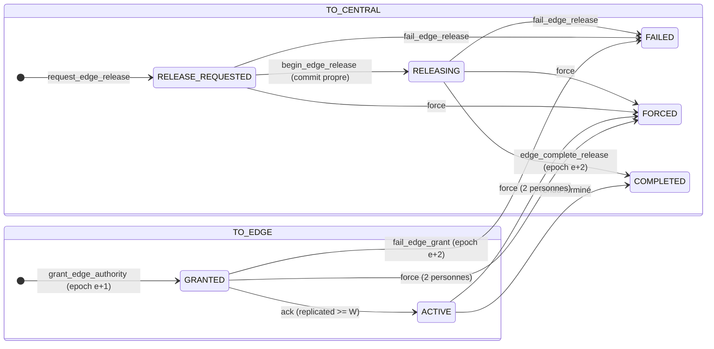
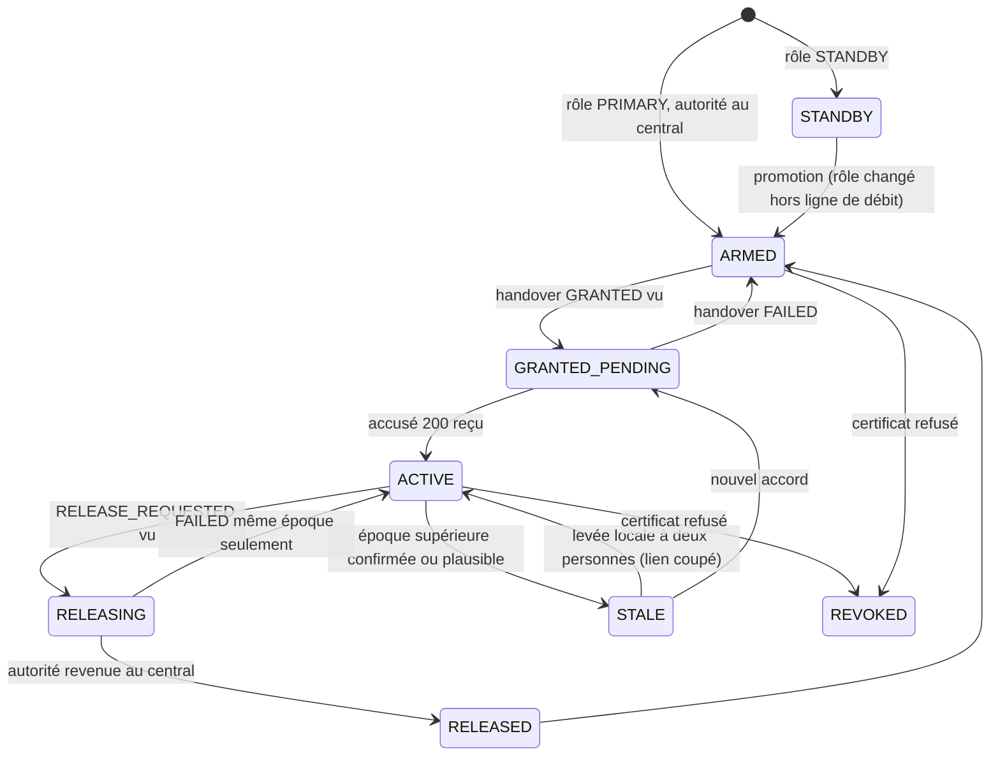
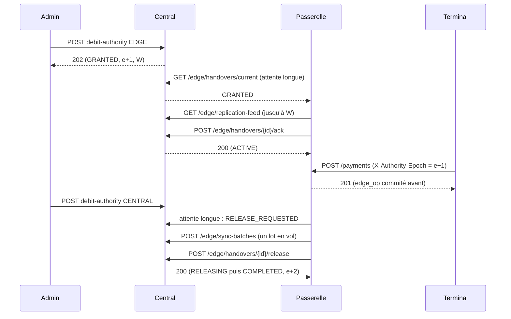

# Data Model: Passerelle locale de site

Deux modèles : le **central** (objets existants du schéma de référence `S:` = `packages/ledger-sql/schema_grand_livre_cashless.sql`,
complétés par des migrations à partir de `0058`, jamais par modification d'un `.sql` généré) et la **passerelle** (base PostgreSQL 17
locale à schéma réduit, série `edge-NNNN`, R-01). Décisions et raisons : `research.md` (R-xx). Les numéros de migration sont
indicatifs : le découpage en lots de `tasks.md` fait foi. **Toute table nouvelle du central porte `operator_id` et
`tenant_isolation` (ENABLE + FORCE)**, n'est écrite par aucun rôle applicatif en direct (`REVOKE INSERT, UPDATE, DELETE, TRUNCATE`),
et chaque écriture passe par une fonction `SECURITY DEFINER` (`search_path = public, pg_temp`, `REVOKE ALL FROM PUBLIC`, accord nommé).

---

# A. Central

## A.1 Rôles et droits (0058)

| Rôle | Nature | Droits |
|---|---|---|
| `cashless_app` (existant) | processus public | **retrait** de INSERT, UPDATE, DELETE, TRUNCATE sur `edge_gateway` (R-06.1) ; reste SELECT (RLS) ; EXECUTE ajouté sur `grant_edge_authority` (enveloppe humaine qui consigne aussi `reference_watermark_seq`), `request_edge_release`, `fail_edge_grant`, `fail_edge_release`, `get_debit_authority`, `force_central_authority_approved` ; **jamais** `set_debit_authority`, `force_central_authority`, `ack_edge_handover`, `complete_edge_release`, `record_edge_seq` ; `post_transaction` en source `EDGE_SYNC` refusée (garde sur `session_user`, R-09) |
| `cashless_edge` (nouveau) | processus `edge` | `LOGIN NOSUPERUSER NOCREATEDB NOCREATEROLE NOBYPASSRLS NOINHERIT`, `CASHLESS_EDGE_PASSWORD`, `DATABASE_URL_EDGE`, mêmes délais que `cashless_app` (`statement_timeout`, `idle_in_transaction_session_timeout`, `lock_timeout`, `transaction_timeout`). `REVOKE ALL` sur toutes les tables. EXECUTE nommé sur : `identify_edge_gateway`, `touch_edge_gateway`, `get_current_edge_handover`, `get_debit_authority`, `begin_edge_release`, `edge_ack_handover`, `edge_complete_release`, `edge_record_seq`, `edge_sync_batch_begin`, `edge_sync_batch_result`, `edge_record_staff_token_audit`, `edge_post_transaction`, `edge_activate_media`, `edge_take_deposit`, `edge_topup_cash`, `edge_replication_page`. Aucun `post_transaction`, aucun `set_debit_authority`, aucune S12 brute |
| `cashless_edgeadmin` (nouveau) | outil `tools/edge-admin` | même forme ; EXECUTE seulement sur `register_edge_gateway`, `revoke_edge_gateway`, `rotate_edge_gateway_cert`, `swap_edge_gateway_roles` (échange atomique, A25) ; `set_edge_gateway_role` n'est plus accordée seule |
| `cashless_tagkeys` (existant) | processus des clés | + EXECUTE sur `deposit_edge_pwd_pack` (dépôt du colis chiffré sous la clé de contenu de la passerelle, scellée pour sa clé d'accord, R-08) |
| processus de maintenance (existant) | travailleurs | + EXECUTE sur `mark_edge_gateways_silent` |

Tests de droits : `tests_execute_grants.sql` (liste exacte de `cashless_app` : mise à jour de la liste figée, sans fonction S12 brute),
nouvelle liste figée de `cashless_edge`, `tests_offline_rights.sql` (liste des tables), test d'architecture « un processus, un pool »
étendu à `edge`, test à connexion réelle sous `cashless_app` pour la garde `EDGE_SYNC` (un `SET ROLE` ne suffit pas).

**Non-régression des suites générées (A04, C-010)** : après `0058` à `0061`, les fichiers `tests_grand_livre_cashless.sql`,
`tests/tests_definer_search_path.sql` et `tests/tests_offline_snapshots.sql` passent **sans modification** (ils insèrent
`edge_gateway` avec les seules colonnes `(id, operator_id, event_id, serial, role)`, deux `PRIMARY` pour le même événement
`…0e1` aux lignes 499-500, et appellent `force_central_authority`). C'est un lot à part, premier en CI SQL ; une contrainte
qui les ferait échouer est refusée.

## A.2 `edge_gateway` (S:726) : colonnes ajoutées (0058)

Colonnes existantes inchangées : `id`, `operator_id`, `event_id`, `serial` (unique), `role` (`PRIMARY`|`STANDBY`), `public_key`
(**clé de signature des lots**, ECDSA P-256, R-13), `status` (`ACTIVE`|`ISOLATED`|`CATCHING_UP`|`REVOKED`), `last_replicated_posting_id`,
`last_seen_at`, `contiguous_edge_seq`, `last_chain_hash`, `agreement_public_key` (65 octets), `cert_sha256` (32 octets, **identité
mTLS**, R-04), `lan_url`. Le grand livre se résout par `ledger` (`scope_type = 'EVENT'`, `scope_id = event_id`, `ledger.edge_gateway_id`
pour la passerelle désignée) ; aucune colonne `ledger_id` n'est ajoutée (A04, A27).

**Toutes les colonnes ajoutées sont NULLABLES ou à valeur par défaut** : les suites générées du kit insèrent une passerelle sans elles.

| Colonne ajoutée | Type | Note |
|---|---|---|
| `registered_at` | timestamptz DEFAULT now() | écrit par `register_edge_gateway` |
| `registered_by_label` | text NULL | libellé de l'opérateur de l'outil (audit) ; non nul imposé par la FONCTION d'inscription, pas par la table |
| `role_changed_at` | timestamptz NULL | posé par `register_edge_gateway` et `swap_edge_gateway_roles` ; départ du délai avant les colis de mots de passe (A16) |
| `revoked_at`, `revoke_reason` | timestamptz, text NULL | `revoked_at` posé par un déclencheur `BEFORE UPDATE OF status` (voir ci-dessous), `revoke_reason` par `revoke_edge_gateway` et `force_central_authority_approved` |
| `reference_applied_seq` | bigint NOT NULL DEFAULT 0 | plus haut curseur `after_change_seq` demandé par la passerelle (preuve d'application, A03) |

**Contraintes (A04)**. Aucune ne peut échouer sur une insertion du kit ni sur `force_central_authority` :
- `UNIQUE (cert_sha256) WHERE status <> 'REVOKED'` : sans effet sur des lignes sans empreinte (NULL distincts).
- **Pas d'index unique « une primaire par événement »** : le kit insère `GW-1` et `GW-3` en `PRIMARY` pour le même événement
  (`tests_grand_livre_cashless.sql:499-500`). L'unicité de la primaire non révoquée est contrôlée dans `register_edge_gateway`,
  `swap_edge_gateway_roles` et `set_edge_gateway_role`, sous un verrou consultatif par événement ; `cashless_app` n'a plus aucun droit
  d'écriture sur la table, seules ces fonctions la créent. Test pgTAP : deux `register` simultanés pour le même événement, un seul passe.
- **Pas de `CHECK (status <> 'REVOKED' OR revoked_at IS NOT NULL)`** : `force_central_authority` fait `UPDATE edge_gateway SET status =
  'REVOKED'` sans toucher `revoked_at` (`S:2686`) et on ne la réécrit pas (C-003). Un déclencheur `BEFORE UPDATE OF status` pose
  `revoked_at := coalesce(NEW.revoked_at, now())` quand `status` passe à `REVOKED`, et refuse tout retour hors de `REVOKED`
  (`REVOKED` est terminal). La reprise forcée reste donc exécutable sans migration de la fonction.
- Aucune suppression (déclencheur `forbid_mutation` sur DELETE).

Écriture : `register_edge_gateway`, `revoke_edge_gateway`, `rotate_edge_gateway_cert`, `swap_edge_gateway_roles`, `set_edge_gateway_role`
(refusée tant qu'un handover est ouvert pour l'événement), `touch_edge_gateway`, `mark_edge_gateways_silent`, `edge_record_seq` (via la S12),
`edge_ack_handover`, `edge_replication_page` (pour `reference_applied_seq`), `force_central_authority`.

## A.3 Autorité de débit et handover (S:2491, objets existants, fonctions ajoutées)

`ledger.debit_authority` (`CENTRAL`|`EDGE`), `ledger.authority_epoch`, `ledger.edge_gateway_id` : inchangés ; seules les fonctions
S12 changent l'autorité (C-003).

`debit_authority_handover` : colonnes, contraintes (`handover_one_open (ledger_id, direction)`), table `handover_transition` et
déclencheur de transition inchangés. **Ajouts** (0058) : déclencheur `AFTER INSERT OR UPDATE` qui émet
`pg_notify('edge_handover_changed', edge_gateway_id::text)` (R-17) ; colonne `begun_releasing_at` (timestamptz NULL, posée par
`begin_edge_release`, sert l'alerte « rendu bloqué ») ; colonne `ops_count` (bigint NULL, déclaré au rendu, contrôlé par
`edge_complete_release`) ; colonne `edge_seq_at_activation` (bigint NULL, sur le handover `TO_EDGE`, posée par `edge_ack_handover`
= `contiguous_edge_seq` de la passerelle à l'accusé) ; colonne `reference_watermark_seq` (bigint NULL, sur le handover `TO_EDGE`,
dernier `change_seq` du grand livre pris à l'accord sous le verrou exclusif de `grant_edge_authority`).

**`operations_count` est un compte PAR CYCLE (A05)** : `ops_count = final_edge_seq - edge_seq_at_activation`. La numérotation et la
chaîne de la passerelle ne repartent jamais de zéro (`edge_sync_registry PRIMARY KEY (gateway_id, edge_seq)`, `contiguous_edge_seq`,
`last_chain_hash` persistants) : au premier cycle `edge_seq_at_activation = 0` et `ops_count = final_edge_seq` (l'exemple du contrat,
4211 et 4211) ; au deuxième cycle d'une passerelle qui avait rendu à 4211, une file de 40 ventes donne `final_edge_seq = 4251` et
`ops_count = 40`. Le rendu précédent exigeait la file vide : à l'accusé, `contiguous_edge_seq` est le dernier numéro du cycle précédent.

Époques : accord = `e+1` ; échec d'accord (`fail_edge_grant`) = `e+2` ; rendu terminé = `e+2` ; reprise forcée = `e+2`.

## A.4 Fonctions (0058 à 0061)

| Fonction | Entrées | Écrit | Erreurs |
|---|---|---|---|
| `identify_edge_gateway(cert)` | empreinte | rien ; renvoie passerelle, prestataire, événement, grand livre, rôle, statut | `no_data_found` si inconnue ou `REVOKED` |
| `touch_edge_gateway(gw)` | | `last_seen_at = now()` ; `ISOLATED -> CATCHING_UP` | |
| `get_current_edge_handover(gw)` | | rien ; rend UN handover, par priorité (A13) : (1) le `TO_CENTRAL` ouvert (`RELEASE_REQUESTED`, `RELEASING`) ; (2) sinon le dernier `TO_CENTRAL` du `TO_EDGE` actif s'il est `FAILED` (fenêtre bornée : tant que ce `TO_EDGE` reste `ACTIVE` et qu'aucun `TO_CENTRAL` plus récent n'existe) ; (3) sinon le `TO_EDGE` `GRANTED` ou `ACTIVE` ; (4) sinon nul. Le `TO_CENTRAL` l'emporte donc toujours sur le `TO_EDGE ACTIVE` ouvert en même temps | |
| `get_debit_authority(ledger)` | | rien ; renvoie autorité, époque, passerelle, `lan_url` | `no_data_found` hors périmètre |
| `begin_edge_release(gw, h, epoch, final_seq, last_hash, ops)` | | `RELEASE_REQUESTED -> RELEASING`, `begun_releasing_at`, `ops_count`, **commit propre** ; rejouable (déjà `RELEASING` : sans effet) | `CL013` état, `CL015` époque |
| `edge_complete_release(gw, h, epoch, final_seq, last_hash, ops)` | | appelle `complete_edge_release` ; `ops = final_seq - edge_seq_at_activation` du `TO_EDGE` lié (A05) ; refuse un `COMPLETED` direct sans `RELEASING` | `CL013`, `CL015`, `CL014` (manquants), `CL017` (chaîne ou compte) |
| `fail_edge_release(h, actor)` | | `TO_CENTRAL -> FAILED` ; l'autorité reste `EDGE` | `CL013` |
| `edge_ack_handover(gw, h, epoch, replicated)` | | S12 `ack_edge_handover` après contrôle d'appartenance ; pose `edge_seq_at_activation`. **Idempotent (A17)** : si le handover est déjà `ACTIVE`, de cette passerelle, à cette époque, et que le grand livre est encore `EDGE` à cette époque, rend l'état courant (`200`) sans écrire. **Refuse** (`CL014`, `409 EDGE_NOT_CAUGHT_UP`) tant que `reference_applied_seq < reference_watermark_seq` (A03) | `CL013`, `CL015`, `CL014` |
| `force_central_authority_approved(ledger, approval, reason)` | | contrôle `approval_request`, appelle `force_central_authority` | `CL013`, `42501` |
| `edge_record_seq(gw, seq, origin_key, content, outcome, tx, reason)` | | S12 `record_edge_seq` après contrôle de statut, rôle, handover | `CL002`, `CL013`, `CL016` |
| `edge_sync_batch_begin / _result` | | tables A.5 | `CL010`, `IDEMPOTENCY_KEY_REUSED` |
| `edge_post_transaction`, `edge_activate_media`, `edge_take_deposit`, `edge_topup_cash` | | grand livre en source `EDGE_SYNC` avec `metadata.origin_key`, `origin_occurred_at`, `origin_mode`. **Bornes en SQL, sous verrou (A06, A08, A24) : voir A.4 bis.** Chacune écrit l'opération ET appelle `record_edge_seq` dans UNE transaction | `CL006` n'est pas levée (source `EDGE_SYNC`) ; `CL020`, `CL029`, `CL013` ; `CL007` traitée (A.4 bis) |
| `edge_replication_page(gw, after_posting, after_change, limit)` | | `reference_applied_seq` seulement. Lecture `REPEATABLE READ`. **Horizon (A18)** : avant la transaction de lecture, un verrou exclusif de l'autorité de débit (`lock_timeout` 200 ms) est pris et relâché aussitôt après `SELECT max(id) FROM posting` : aucune écriture en vol (`post_transaction` tient le verrou partagé jusqu'à sa validation) n'a donc d'`id` inférieur à l'horizon ; `to_posting_id <= horizon`. Si le verrou n'est pas obtenu, l'horizon précédent est servi. Packs servis seulement si `role = 'PRIMARY'` ET `role_changed_at < now() - délai` (A16) | |
| `mark_edge_gateways_silent(threshold)` | | `status` (`ISOLATED`, retour `ACTIVE`) | |
| `register_edge_gateway`, `revoke_edge_gateway`, `rotate_edge_gateway_cert`, `swap_edge_gateway_roles(old, new)`, `set_edge_gateway_role` | | `edge_gateway` + `audit_log` + une alerte immédiate à l'inscription et à tout changement de rôle (A16). `swap_edge_gateway_roles` échange `PRIMARY` et `STANDBY` en une instruction atomique sous le verrou de l'événement (A25), refusée tant qu'un handover est ouvert | `check_violation` |
| `edge_record_staff_token_audit(gw, batch, rows)` | | `edge_staff_token_audit` + `audit_log` (décision 18) ; refuse une ligne hors de l'intervalle du lot | `check_violation` |

Modifiées par `CREATE OR REPLACE` (signature et droits conservés, relecture humaine) : `post_transaction` (garde `EDGE_SYNC`),
`begin_cash_close` (refus en `EDGE` ou file non vide, après les verrous de `0040`), `grant_edge_authority` via l'enveloppe humaine
(refus si une session de caisse du grand livre est `CLOSING`). `take_deposit`, `activate_media`, `take_deposit_for_session`,
`complete_edge_release`, `ack_edge_handover`, `record_edge_seq`, **`force_central_authority`** ne sont pas modifiées
(C-003, A04).

## A.4 bis Bornes de décision dans l'enveloppe SQL (A06, A07, A08, A24)

`edge_post_transaction` ne reçoit pas de lignes libres. Elle **construit elle-même** les lignes du portefeuille et de l'attente à partir de
`(media, montant, type, décision)`, sous le verrou de compte, et n'accepte des lignes calculées par le moteur TypeScript que pour les comptes
de frais et de commission, validés par leur fonction (`purpose`) et leur règle. Dans la même transaction, avant d'écrire, elle vérifie :

1. **Type** dans la liste blanche `PURCHASE`, `REVERSAL`, `DEPOSIT_TAKEN` (caution), `TOPUP_CASH`, `PRELOAD` d'activation ; tout autre type
   (par exemple `ADJUSTMENT`) : refus.
2. **Comptes de la forme attendue** : portefeuille = celui du bracelet désigné par `token_hash`, dans le grand livre du handover ;
   compte marchand = celui du point de vente du terminal d'origine (lu en base, jamais dans la requête) ; compte de caisse = celui de la
   session de caisse `OPEN` du terminal ; compte d'attente = `S-ATTENTE` du grand livre. Somme nulle garantie par `post_transaction`.
3. **Montant unitaire** inférieur ou égal au plafond de rejeu par vente (A07).
4. **Verrou de compte** : les soldes payé et offert du portefeuille sont verrouillés (`FOR UPDATE`) avant la lecture ; `charged_to_wallet`
   est **rogné à la borne sous verrou** (solde central disponible selon `spend_order`) ; l'excédent va en `S-ATTENTE`, raison
   `INSUFFICIENT_FUNDS` (valeur existante de `ShortfallReason`, A11), anomalie `OFFLINE_SHORTFALL`. Une lecture suivie d'une écriture sans
   verrou est interdite.
5. **`CL007` en `EDGE_SYNC` (A06)** : sous le verrou de l'étape 4, `CL007` ne peut plus se produire. Si elle survient quand même (défaut), la
   transaction de l'opération est annulée en entier (numéro non consommé, rien d'écrit), rejouée une fois ; si elle échoue encore, une
   seconde transaction enregistre le numéro par `record_edge_seq` avec l'issue `REJECTED`, raison `INSUFFICIENT_FUNDS_RETRY`
   (`retryable = true`, valeur existante de `OfflineRejectReason`) et une anomalie ; **le vidage ne se bloque jamais** et un numéro
   n'est jamais consommé sans effet explicite.
6. **Preuve du bracelet au rejeu (A07, décision 13)** : pour `PURCHASE` et `REVERSAL` de mode `EDGE_ONLINE`, l'opération doit porter l'objet
   `tap` : compteur strictement supérieur au dernier compteur du bracelet connu du central, UID égal à celui du bracelet, signature de passage
   vérifiée par le processus des clés (le central détient les clés, pas la passerelle), `token_hash` égal au portefeuille débité. Sinon
   `REJECTED` / `MALFORMED_OPERATION` (détail dans `detail`), anomalie `NON_COMPLIANT_OPERATION`.
7. **Plafond par terminal et par heure (A07)** : somme des ventes `EDGE_ONLINE` d'un terminal par heure glissante inférieure ou égale au plafond
   horaire ; le dépassement n'est pas rejeté : la part au-delà va en `S-ATTENTE` (`INSUFFICIENT_FUNDS` en raison, `detail` = `EDGE_REPLAY_CEILING`)
   avec une **alerte**. **Valeurs des plafonds : À SOUMETTRE AU PORTEUR** (la décision 13 ne les chiffre pas ; le plafond par vente ne peut pas
   venir de `offline_policy.max_per_sale`, que la politique met à 0 par défaut alors que la passerelle sert sans plafond hors ligne).
8. **`REVERSAL` (A08)** : mêmes contrôles que l'annulation en ligne (cible existante dans le même grand livre, même portefeuille, jamais déjà
   annulée) ; le crédit rendu au portefeuille est au plus le `charged_to_wallet` de la vente **telle qu'écrite au central** ; l'excédent
   annule la part de la vente d'origine restée en `S-ATTENTE` (`reduce_offline_shortfall`). Cible absente ou non écrite : `REJECTED` /
   `REVERSAL_TARGET_NOT_FOUND` (valeur existante). Une annulation émise deux fois sur le même `reverses_seq` : `DUPLICATE`.
9. **`edge_activate_media` (A24)** : à l'activation anonyme le portefeuille doit ne pas exister (créé par l'enveloppe) ; jamais rattaché à un
   portefeuille existant. Un `wallet_id` existant n'est admis que pour une réactivation du même bracelet de ce portefeuille (même
   `media_assignment`).
10. **`edge_take_deposit` (A24)** : `cash_desk_account_id` n'est pas lu dans la requête : c'est le compte de caisse de la session `OPEN` du
    terminal d'origine (`device`, session). Un compte différent : `REJECTED` / `MALFORMED_OPERATION`.
11. **`edge_topup_cash` (A09, décision 14)** : jamais rejetée pour un plafond réglementaire ; écrite en deux parts selon `wallet_topup_headroom`
    (portefeuille jusqu'à la marge, reste en `L-ESP-A-RENDRE`), `ACCEPTED` et anomalie `CASH_TOPUP_OVER_LIMIT` portant `media_id` et `amount`,
    résolue par `refund_cash_due` (deux personnes au-delà de `cash_refund_single_max`) ; **dépassement temporaire d'un plafond réglementaire
    sur la passerelle entre la recharge locale et le rejeu : à signaler au juriste**. Toute autre cause de rejet résiduelle (session fermée par un
    chemin non couvert, bracelet retiré) ouvre une anomalie portant le montant, le terminal et la clé d'origine ; les ventes qui en dépendent
    sont traitées comme un manque (étape 4).

## A.5 Tables nouvelles (0060, 0061)

### `edge_sync_batch` (0060)

| Champ | Type | Note |
|---|---|---|
| `batch_id` | uuid PK | = `Idempotency-Key` |
| `operator_id` | uuid NOT NULL | `tenant_isolation` |
| `gateway_id` | uuid NOT NULL REFERENCES edge_gateway | |
| `ledger_id`, `epoch` | uuid, int | |
| `edge_seq_from`, `edge_seq_to` | bigint | `from <= to`, au plus 500 opérations |
| `request_sha256` | bytea(32) | JCS du corps sans `signature` ; autre empreinte pour le même `batch_id` : `IDEMPOTENCY_KEY_REUSED` |
| `status` | text | `RECEIVED`, `PROCESSING`, `DONE`, `ABANDONED` |
| `received_at`, `completed_at` | timestamptz | abandon si traitement interrompu plus de 15 min |

`UNIQUE INDEX edge_sync_batch_one_in_flight (gateway_id) WHERE status IN ('RECEIVED','PROCESSING')`.

**Lot abandonné (A29)** : un lot `ABANDONED` (traitement interrompu plus de 15 min) renvoie `abandoned: true` et des résultats partiels ; le
même `batch_id` rendrait ces résultats en boucle. La passerelle envoie donc le reste dans **un nouveau `batch_id`**, avec `edge_seq_from` =
premier numéro non enregistré (`contiguous_edge_seq + 1` lu dans les résultats). Test : lot abandonné, reprise sous un nouveau `batch_id`,
numéros continus.

### `edge_sync_batch_result` (0060)

`(batch_id, edge_seq)` PK, `operator_id`, `outcome` (`ACCEPTED`, `ACCEPTED_WITH_SHORTFALL`, `DUPLICATE`, `REJECTED`, `VOID`), `reason`,
`detail`, `transaction_id` NULL, `retryable boolean`. Immuable après insertion. Sert le rejeu d'un `batch_id` identique.

### `edge_sync_registry` (S:2707) : contrainte modifiée (0060)

`outcome` admet en plus `VOID` (numéro consommé sans effet comptable : `VOID`, et `ONLINE_REF` sans écriture) ; `CHECK`
`outcome NOT IN ('ACCEPTED_WITH_SHORTFALL','DUPLICATE') OR transaction_id IS NOT NULL` et `REJECTED` sans `transaction_id` : conservés.
(`ALTER TABLE ... DROP CONSTRAINT / ADD CONSTRAINT` ; table toujours immuable.)

### `edge_pwd_pack_key` et `edge_pwd_pack` (0061) : un seul mécanisme de scellement (A02)

Le flux porte UNE clé de contenu par passerelle (`ReplicationPage.pwd_pack_key`, schéma unique du contrat) ; le colis de chaque bracelet est
chiffré sous cette clé (`pwd_pack_enc`). Il n'existe pas de « colis scellé par bracelet » : la version antérieure de ce modèle est supprimée.

- `edge_pwd_pack_key` : `gateway_id` PK, `operator_id`, `agreement_key_sha256` bytea(32), `wrapped_key` (`WrappedKey` : clé AES-256 de contenu
  scellée pour `agreement_public_key`, ECDH P-256), `created_at`. Générée une fois par le processus `tag-keys` ; remplacée si la clé d'accord
  change (rotation), ce qui invalide les colis.
- `edge_pwd_pack` : `(gateway_id, media_id)` PK, `operator_id`, `pwd_pack_enc` (AES-256-GCM sous la clé de contenu, jamais de mot de passe en
  clair), `pwd_pack_sha256`, `media_version`, `created_at`. Écrit par `deposit_edge_pwd_pack` (rôle des clés), lu par `edge_replication_page`
  seule. Un colis dont la clé de contenu n'est plus la courante n'est pas servi.
- **Qui reçoit des colis (A16, décision 16)** : seulement une passerelle `PRIMARY` non `REVOKED` dont `role_changed_at` date de plus de
  `EDGE_PACK_DELAY` (délai en configuration du central ; **valeur À SOUMETTRE AU PORTEUR**, proposition 30 minutes). Rien pour une `STANDBY` non
  promue. À la promotion (`swap_edge_gateway_roles`), le délai repart et la passerelle reprend une copie complète (`after_posting_id = 0`,
  `after_change_seq = 0`) avant tout accord.

### `edge_reference_change` (0061) : journal des changements de référence (A03)

`(ledger_id, change_seq)` PK, `operator_id` (`tenant_isolation`), `entity_kind` (`WALLET_STATE`, `MEDIA`, `DEVICE`, `DEVICE_CONFIG`,
`CASH_SESSION`, `VENDOR`, `VENDOR_SESSION`, `STAFF`, `CATALOG`, `EVENT`, `UNASSIGNED_MEDIA`, `GATEWAY`), `entity_id`, `changed_at`. Alimentée par des
déclencheurs sur les tables d'origine (liste exacte au lot ; aucune de ces tables n'est un `.sql` généré à modifier : déclencheurs ajoutés par
migration). **Numérotation** : le déclencheur prend un verrou consultatif transactionnel par grand livre, tenu jusqu'à la validation, puis attribue
`max(change_seq) + 1` : l'ordre des numéros est l'ordre de validation, sans saut possible ni trou pour une transaction lente. Le volume est faible
(changements de référence, pas de ventes). `edge_replication_page` renvoie, pour `change_seq > after_change_seq`, l'état courant de chaque entité
touchée, borné par `Limit`, dans `reference`.

### `edge_staff_token_audit` (0061) : audit de la tolérance des jetons de personne (décision 18)

`(gateway_id, batch_id, edge_seq)` PK, `operator_id`, `at`, `subject`, `issuer`, `jti`, `seconds_past_expiry`, `route`, `device_serial`,
`cash_session_id`, `received_at`. Immuable (`forbid_mutation`). Écrite par `edge_record_staff_token_audit` à la réception du lot (champ
facultatif `staff_token_audit` d'`EdgeSyncBatch`) et recopiée dans `audit_log`.

### `edge_device_seq_acked` (vue, 0061)

Vue étroite `(device_id, contiguous_acked_seq, max_seen_seq, missing_seqs, next_seq_floor, as_of)` lue par `edge_replication_page` pour porter `device_seq_acked` (R-25), seul porteur de cette donnée dans le flux.

## A.6 Invariants du central

1. **Une autorité à la fois** : `ledger.debit_authority = 'EDGE'` implique exactement un handover `TO_EDGE` ouvert (`GRANTED` ou
   `ACTIVE`) ; aucune écriture de portefeuille débitrice de source autre que `EDGE_SYNC` n'est acceptée (CL006), et `EDGE_SYNC` n'est écrite
   que par une enveloppe (`cashless_edge`), jamais par `cashless_app`.
2. **Numérotation continue** : pour une passerelle, `edge_sync_registry.edge_seq` = 1..`contiguous_edge_seq` sans trou ; `last_chain_hash`
   = `chain_step` itéré depuis `edge_chain_genesis(gateway)` sur les `content_sha256` du registre ; `UNIQUE (gateway_id, origin_key)`.
3. **Une écriture par clé** : `UNIQUE (ledger_id, idempotency_key)` ; l'écriture `EDGE_SYNC` utilise la clé d'origine du terminal
   `<serial>:<seq>` (l'`Idempotency-Key` de la requête) pour TOUTES les opérations, guichet compris (A10) ; `edge_seq` ne sert qu'à
   l'ordre. Une requête qui produit deux opérations (activation avec caution) donne `<serial>:<seq>` à l'activation et
   `<serial>:<seq>#deposit` à la caution. Un rejeu direct du terminal est `DUPLICATE`, et une clé déjà connue du registre d'idempotence
   de la route en ligne l'est aussi.
4. **Pas de rendu sans file vide** : `COMPLETED` d'un handover `TO_CENTRAL` exige `contiguous_edge_seq = final_edge_seq`, `ops_count =
   final_edge_seq - edge_seq_at_activation` du cycle (A05) et chaîne égale ; `RELEASING` est committé avant cette vérification (`begin_edge_release`).
5. **`REVOKED` est terminal** : aucune fonction n'en sort ; une passerelle `REVOKED` ne passe plus `identify_edge_gateway`, ni `edge_record_seq`.
6. **Périmètre** : toute fonction `edge_*` compare `p_gateway` à `app.gateway_id` (posé par la garde mTLS), et le grand livre à celui de la
   passerelle ; aucune lecture d'un autre prestataire (RLS) ni d'un autre événement.
7. **Garde de caisse inchangée** : toute écriture sur un compte `cash_desk` exige une session `OPEN` (CL029) ; `begin_cash_close` est refusé
   tant que l'autorité n'est pas `CENTRAL` ou qu'un handover est ouvert.
8. **Décision bornée (A06)** : `charged_to_wallet + shortfall_amount = amount`, `charged_to_wallet <= solde central` lu sous verrou de compte
   dans l'enveloppe SQL ; l'excédent va en `S-ATTENTE` avec anomalie ; bornes de preuve du bracelet et de plafond (A.4 bis).
10. **Une transaction par opération (A06)** : l'écriture comptable et `edge_record_seq` sont dans la MÊME transaction ; aucune exception ne
    peut survenir après `record_edge_seq`.
9. **Les états de lien n'accordent rien** : `ISOLATED` et `CATCHING_UP` ne conditionnent aucun droit hors le refus d'un nouvel accord
   (la bascule exige `ACTIVE`).

## A.7 Machine à états du handover (central)

Persisté avant de répondre (central) :

| Appel | Écrit et commite avant la réponse | Réponse |
|---|---|---|
| `POST debit-authority` EDGE | époque `e+1`, filigrane W, handover `GRANTED` | `202` |
| `POST /edge/handovers/{id}/ack` | `ACTIVE`, `last_replicated_posting_id`, `last_seen_at` | `200` (la passerelle ne débite qu'après) |
| `POST debit-authority` CENTRAL | handover `TO_CENTRAL RELEASE_REQUESTED` (le grand livre reste `EDGE`) | `202` |
| `POST /edge/handovers/{id}/release` | **d'abord** `RELEASING` (transaction propre), **puis** vérification | `200` si continu, `409 EDGE_NOT_CAUGHT_UP` (`missing_edge_seqs`) ou `409 CHAIN_BROKEN` (`RELEASING` conservé) |
| reprise forcée approuvée | passerelle `REVOKED`, grand livre `CENTRAL` époque `e+2`, handovers `FORCED`, audit | `200` |
| `POST /edge/sync-batches` | une transaction par opération : `edge_seq`, écriture ou `DUPLICATE`, résultat ; puis le lot `DONE` | `200` avec les résultats ; rejeu du même `batch_id` : mêmes résultats |

---

# B. Passerelle (base locale, série `edge-NNNN`)

Une seule base, un seul rôle (`edge_app`), aucune RLS (un prestataire, un événement), pas de `post_transaction`. Les montants sont des
`bigint` en unités mineures. Les tables marquées (R) sont **répliquées** depuis le central (écrites seulement par l'application d'une
page de flux, dans la transaction qui avance le curseur) ; (L) sont **locales** (écrites par la passerelle).

## B.1 Identité et autorité

### `edge_meta` (L, une ligne)
`gateway_id`, `operator_id`, `event_id`, `ledger_id`, `serial`, `role` (`PRIMARY`|`STANDBY`), `central_url`, `lan_authority`
(valeur de `@authority` des signatures de terminal), `created_at`. Écrite à l'installation par le fichier d'enrôlement.

### `edge_authority` (L, une ligne)
| Champ | Note |
|---|---|
| `state` | `STANDBY`, `ARMED`, `GRANTED_PENDING`, `ACTIVE`, `RELEASING`, `RELEASED`, `STALE`, `REVOKED` (R-16) |
| `link_state` | `CONNECTED`, `ISOLATED`, `CATCHING_UP` (sous-état de `ACTIVE`, information) |
| `epoch` | époque détenue (0 si aucune) |
| `handover_id`, `watermark_posting_id` | accord en cours |
| `activated_at` | heure **centrale** de l'accusé (lue du handover) ; borne la tolérance de jeton |
| `edge_seq_at_activation` | `contiguous_edge_seq` du central à l'accusé (rendu par `edge_ack_handover`) ; sert `operations_count` du rendu (A05) |
| `token_tolerance_until` | `activated_at + 12 h`, jamais prolongée |
| `releasing_since` | posé avant de cesser de débiter |
| `highest_epoch_seen` | époque la plus haute vue et **retenue** : confirmée par le central (long-polling) ou plausible (au plus `epoch + 2`), voir B.8 (A12) ; `epoch < highest_epoch_seen` interdit tout débit |
| `unconfirmed_epoch_seen` | époque vue dans une requête, non retenue (implausible ou non confirmée) ; information et alerte seulement, n'interdit aucun débit |
| `updated_at` | |

Contrainte : une transition d'état n'est permise que selon la table `edge_authority_transition` (sur le modèle de `handover_transition`) et
`state = 'RELEASING'` ne sort que vers `RELEASED` ou, avec `handover_failed_epoch = epoch`, vers `ACTIVE`.

### `edge_clock` (L, une ligne) (A14)
`time_floor` (plafond d'heure : le maximum jamais observé, heure centrale de l'en-tête `Date` ou heure système, écrit dans chaque
transaction qui écrit une heure, au plus une fois par seconde), `central_offset_ms`, `boot_id`, `boot_system_time`, `skew_alert boolean`. La
valeur monotone n'est **pas** persistée : une horloge monotone n'a de sens que dans un démarrage. Au démarrage, `t0 = max(heure système,
time_floor)` ; ensuite l'heure servie est `t0 + temps monotone écoulé depuis le démarrage`, recalée sur l'heure centrale à chaque échange réussi.
Jamais une heure inférieure à `time_floor`. Un écart de plus de 24 h à une mesure centrale refuse l'accusé de bascule. **Limite consignée** : une
horloge système reculée pendant un arrêt de la machine fait perdre la durée de l'arrêt (le plafond reprend à la dernière heure observée) ; les
fenêtres de 12 h se comptent alors en temps de fonctionnement tant qu'aucune mesure centrale ni horloge cohérente n'est disponible.

## B.2 File des décisions

### `edge_chain_head` (L, une ligne)
`last_edge_seq` bigint (0 au départ), `last_chain_hash` bytea(32) (au départ `edge_chain_genesis(gateway_id)` calculée par le code partagé),
`acked_edge_seq` (plus haut numéro dont le central a rendu un résultat), `acked_chain_hash`. Verrouillée `FOR UPDATE` pour attribuer un numéro.

### `edge_op` (L)
| Champ | Note |
|---|---|
| `edge_seq` bigint PK | continu à partir de 1, jamais de trou, jamais réutilisé |
| `origin_key` text UNIQUE | `Idempotency-Key` du terminal `<serial>:<seq>` pour toutes les opérations ; suffixe `#deposit` pour la caution issue d'une activation (A10) |
| `type` | `PURCHASE`, `REVERSAL`, `TOPUP_CASH`, `VOID`, `ONLINE_REF`, `ACTIVATION`, `DEPOSIT_CASH` |
| `authorized_mode` | `EDGE_ONLINE`, `DEVICE_OFFLINE` |
| `device_serial`, `device_id` | |
| `device_batch_id` | lot de terminal d'origine, `NULL` si `EDGE_ONLINE` |
| `operation` jsonb | l'objet `EdgeSyncOperation` complet tel qu'il sera envoyé (champs chaînés, `edge_guichet`, `edge_decision`) |
| `content_sha256`, `chain_hash` | bytea(32), calculés par le code partagé (R-12) |
| `occurred_at`, `recorded_at` | heure du terminal corrigée, heure de la passerelle corrigée |
| `central_status` | `PENDING`, `SENT`, `ACCEPTED`, `ACCEPTED_WITH_SHORTFALL`, `DUPLICATE`, `REJECTED`, `VOID` |
| `central_transaction_id`, `central_reason`, `central_detail` | résultat du central |
| `sent_batch_id` | lot dans lequel l'opération est partie |

Index : `(central_status, edge_seq)`. Aucune suppression ni modification des champs de contenu (déclencheur) ; seuls `central_*`,
`sent_batch_id` changent. L'entrée est écrite avec l'effet local dans **la même transaction** que la réponse au terminal (R-16).

### `edge_op_delta` (L)
`(edge_seq, wallet_id)` PK, `paid_delta`, `promo_delta` (négatifs pour un débit, positifs pour une recharge), indexé `(wallet_id, edge_seq)`.
**Règle de purge par issue du central (A26)** :
`ACCEPTED` et `ACCEPTED_WITH_SHORTFALL` : delta conservé jusqu'à l'application d'une page dont `edge_seq_applied >= edge_seq` ;
`DUPLICATE` : delta conservé (sens sans danger : solde sous-estimé) jusqu'à l'application d'une passe de réplication COMMENCÉE après la
réception du résultat et couvrant le portefeuille, puis annulé ; `REJECTED` et `VOID` : delta annulé dès le résultat (le central n'a rien
écrit). Le lien entre une ligne d'`edge_op` et le solde répliqué passe par `edge_seq_applied`, jamais par un `posting.id`. Test des deux sens
(delta supprimé trop tôt, jamais ; delta gardé trop longtemps, borné).

### `edge_device_batch` (L)
`device_batch_id` PK, `device_id`, `header` jsonb, `signature` bytea (en-tête et signature d'origine du terminal, relayés tels quels),
`received_at`, `relayed_in_batch uuid NULL`.

### `edge_outgoing_batch` (L)
`batch_id` uuid PK, `edge_seq_from`, `edge_seq_to`, `epoch`, `body_sha256`, `status` (`PREPARED`, `SENT`, `DONE`), `sent_at`. Un seul lot non `DONE`
à la fois ; le même `batch_id` est renvoyé tel quel après coupure (idempotence).

## B.3 Soldes et bracelets (R)

### `edge_wallet` (R)
`wallet_id` PK, `status`, `central_paid`, `central_promo`, `applied_edge_seq` (valeur de `edge_seq_applied` de la page qui a porté ce solde),
`last_posting_id`.
**Solde effectif** = `central_paid (+ promo) + Σ (paid_delta + promo_delta)` des lignes `edge_op_delta` de `edge_seq > applied_edge_seq`, jamais
négatif. Le débit local suit `spend_order` du code partagé. Statut et palier d'identification : `edge_wallet_state` (R) alimenté par
`reference.wallet_states`, qui prime sur `status` pour un `change_seq` plus récent.

### `edge_media` (R)
`token_hash` bytea(32) PK, `media_id`, `wallet_id`, `status`, `batch_id`, `batch_status`, `uid`, `counter_last`, `signature_key_ref`,
`pwd_pack_enc` bytea NULL (colis chiffré sous la clé de contenu `pwd_pack_key`, elle-même scellée pour la clé d'accord de la passerelle ;
**jamais** de mot de passe en clair), `version`. Le statut du bracelet vient de `reference.media_refs` (journal `change_seq`) et prime sur celui de
`media[]` (A03).

### `edge_tap` (L)
`tap_id` bigserial PK (local à la passerelle, R-18), `token_hash`, `device_id`, `counter`, `result`, `consumed_by_edge_seq` NULL, `created_at`.

### `edge_replication_cursor` (L, une ligne)
`last_replicated_posting_id`, `last_change_seq`, `last_edge_seq_applied`, `last_applied_at`. Les trois sont avancés **dans la transaction** qui applique la
page. Avant l'accusé, la passerelle relit une page vide avec `last_change_seq` pour que le central consigne `reference_applied_seq` (A03).

## B.4 État de service (R)

`edge_cash_session` (`cash_session_id` PK, `device_id`, `cash_account_id`, `opened_by_iss`, `opened_by_sub`, `opened_at`, `status`, `usable_on_edge`,
`closed_at`) · `edge_vendor_session` (`vendor_session_id` PK, `vendor_id`, `device_id`, `expires_at`, `closed_at`) · `edge_vendor`
(`vendor_id` PK, `display_name`, `status`, `blocked`) · `edge_device` (`device_id` PK, `serial` UNIQUE, `kind`, `app_mode`, `status`,
`public_key`, `cert_sha256`, `agreement_public_key`, `station_id`, `pos_id`) · `edge_device_token_family` (`fid` PK, `device_id`, `status`,
`refresh_token_sha256_current`, décision 11 : renouvellement sans rotation) · `edge_identity_key` (`kid` PK, `jwk`, `issuer` ; copie tenue par
la passerelle tant que le serveur d'identité est joignable, pas répliquée par le central) · `edge_staff` (`iss`, `sub` PK, `status`, `roles` text[]) · `edge_catalog_item` (`pos_id`,
`item_id`, `version`, `price`, `lines` jsonb) · `edge_event_setting` (une ligne : statut, devise, `minor_units`, fuseau, `activation_modes`,
`terminal_settings` jsonb, `config_id`, politique hors ligne effective par terminal, historique `policy_in_force`) · `edge_wallet_limit`
(`wallet_id`, cumul mensuel, plafonds). Chaque entité est remplacée en entier (état courant) quand `reference` la porte, dans la transaction qui avance
`last_change_seq`. Il n'y a pas de clé du central pour vérifier des jetons : la passerelle ne vérifie que les siens.

## B.5 Preuves de requête et idempotence (L)

`edge_device_nonce` (`device_id`, `nonce` PK, `expires_at`) · `edge_idempotency` (`device_id`, `idempotency_key` PK, `request_sha256`, `status_code`,
`response` jsonb, `edge_seq` NULL ; même clé et même empreinte rend la même réponse, autre empreinte : `422 IDEMPOTENCY_KEY_REUSED`) ·
`edge_device_seq` (`device_id` PK, `contiguous_local_seq`, `last_chain_hash`, `central_acked_seq`, `central_acked_at`, `acked_known boolean` ; alimenté par
`device_seq_acked` puis par les résultats de lots).

## B.6 Jetons, audit, snapshots (L)

`edge_token_key` (`kid` PK, `public_jwk`, `status`, `created_at`, `rotated_at` ; la clé privée n'est **pas** en base : port matériel) ·
`edge_audit` (`id` bigserial, `at`, `kind` dont `STAFF_TOKEN_TOLERATED`, `STATE_CHANGE`, `STALE_EPOCH`, `STALE_EPOCH_UNCONFIRMED`, `CLOCK_SKEW`,
`FAILPOINT_REFUSED`, `PURGE`, `LOCAL_UNSTALE`, `actor`, `device_id`, `edge_seq`, `detail` jsonb, `sent_in_batch` uuid NULL, `prev_hash`, `row_hash` ;
append-only chaîné, déclencheur). Les lignes `STAFF_TOKEN_TOLERATED` sont versées au central dans `EdgeSyncBatch.staff_token_audit` (décision 18) ;
`sent_in_batch` marque celles dont le lot est `DONE` ·
`edge_snapshot` (`version` PK, `kind` `FULL`|`DELTA`, `base_version`, `header` jsonb, `signature`, `signing_kid`, `content_sha256`, `created_at`) ·
`edge_snapshot_entry` (`version`, `token_hash` PK, `entry` jsonb, `pwd_pack_enc` bytea NULL, `removed`) · `edge_snapshot_key` (`version`, `device_id`
PK, `envelope` jsonb) · `edge_snapshot_ack` (`device_id`, `version` PK, `acked_at`).

## B.7 Invariants de la passerelle

1. **Numéro, chaîne, effet et réponse** : l'attribution de `edge_seq`, l'insertion de `edge_op`, ses `edge_op_delta`, l'entrée d'idempotence, le nonce et
   le tap consommé sont écrits dans une seule transaction locale, commitée **avant** toute réponse au terminal.
2. **Continuité** : `edge_op.edge_seq` = 1..`edge_chain_head.last_edge_seq` sans trou ; `chain_hash(n) = chain_step(chain_hash(n-1), content_sha256(n))` à
   partir de la genèse ; rien ne supprime ni ne réécrit une opération.
3. **Pas de débit hors autorité** : une opération qui débite n'est acceptée que si `state = 'ACTIVE'`, `epoch >= highest_epoch_seen`, et (si la route le
   déclare) `X-Authority-Epoch = epoch` ; sinon `409 DEBIT_AUTHORITY_EDGE` (pas d'autorité), `409 DEBIT_AUTHORITY_MOVING` (`RELEASING`) ou
   `409 STALE_AUTHORITY_EPOCH` (`STALE`, persistant).
4. **`RELEASING` ne se quitte pas** vers `ACTIVE` sauf échec du handover `TO_CENTRAL` signalé par le central pour la même époque ; l'état est persisté avant
   de cesser de débiter ou de refuser un lot.
5. **Solde local et solde réel (A09, corrigé)** : solde effectif = solde central répliqué + deltas locaux d'`edge_seq > edge_seq_applied`. Les débits
   locaux le tiennent au plus égal au réel ; **une recharge espèces locale le relève immédiatement, avant son rejeu**, donc le solde local peut
   dépasser le solde central de la somme des recharges espèces non encore rejouées. Ce n'est pas la monotonie qui protège le central : c'est la borne
   de `charged_to_wallet` au solde central sous verrou, au rejeu (A.4 bis, étape 4). Une recharge n'est créditée qu'avec sa trace en file.
6. **Aucune clé maître, aucun mot de passe en clair** en base ; aucune clé privée de la passerelle en base.
7. **Un lot en vol** : une seule ligne `edge_outgoing_batch` non `DONE` ; renvoi à l'identique du même `batch_id`.
8. **Session de caisse** : une recharge, une activation ou une caution n'est acceptée que sur une `edge_cash_session` `OPEN` et `usable_on_edge` du terminal
   de la requête ; toute autre : refus, rien d'écrit.
9. **Faux interdits** : au démarrage en production, `HARDWARE_KEYSTORE` ou `EDGE_CA` factices, un vérificateur d'identité de test, `EDGE_FAILPOINT` ou
   `EDGE_ALLOW_FAILPOINTS` posés, `CORS_ALLOW_ALL`, l'écoute sans TLS, une `@authority` à joker ou un secret de test refusent le démarrage ; `NODE_ENV`
   suit l'énumération stricte de l'API (`production`, `development`, `test`), toute autre valeur ou son absence refuse (échec fermé).
10. **Purge (A21)** : après la purge, la clé d'accord, la clé de jetons, les colis de mots de passe, les empreintes de jetons de rafraîchissement et les
    tables répliquées sont détruits ; la passerelle ne sert plus rien (voir B.10).

## B.8 Machine à états de la passerelle et ce qui est persisté

| Événement | Persisté (commit) avant | Puis |
|---|---|---|
| handover `GRANTED` vu au long-polling | `GRANTED_PENDING` (handover, époque, filigrane) | rattrape le flux jusqu'au filigrane, aucun débit |
| flux au filigrane | curseur avancé avec la page | envoie l'accusé |
| accusé `200` reçu (ou répété : idempotent, A17) | `ACTIVE`, `activated_at`, `edge_seq_at_activation`, `token_tolerance_until` | commence à débiter. Si l'arrêt survient entre le `200` et cette écriture : au redémarrage, `GRANTED_PENDING` + handover vu `ACTIVE` pour la même époque + curseur au filigrane donne `ACTIVE` sans nouvel accusé |
| `RELEASE_REQUESTED` vu | `RELEASING` | cesse de débiter (`409 DEBIT_AUTHORITY_MOVING`), refuse les nouveaux lots, vide la file |
| file vide | `edge_chain_head.acked_*` vérifiés | demande le rendu (`final_edge_seq`, `last_chain_hash`, `operations_count`) |
| `409 EDGE_NOT_CAUGHT_UP` | rien de nouveau | reprend le vidage depuis `missing_edge_seqs` |
| rendu `200` | `RELEASED`, `highest_epoch_seen = e+2` | repasse en `ARMED` à l'étape suivante, redevient lecteur |
| handover `FAILED` (même époque) | retour `ACTIVE` | reprend les débits. Condition (A13) : `get_current_edge_handover` rend un `TO_CENTRAL` `FAILED` dont l'époque égale l'époque détenue ET aucun `TO_CENTRAL` ouvert ; sinon `RELEASING` reste. Quatre cas testés : redémarrage pendant `RELEASING`, avec `RELEASE_REQUESTED` toujours ouvert, avec `FAILED`, avec `COMPLETED` |
| **levée locale de `STALE` à deux personnes** (lien coupé, A12) | `ACTIVE`, `highest_epoch_seen` ramenée à `epoch`, ligne d'audit `LOCAL_UNSTALE` (deux auteurs distincts) | reprend les débits ; refusée si le central a confirmé l'époque supérieure ; l'ordre est versé à l'audit du central au retour du lien |
| époque supérieure vue dans une **requête de terminal** | **seulement si retenue (A12)** : corroborée par le canal de contrôle du central, ou plausible (`<= epoch + 2`) : `STALE`, `highest_epoch_seen` | `409 STALE_AUTHORITY_EPOCH`. Sinon : `unconfirmed_epoch_seen`, ligne d'audit `STALE_EPOCH_UNCONFIRMED`, alerte, **aucun arrêt de débit**, `409 STALE_AUTHORITY_EPOCH` pour cette requête seule |
| époque supérieure vue au **long-polling** (handover du central) | `STALE`, `highest_epoch_seen` (source fiable) | `409 STALE_AUTHORITY_EPOCH` |
| certificat refusé (`REVOKED`) | `REVOKED` | cesse de débiter, alerte locale |
| décision d'un terminal (vente, recharge, activation, caution) | `edge_op` + deltas + idempotence + nonce + tap | répond au terminal |

Lien : `link_state` suit `CONNECTED` -> `ISOLATED` (aucun échange réussi depuis 25 s) -> `CATCHING_UP` (échange rétabli, file non vide) -> `CONNECTED`
(file vide) ; il n'accorde ni ne retire aucun droit.

## B.9 bis Purge des secrets du site (A21, décision 17)

Déclenchée (1) **automatiquement** quand la réplication porte `event.status = CLOSED` et que la file est vide et entièrement acquittée, et (2)
**manuellement** par un ordre local signé de deux personnes distinctes (clé d'accord de la procédure de site, audité `PURGE`). Effet : destruction
dans le port matériel de la clé d'accord et de la clé de jetons (les colis `pwd_pack_enc` et `pwd_pack_key` deviennent illisibles : effacement
cryptographique), suppression des colis (`edge_media.pwd_pack_enc`, `edge_snapshot_entry.pwd_pack_enc`, `edge_snapshot_key`), des empreintes de
jetons de rafraîchissement et de toutes les tables répliquées (R) (`TRUNCATE`, puis `VACUUM FULL`), puis destruction de la clé de signature des
lots après le dernier lot `DONE`. Une purge manuelle est refusée si la file n'est pas acquittée (aucune perte). Test : après la purge, aucune
occurrence du canari sous toutes ses représentations (A22) et aucune clé utilisable (`sign`, `agree` refusés). **Limite consignée** : un mini-PC volé
AVANT la purge garde ses secrets jusqu'à ce que la révocation et la reprise forcée du central l'atteignent ; la révocation à distance ne joint pas une
machine débranchée.

## B.9 Vue d'ensemble des échanges

