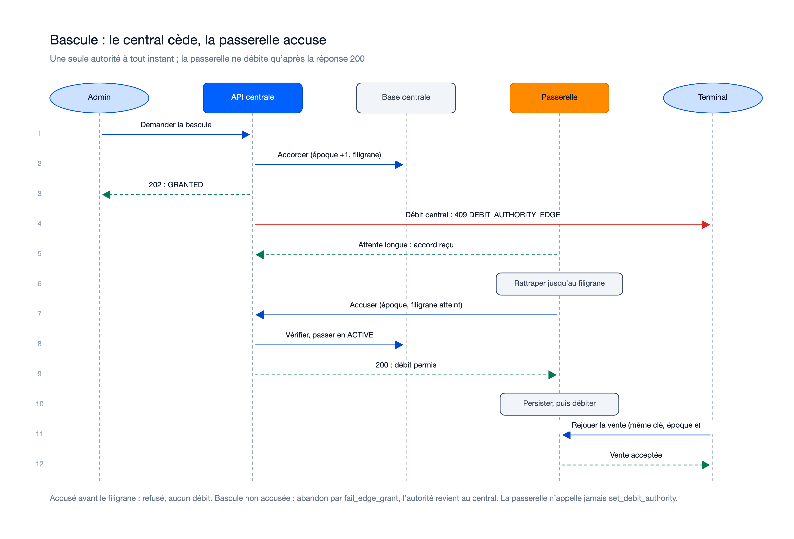
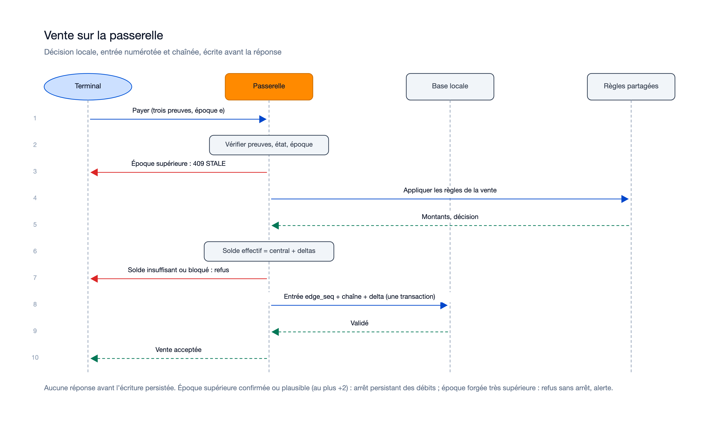
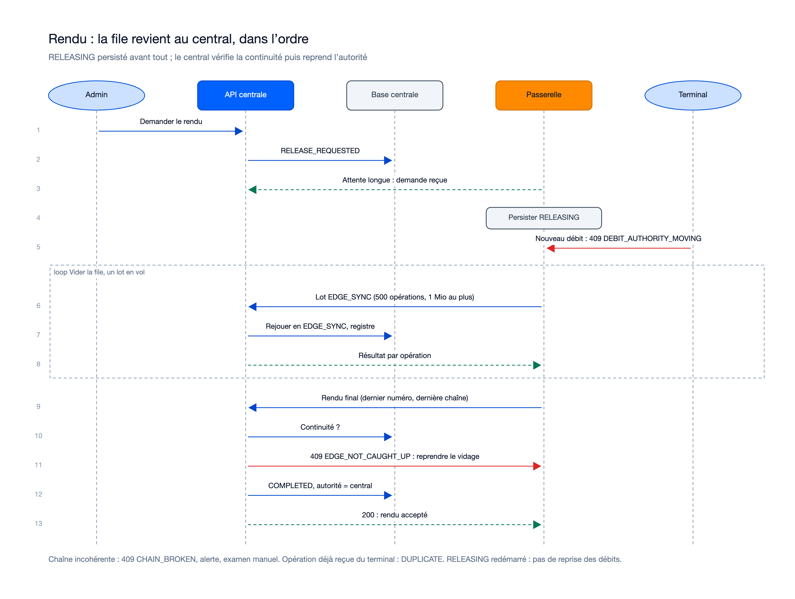
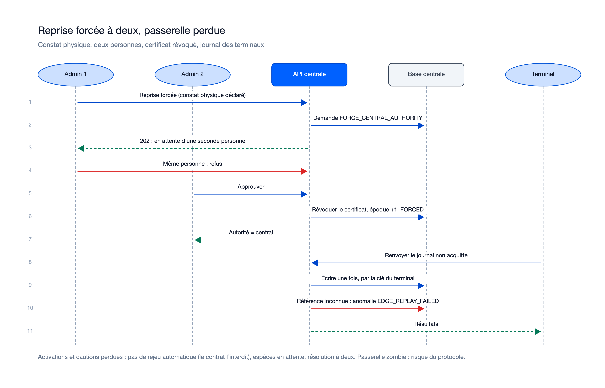

# Séquences : mission passerelle-locale-01M6NM1S

> État : **plan finalisé le 05/11/2026**, flux cibles, rien n'est encore codé. Sources : `plan.md`, `contracts/edge-routes.md`,
> `sync_protocol.md` §9. Diagrammes `/illustre`, rendus relus ; sources dans [`diagrams/`](diagrams/) (`generate.py`).

## Flux internes propres à cette mission

### Bascule : le central cède, la passerelle accuse

Sources : [`sequence-bascule.excalidraw`](diagrams/sequence-bascule.excalidraw), [`sequence-bascule.svg`](diagrams/sequence-bascule.svg).
Le central cesse de débiter dès l'accord (`409 DEBIT_AUTHORITY_EDGE` avec l'adresse de la passerelle et l'époque). La passerelle
rattrape le flux jusqu'au filigrane, accuse ; un accusé incomplet est refusé. Elle ne débite qu'après la réponse `200`.

### Vente sur la passerelle

Sources : [`sequence-vente.excalidraw`](diagrams/sequence-vente.excalidraw), [`sequence-vente.svg`](diagrams/sequence-vente.svg).
Trois preuves du terminal, état de la passerelle (`STANDBY`, `RELEASING`, `STALE`), époque, règles pures partagées
(`packages/shared-rules`), puis une seule transaction locale : entrée `edge_seq`, chaîne et delta de solde, avant la réponse.

### Rendu : la file revient au central

Sources : [`sequence-rendu.excalidraw`](diagrams/sequence-rendu.excalidraw), [`sequence-rendu.svg`](diagrams/sequence-rendu.svg).
`RELEASING` est persisté avant tout ; un seul lot en vol (500 opérations, 1 Mio) ; le rendu final porte le dernier numéro et la
dernière chaîne ; `409 EDGE_NOT_CAUGHT_UP` renvoie au vidage, `409 CHAIN_BROKEN` à un examen manuel.

### Reprise forcée à deux

Sources : [`sequence-reprise.excalidraw`](diagrams/sequence-reprise.excalidraw), [`sequence-reprise.svg`](diagrams/sequence-reprise.svg).

### Flux décrits en texte seulement (pas de diagramme séparé)

- **Réplication** (`getEdgeReplicationFeed`) : tirage continu avec curseur (`after_posting_id`, `after_change_seq`) ; soldes,
  statuts, bracelets, mots de passe chiffrés sous une clé de contenu par passerelle, sessions de caisse et de vendeur, terminaux,
  catalogue ; jamais de mot de passe avant 30 min ni pour une `STANDBY` non promue.
- **Lot hors ligne relayé** : lot du terminal traité avec les règles de la mission 7 sur les soldes locaux, puis relayé en
  `EDGE_SYNC` avec l'en-tête et la signature d'origine ; `400 BATCH_SIGNATURE_INVALID` si la signature d'origine est invalide.
- **Recharge espèces sous session déjà ouverte** : décision locale sur une session répliquée avant la bascule, rejouée au central
  en deux parts si un plafond est dépassé (anomalie `CASH_TOPUP_OVER_LIMIT`, jamais de rejet).

## Flux transverses auxquels cette mission participe (référence, pas dupliqué)

Voir `docs/05-sequence-diagrams.md`, flux : « Bascule vers la passerelle et retour » (flux global de l'initialisation, à
recaler sur le code à la review) ; « Vente hors ligne puis synchronisation » (mission 7, que la passerelle relaie).

## Nécessaire pour cette mission ? Oui : la mission est avant tout une interaction entre composants (administrateur, central, passerelle, terminal, base locale).
## Complet ? Oui pour le plan (réponse proposée par l'Agent). Non dessinés : réplication, lot relayé, recharge espèces (texte ci-dessus) ; à compléter à la review si le code diffère.
## Validé par : réponse proposée par l'Agent le 05/11/2026, en attente de confirmation du porteur.
