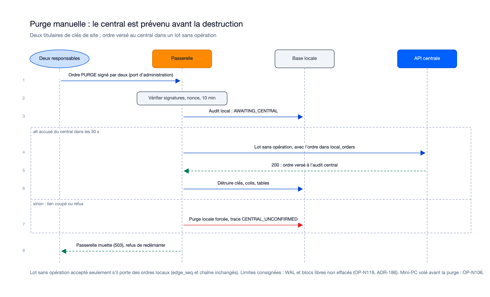

# Séquences : mission passerelle-locale-01M6NM1S

> État : **review terminée le 12/11/2026, 25 lots sur 25 approuvés** ; mission acceptée et consolidée le 12/11/2026, dans `main` par la PR #12 le 13/11/2026. Flux recalés sur le code de la
> lane `y`. Sources : `plan.md`, `contracts/edge-routes.md`, `sync_protocol.md` §9, `docs/passation-8/suivi-lots.md`. Diagrammes
> `/illustre`, rendus relus ; sources dans [`diagrams/`](diagrams/) (`generate.py`). Les quatre diagrammes du plan restent justes et ne
> sont pas redessinés ; un cinquième (purge manuelle) est ajouté.

## Flux internes propres à cette mission

### Bascule : le central cède, la passerelle accuse

Sources : [`sequence-bascule.excalidraw`](diagrams/sequence-bascule.excalidraw), [`sequence-bascule.svg`](diagrams/sequence-bascule.svg).
Le central cesse de débiter dès l'accord (`409 DEBIT_AUTHORITY_EDGE` avec l'adresse de la passerelle et l'époque). La passerelle
rattrape le flux jusqu'au filigrane, accuse ; un accusé incomplet est refusé. Elle ne débite qu'après la réponse `200`.

### Vente sur la passerelle

Sources : [`sequence-vente.excalidraw`](diagrams/sequence-vente.excalidraw), [`sequence-vente.svg`](diagrams/sequence-vente.svg).
Trois preuves du terminal, état de la passerelle (`STANDBY`, `RELEASING`, `STALE`), époque, règles pures partagées
(`packages/shared-rules`), puis une seule transaction locale : entrée `edge_seq`, chaîne et delta de solde, avant la réponse.

### Rendu : la file revient au central

Sources : [`sequence-rendu.excalidraw`](diagrams/sequence-rendu.excalidraw), [`sequence-rendu.svg`](diagrams/sequence-rendu.svg).
`RELEASING` est persisté avant tout ; un seul lot en vol (500 opérations, 1 Mio) ; le rendu final porte le dernier numéro et la
dernière chaîne ; `409 EDGE_NOT_CAUGHT_UP` renvoie au vidage, `409 CHAIN_BROKEN` à un examen manuel.

### Reprise forcée à deux

Sources : [`sequence-reprise.excalidraw`](diagrams/sequence-reprise.excalidraw), [`sequence-reprise.svg`](diagrams/sequence-reprise.svg).

### Purge manuelle : le central est prévenu avant la destruction

Sources : [`sequence-purge.excalidraw`](diagrams/sequence-purge.excalidraw), [`sequence-purge.svg`](diagrams/sequence-purge.svg).
Deux titulaires de clés de site signent l'ordre `PURGE` (10 min, nonce unique). La passerelle l'inscrit à l'audit local (`AWAITING_CENTRAL`),
l'envoie au central dans un lot sans opération (`local_orders`, `edge_seq` et chaîne inchangés), attend l'accusé 30 s, puis détruit.
Sans accusé, la purge locale est forcée et tracée `CENTRAL_UNCONFIRMED`. Après la purge, 503 et refus de redémarrer.

### Flux décrits en texte seulement (pas de diagramme séparé)

- **Réplication** (`getEdgeReplicationFeed`) : tirage continu avec curseur (`after_posting_id`, `after_change_seq`), pages de 200 au plus ;
  soldes, statuts, bracelets, mots de passe chiffrés sous une clé de contenu par passerelle, sessions de caisse et de vendeur, terminaux,
  catalogue, `edge_terms` (plafond par recharge, frais, conditions de caution, ordre de dépense). Jamais de colis avant le délai de garde
  de 30 min ni pour une `STANDBY` non promue : le dépôt est refusé avant ce terme (`0072`), et tout dépôt qui réussit émet dans le flux
  (`0071`) pour qu'une passerelle en marche le reçoive sans relecture complète.
- **Lot hors ligne relayé** : lot du terminal traité avec les règles de la mission 7 sur les soldes locaux, puis relayé en
  `EDGE_SYNC` avec l'en-tête et la signature d'origine, la décision locale (`edge_decision`) jointe et celle du terminal écartée ;
  `400 BATCH_SIGNATURE_INVALID` si la signature d'origine est invalide. La clé d'origine est la même que sur les voies en ligne et hors
  ligne (`<serial>:<seq>` sur 4 chiffres) : une opération reçue deux fois est un doublon (NFR-003).
- **Recharge espèces sous session déjà ouverte** : décision locale sur une session répliquée avant la bascule (réévaluée à chaque
  bascule), refus à la saisie au-delà du plafond par recharge (500 000 XOF par défaut) ; rejouée au central en deux parts si un plafond du
  portefeuille est dépassé (anomalie `CASH_TOPUP_OVER_LIMIT`, jamais de rejet).
- **Lot d'ordres seuls** : un lot sans opération qui ne porte que des ordres locaux à deux personnes (purge, levée de `STALE`) est accepté
  par le central pour les verser à l'audit ; sans ordre, il est refusé par l'API et par la base (`EMPTY_BATCH_WITHOUT_LOCAL_ORDERS`).

## Flux transverses auxquels cette mission participe (référence, pas dupliqué)

Voir `docs/05-sequence-diagrams.md`, flux : « Bascule vers la passerelle et retour » (flux global de l'initialisation, image
non redessinée ; elle reste compatible avec le code, les détails sont dans les diagrammes locaux ci-dessus) ; « Vente hors ligne puis synchronisation » (mission 7, que la passerelle relaie).

## Nécessaire pour cette mission ? Oui : la mission est avant tout une interaction entre composants (administrateur, central, passerelle, terminal, base locale) (réponse proposée par l'Agent le 12/11/2026, en attente de confirmation du porteur).
## Complet ? Oui, recalé à la review (réponse proposée par l'Agent le 12/11/2026, en attente de confirmation du porteur) : cinq diagrammes `/illustre` (purge manuelle ajoutée), réplication, lot relayé, recharge espèces et lot d'ordres seuls en texte. Écart du plan : la purge versée au central avant la destruction n'était pas un flux du plan.
## Validé par : réponse proposée par l'Agent le 12/11/2026, en attente de confirmation du porteur.
