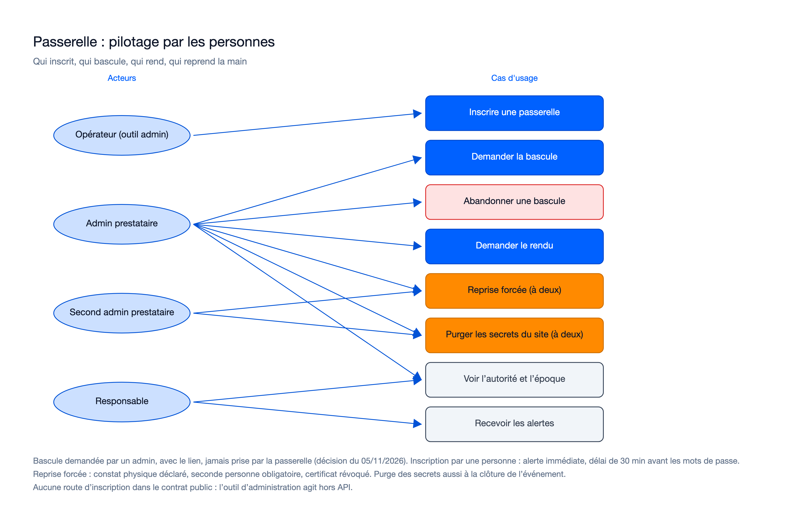
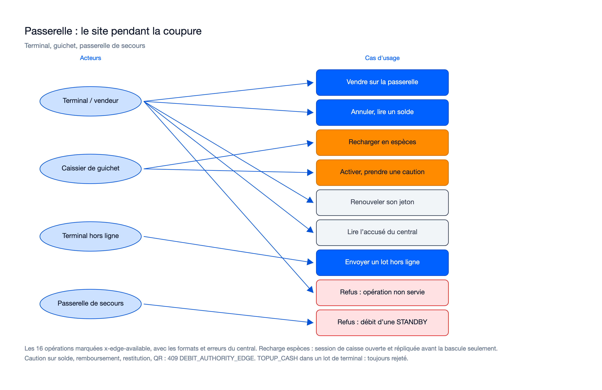

# Cas d'usage : mission passerelle-locale-01M6NM1S

> État : **review terminée le 12/11/2026, 25 lots sur 25 approuvés** ; mission acceptée et consolidée le 12/11/2026,
> dans `main` par la PR #12 le 13/11/2026. Recalé le 12/11/2026 sur le code de la lane `y` (qui contient toutes les autres lanes). Source : `spec.md`
> (9 user stories, 39 FR, 13 NFR, 13 contraintes), `plan.md`, `contracts/`, `docs/passation-8/suivi-lots.md`. Diagrammes `/illustre`
> (préférence du porteur du 13/10/2026), police sans empattement, rendus relus. Le diagramme du pilotage a été corrigé à la review
> (acteurs de la purge) ; les quatre autres sont conservés (ils restent justes).

## Cas d'usage propres à cette mission

### Personnes : inscrire, basculer, rendre, reprendre la main

Sources : [`usecase-admin.excalidraw`](diagrams/usecase-admin.excalidraw), [`usecase-admin.svg`](diagrams/usecase-admin.svg).

### Site : le terminal et le guichet pendant la coupure

Sources : [`usecase-site.excalidraw`](diagrams/usecase-site.excalidraw), [`usecase-site.svg`](diagrams/usecase-site.svg).

| Cas d'usage | Acteur | Règle principale (prévue) | Route ou outil |
|---|---|---|---|
| Inscrire une passerelle | Opérateur, par l'outil d'administration | Numéro, rôle `PRIMARY` ou `STANDBY`, certificat, clé d'accord, adresse du site ; une personne ; alerte immédiate, aucun mot de passe de bracelet avant 30 min (délai de garde, appliqué aussi au dépôt des colis par la migration `0072`), rien pour une `STANDBY` non promue ; `central_url` d'enrôlement finissant par `/v1` | `tools/edge-admin` (hors API publique, aucune route ajoutée) |
| Demander la bascule | `OPERATOR_ADMIN` | `grant_edge_authority` : le central cesse de débiter, `202`, époque +1 ; refusée si la passerelle est `STANDBY`, révoquée ou d'un autre événement | `POST /ledgers/{ledger_id}/debit-authority` (`target = EDGE`) |
| Abandonner une bascule | `OPERATOR_ADMIN` | `fail_edge_grant` sur un handover `GRANTED` : l'autorité revient au central | même route (`target = CENTRAL`) |
| Voir l'autorité et l'époque | `OPERATOR_ADMIN`, `ORGANIZER_ADMIN` (lecture, confirmé dans `READ_ROLES`) ; passerelle | Autorité, époque, passerelle désignée, handover ouvert | `GET /ledgers/{ledger_id}/debit-authority` |
| Demander le rendu | `OPERATOR_ADMIN` | `RELEASE_REQUESTED` ; la passerelle persiste `RELEASING` et cesse de débiter | même route (`target = CENTRAL`, `force = false`) |
| Reprise forcée à deux | `OPERATOR_ADMIN` + seconde personne | Constat physique déclaré, `FORCE_CENTRAL_AUTHORITY`, certificat révoqué, handover `FORCED` | même route (`force = true`), approbation |
| Purger les secrets du site | Deux titulaires de clés de site (pas des admins du central) ; automatique à la clôture si la file est vide et acquittée | Ordre `PURGE` signé par deux, valable 10 min, sur l'écouteur d'administration local en TLS ; refusé si la file n'est pas acquittée ; versé au central AVANT la destruction (lot sans opération portant l'ordre, accusé attendu 30 s) ; sans accusé, purge locale forcée, trace `CENTRAL_UNCONFIRMED` ; après la purge, 503 et refus de redémarrer (FR-035) | écouteur d'administration de la passerelle, `POST /local/orders` |
| Lever `STALE` localement | Deux titulaires de clés de site | Ordre `LOCAL_UNSTALE` à deux personnes, seulement si le lien est coupé ; versé à l'audit du central par un champ facultatif de `/edge/sync-batches` (ADR-169) | écouteur d'administration |
| Recevoir les alertes | Responsable | Inscription, changement de rôle, chaîne rompue, rendu bloqué, passerelle muette, époque forgée | audit et alertes (FR-034) |
| Vendre, annuler, lire un solde | Terminal, vendeur | Les 16 opérations `x-edge-available` avec les mêmes formats et erreurs ; époque exigée ; solde effectif = solde central + deltas locaux | `createPayment`, `reversePayment`, `getPayment`, `createTap` et les lectures (16 opérations, voir `contracts/gateway-served-operations.md`) |
| Recharger en espèces | Caissier | Seulement sur une session de caisse ouverte au central et répliquée avant la bascule (réévaluée à chaque bascule, `edge-0010`) ; plafond par recharge réglable, 500 000 XOF par défaut, refus à la saisie ; jamais rejetée au rejeu (deux parts, anomalie à deux) ; aucune ouverture, relève ni fermeture sur la passerelle | `POST /topups/cash` (`createCashTopup`) sur la passerelle |
| Activer, prendre une caution | Caissier | Activation sans frais sur solde et caution en espèces, transmises au central dans la même file ; conditions de caution et frais répliqués (`edge_terms`, ADR-172) ; sans elles, refus | `POST /media/activations`, `POST /media/{media_id}/deposit` sur la passerelle |
| Renouveler son jeton | Terminal | Jeton court signé par la clé propre de la passerelle, valable sur elle seule, sans rotation du jeton de rafraîchissement | `POST /device-tokens/refresh` sur la passerelle |
| Lire l'accusé du central | Terminal | Accusé contigu du central, jamais l'accusé provisoire de la passerelle | `GET /device/seq-status` |
| Envoyer un lot hors ligne | Terminal isolé | Règles de la mission 7 avec les soldes de la passerelle ; relais avec la signature d'origine, la décision locale (`edge_decision`) jointe et celle du terminal écartée (défaut B corrigé en WP25) ; `TOPUP_CASH` d'un lot toujours rejeté | `POST /offline-batches` sur la passerelle (`submitOfflineBatch`) |
| Refus : opération non servie, `STANDBY` | Terminal | Caution sur solde, remboursement, restitution, QR : `409 DEBIT_AUTHORITY_EDGE` ; `STANDBY` refuse tout débit | passerelle |

## Lien avec la synthèse globale

Contribue à : `docs/02-use-case-diagram.md`, section « Hors ligne et passerelle locale » (domaine existant, la mission 8
livre sa moitié « passerelle locale »). Pas de renommage ni de fusion de cas d'usage globaux.

## Nécessaire pour cette mission ? Oui : la mission introduit six acteurs et seize cas d'usage nouveaux (pilotage, site, guichet, purge), donc la règle de génération des diagrammes s'applique (réponse proposée par l'Agent le 12/11/2026, en attente de confirmation du porteur).
## Complet ? Oui, recalé à la review (réponse proposée par l'Agent le 12/11/2026, en attente de confirmation du porteur). Les deux points ouverts du plan sont tranchés par le code : lecture de `getDebitAuthority` par `OPERATOR_ADMIN` et `ORGANIZER_ADMIN` ; conditions de caution répliquées par `edge_terms` pour `activateMedia` et `takeDeposit`. Écarts plan vers livré : acteurs de la purge corrigés (titulaires de clés de site), cas « lever `STALE` à deux » ajouté.
## Validé par : réponse proposée par l'Agent le 12/11/2026, en attente de confirmation du porteur.
