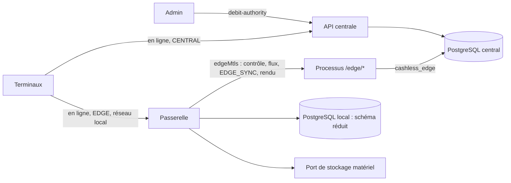

# Implementation Plan: Passerelle locale de site

**Branch**: `feat/passerelle-locale` | **Date**: 2026-11-05 | **Spec**: [spec.md](spec.md)
**Input**: Mission specification from `kitty-specs/passerelle-locale-01M6NM1S/spec.md`

Contrat de branche : départ, planification et cible de fusion sur `feat/passerelle-locale`, puis PR vers `main`.

## Summary

Une passerelle de site prend l'autorité de débit d'un événement pendant une coupure, puis la rend au central sans perte ni double écriture. Le grand livre sait déjà tenir l'exclusion (fonctions S12 et S13, jamais exposées). Il manque l'application `apps/gateway` et, au central, les routes `debit-authority` et `/edge/*`.

Décisions du porteur du 05/11/2026 (`decisions/`, `docs/passation-8/contexte-m8.md`) :

| # | Décision |
|---|---|
| 1 | Bascule demandée par un admin, avec le lien ; aucune prise d'autorité par la passerelle |
| 2 | Recharges espèces sur sessions ouvertes au central et répliquées avant la bascule, fermées au central après le rendu |
| 3 | Clés de la passerelle derrière un port de stockage matériel, faux refusé en production, réel en 12b |
| 4 | `STANDBY` promue par handover normal seulement |
| 5 | Contrat stable : champs facultatifs sur `ReplicationPage` seulement, sous `/edge/*` ; inscription hors API publique |
| 6 | PostgreSQL local, schéma réduit, règles partagées en TypeScript ; le central seul tient la comptabilité |
| 7 | Jetons d'appareil signés par une clé propre à la passerelle, valables sur elle seule |
| 8 | Jeton de personne expiré toléré au guichet : passerelle seulement, même personne, même terminal, session ouverte, 12 h, audité |
| 9 | Passerelle perdue : pas de rejeu depuis le journal (le contrat l'interdit), anomalie `EDGE_REPLAY_FAILED` sur toute référence inconnue, rétablissement manuel à deux |

Décisions du porteur après la passe contradictoire (05/11/2026, `docs/passation-8/contexte-m8.md` décisions 11 à 18 ; la numérotation du tableau ci-dessus est celle de
`decisions/`, celle-ci est celle de la fiche de contexte) :

| # | Décision |
|---|---|
| 11 | Jeton d'appareil renouvelé sans rotation sur la passerelle (empreinte courante et certificat répliqués, jeton court valable sur elle seule, rotation forcée au retour) ; écart accepté |
| 12 | Paramètre facultatif `after_change_seq` accepté sur `/edge/replication-feed` |
| 13 | Ventes `EDGE_ONLINE` : au rejeu, preuve du bracelet, plafond par vente, par terminal et par heure, alerte ; risque résiduel accepté, perte maximale chiffrée |
| 14 | Recharge espèces jamais rejetée pour un plafond au rejeu : deux parts, anomalie résolue à deux ; dépassement temporaire à signaler au juriste |
| 15 | `STALE` persisté seulement si confirmé ou plausible (époque détenue + 2) ; levée locale à deux personnes |
| 16 | Inscription d'une passerelle par UNE personne, alerte immédiate et délai avant les mots de passe ; rien pour une `STANDBY` non promue ; écart accepté |
| 17 | Purge automatique à la clôture de l'événement et manuelle à deux personnes ; limite : mini-PC volé avant la purge |
| 18 | Audit de la tolérance des jetons de personne versé au central par un champ facultatif sous `/edge/*` |

## Technical Context

**Language/Version**: TypeScript 5.9.3, Node.js 22 LTS (`engines: >=22 <23`), SQL PostgreSQL 17
**Primary Dependencies**: NestJS 11, `pg`, `jose`, `tsx`, déjà épinglés (`docs/08-pile-logicielle.md`). Aucune dépendance nouvelle prévue ; toute exception est listée et contrôlée dans `research.md` (DIRECTIVE_051), avec passe contradictoire
**Storage**: PostgreSQL 17 au central (migrations `0058` et suivantes) ; PostgreSQL 17 local à la passerelle (schéma réduit, série propre `edge-NNNN`)
**Testing**: Jest (unitaires et intégration à deux processus, relais TCP coupable, points d'arrêt actifs hors production) ; pgTAP pour les droits et fonctions ; vecteurs de la chaîne produits par les générateurs, jamais dans les `.sql` générés
**Target Platform**: mini-PC Linux sur site (image Docker) ; central inchangé. Preuves sur poste macOS et CI Linux
**Project Type**: monorepo npm (`apps/`, `packages/`)
**Performance Goals**: paiement sur la passerelle p95 ≤ 200 ms et p99 ≤ 500 ms (NFR-005, 1 000 paiements, serveur seul) ; 10 000 opérations reversées en moins de 10 min (NFR-006) ; accusé de bascule en moins de 30 s, avec réveil immédiat de l'attente longue (NFR-007) ; blocage appliqué en moins de 5 s (NFR-008)
**Constraints**: contrat stable (C-002), vérifié en CI contre `d2a7c538` ; `set_debit_authority` jamais appelée (C-003) ; aucune clé maître sur site (C-009) ; aucun faux en production (règle 2 de `CLAUDE.md`) ; `.sql` générés intouchés (C-010)
**Scale/Scope**: un événement et un prestataire par passerelle ; 10 000 opérations en file ; lots de 500 opérations et 1 Mio ; 39 FR, 13 NFR, 13 contraintes

## Charter Check

Pas de charte (`.kittify/charter/charter.yaml` absent) : contrôle sans objet. Les règles qui en tiennent lieu sont `CLAUDE.md` (écarts de sécurité, aucun faux en production, dette nommée, revue) et SPECIFICATION §0.3.

Contrôle des écarts de sécurité : voir Complexity Tracking et `research.md`. Aucun écart n'est codé sans décision du porteur. Restent À SOUMETTRE AU PORTEUR (rien n'est codé sur eux avant sa réponse) : les valeurs des plafonds de rejeu `EDGE_ONLINE` (par vente, par terminal et par heure) et le délai avant l'envoi des mots de passe après inscription (`research.md`, « Écarts de sécurité », points 11 à 14).

## Project Structure

### Documentation (this mission)

```
kitty-specs/passerelle-locale-01M6NM1S/
├── spec.md
├── plan.md
├── research.md
├── research-adversarial.md
├── data-model.md
├── quickstart.md
├── contracts/
│   ├── replication-page-additions.yaml
│   ├── edge-routes.md
│   ├── gateway-served-operations.md
│   └── contract-stability-check.md
└── tasks.md             # /spec-kitty.tasks
docs/passation-8/        # fiche commune, rapports de recherche et de relecture, suivi des lots
```

### Source Code (repository root)

```
apps/
├── api/src/
│   ├── edge/                  # routes /edge/*, garde edgeMtls, réplication, réception EDGE_SYNC, rendu
│   ├── debit-authority/       # POST et GET /ledgers/{id}/debit-authority, reprise forcée
│   └── processes/             # processus dédié aux routes /edge/*, rôle cashless_edge
└── gateway/
    ├── Dockerfile
    ├── migrations/            # série edge-NNNN : file, soldes, état de bascule, curseur, copies
    ├── src/
    │   ├── authority/         # machine à états, persistance, exclusion par l'époque
    │   ├── replication/       # tirage continu du flux
    │   ├── queue/             # edge_seq, chaîne, vidage
    │   ├── operations/        # les 16 opérations servies, refus des autres
    │   ├── device-proofs/     # trois preuves du terminal, jetons de la passerelle
    │   ├── staff/             # jetons de personne, tolérance bornée
    │   ├── key-store/         # port de stockage matériel, faux refusé en production
    │   └── snapshots/         # snapshots signés par la clé propre
    └── test/
packages/
├── contracts/                 # openapi.yaml : ajouts facultatifs sous /edge/* seulement
├── ledger-sql/migrations/     # 0058 et suivantes
└── shared-rules/              # règles pures partagées central et passerelle (R-02)
tools/
└── edge-admin/                # inscription d'une passerelle, hors API publique
docs/
└── procedure-site-passerelle.md
```

Le paquet partagé est `packages/shared-rules` (R-02 de `research.md`). `research-adversarial.md` suit les 29 constats de la passe contradictoire.

### Architecture



## Complexity Tracking

| Écart | Pourquoi il est nécessaire | Alternative écartée, et pourquoi | Dette |
|---|---|---|---|
| « Même moteur » (SPEC §9) devient « mêmes modules » | Le flux du contrat ne porte que des soldes : ni écritures, ni invariants à répliquer | Schéma central complet : flux bien plus large, second sens de `debit_authority`, refonte de l'API (porteur, 05/11/2026) | Signalé, à reporter dans SPECIFICATION |
| Clés de passerelle simulées | Aucun matériel avant la 12b | Clé logicielle chiffrée : exposée en mémoire et sur disque ; achat immédiat : hors feuille de route | OP, ADR, test, report 12b |
| Jetons d'appareil de la passerelle : droit nouveau | Sinon, terminaux perdus 15 min après la coupure | Clé du central sur site : valable partout ; aucun renouvellement : passerelle inutile | OP, ADR, test de refus au central |
| Jeton de personne expiré toléré : contrôle affaibli | Sinon, guichets arrêtés à l'expiration | Refus strict : annule la décision sur les espèces ; jeton long : valable aussi au central | OP, ADR, test de bornes, audit |
| Reprise forcée : pas de rejeu automatique des activations et cautions | Le contrat interdit `ACTIVATION` et `DEPOSIT_CASH` dans un lot de terminal | Changer le contrat : refusé par la consigne du porteur | OP, anomalie, résolution à deux |
| Jeton d'appareil de la passerelle sans rotation (décision 11) | Sans renouvellement, le site s'arrête 15 min après la coupure (A01) | Rotation locale : jeton inconnu du central au retour ; aucun renouvellement : passerelle inutile | OP, ADR, test de refus du jeton copié |
| Ventes `EDGE_ONLINE` sans signature du terminal (décision 13) | La passerelle décide seule ; le contrat ne relaie la signature que pour `DEVICE_OFFLINE` | Relais de la signature : changement de contrat ; recalcul au central : seconde autorité | OP, ADR, perte maximale chiffrée, bornes au rejeu |
| Inscription par une personne (décision 16) | Choix du porteur contre la recommandation (deux personnes) | Approbation à deux : plus lourde à l'installation | OP, ADR, alerte, délai avant les colis |
| `STALE` plausible (décision 15) | Une époque forgée ne doit pas arrêter le site | `STALE` sur toute époque supérieure : arrêt par un en-tête forgé | OP, ADR, levée locale à deux |
| Purge : mini-PC volé avant la purge (décision 17) | Un mini-PC débranché ne reçoit pas la révocation | Aucune : limite physique | OP, ADR, test de purge |
| Recharge espèces au rejeu : dépassement temporaire de plafond (décision 14) | Ne jamais perdre des espèces encaissées | Rejet au rejeu : espèces sans écriture (A09) | OP, ADR, à signaler au juriste |

## Implementation Concern Map

Les concerns ne sont pas des lots. `/spec-kitty.tasks` les traduit.

### IC-01 — Droits, rôle et fonctions de la base

- **Purpose**: exposer S12 et S13 à un rôle dédié, avec les fonctions manquantes, sans affaiblir les contrôles.
- **Relevant requirements**: FR-003, FR-006, FR-007, FR-021, FR-022, FR-024, FR-031 ; C-003, C-010, C-012 ; NFR-011.
- **Key decisions**: rôle `cashless_edge` ; enveloppes liées à la passerelle et au handover ; `EDGE_SYNC` refusée à `cashless_app` ; écriture directe de `cashless_app` sur `edge_gateway` retirée ; `record_edge_seq` refuse une passerelle `REVOKED` ou sans handover ; `RELEASING` posé avant la vérification ; colonnes nouvelles de `edge_gateway` nullables, sans index ni `CHECK` qui casse les suites générées, `revoked_at` posé par déclencheur (A04) ; `operations_count` par cycle (A05) ; accusé idempotent (A17) ; échange atomique des rôles (A25).
- **Risks**: `tests_execute_grants.sql` fige les droits, à mettre à jour ; **lot de non-régression « les suites générées passent sans modification après 0058-0061 », premier de la CI SQL** ; fichiers à faire relire par une personne, dont l'enveloppe `edge_post_transaction` et ses bornes, `edge_activate_media`, `edge_take_deposit`, la persistance de `STALE`, la lecture du handover courant et la gestion d'horloge.

### IC-02 — Autorité de débit au central

- **Purpose**: servir `debit-authority`, y compris la reprise forcée à deux, sur tous les chemins de débit.
- **Relevant requirements**: FR-003, FR-004, FR-007, FR-013, FR-028.
- **Key decisions**: appel des seules fonctions du schéma ; 409 complétés seulement selon ce que le contrat déclare ; l'en-tête d'époque n'est contrôlé que là où le contrat le déclare (paiement, annulation, recharge espèces, lots) ; activation et caution contrôlent l'état de la passerelle sans en-tête (R-29, rien n'est imposé aux clients).
- **Risks**: refus à prouver chemin par chemin ; ne pas modifier le comportement des clients existants en `CENTRAL`.

### IC-03 — Canal de la passerelle au central

- **Purpose**: identité `edgeMtls`, canal de contrôle, accusé, rendu.
- **Relevant requirements**: FR-005, FR-006, FR-021, FR-022, FR-031, FR-034 ; NFR-007, NFR-011.
- **Key decisions**: certificat de la passerelle par autorité distincte de celle des terminaux ; attente longue avec réveil immédiat ; processus central dédié ; révocation vérifiée à chaque requête.
- **Risks**: seconde autorité sur le serveur TLS : un certificat de terminal ne doit jamais passer sur `/edge/*`, ni l'inverse.

### IC-04 — Réplication

- **Purpose**: tenir à jour tout ce que la passerelle doit savoir.
- **Relevant requirements**: FR-008, FR-009, FR-027 ; NFR-008, NFR-010, NFR-012 ; C-002.
- **Key decisions**: UN schéma de flux (`replication-page-additions.yaml`) : champs facultatifs sur `ReplicationPage` et `after_change_seq` ; journal `change_seq` pour tout changement sans écriture comptable, blocages compris ; horizon des écritures validées ; accusé refusé sans le curseur de référence ; mots de passe chiffrés sous une clé de contenu par passerelle, scellée pour sa clé d'accord, jamais à une `STANDBY` non promue ni avant le délai ; jamais d'empreinte de PIN.
- **Risks**: fuite d'une donnée d'un autre événement ; écriture validée hors ordre ; triggers de journal sur les tables d'origine.

### IC-05 — Réception au central (`EDGE_SYNC`)

- **Purpose**: rejouer la file dans l'ordre, sans double écriture, en reprenant la décision de la passerelle.
- **Relevant requirements**: FR-017, FR-018, FR-019, FR-020, FR-025, FR-036, FR-038 ; NFR-003.
- **Key decisions**: enveloppe vérifiant passerelle, handover, époque et `origin_*`, qui construit elle-même les lignes ; bornes en SQL sous verrou de compte (types, comptes, rognage à la borne, preuve du bracelet, plafonds, `REVERSAL`, recharge en deux parts) ; une transaction par opération avec `record_edge_seq` ; traitement de `CL007` ; `activate_media` et `take_deposit` sous source `EDGE_SYNC` avec la clé du terminal ; idempotence par lot ; lot abandonné repris sous un nouveau `batch_id` ; audit des jetons toléré reçu avec le lot.
- **Risks**: fonctions de la mission 7 liées à un terminal ; contenu de `edge_decision` non vérifiable : borner, journaliser, alerter ; perte maximale `EDGE_ONLINE` chiffrée (R-09).

### IC-06 — Passerelle : socle et machine à états

- **Purpose**: application, base locale, autorité persistée, exclusion par l'époque.
- **Relevant requirements**: FR-001, FR-006, FR-012, FR-021, FR-023, FR-030 ; NFR-004.
- **Key decisions**: état persisté avant toute réponse ou action ; `RELEASING` et époque périmée sans retour possible ; `STALE` persisté seulement si confirmé ou plausible, levée locale à deux ; lecture du handover courant par priorité ; horloge à plafond persisté ; `STANDBY` sans débit, vérifié à chaque requête, rôle appris par `reference.gateway`.
- **Risks**: reprise après arrêt brutal : tests à chaque point d'arrêt, dont l'arrêt du conteneur PostgreSQL local.

### IC-07 — Passerelle : file et chaîne

- **Purpose**: numéroter, chaîner, persister, vider.
- **Relevant requirements**: FR-014, FR-017, FR-026 ; NFR-002, NFR-004, NFR-006.
- **Key decisions**: écriture de la décision et de l'effet sur le solde dans la même transaction, avant la réponse ; un lot en vol ; contenu haché fixé par vecteurs communs ; accusé du central seulement vers les terminaux.
- **Risks**: contenu du hachage aujourd'hui non défini pour activation et caution.

### IC-08 — Passerelle : preuves du terminal et des personnes

- **Purpose**: authentifier sans le central.
- **Relevant requirements**: FR-010, FR-039 ; NFR-011 ; décisions 7 et 8.
- **Key decisions**: trois preuves du terminal sur la passerelle, avec registre de nonces local ; `@authority` empêche le rejeu entre central et passerelle (listes disjointes, sans joker, testé dans les deux sens) ; jetons propres à la passerelle, refusés au central, renouvelés sans rotation (empreinte répliquée, décision 11) ; tolérance des jetons de personne strictement bornée (dont `exp >= activated_at`) et auditée, audit versé au central.
- **Risks**: fichiers à faire relire par une personne ; tests de borne pour chaque condition de la tolérance ; secret dérivé de plus sur le site (empreintes).

### IC-09 — Passerelle : opérations de vente

- **Purpose**: ventes, annulations, lectures, refus.
- **Relevant requirements**: FR-010, FR-011, FR-012 ; NFR-005.
- **Key decisions**: mêmes formats et erreurs qu'au central, prouvés contre le schéma du contrat ; règles pures partagées ; solde effectif = solde central + deltas d'`edge_seq` supérieur à `edge_seq_applied` (jamais au-dessus du réel pour les débits ; les recharges espèces non rejouées le relèvent, c'est la borne au rejeu qui protège le central).
- **Risks**: divergence de règles : mêmes scénarios de référence des deux côtés.

### IC-10 — Passerelle : guichet

- **Purpose**: recharges, activations, cautions.
- **Relevant requirements**: FR-015, FR-016, FR-020 ; C-005, C-006.
- **Key decisions**: session ouverte et répliquée avant la bascule, sans exemption ; `TOPUP_CASH` d'un lot de terminal toujours rejeté ; recharge de la passerelle jamais rejetée pour un plafond au rejeu (deux parts, anomalie `CASH_TOPUP_OVER_LIMIT`, décision 14) ; clés d'origine = `Idempotency-Key` du terminal ; `begin_cash_close` refusé (`409 CONFLICT_STATE`) tant que l'autorité est à la passerelle ou que la file n'est pas vide.
- **Risks**: garde ADR-132 au rejeu ; écriture d'attente de §9.6 sur une caisse ; dépassement temporaire d'un plafond réglementaire (à signaler au juriste).

### IC-11 — Passerelle : lots hors ligne et snapshots

- **Purpose**: traiter et relayer les lots, produire des snapshots locaux.
- **Relevant requirements**: FR-025, FR-026, FR-027.
- **Key decisions**: règles de la mission 7 sur les soldes locaux ; relais de l'en-tête et de la signature d'origine ; clé propre `owner = EDGE`, déclarée dans `config.snapshot_keys`.
- **Risks**: code de la mission 7 très lié à la base centrale : ne réutiliser que le pur.

### IC-12 — Reprise forcée et passerelle perdue

- **Purpose**: reprendre la main à deux, traiter le journal des terminaux.
- **Relevant requirements**: FR-028, FR-029 ; NFR-003.
- **Key decisions**: `FORCE_CENTRAL_AUTHORITY` à deux, sans valideur dans le corps ; révocation du certificat (`revoked_at` posé par déclencheur, la fonction du kit n'est pas réécrite) ; référence `ONLINE_REF` inconnue : anomalie `EDGE_REPLAY_FAILED`, les opérations déjà rejouées étant retrouvées par la clé du terminal ; `TOPUP_CASH` : refus existant, anomalie avec montant.
- **Risks**: passerelle zombie, risque résiduel accepté par le protocole.

### IC-13 — Port de stockage matériel et faux

- **Purpose**: isoler les clés de la passerelle ; refuser les faux en production.
- **Relevant requirements**: FR-032, FR-035 ; NFR-009, NFR-010, NFR-013 ; C-007, C-009.
- **Key decisions**: une seule porte pour signature des snapshots, signature des jetons et clé d'accord ; garde de démarrage réelle, éprouvée avec le vrai `NestFactory`, énumération `NODE_ENV` stricte de l'API et liste exhaustive des réglages de développement refusés en production (R-26).
- **Risks**: le défaut de démarrage de la mission 4 a montré que des tests sans vrai démarrage ne prouvent rien.

### IC-14 — Inscription, image et procédure de site

- **Purpose**: installer et révoquer en confiance.
- **Relevant requirements**: FR-002, FR-033, FR-034, FR-037.
- **Key decisions**: outil d'administration hors API publique, rôle distinct, audité ; inscription par une personne avec alerte immédiate et délai avant les colis (décision 16) ; image sans secret ; procédure disque chiffré, onduleur, Wi-Fi, révocation, **purge des secrets à la clôture et à deux personnes** (décision 17, FR-035).
- **Risks**: Docker et image non éprouvés sur le matériel réel ; mini-PC volé avant la purge (limite consignée).

### IC-15 — Contrat

- **Purpose**: ajouter le strict nécessaire, et prouver que rien d'autre ne bouge.
- **Relevant requirements**: FR-009 ; NFR-012 ; SC-006 ; C-002.
- **Key decisions**: UN schéma de flux, types TypeScript et Dart régénérés ; aucune valeur d'énumération ajoutée ; contrôle en CI contre `d2a7c538`, avec témoin positif à codes de sortie distincts, vérification que la mutation a eu lieu, et `CODEOWNERS` ou contrôle équivalent sur `contract-baseline.json` (A23).
- **Risks**: une modification sur une route cliente doit faire échouer la CI.

### IC-16 — Preuves de bout en bout, CI et consignation

- **Purpose**: prouver l'exclusion, l'absence de perte et consigner les dettes.
- **Relevant requirements**: SC-001 à SC-007 ; NFR-001 à NFR-006 ; règle 3 de `CLAUDE.md`.
- **Key decisions**: relais TCP coupable, deuxième base, étape CI dédiée en série ; deux cycles de bascule consécutifs sur la même passerelle (A05) ; canari sous toutes ses représentations avec contrôle positif (A22) ; §13-4 et §13-5 du protocole ; OP et ADR ; reports en 12b et 13 ; matrice d'acceptation tenue au fil des lots ; tests de la mission 7 relancés.
- **Risks**: durée et mémoire de la CI ; instabilités connues du poste.
