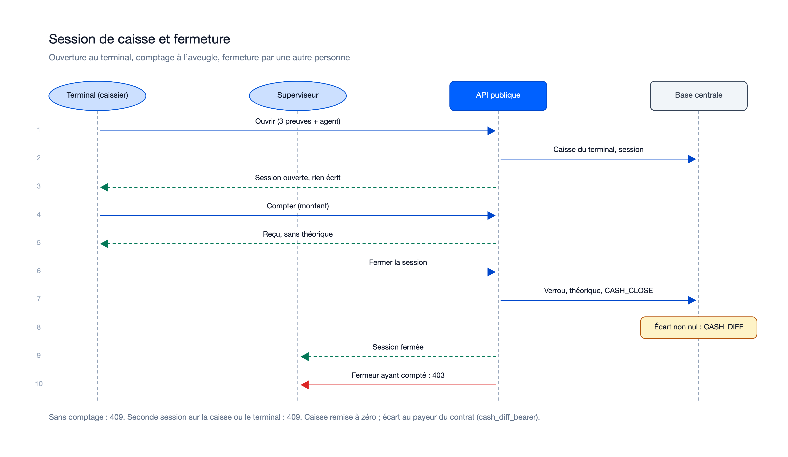
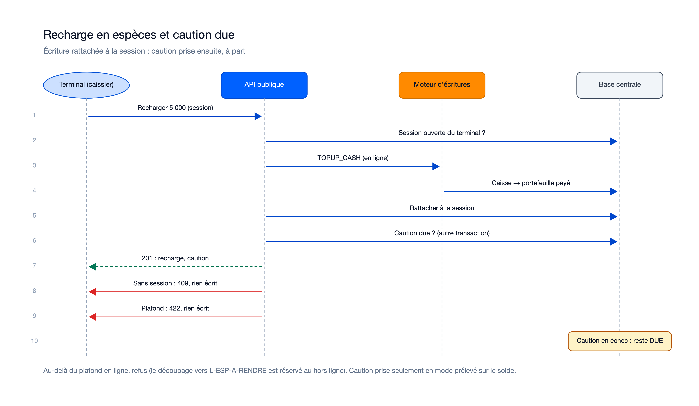
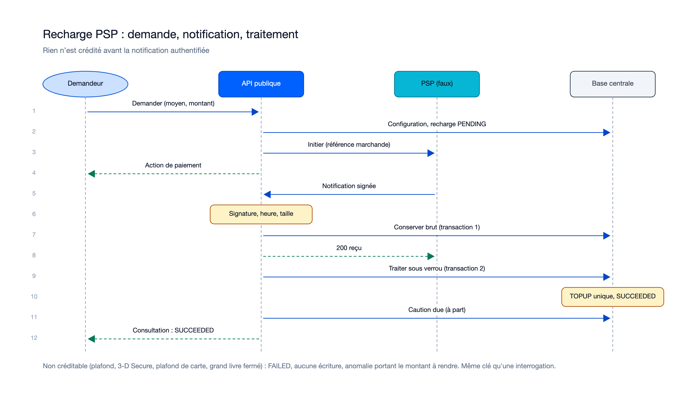
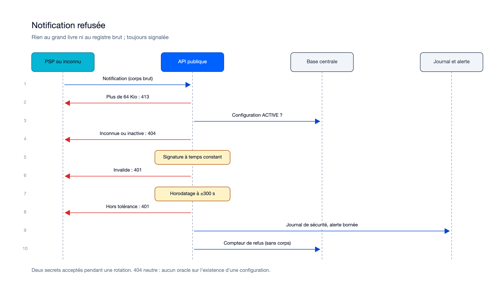
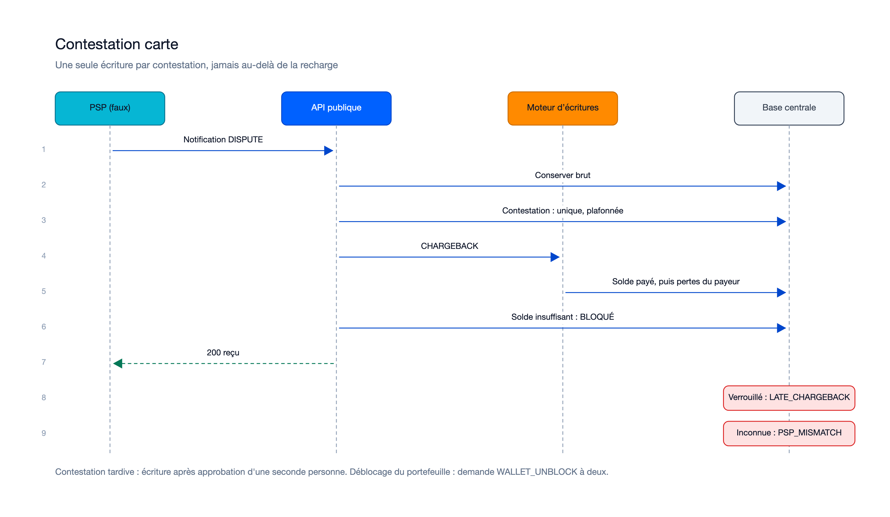

# Séquences — mission recharges-caisses-psp-01M5YEBA

> État : **plan finalisé le 27/10/2026** ; flux tels que planifiés (`research.md` R-02, R-03, R-10, R-11, R-12, R-14 et
> R-20). À recaler sur le code livré à l'addendum post-relecture.

## Flux internes propres à cette mission

### Session de caisse et fermeture

Sources : [`sequence-session-caisse.excalidraw`](diagrams/sequence-session-caisse.excalidraw), [`sequence-session-caisse.svg`](diagrams/sequence-session-caisse.svg).

### Recharge en espèces et caution due

Sources : [`sequence-recharge-especes.excalidraw`](diagrams/sequence-recharge-especes.excalidraw), [`sequence-recharge-especes.svg`](diagrams/sequence-recharge-especes.svg).

### Recharge PSP : demande, notification conservée, traitement

Sources : [`sequence-recharge-psp.excalidraw`](diagrams/sequence-recharge-psp.excalidraw), [`sequence-recharge-psp.svg`](diagrams/sequence-recharge-psp.svg).

### Interrogation planifiée et expiration

Sources : [`sequence-interrogation.excalidraw`](diagrams/sequence-interrogation.excalidraw), [`sequence-interrogation.svg`](diagrams/sequence-interrogation.svg).

### Notification refusée

Sources : [`sequence-notification-refusee.excalidraw`](diagrams/sequence-notification-refusee.excalidraw), [`sequence-notification-refusee.svg`](diagrams/sequence-notification-refusee.svg).

### Contestation carte

Sources : [`sequence-contestation-carte.excalidraw`](diagrams/sequence-contestation-carte.excalidraw), [`sequence-contestation-carte.svg`](diagrams/sequence-contestation-carte.svg).

Régénération : `python3.14 diagrams/generate.py diagrams ~/.claude/skills/illustre/references/render_excalidraw.py`
(police sans-serif imposée, rendus relus le 27/10/2026).

## Flux transverses auxquels cette mission participe (référence, pas dupliqué)
Voir `docs/05-sequence-diagrams.md`, flux : « Recharge mobile money » (complété par les flux de cette mission),
« Double validation au back-office » (activation d'une configuration, choix pendant `LIVE`, dépôt, déblocage,
contestation tardive) et « Paiement en ligne par bracelet » (caution due après un crédit).

## Nécessaire pour cette mission ? Oui — sept flux nouveaux entre terminal, back-office, API, moteur, PSP, travailleur et base.
## Complet ? Oui au stade plan — à recaler sur le code livré (à confirmer par le porteur).
## Validé par : en attente du porteur (proposition de l'Agent, 27/10/2026)
