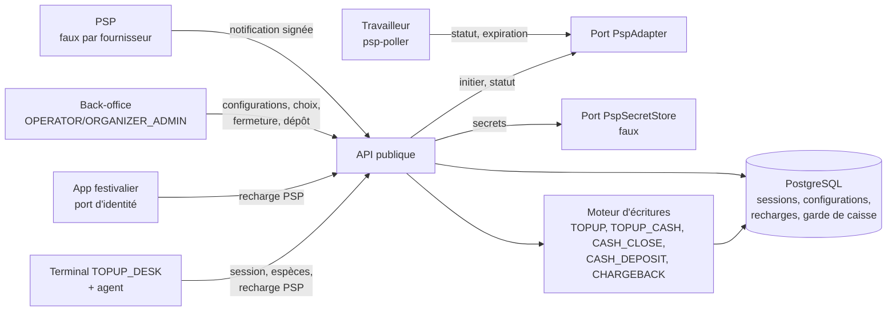

# Implementation Plan: Recharges, caisses et PSP

**Branch**: `feat/recharges-caisses-psp` | **Date**: 2026-10-27 | **Spec**: [spec.md](spec.md)
**Input**: `kitty-specs/recharges-caisses-psp-01M5YEBA/spec.md`
**Base** : `main` après les PR #6 (mission 5b) et #7 (documentation), CI verte (`2adf0dca`). Migrations jusqu'à `0035`.

**Contrat de branche** : branche courante, de planification et de fusion `feat/recharges-caisses-psp`
(`branch_matches_target = true`) ; la mission rejoint ensuite `main` par une PR, comme la 5b.

## Summary

La mission fait entrer l'argent réel.

- **Caisses** : une caisse par terminal `TOPUP_DESK` (`A-CAISSE-<série>`), créée par la base à la première session.
  Session ouverte et comptée depuis le terminal par l'agent, fermée par un `SUPERVISOR` autre que celui qui a compté :
  `CASH_CLOSE`, écart au payeur du contrat, `CASH_DIFF`. **La base refuse toute écriture sur une caisse sans session
  ouverte** : OP-N49 est levé et aucune espèce n'échappe au contrôle de fermeture.
- **Recharge espèces** : `TOPUP_CASH` rattaché à la session ; refus au-delà du plafond en ligne ; découpage vers
  `L-ESP-A-RENDRE` réservé au hors ligne, avec son anomalie (défaut du moteur corrigé) ; caution due prise ensuite.
- **PSP** : configurations par organisateur et par moyen (activation à deux), choix par événement contrôlé par la
  base (titulaire = détenteur des fonds). Demande de recharge, notification vérifiée (signature à temps constant,
  horodatage, taille), conservée brute si authentifiée, traitée une seule fois ; refus signalés sans rien écrire.
  Paiement non créditable (plafond, 3-D Secure, plafond de carte, grand livre fermé) : aucune écriture, anomalie
  portant le montant à rendre. Interrogation planifiée et expiration.
- **Carte** : 3-D Secure attesté, plafond par carte et par jour, `CARD_VELOCITY`, contestations (portefeuille bloqué,
  pertes au payeur du contrat, contestation tardive à deux), déblocage à deux.
- **Faux** : un faux par fournisseur et un faux coffre à secrets, refusés au démarrage en production. Les adaptateurs
  réels et le coffre AWS sont **reportés** (décision du porteur du 27/10/2026, OP-N81 / ADR-131) : pas de recharge en
  ligne en production avant la mission qui les livre.



## Technical Context

**Language/Version**: TypeScript 5.9 sur Node.js 22 LTS (API, document 08) ; SQL PostgreSQL 17 (migrations, pgTAP)
**Primary Dependencies**: NestJS 11, `pg`, `jose` (existants) ; `node:crypto` (HMAC-SHA256, `timingSafeEqual`) ; aucune nouvelle dépendance (R-18 : `axios` attend les adaptateurs réels)
**Storage**: PostgreSQL 17 — migrations `0036` et suivantes ; `post-roles.sql` ; schéma de référence inchangé
**Testing**: pgTAP (une suite par migration, garde de caisse, droits, concurrence) ; Jest (unitaires ; intégration HTTPS avec le terminal de test, le faux PSP et la vraie base ; parcours complet ; isolation ; balayage des secrets avec canari ; garde de production ; latence sautée sous `SKIP_LATENCY`, lancée seule en CI) ; tests en série (base partagée)
**Target Platform**: serveur Linux ; terminaux `TOPUP_DESK` enrôlés par la 5a ; app festivalier par le port d'identité de la 5b
**Project Type**: monorepo npm (`apps/api`, `packages/contracts`, `packages/ledger-sql`)
**Performance Goals**: accusé d'une notification authentifiée p95 ≤ 500 ms (NFR-006) ; recharge espèces p95 ≤ 200 ms (NFR-009)
**Constraints**: aucun double crédit (NFR-001) ; aucune écriture pour une notification refusée (NFR-002) ; aucun secret exposé (NFR-003) ; aucun faux en production (NFR-004) ; aucune espèce hors session (FR-004) ; tout ou rien (NFR-008) ; fichiers `.sql` générés jamais modifiés (C-002)
**Scale/Scope**: 31 FR dont 30 dans la mission (FR-021 reporté), 10 NFR, 10 contraintes ; 10 opérations du contrat servies ou corrigées, 8 ajoutées ; OP-N49 levé ; OP-N81 et OP-N82 ouverts

## Charter Check

Aucune charte (`.kittify/charter/charter.yaml` absent) : section sans objet. En tiennent lieu `CLAUDE.md` et
`docs/SPECIFICATION.md`.

Contrôle après conception :

- **Décisions du porteur (27/10/2026)** : adaptateurs PSP réels et coffre AWS reportés ; faux gardés plus longtemps que
  prévu → dette nommée : **OP-N81 / ADR-131**, test de borne (garde de production), reports dans PROMPTS et PRD
  (nouvelle mission « Adaptateurs PSP réels »).
- **Limite nommée** : remboursement au payeur d'un paiement non crédité hors de la plateforme (**OP-N82**), clôture par
  résolution d'anomalie à deux ; pas d'affaiblissement (rien n'est crédité), dette de fonction.
- **Contradictions signalées (§0.3)** : notification refusée (R-10), clés d'idempotence et `CANCELLED` (contrat
  appliqué), `A-PSP-*` négatif (ADR-77 appliqué), `CARD_DAILY_LIMIT` à l'initiation (impossible, contrat corrigé),
  authentification des sessions de caisse (R-04).
- **Renforcements, faits puis consignés** (ADR-132) : garde de caisse en base (R-02), comptage à l'aveugle et fermeture
  par une autre personne (R-03), sessions depuis le terminal (R-04), taille bornée et temps constant pour les
  notifications (R-10), écritures de toutes les nouvelles tables par fonctions seulement.
- **Correction d'un défaut existant** : découpage `TOPUP_CASH` en ligne et anomalie manquante (R-05).
- **Compléments de spécification** : type d'anomalie `PSP_TOPUP_NOT_CREDITED` (R-11), actions `WALLET_UNBLOCK` et
  `CASH_DEPOSIT` (R-14, R-15), portée de frais `PSP_CONFIGURATION` remplaçant la convention d'ADR-82 §3 (ADR-133).
- **Passe contradictoire** (`research-adversarial.md`, 34 constats dont 4 bloquants) : 31 corrigés dans le plan
  (research R-20, qui fait foi), 3 reportés avec raison (A16 argent non crédité → OP-N82 et mission 9 ; A17 session
  d'une recharge hors ligne → mission 7 ; A32 transition avec sessions ouvertes → mission 9). Contradictions
  ajoutées : traitement des notifications après conservation (contrat appliqué), clés d'écriture qualifiées par la
  configuration (plus sûres que le contrat), clé de fermeture `cash-close:<session>`, `signature_valid` constant,
  alerte des comptes chauds `A-PSP-*` (négatif permis).
- Aucune décision du plan ne retire, n'élargit ni ne reporte un contrôle hors OP-N81 et OP-N82.

## Project Structure

### Documentation (this mission)

```
kitty-specs/recharges-caisses-psp-01M5YEBA/
├── plan.md
├── research.md
├── research-adversarial.md   # passe contradictoire
├── data-model.md
├── quickstart.md
├── contracts/
│   ├── cash.md               # caisses, sessions, recharges espèces, dépôt
│   ├── psp.md                # configurations, choix, recharges, notifications, contestations, faux
│   ├── database-rights.md    # droits de cashless_app, garde de caisse
│   └── openapi-additions.md  # opérations corrigées et ajoutées
└── tasks.md                  # créé par /spec-kitty.tasks
```

### Source Code (repository root)

```
packages/ledger-sql/
├── migrations/0036_cash_sessions.sql      # cash_session, comptages, rattachement, garde de caisse, fonctions
├── migrations/0037_psp_configurations.sql # psp_configuration, event_psp_selection, résolution, comptes A-PSP-*, fee_rule
├── migrations/0038_psp_topups.sql         # psp_topup, psp_event, psp_chargeback, fonctions, anomalie, actions
├── post-roles.sql
└── tests/tests_cash_sessions.sql, tests_psp_configurations.sql, tests_psp_topups.sql,
    tests_cash_psp_rights.sql, tests_execute_grants.sql

packages/contracts/openapi.yaml, src/, dart/

apps/api/src/
├── cash-sessions/               # ouverture, comptage, fermeture, lecture ; dépôt (action d'approbation)
├── topups/cash/                 # recharge espèces, caution due ensuite
├── psp/                         # ports PspAdapter et PspSecretStore, faux, registre des fournisseurs
├── psp-configurations/          # configurations, choix par événement, actions d'approbation
├── topups/psp/                  # demande, consultation, annulation, traitement d'un paiement
├── webhooks/                    # réception (corps brut, signature, horodatage, taille), signalement
├── chargebacks/                 # contestations, blocage, WALLET_UNBLOCK, LATE_CHARGEBACK
├── media/lifecycle/             # counter-access (session), deposit, cash-due, release : session servie
├── ledger/                      # découpage TOPUP_CASH hors ligne seulement, CASH_CLOSE à théorique nul
├── configuration/sql-config-resolver.ts  # frais par configuration
├── processes/                   # garde de production (faux PSP, faux coffre), processus psp-poller
└── main.psp-poller.ts

apps/api/test/
├── unit/                        # signature, horodatage, normalisation, garde de production
├── integration/cash-sessions, topups, psp-configurations, webhooks, chargebacks, media (OP-N49)
└── integration/end-to-end/      # parcours, isolation, secrets (canari), concurrence, latence
```

## Complexity Tracking

| Écart à la simplicité | Pourquoi | Alternative plus simple écartée |
|---|---|---|
| Garde de caisse en base (déclencheur sur `posting`) | Aucune espèce hors session, quelle que soit la route (FR-004) | Contrôle dans l'API seule |
| Fermeture par une autre personne que le compteur | Contrôle de caisse réel (NFR-007) | `SUPERVISOR` seul |
| Notification refusée signalée sans être stockée | Concilie §11.1 et le contrat sans exposer la base au volume non authentifié | Stocker tout corps reçu |
| Un faux par fournisseur | Interface figée et testée avant les adaptateurs réels (porteur) | Un seul faux générique |

## Implementation Concern Map

### IC-01 — Sessions de caisse (base)

- **Purpose**: tables `cash_session`, comptages, rattachement ; fonctions d'ouverture, comptage, fermeture ; création
  du compte de caisse ; garde de caisse sur `posting`.
- **Relevant requirements**: FR-001 à FR-004, NFR-007, NFR-008, C-002, C-004
- **Affected surfaces**: `packages/ledger-sql/migrations/0036_cash_sessions.sql`, `post-roles.sql`, `tests/tests_cash_sessions.sql`
- **Sequencing/depends-on**: none
- **Risks**: garde limitée aux caisses inscrites (`cash_desk`) : suites de référence générées inchangées ; tests de la
  mission 4 adaptés (session ouverte) ; la garde lit sans verrou, `begin_cash_close` verrouille le solde puis passe
  `CLOSING` (état de ligne) ; `account_purpose_guard` ; variantes `…_for_session` (R-20).

### IC-02 — Sessions de caisse et espèces (API)

- **Purpose**: routes de session (terminal + personne), recharge espèces, rattachement des transactions d'espèces,
  session servie aux routes du guichet (caution, espèces dues, libération), caution due après recharge.
- **Relevant requirements**: FR-001 à FR-008, NFR-009
- **Affected surfaces**: `apps/api/src/cash-sessions/`, `apps/api/src/topups/cash/`, `apps/api/src/media/lifecycle/`
- **Sequencing/depends-on**: IC-01, IC-09
- **Risks**: comptage à l'aveugle (aucune réponse ne porte le théorique avant la fermeture) ; numérotation
  `<série>:<seq>` de la 5b ; caution en transaction distincte.

### IC-03 — Moteur : découpage hors ligne et fermeture à théorique nul

- **Purpose**: découpage `TOPUP_CASH` limité à `OFFLINE_SYNC`/`EDGE_SYNC` avec anomalie `CASH_TOPUP_OVER_LIMIT` ;
  `buildCashClose` accepte un théorique nul.
- **Relevant requirements**: FR-005, FR-006, FR-003
- **Affected surfaces**: `apps/api/src/ledger/ledger-engine.service.ts`, `builders/closing/cash.ts`, tests du moteur
- **Sequencing/depends-on**: IC-01 (fonction d'anomalie)
- **Risks**: cas du moteur existants (vecteurs) ; aucun changement des `.sql` générés.

### IC-04 — Configurations PSP et choix par événement (base)

- **Purpose**: `psp_configuration`, `event_psp_selection`, déclencheur du titulaire, défaut unique, résolution,
  comptes `A-PSP-*` (négatif permis), portée de frais `PSP_CONFIGURATION`.
- **Relevant requirements**: FR-009 à FR-011, FR-023, C-004
- **Affected surfaces**: `migrations/0037_psp_configurations.sql`, `tests/tests_psp_configurations.sql`
- **Sequencing/depends-on**: none
- **Risks**: grands livres existants (comptes `A-PSP-*` créés par la migration) ; `secret_ref` non lisible par
  `cashless_app` hors fonction.

### IC-05 — Configurations PSP (API) et actions d'approbation

- **Purpose**: routes de configuration et de choix, actions `PSP_CONFIGURATION` et `EVENT_PSP_SELECTION`, résolveur de
  frais par configuration.
- **Relevant requirements**: FR-009 à FR-011, FR-023, FR-031
- **Affected surfaces**: `apps/api/src/psp-configurations/`, `apps/api/src/configuration/sql-config-resolver.ts`
- **Sequencing/depends-on**: IC-04, IC-09
- **Risks**: cloisonnement prestataire/organisateur ; `secret_ref` rendu à l'`OPERATOR_ADMIN` seul.

### IC-06 — Ports PSP et faux

- **Purpose**: `PspAdapter`, `PspSecretStore`, un faux par fournisseur, faux coffre, garde de production.
- **Relevant requirements**: FR-020, FR-021 (report), FR-022, NFR-003, NFR-004
- **Affected surfaces**: `apps/api/src/psp/`, `apps/api/src/processes/bootstrap.ts`, `test/unit/production-guard.spec.ts`
- **Sequencing/depends-on**: none
- **Risks**: en production, fournisseur « indisponible » au lieu des faux (le processus public démarre avec les
  espèces) ; `secret_ref` lié au titulaire ; échéance du secret précédent ; secrets jamais journalisés (R-20).

### IC-07 — Recharges PSP et notifications (base)

- **Purpose**: `psp_topup`, `psp_event`, `psp_chargeback` ; fonctions de création, de conservation, de complétion,
  d'échec, d'expiration, d'annulation, de contestation, de blocage ; type d'anomalie et actions ajoutés.
- **Relevant requirements**: FR-012 à FR-019, FR-024 à FR-028, NFR-001, NFR-008
- **Affected surfaces**: `migrations/0038_psp_topups.sql`, `tests/tests_psp_topups.sql`
- **Sequencing/depends-on**: IC-04
- **Risks**: unicités (notification, paiement, contestation) ; plafond cumulé des contestations ; transitions finales.

### IC-08 — Recharges PSP, notifications et contestations (API)

- **Purpose**: demande, consultation, annulation ; réception (corps brut, taille, signature, horodatage), signalement
  des refus ; traitement d'un paiement (R-11) ; contestations ; `WALLET_UNBLOCK` ; travailleur `psp-poller`.
- **Relevant requirements**: FR-012 à FR-019, FR-024 à FR-028, NFR-001, NFR-002, NFR-006
- **Affected surfaces**: `apps/api/src/topups/psp/`, `webhooks/`, `chargebacks/`, `main.psp-poller.ts`
- **Sequencing/depends-on**: IC-05, IC-06, IC-07, IC-09
- **Risks**: conservation puis traitement (`UNMATCHED`, `RETRY`) ; référence marchande `psp_topup_id` ; tableau des
  états ; verrou de ligne et verrou consultatif par carte ; refus définitifs du moteur sans `500` en boucle ; aucun
  appel réseau sous verrou ; route publique sans identité (R-20).

### IC-09 — Droits de la base et contrat d'API

- **Purpose**: `post-roles.sql`, listes figées de droits ; `openapi.yaml` (corrections et ajouts), types régénérés.
- **Relevant requirements**: FR-030, C-004, NFR-005
- **Affected surfaces**: `post-roles.sql`, `tests_execute_grants.sql`, `tests_cash_psp_rights.sql`, `packages/contracts/`
- **Sequencing/depends-on**: contrat : none ; droits : IC-01, IC-04, IC-07
- **Risks**: cohérence TS/Dart générés ; droits par colonne (`secret_ref`, `body`).

### IC-10 — Dépôt en banque

- **Purpose**: action `CASH_DEPOSIT` à deux, écriture `CASH_DEPOSIT`.
- **Relevant requirements**: FR-029
- **Affected surfaces**: `apps/api/src/cash-sessions/` (action), tests
- **Sequencing/depends-on**: IC-02
- **Risks**: montant au-delà du transit (refus de la base, demande `FAILED`).

### IC-11 — Preuves de bout en bout, CI et consignation

- **Purpose**: parcours complet, isolation, balayage des secrets avec canari, concurrence (rejeux de notifications,
  contestations), latence ; CI ; OP-N49 levé, OP-N81, OP-N82, ADR-131 à ADR-133, reports PROMPTS/PRD, documentation.
- **Relevant requirements**: SC-001 à SC-008, NFR-001 à NFR-010
- **Affected surfaces**: `apps/api/test/integration/end-to-end/`, `.github/workflows/`, `docs/`
- **Sequencing/depends-on**: tous les autres
- **Risks**: base partagée (tests en série), horloge Docker (aucune comparaison d'horloge Node/base).
