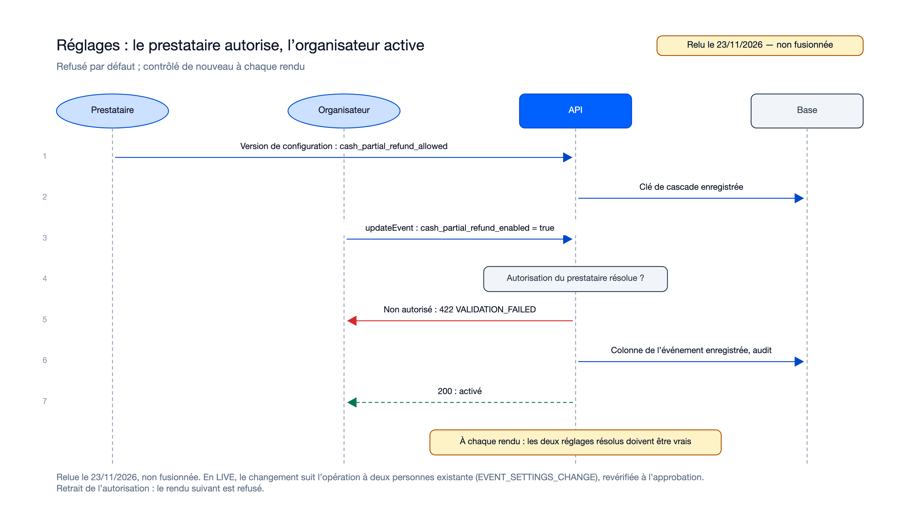

# Séquences : mission remboursement-partiel-especes-01M84932

> État : **relue le 23/11/2026, six lots approuvés, non fusionnée.** Flux recalés sur le code de la lane `f` (`partial-refund.service.ts`, `partial-refund-threshold.ts`) ; aucun test relancé par cette mise à jour.
> Diagrammes `/illustre` régénérés (bandeau « Relu le 23/11/2026 — non fusionnée »), rendus relus ; sources dans [`diagrams/`](diagrams/) (`generate.py`).

## Flux internes propres à cette mission

### Rendu partiel au guichet

Sources : [`sequence-rendu-partiel.excalidraw`](diagrams/sequence-rendu-partiel.excalidraw), [`sequence-rendu-partiel.svg`](diagrams/sequence-rendu-partiel.svg).
Le caissier envoie le montant débité avec `tap_id` (ou `tap`) et `Idempotency-Key`. L'API prend le verrou du bracelet, contrôle son statut (`409 MEDIA_STATE_INVALID`), puis l'autorité de débit (`409 DEBIT_AUTHORITY_EDGE`)
et le statut du portefeuille (`422 WALLET_BLOCKED`), puis les deux réglages et la politique de remboursement (`422 REFUND_NOT_ALLOWED`) et la session de caisse `OPEN` (`409 CONFLICT_STATE`). Elle prend ensuite le verrou
du solde payé, vérifie montant, solde (`422 INSUFFICIENT_FUNDS`) et frais (`422 AMOUNT_OUT_OF_RANGE`), lit le cumul du jour UTC **du portefeuille sous verrou** et, au-dessus du seuil, exige le jeton d'une seconde personne
(`403 APPROVAL_REQUIRED`, rien d'écrit). Puis une écriture `WALLET_REFUND` marquée `partial_cash_refund` (brut, frais du moteur, net en caisse), rattachée à la session, et l'audit `MEDIA_PARTIAL_CASH_REFUNDED`.
Le bracelet reste actif. La phase de l'événement est refusée par le moteur (`422 VALIDATION_FAILED` en `DRAFT`) au moment de l'écriture. **Ordre des contrôles différent du plan** : le diagramme les regroupe sur une seule étape interne.

### Réglages : le prestataire autorise, l'organisateur active

Sources : [`sequence-reglages.excalidraw`](diagrams/sequence-reglages.excalidraw), [`sequence-reglages.svg`](diagrams/sequence-reglages.svg).
Le prestataire enregistre `cash_partial_refund_allowed` ; l'organisateur active `cash_partial_refund_enabled`, refusé (`422 VALIDATION_FAILED`, règle `operator.cash_partial_refund_allowed`, message de repli, OP-N175)
si l'autorisation résolue est fausse ; en `LIVE`, demande à deux personnes `EVENT_SETTINGS_CHANGE` dont les bornes sont revérifiées à l'approbation. Les deux réglages sont revérifiés à chaque rendu : retirer l'autorisation du prestataire suffit à refuser le rendu suivant.

## Flux transverses auxquels cette mission participe (référence, pas dupliqué)

Voir `docs/05-sequence-diagrams.md`, flux : « Remboursement d'un festivalier (demande, approbation à deux, confirmation, guichet de retour) » (le rendu partiel en est une variante au guichet, sans restitution) et « Session de caisse et recharge en espèces » (les espèces rendues sortent de la caisse de la session).

## Nécessaire pour cette mission ? Oui : deux interactions inter-composants livrées (rendu au guichet avec seconde personne, réglages à deux niveaux) (réponse proposée par l'Agent le 23/11/2026, en attente du porteur).
## Complet ? Oui pour la relecture ; restent en texte : idempotence, refus de statut du bracelet, concurrence à 20 envois (3 tests, exactement 10 rendus ; 5 sur deux bracelets du même portefeuille) (réponse proposée par l'Agent le 23/11/2026, en attente du porteur).
## Validé par : réponse proposée par l'Agent le 23/11/2026, en attente du porteur.
