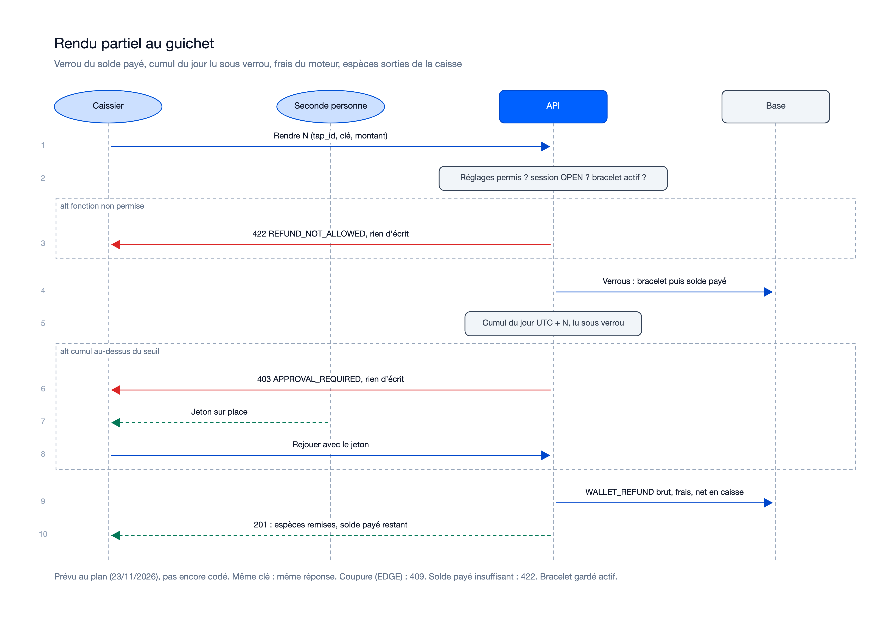

# Séquences : mission remboursement-partiel-especes-01M84932

> État : **plan finalisé le 23/11/2026, rien n'est codé.** Flux prévus au plan ; D1 à D6 par défaut, non validées par le porteur ; ajouts au contrat soumis au porteur.
> Diagrammes `/illustre`, rendus relus ; sources dans [`diagrams/`](diagrams/) (`generate.py`).

## Flux internes propres à cette mission

### Rendu partiel au guichet

Sources : [`sequence-rendu-partiel.excalidraw`](diagrams/sequence-rendu-partiel.excalidraw), [`sequence-rendu-partiel.svg`](diagrams/sequence-rendu-partiel.svg).
Le caissier envoie le montant débité avec `tap_id` et `Idempotency-Key`. L'API contrôle les deux réglages, la session de caisse `OPEN`, le statut du bracelet et du portefeuille
et l'autorité de débit (`409 DEBIT_AUTHORITY_EDGE`), prend les verrous (bracelet, puis solde payé), lit le cumul du jour UTC **sous verrou** et, au-dessus du seuil, exige le jeton
d'une seconde personne (`403 APPROVAL_REQUIRED`, rien d'écrit). Puis une écriture `WALLET_REFUND` (brut, frais du moteur, net en caisse) rattachée à la session. Le bracelet reste actif.

### Réglages : le prestataire autorise, l'organisateur active

Sources : [`sequence-reglages.excalidraw`](diagrams/sequence-reglages.excalidraw), [`sequence-reglages.svg`](diagrams/sequence-reglages.svg).
Le prestataire enregistre `cash_partial_refund_allowed` ; l'organisateur active `cash_partial_refund_enabled`, refusé (`422 VALIDATION_FAILED`, règle `operator.cash_partial_refund_allowed`)
si l'autorisation résolue est fausse. Les deux réglages sont revérifiés à chaque rendu : retirer l'autorisation du prestataire suffit à refuser le rendu suivant.

## Flux transverses auxquels cette mission participe (référence, pas dupliqué)

Voir `docs/05-sequence-diagrams.md`, flux : « Remboursement d'un festivalier (demande, approbation à deux, confirmation, guichet de retour) » (le rendu partiel en est une variante au guichet, sans restitution) et « Session de caisse et recharge en espèces » (les espèces rendues sortent de la caisse de la session).

## Nécessaire pour cette mission ? Oui : deux interactions inter-composants nouvelles (rendu au guichet avec seconde personne, réglages à deux niveaux) (réponse proposée par l'Agent le 23/11/2026, en attente du porteur).
## Complet ? Oui pour le plan ; restent en texte : idempotence, refus de statut du bracelet, concurrence à 20 envois ; à recaler à la review (réponse proposée par l'Agent le 23/11/2026, en attente du porteur).
## Validé par : réponse proposée par l'Agent le 23/11/2026, en attente du porteur.
