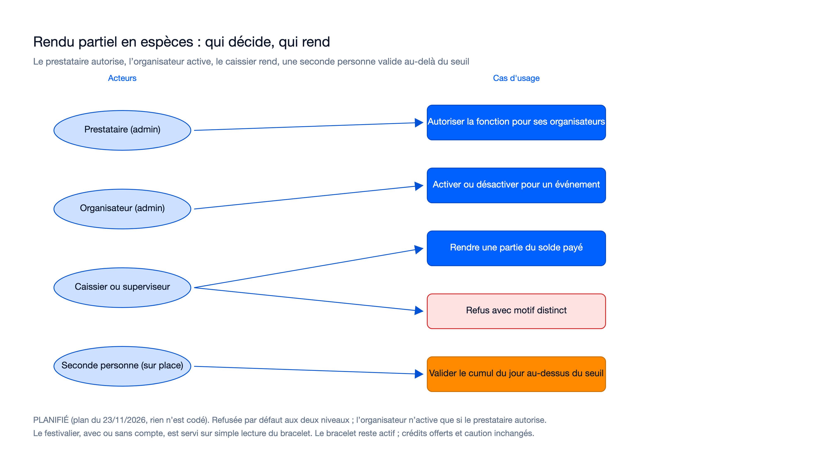

# Cas d'usage : mission remboursement-partiel-especes-01M84932

> État : **plan finalisé le 23/11/2026, rien n'est codé** (mission 9c « Remboursement partiel en espèces au guichet »). Source : `spec.md` (3 user stories,
> 13 FR, 4 NFR, 5 contraintes), `plan.md`, `research.md` (décisions **D1 à D6 prises par défaut pendant l'absence du porteur, non encore validées par lui**),
> `data-model.md`, `contracts/partial-cash-refund.md` (ajouts au contrat **encore soumis au porteur**, rien n'est codé). Diagramme `/illustre`
> (préférence du porteur du 13/10/2026), police sans empattement, rendu relu ; sources et générateur dans [`diagrams/`](diagrams/) (`generate.py`).

## Cas d'usage propres à cette mission

Sources : [`usecase-rendu-partiel.excalidraw`](diagrams/usecase-rendu-partiel.excalidraw), [`usecase-rendu-partiel.svg`](diagrams/usecase-rendu-partiel.svg).

| Cas d'usage | Acteur | Règle principale (prévue) | Route ou réglage |
|---|---|---|---|
| Autoriser la fonction pour ses organisateurs | Prestataire (`OPERATOR_ADMIN`) | Refusée par défaut ; clé de cascade au niveau prestataire (D1) | `cash_partial_refund_allowed` via `createOperatorConfigVersion` |
| Activer ou désactiver pour un événement | Organisateur (`ORGANIZER_ADMIN`) | Désactivée par défaut ; activer est refusé (`422 VALIDATION_FAILED`) si le prestataire n'autorise pas ; en `LIVE`, circuit à deux personnes existant à vérifier | `cash_partial_refund_enabled` via `updateEvent` (ajout au contrat A2, soumis) |
| Rendre une partie du solde payé | Caissier ou superviseur du guichet (`TOPUP_DESK`), session de caisse ouverte | Montant débité brut ≤ solde payé, espèces remises nettes des frais de `refund_policy` à chaque rendu (D2) ; bracelet lu, resté actif ; crédits offerts et caution inchangés ; bracelets anonymes acceptés ; rejouable par `Idempotency-Key` ; refusé pendant `EDGE` | `POST /media/{media_id}/partial-cash-refunds` (`refundPartialCash`, ajout au contrat A1, soumis) |
| Refus avec motif distinct | Caissier | Fonction non permise : `422 REFUND_NOT_ALLOWED`, `reason` `PARTIAL_CASH_REFUND_DISABLED`, sans code nouveau (D4) ; montant hors bornes `422 AMOUNT_OUT_OF_RANGE`, solde insuffisant `422 INSUFFICIENT_FUNDS`, session absente `409 CONFLICT_STATE` | idem |
| Valider le cumul du jour au-dessus du seuil | Seconde personne sur place | Cumul des rendus partiels du bracelet depuis 00:00 UTC, montant demandé compris, `>` `cash_refund_single_max` : jeton d'approbation d'une autre personne, lu sous le verrou du solde payé (D3, ADR-190, ADR-195) ; sans jeton `403 APPROVAL_REQUIRED`, rien d'écrit | en-tête `X-Approval-Token` |

Hors périmètre : espèces dues (restent rendues par `refundCashDue`, limite L2), guichet de retour (inchangé, C-002), tout remboursement hors espèces (C-005), interface (l'app terminal est une autre mission).
Limite à consigner au code : L1, un bracelet remplacé dans la journée repart d'un cumul nul.

## Lien avec la synthèse globale

Contribue à : `docs/02-use-case-diagram.md`, domaines « Bracelets NFC : format, clés, lots, cycle de vie » (rendu au guichet sans restitution) et « Argent réel : PSP, caisses, rapprochements, versements » (sortie d'espèces de la caisse, réglages de remboursement). Aucun renommage ni fusion de cas d'usage globaux.

## Nécessaire pour cette mission ? Oui : quatre acteurs et cinq cas d'usage nouveaux, dont un acteur de réglage de plus (le prestataire) ; diagramme généré et relu (réponse proposée par l'Agent le 23/11/2026, en attente du porteur).
## Complet ? Oui pour le plan ; à recaler à la review sur le code livré (codes de refus réels, circuit `LIVE` des réglages) ; D1 à D6 et ajouts au contrat restent à valider par le porteur (réponse proposée par l'Agent le 23/11/2026, en attente du porteur).
## Validé par : réponse proposée par l'Agent le 23/11/2026, en attente du porteur.
