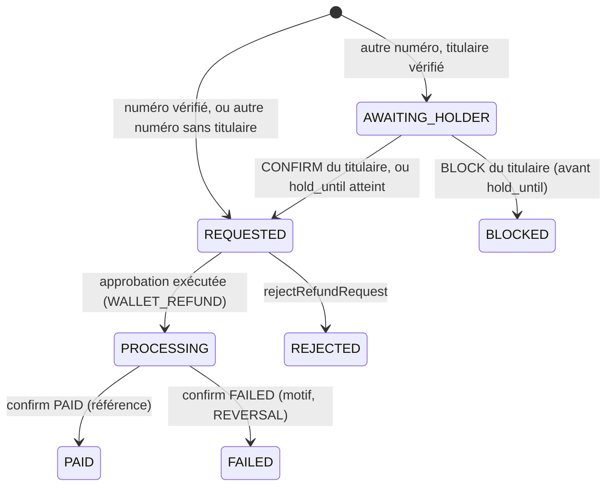

# Data Model: Remboursements des festivaliers

## `refund_request` (nouvelle table, S16)

| Colonne | Type | Règle |
|---|---|---|
| `id` | `uuid` PK | `refund_request_id` du contrat (rendu en chaîne) |
| `operator_id` | `uuid` NOT NULL → `party` | RLS `tenant_isolation` (ENABLE + FORCE) |
| `ledger_id`, `event_id` | `uuid` NOT NULL | du portefeuille |
| `wallet_id` | `uuid` NOT NULL → `wallet` | |
| `customer_id` | `uuid` NULL → `customer_identity` | demandeur festivalier (app) |
| `requested_by` | `uuid` NULL | demandeur du back-office (virement, reporté) ; jamais égal au valideur |
| `method` | `text` CHECK `WAVE`, `ORANGE_MONEY`, `BANK_TRANSFER` | `BANK_TRANSFER` refusé en 9a (OP-N123) |
| `msisdn` | `text` | E.164 |
| `iban` | `text` NULL | reporté |
| `new_number` | `boolean` NOT NULL | destination ≠ numéro vérifié du titulaire |
| `status` | `text` CHECK énumération du contrat | voir états |
| `estimated_amount`, `fee` | `bigint` | calculés à la création, recalculés à l'exécution |
| `currency` | `text` NOT NULL | de l'événement |
| `hold_until` | `timestamptz` NULL | autre numéro avec titulaire vérifié |
| `extra_check_required` | `boolean` NOT NULL DEFAULT false | montant > `refund_new_number_max` (autre numéro) |
| `holder_decision`, `holder_decided_at` | `text`, `timestamptz` NULL | `CONFIRM` / `BLOCK` |
| `approval_request_id` | `uuid` NULL | dernière approbation proposée |
| `approved_by` | `uuid` NULL | valideur |
| `transaction_id` | `uuid` NULL | `WALLET_REFUND` |
| `external_reference` | `text` NULL | obligatoire pour `PAID` |
| `failure_reason`, `reject_reason` | `text` NULL | obligatoires pour `FAILED` / `REJECTED` |
| `reversal_transaction_id` | `uuid` NULL | `REVERSAL` de l'échec |
| `confirmed_by`, `confirmed_at` | `uuid`, `timestamptz` NULL | non exposés |
| `created_at`, `updated_at` | `timestamptz` NOT NULL | |

**Invariants (base)** :

- index unique partiel `(wallet_id) WHERE status IN ('AWAITING_HOLDER','REQUESTED','PROCESSING')` (FR-003) ;
- `status = 'PAID'` ⇒ `external_reference` non vide ;
- `status = 'FAILED'` ⇒ `failure_reason` et `reversal_transaction_id` non vides ;
- `status = 'REJECTED'` ⇒ `reject_reason` ;
- `status IN ('PROCESSING','PAID','FAILED')` ⇒ `transaction_id` et `approved_by` non nuls.

**Droits** (`post-roles.sql`, section 11) :

- `cashless_app` : `SELECT`, `INSERT`, et `UPDATE` des seules colonnes de transition ;
- aucun `DELETE`, aucun `TRUNCATE` ;
- les autres rôles : rien.

## États

`CANCELLED` : dans l'énumération du contrat, aucune transition en 9a (aucune route ne la produit).

États terminaux : `PAID`, `FAILED`, `REJECTED`, `BLOCKED`, `CANCELLED`. Après un `FAILED` ou un `REJECTED`, une nouvelle
demande est possible.

## `otp_challenge` (colonnes ajoutées)

| Colonne | Type | Règle |
|---|---|---|
| `purpose` | `text` NOT NULL DEFAULT `'LOGIN'`, CHECK `LOGIN`, `REFUND_HOLDER` | un code vivant par (numéro, usage) |
| `subject_id` | `uuid` NULL | `refund_request.id` pour `REFUND_HOLDER` ; NULL pour `LOGIN` |

Le code du nouveau numéro est un défi `LOGIN` (obtenu par `requestCustomerOtp`) ; il est vérifié contre la destination
puis consommé à la création de la demande.

## Écritures

| Moment | Type | Lignes |
|---|---|---|
| Exécution de l'approbation | `WALLET_REFUND` (source `BACKOFFICE`, clé `bo:<Idempotency-Key>`) | débit portefeuille payé ; crédit `A-PSP-WAVE` / `A-PSP-OM` ; frais à `ORG_FFEST` + `ORG_TAX` |
| Paiement échoué | `REVERSAL` (`reverses_id` = le `WALLET_REFUND`, clé `bo:<Idempotency-Key>`) | inverse exact |
| Guichet de retour | `DEPOSIT_REFUNDED`, `PROMO_EXPIRY`, `WALLET_REFUND` (caisse de la session), `WALLET_REFUND` d'espèces dues | ordre §7.9, une transaction |

## Fonctions SQL

- `refund_request_operator(uuid) RETURNS uuid` : SECURITY DEFINER ; EXECUTE pour `cashless_app` seulement (route
  publique du titulaire).
- `promote_due_refund_requests() RETURNS integer` : SECURITY DEFINER ; passe en `REQUESTED` les `AWAITING_HOLDER`
  échues ; idempotente ; EXECUTE pour `cashless_app` et `cashless_maint`.
- `post_transaction` : nouvelle version, garde de statut élargie au seul `REVERSAL` d'un `WALLET_REFUND` (R-03).
- `replace_media` : nouvelle version, réattribue les anomalies `CASH_TOPUP_OVER_LIMIT` ouvertes (R-09).
