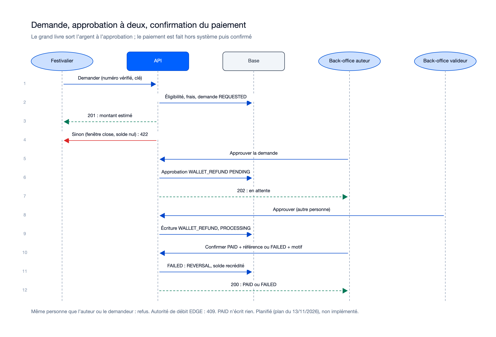
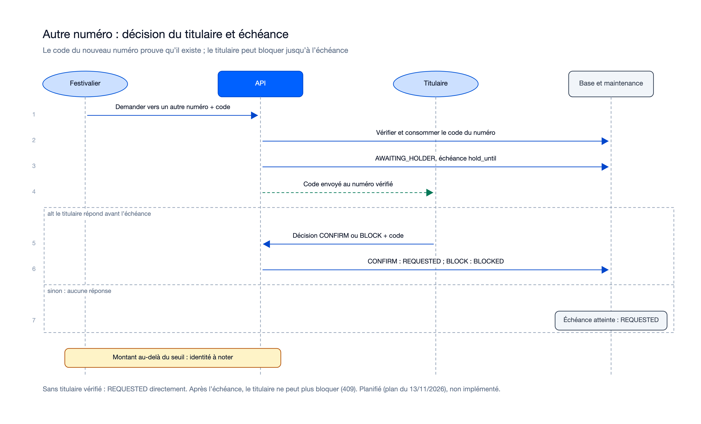
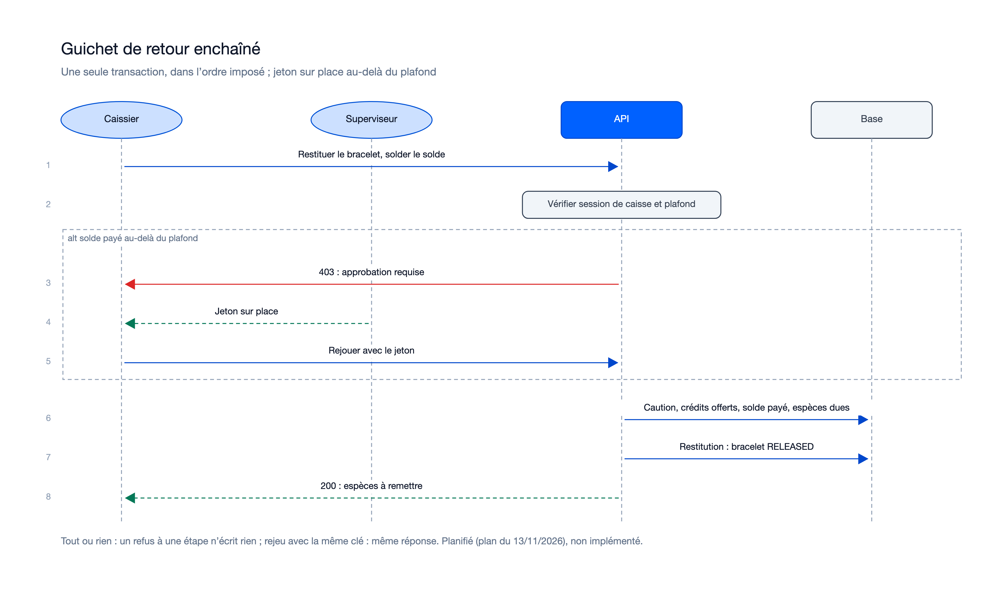

# Séquences : mission remboursements-01M7AG5V

> État : **review terminée le 16/11/2026, acceptée le 16/11/2026 (`8cd5ae97`), dans `main` par la PR #15 le 16/11/2026**. Flux recalés sur le code livré (lane-g) et les décisions 11 à 15 ;
> les trois diagrammes ont été régénérés à la review. Diagrammes `/illustre`, rendus relus ; sources dans [`diagrams/`](diagrams/) (`generate.py`).

## Flux internes propres à cette mission

### Demande, approbation à deux, confirmation du paiement

Sources : [`sequence-demande-approbation.excalidraw`](diagrams/sequence-demande-approbation.excalidraw), [`sequence-demande-approbation.svg`](diagrams/sequence-demande-approbation.svg).
La demande est créée `REQUESTED` avec le montant estimé. Un premier membre du back-office propose l'approbation (`202`, rien d'écrit) ; un
second l'exécute : une seule écriture `WALLET_REFUND` au solde payé du moment, la demande passe `PROCESSING`. Le paiement est fait hors
système ; `PAID` exige une référence et n'écrit rien, `FAILED` exige un motif et passe un `REVERSAL` qui recrédite le portefeuille. Même
personne que l'auteur ou le demandeur à l'approbation : refus ; autorité `EDGE` : `409`. **Écart au plan (décision 13)** : `FAILED` est refusé en `403` à qui a
proposé ou exécuté le remboursement (`PAID` reste ouvert), donc le diagramme montre un confirmeur tiers ; une seule personne étrangère recrédite encore (OP-N126).

### Autre numéro : décision du titulaire et échéance

Sources : [`sequence-autre-numero.excalidraw`](diagrams/sequence-autre-numero.excalidraw), [`sequence-autre-numero.svg`](diagrams/sequence-autre-numero.svg).
Le code du nouveau numéro est vérifié contre la destination et consommé. **Écart au plan (décision 15)** : un compte sans identité vérifiée est refusé
(`422 REFUND_NOT_ALLOWED`), la branche « sans titulaire, `REQUESTED` directement » n'existe plus (ADR-194). Sinon la demande est `AWAITING_HOLDER` jusqu'à
`hold_until` (48 h par défaut) et un code lié à la demande est envoyé au numéro du titulaire **avec le lien du contrat** (`refund_request_id`, `otp_request_id` remis à l'envoyeur, décision 14, OP-N129 levé). `CONFIRM` donne `REQUESTED`, `BLOCK` donne `BLOCKED` ; sans
réponse, la demande devient `REQUESTED` à l'échéance (lecture ou maintenance, au plus 5 min de retard).

### Guichet de retour enchaîné

Sources : [`sequence-guichet-retour.excalidraw`](diagrams/sequence-guichet-retour.excalidraw), [`sequence-guichet-retour.svg`](diagrams/sequence-guichet-retour.svg).
Un seul appel `releaseMedia` avec `settle_balance` : caution, expiration des crédits offerts, solde payé en espèces, espèces dues, restitution,
dans une transaction, sur la session de caisse ouverte du terminal. **Écart au plan (décision 11)** : le plafond `cash_refund_single_max` est comparé au cumul des espèces
qui sortent (caution rendue en espèces + brut du solde payé + espèces dues), calculé avant la première écriture ; au-delà, jeton d'approbation sur place exigé
(`403 APPROVAL_REQUIRED`) ; un refus à une étape n'écrit rien ; rejeu avec la même clé : même réponse.

## Flux transverses auxquels cette mission participe (référence, pas dupliqué)

Voir `docs/05-sequence-diagrams.md`, flux : « Double validation au back-office » (l'action `WALLET_REFUND` s'y ajoute) et « Clôture d'un
événement » (matrice des statuts, `REVERSAL` d'un `WALLET_REFUND`, mission 9b pour la clôture).

## Nécessaire pour cette mission ? Oui : trois interactions inter-composants nouvelles (circuit à deux, décision du titulaire, guichet), toutes recalées (réponse proposée par l'Agent le 16/11/2026, en attente de confirmation du porteur).
## Complet ? Oui, trois diagrammes régénérés et relus ; restent en texte : liste des demandes, refus (`REJECTED`), transfert des espèces dues lors d'un remplacement (`replace_media`, `0082`), promotion des demandes échues par la maintenance (proposition de l'Agent, en attente de confirmation du porteur).
## Validé par : réponse proposée par l'Agent le 16/11/2026, en attente de confirmation du porteur.
