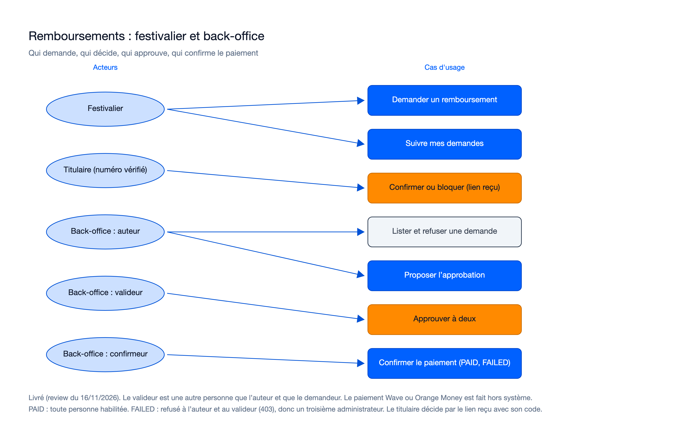

# Cas d'usage : mission remboursements-01M7AG5V

> État : **review terminée le 16/11/2026 (sept lots approuvés), acceptation à venir, non fusionnée** (mission 9a « Remboursements des festivaliers »).
> Recalé sur le code livré (branche `kitty/mission-remboursements-01M7AG5V-lane-g`) et sur les décisions 11 à 15 du porteur. Source : `spec.md`
> (4 user stories, 20 FR, 5 NFR, 8 contraintes, FR-012 amendée), `plan.md`, `research.md`, `data-model.md`, `contracts/`. Diagrammes
> `/illustre` (préférence du porteur du 13/10/2026), police sans empattement, rendus relus ; sources et générateur dans
> [`diagrams/`](diagrams/) (`generate.py`).

## Cas d'usage propres à cette mission

### Festivalier, titulaire et back-office

Sources : [`usecase-remboursement.excalidraw`](diagrams/usecase-remboursement.excalidraw), [`usecase-remboursement.svg`](diagrams/usecase-remboursement.svg).

### Guichet de retour

Sources : [`usecase-guichet.excalidraw`](diagrams/usecase-guichet.excalidraw), [`usecase-guichet.svg`](diagrams/usecase-guichet.svg).

| Cas d'usage | Acteur | Règle principale (prévue) | Route |
|---|---|---|---|
| Demander un remboursement | Festivalier connecté | Vers son numéro vérifié (Wave ou Orange Money) ; solde payé positif, fenêtre de remboursement ouverte, règle de frais configurée, une seule demande ouverte par portefeuille ; montant estimé = solde payé moins frais ; crédits offerts exclus ; `Idempotency-Key` | `POST /me/refund-requests` (`createMyRefundRequest`) |
| Suivre mes demandes | Festivalier | Ses demandes seulement, paginées ; celles d'un autre festivalier sont invisibles (`404`) | `GET /me/refund-requests` (`listMyRefundRequests`) |
| Demander vers un autre numéro | Festivalier | Code à usage unique du nouveau numéro exigé et consommé (même si la création échoue ensuite) ; statut `AWAITING_HOLDER` avec échéance `hold_until` ; un compte sans identité vérifiée est refusé (`422 REFUND_NOT_ALLOWED`, FR-012 amendée, décision 15, ADR-194) | `POST /me/refund-requests` |
| Confirmer ou bloquer (autre numéro) | Titulaire (numéro vérifié) | Code lié à la demande, envoyé à son numéro avec le lien du contrat (l'envoyeur reçoit `refund_request_id` et `otp_request_id`, décision 14) ; `CONFIRM` donne `REQUESTED`, `BLOCK` donne `BLOCKED` (alerte réduite à une ligne d'audit, OP-N125) ; plus de blocage possible après l'échéance (`409`) ; sans réponse, la demande devient `REQUESTED` à l'échéance | `POST /refund-requests/{id}/holder-decision` (public) |
| Lister et refuser une demande | Back-office (`OPERATOR_ADMIN`, `ORGANIZER_ADMIN`) | Filtres statut et événement ; refus d'une demande `REQUESTED` avec motif, sans écriture | `GET /refund-requests`, `POST /refund-requests/{id}/reject` |
| Proposer l'approbation | Back-office, auteur | Crée une approbation `WALLET_REFUND` en attente (`202`), rien n'est écrit ; pour un montant au-delà du seuil vers un autre numéro, la vérification d'identité est notée | `POST /refund-requests/{id}/approve` |
| Approuver à deux | Back-office, valideur | Personne distincte de l'auteur et du demandeur ; une seule écriture `WALLET_REFUND` (solde payé à l'instant, frais déduits), demande `PROCESSING` ; refusé si la passerelle locale a l'autorité (`409`) | `POST /approval-requests/{id}/approve` |
| Confirmer le paiement | Back-office (personne habilitée) | Paiement fait hors système ; `PAID` avec référence (aucune écriture, ouvert à toute personne habilitée) ou `FAILED` avec motif (contre-passation, solde recrédité, nouvelle demande possible), **refusé en `403` à qui a proposé ou exécuté le remboursement** (décision 13, ADR-191) : il faut un troisième administrateur sur l'événement ; une seule personne étrangère suffit encore à recréditer (dette OP-N126, levée par la 9b) | `POST /refund-requests/{id}/confirm` |
| Restituer et solder le bracelet | Caissier | Un seul appel, tout ou rien, dans l'ordre imposé : caution, expiration des crédits offerts, solde payé en espèces, espèces dues, restitution ; sur la session de caisse ouverte du terminal ; rejouable ; bracelet non `ACTIVE` refusé (`409 MEDIA_STATE_INVALID`) | `POST /media/{id}/release` avec `settle_balance` |
| Rendre le solde payé en espèces et les espèces dues | Caissier | Étapes de l'enchaînement ci-dessus ; espèces dues d'un bracelet remplacé rendues une fois et une seule (elles suivent le bracelet neuf) | idem |
| Approuver sur place (cumul au-dessus du plafond) | Superviseur | Jeton d'approbation sur place d'une seconde personne quand le TOTAL des espèces qui sortent (caution rendue en espèces + brut du solde payé + espèces dues) dépasse `cash_refund_single_max` (`>`, décision 11, ADR-190), calculé avant la première écriture ; sans lui `403 APPROVAL_REQUIRED` et rien n'est écrit | en-tête `X-Approval-Token` |

Limites consignées : OP-N124 (code du titulaire consommé avant sa décision), OP-N125 (quota de codes commun, alerte de `BLOCK` en audit), OP-N126 (un seul recréditeur), OP-N128 (`approved_by` nul sur la caution seule, cumul lu sous le verrou du bracelet).

Hors périmètre (reporté en 9b ou consigné) : demande créée par le back-office et virement bancaire (OP-N123), versements, rapprochements et
clôture (mission 9b), remboursement par carte (exclu de la V1).

## Lien avec la synthèse globale

Contribue à : `docs/02-use-case-diagram.md`, domaines « App festivalier » (demande et suivi), « Argent réel : PSP, caisses, rapprochements,
versements » (remboursements, circuit à deux) et « Bracelets NFC » (guichet de retour enchaîné). Pas de renommage ni de fusion de cas d'usage
globaux ; le cas « Demander un remboursement » existe déjà au diagramme global.

## Nécessaire pour cette mission ? Oui : cinq acteurs (dont le confirmeur tiers du `FAILED`) et onze cas d'usage nouveaux ; deux diagrammes régénérés et relus (réponse recalée à la review le 16/11/2026, proposition de l'Agent, en attente de confirmation du porteur).
## Complet ? Oui, recalé sur le code livré (cumul du guichet, `FAILED` refusé au proposant et à l'exécutant, lien du titulaire, FR-012 amendée) ; portefeuille bloqué : seul le blocage par bracelet perdu rembourse (proposition de l'Agent, en attente de confirmation du porteur).
## Validé par : réponse proposée par l'Agent le 16/11/2026, en attente de confirmation du porteur.
