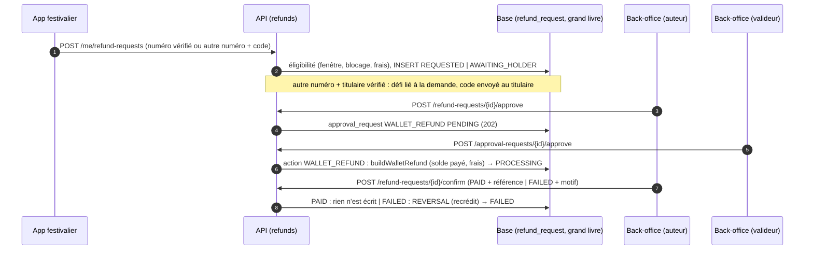

# Implementation Plan: Remboursements des festivaliers

**Branch**: `feat/remboursements` | **Date**: 2026-11-13 | **Spec**: [spec.md](spec.md)
**Input**: Mission specification from `kitty-specs/remboursements-01M7AG5V/spec.md`

## Summary

Servir les routes de remboursement déjà au contrat `openapi.yaml`, plus l'enchaînement du guichet de retour.

- **Côté festivalier** : création et liste de ses demandes (`createMyRefundRequest`, `listMyRefundRequests`) et
  décision du titulaire (`decideRefundRequestAsHolder`).
- **Côté back-office** : liste, refus, approbation à deux, puis confirmation du paiement fait hors système
  (`listRefundRequests`, `rejectRefundRequest`, `approveRefundRequest`, `confirmRefundRequest`).
- **Côté guichet** : `releaseMedia` avec `settle_balance`.

Le grand livre fournit déjà l'écriture `WALLET_REFUND` (constructeur `buildWalletRefund`), la double validation
(ADR-74), le jeton d'approbation sur place, la caution, l'expiration des crédits offerts et les espèces dues.

La mission ajoute :

- la table `refund_request` (S16), avec isolation par prestataire, ses droits et une demande ouverte au plus par
  portefeuille ;
- l'action d'approbation `WALLET_REFUND` ;
- la contre-passation d'un échec de paiement, la matrice du moteur acceptant ce seul `REVERSAL` après
  `RECONCILING` (décision du porteur, contradiction SPEC §11.4 / §12.1) ;
- un défi de code à usage unique lié à la demande, pour le titulaire ;
- l'enchaînement atomique du guichet de retour ;
- le transfert des espèces dues au bracelet neuf lors d'un remplacement (OP-N55).

Aucune route, aucun champ ni code d'erreur nouveau (C-002). Paiement manuel (C-003).

## Technical Context

**Language/Version**: TypeScript 5.9.3, Node.js 22 LTS (`engines: >=22 <23`), SQL PostgreSQL 17
**Primary Dependencies**: NestJS 11, `pg`, `jose` (jetons du festivalier), déjà épinglés (`docs/08-pile-logicielle.md`).
Aucune dépendance nouvelle (DIRECTIVE_051 sans objet, voir `research.md` R-12)
**Storage**: PostgreSQL 17 au central ; migration `0081_refund_requests.sql` (et suivantes au besoin), numéro monotone
après `0080` (R-11)
**Testing**: pgTAP (table, droits, garde de la matrice, une demande ouverte, transfert des espèces dues) ; Jest
intégration (routes, circuit à deux, titulaire, guichet, autorité `EDGE`, concurrence) sur base recréée ; mesures de
NFR-004 dans une suite isolée (`SKIP_LATENCY`)
**Target Platform**: API centrale (processus `api`, Linux), CI GitHub Actions ; preuves locales sur macOS
**Project Type**: monorepo npm (`apps/`, `packages/`)
**Performance Goals**: 95 % des créations et lectures de demandes en moins de 500 ms sous 20 requêtes simultanées
(NFR-004) ; demande `AWAITING_HOLDER` traitable au plus 5 min après `hold_until` (NFR-005)
**Constraints**: contrat stable (C-002) ; paiement manuel (C-003) ; écritures par les fonctions et le moteur existants
(C-005) ; un rôle par processus, aucun `DELETE` (C-006) ; écarts de sécurité soumis avant d'être codés (C-007) ;
`.sql` générés intouchés
**Scale/Scope**: une demande ouverte par portefeuille ; 20 FR, 5 NFR, 8 contraintes ; 7 opérations du contrat
servies, 1 complétée (`releaseMedia`)

## Charter Check

Pas de charte (`.kittify/charter/charter.yaml` absent) : contrôle sans objet. Les règles qui en tiennent lieu sont
`CLAUDE.md` (écarts de sécurité, aucun faux en production, dette nommée, revue) et SPECIFICATION §0.3.

Décisions du porteur du 13/11/2026 :

- au specify : découpage 9a/9b ; paiement manuel ; virement créé par le back-office reporté (OP-N123) ;
- au plan :
  - `REVERSAL` d'un `WALLET_REFUND` accepté par la base partout où `WALLET_REFUND` l'est ;
  - portefeuille bloqué remboursable seulement si le blocage vient d'une perte ;
  - rôles `OPERATOR_ADMIN` ou `ORGANIZER_ADMIN` ;
  - règle de frais obligatoire (refus 422 sans règle).

Écarts de sécurité : aucun écart qui affaiblit n'est prévu.

- **Élargissement de la matrice (R-03)** : il porte sur un crédit au festivalier, et il est borné par un test
  négatif. Il est consigné en ADR-189 parce qu'il touche une garde de la base.
- **Renforcements, qui se font puis se consignent** :
  - le défi du titulaire est lié à la demande ;
  - le code du nouveau numéro est vérifié contre la destination ;
  - le seuil d'espèces au guichet est contrôlé pour le solde payé.

## Project Structure

### Documentation (this mission)

```
kitty-specs/remboursements-01M7AG5V/
├── spec.md
├── plan.md              # ce fichier
├── research.md          # décisions R-01 à R-12
├── data-model.md        # refund_request, états, invariants, défi du titulaire
├── quickstart.md        # parcours de vérification locale
├── contracts/
│   ├── served-operations.md   # opérations servies, codes, règles par route
│   └── interfaces.md          # fonctions SQL, action d'approbation, services partagés entre lots
├── checklists/requirements.md
└── decisions/
```

### Source Code (repository root)

```
packages/ledger-sql/
├── migrations/0081_refund_requests.sql      # table, RLS, index, fonctions
├── migrations/0082_replace_media_cash_due.sql  # OP-N55
├── post-roles.sql                           # section 11 : droits de refund_request et des fonctions
└── tests/tests_refund_requests.sql          # pgTAP (+ mises à jour tests_execute_grants, tests_offline_rights…)

apps/api/src/
├── refunds/                                 # nouveau module
│   ├── refunds.module.ts
│   ├── my-refund-requests.controller.ts     # /me/refund-requests (GET, POST)
│   ├── refund-requests.controller.ts        # /refund-requests (GET), reject, approve, confirm, holder-decision
│   ├── refund-requests.service.ts           # création, éligibilité, liste, refus, confirmation
│   ├── refund-eligibility.ts                # fenêtre, blocage, frais, montant estimé
│   ├── wallet-refund-action.ts              # action d'approbation WALLET_REFUND
│   └── holder-challenge.service.ts          # défi du titulaire
├── customer-auth/customer-auth.service.ts   # vérification réutilisable d'un défi (sans émettre de jetons)
├── customer-app/me.service.ts               # refund.eligible, deadline effective, fee
├── media/lifecycle/release.*                # enchaînement settle_balance / refund_deposit_by
├── ledger/                                  # session de caisse pour un WALLET_REFUND en espèces ; matrice REVERSAL
├── debit-authority/debit-paths.ts           # classement des routes de remboursement
└── processes/maintenance…                   # échéance des demandes AWAITING_HOLDER

apps/api/test/
├── integration/refunds/…                    # parcours, concurrence, titulaire, droits, EDGE
├── integration/media/release-chaining.spec.ts
└── unit/refunds/…
```

**Structure Decision**: monorepo existant. Le code vit dans `apps/api/src` et `packages/ledger-sql`, les tests dans
`apps/api/test` et `packages/ledger-sql/tests` (C-008). Le contrôle des chemins `src/`/`tests/` de la mission
`software-dev` ne correspond pas au monorepo. Les lots déclarent donc leurs chemins réels (leçon de la mission 5a,
mémoire du porteur), sans `--lenient` à l'`accept`.

### Architecture



## Complexity Tracking

| Écart ou complexité | Pourquoi | Alternative plus simple écartée |
|---|---|---|
| Garde de la matrice élargie au `REVERSAL` d'un `WALLET_REFUND` (R-03, ADR-189) | SPEC §11.4 et le contrat exigent le recrédit d'un paiement échoué, quel que soit le statut où le remboursement a été permis | Refuser `FAILED` après `RECONCILING` : écartée par le porteur (festivalier non recrédité) |
| Colonne `purpose` et lien à la demande sur `otp_challenge` (R-05) | Un défi générique, non lié, pourrait servir à décider une autre demande ; un code de titulaire ne doit pas invalider une connexion en cours | Réutiliser le défi de connexion tel quel : faille de réemploi |
| Enchaînement du guichet en une transaction (R-08) | Le contrat le veut idempotent dans son ensemble ; tout ou rien évite un bracelet à moitié soldé | Plusieurs transactions avec reprise : états intermédiaires visibles, plus de cas d'erreur |

## Implementation Concern Map

Les concerns ne sont pas des lots. `/spec-kitty.tasks` les traduit.

### IC-01 — Table des demandes, droits et garde de la base

- **Purpose**: créer `refund_request` (S16), son isolation par prestataire, ses droits et ses invariants en base.
- **Relevant requirements**: FR-001, FR-003, FR-020 ; NFR-002, NFR-003 ; C-005, C-006.
- **Affected surfaces**: `packages/ledger-sql/migrations/0081_refund_requests.sql`, `post-roles.sql` (section 11),
  `tests/tests_refund_requests.sql`, `tests_execute_grants.sql`, `tests_offline_rights.sql` (liste des tables).
- **Sequencing/depends-on**: none.
- **Risks**:
  - les listes figées des suites de droits sont à mettre à jour ;
  - les colonnes modifiables par `cashless_app` se limitent à celles des transitions ;
  - `refund_request_operator(uuid)` est en SECURITY DEFINER pour la route publique du titulaire ;
  - à faire relire par une personne : la section 11 de `post-roles.sql` et la fonction SECURITY DEFINER.

### IC-02 — Contre-passation d'un échec et matrice des statuts

- **Purpose**: permettre le `REVERSAL` d'un `WALLET_REFUND` de source back-office partout où `WALLET_REFUND` est
  permis, et rien d'autre.
- **Relevant requirements**: FR-009, FR-019 ; NFR-003.
- **Affected surfaces**: `apps/api/src/ledger/status-matrix.ts` et `checkStatus` de `ledger-engine.service.ts` (le
  moteur applique la matrice par statut d'événement ; `post_transaction` ne lit que `ledger.status` et reste
  inchangée, constaté à la rédaction des lots) ; tests unitaires et d'intégration du moteur.
- **Sequencing/depends-on**: none.
- **Risks**:
  - un test négatif refuse tout autre `REVERSAL` hors `LIVE` et `CLOSING` ;
  - après verrouillage (`LOCKED`), on passe par les réclamations tardives (9b) ;
  - ADR-189 à consigner.

### IC-03 — Création, éligibilité et listes

- **Purpose**: servir `createMyRefundRequest`, `listMyRefundRequests`, `listRefundRequests` et `rejectRefundRequest`
  avec les règles d'éligibilité.
- **Relevant requirements**: FR-002 à FR-007, FR-010, FR-011, FR-014 ; NFR-002, NFR-004.
- **Affected surfaces**:
  - `apps/api/src/refunds/*` (contrôleurs, service, `refund-eligibility.ts`) ;
  - `customer-app/me.service.ts` (`refund.eligible`, date limite effective, `fee`) ;
  - `debit-authority/debit-paths.ts`.
- **Sequencing/depends-on**: IC-01.
- **Risks**:
  - date limite effective = `refund_deadline` sinon `ends_at` + 30 j (`effectiveRefundDeadline`), jamais la colonne
    brute ;
  - montant estimé = solde payé moins les frais, avec la règle obligatoire (refus 422) ;
  - une demande d'un autre festivalier rend `404` ;
  - le portefeuille bloqué suit la règle R-04 ;
  - le code du nouveau numéro est vérifié et consommé (R-05).

### IC-04 — Défi du titulaire et décision

- **Purpose**: envoyer un code au titulaire, lié à la demande, et servir `decideRefundRequestAsHolder` jusqu'à
  `hold_until`, puis promouvoir les demandes échues.
- **Relevant requirements**: FR-011, FR-012, FR-013 ; NFR-005.
- **Affected surfaces**:
  - `apps/api/src/customer-auth/customer-auth.service.ts` (vérification extraite, sans émission de jetons) ;
  - `refunds/holder-challenge.service.ts` ;
  - migration (colonnes `purpose`, `subject_id` d'`otp_challenge`) ;
  - processus de maintenance (échéance).
- **Sequencing/depends-on**: IC-01, IC-03.
- **Risks**:
  - quotas et blocages partagés avec la connexion (R-05) ;
  - la route est publique : prestataire retrouvé par SECURITY DEFINER ;
  - réponse identique pour un code faux et une demande inconnue ;
  - l'échéance est appliquée à la lecture et par la maintenance (R-06).

### IC-05 — Approbation à deux, écriture et confirmation

- **Purpose**: action d'approbation `WALLET_REFUND` (exécution = écriture, `PROCESSING`) et `confirmRefundRequest`
  (`PAID` sans écriture, `FAILED` = `REVERSAL`).
- **Relevant requirements**: FR-008, FR-009, FR-019, FR-020 ; NFR-001, NFR-003.
- **Affected surfaces**:
  - `refunds/wallet-refund-action.ts` (modèle `reversals/sale-reversal-action.ts`) ;
  - `ledger/builders/festival/refund.ts` (compte d'argent par canal) ;
  - `debit-authority/debit-paths.ts`.
- **Sequencing/depends-on**: IC-01, IC-02, IC-03.
- **Risks**:
  - montant = solde payé au moment de l'exécution ;
  - clé `bo:<Idempotency-Key>` de l'appel figée dans la charge (R-07) ;
  - valideur différent de l'auteur, garanti par la base ;
  - `extra_check_required` exige la note de vérification ;
  - garde `EDGE` côté TypeScript pour le `REVERSAL` (crédit, hors CL006) ;
  - concurrence : 100 exécutions donnent une seule écriture.

### IC-06 — Guichet de retour enchaîné

- **Purpose**: `releaseMedia` avec `settle_balance` / `refund_deposit_by`, dans l'ordre §7.9, tout ou rien, jeton
  d'approbation sur place au-delà de `cash_refund_single_max`.
- **Relevant requirements**: FR-015, FR-016, FR-017.
- **Affected surfaces**:
  - `media/lifecycle/release.controller.ts` et `release.service.ts`, `lifecycle.dto.ts` (refus `release.no_chaining`
    retiré) ;
  - moteur du grand livre (session de caisse d'un `WALLET_REFUND` en espèces) ;
  - `debit-authority/debit-paths.ts`.
- **Sequencing/depends-on**: IC-01 (rien de la table), IC-05 (constructeur partagé).
- **Risks**:
  - garde `posting_cash_desk_guard` (session `OPEN`, même terminal) ;
  - le jeton `releaseMedia` porte sur le corps exact ;
  - `cash_to_hand_back` = caution en espèces + solde payé + espèces dues ;
  - comportement sans `settle_balance` inchangé ;
  - le test `debit-paths-refused.spec.ts` est à tenir à jour.

### IC-07 — Espèces dues d'un bracelet remplacé (OP-N55)

- **Purpose**: faire suivre au bracelet neuf, lors de `replace_media`, les anomalies `CASH_TOPUP_OVER_LIMIT` encore
  ouvertes de l'ancien, pour qu'elles soient rendues une fois et une seule.
- **Relevant requirements**: FR-018.
- **Affected surfaces**: migration (nouvelle version de `replace_media`), pgTAP, Jest de `refundCashDue` après
  remplacement.
- **Sequencing/depends-on**: IC-01 (même migration).
- **Risks**:
  - garde `anomaly_cash_due_guard` ;
  - l'ancien bracelet n'a plus d'espèces dues, le neuf les porte ;
  - lever OP-N55 et ADR-100 dans les documents ;
  - à faire relire par une personne.

### IC-08 — Preuves, consignation et documentation

- **Purpose**: parcours de bout en bout, concurrence, mesures NFR-004, consignation (ADR-189, OP-N51/N55 levés,
  OP-N123), matrice d'acceptation tenue au fil des lots.
- **Relevant requirements**: SC-001 à SC-005 ; NFR-001 à NFR-005 ; C-007.
- **Affected surfaces**:
  - `apps/api/test/integration/refunds/*` ;
  - `docs/POINTS_OUVERTS.md`, `docs/DECISIONS_ADR.md`, `PROMPTS-A-ENVOYER.md`, `PRD.md` ;
  - `tools/export/files/REPONSE-ENDPOINTS-FESTIVALIER.md` (P4 servis) ;
  - `kitty-specs/remboursements-01M7AG5V/acceptance-matrix.json`.
- **Sequencing/depends-on**: IC-01 à IC-07.
- **Risks**: les suites `SKIP_LATENCY` sont à lancer avant l'`accept`.
