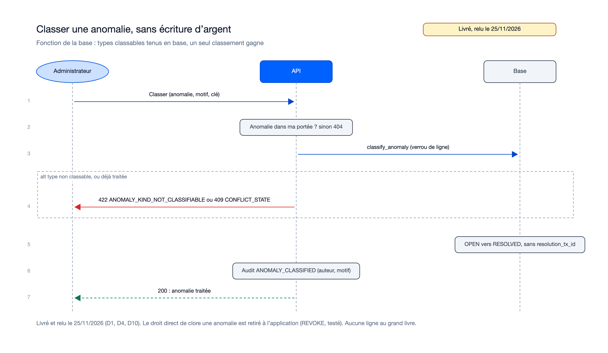
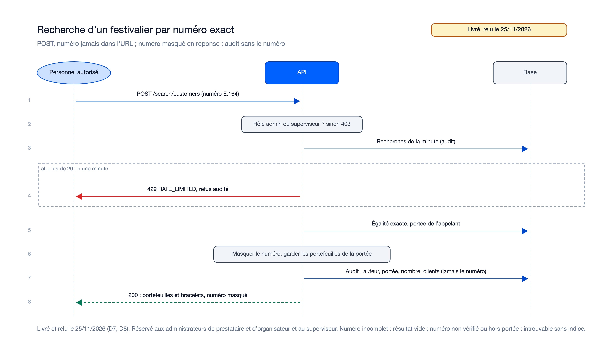

# Séquences : mission routes-backoffice-01M86KT6

> État : **relue le 25/11/2026 (11 lots sur 11 approuvés ; WP11 au cycle 2, `e32df355`, code réuni dans la lane k), non acceptée, non fusionnée**.
> Flux recalés sur le code ; diagrammes `/illustre` régénérés le 25/11/2026, rendus relus ; sources dans [`diagrams/`](diagrams/) (`generate.py`). D4, D7, D8 et D10 validés par le porteur le 24/11/2026.

## Flux internes propres à cette mission

### Classer une anomalie, sans écriture d'argent

Sources : [`sequence-classement-anomalie.excalidraw`](diagrams/sequence-classement-anomalie.excalidraw), [`sequence-classement-anomalie.svg`](diagrams/sequence-classement-anomalie.svg).
L'administrateur envoie le motif (1 à 500 caractères) avec `Idempotency-Key`. L'API vérifie la portée (404 sinon), puis appelle `classify_anomaly`, qui prend un verrou de ligne : type hors des 10 classables, `422 VALIDATION_FAILED`
avec `reason ANOMALY_KIND_NOT_CLASSIFIABLE` ; anomalie déjà traitée ou classée en même temps par un autre, `409 CONFLICT_STATE` (un seul classement gagne). Sinon `OPEN` passe à `RESOLVED` sans `resolution_tx_id`, l'audit
`ANOMALY_CLASSIFIED` est écrit, aucune ligne n'est créée au grand livre.

### Recherche d'un festivalier par numéro exact

Sources : [`sequence-recherche-numero.excalidraw`](diagrams/sequence-recherche-numero.excalidraw), [`sequence-recherche-numero.svg`](diagrams/sequence-recherche-numero.svg).
Le numéro E.164 est dans le corps d'un `POST`. L'API refuse tout rôle autre qu'administrateur de prestataire, administrateur d'organisateur ou superviseur (403, sans ligne d'audit ; y compris `PLATFORM_ADMIN`, retiré en renforcement), compte les recherches de l'auteur sur les 60 dernières secondes dans l'audit (au-delà de 20 : `429 RATE_LIMITED` avec `Retry-After`, refus audité),
cherche par égalité exacte dans le prestataire puis restreint aux portefeuilles des événements de la portée de l'appelant, masque le numéro côté serveur et écrit l'audit (auteur, rôle, portée, nombre, identifiants des clients ; jamais le numéro).

Les erreurs du classement (`CL066` à `CL069` de la base) sont traduites dans `anomalies.service.ts` et non dans `sqlstate-map.ts` (OP-N197) ; `reason` est une propriété de premier niveau du `422`. Restent en texte : lectures de ventes et d'anomalies (vues sous RLS, curseur), profil du personnel, niveau NFC calculé à la lecture (jointure `phone_model`), enrôlement d'un modèle non testé (toujours permis).

## Flux transverses auxquels cette mission participe (référence, pas dupliqué)

Voir `docs/05-sequence-diagrams.md`, flux : « Recherche et classement au back-office (ventes, anomalies, numéro de festivalier) » (ajouté par cette mission, livré) ; l'enrôlement d'un terminal (mission 5a) reçoit seulement un champ facultatif.

## Nécessaire pour cette mission ? Oui : deux interactions inter-composants nouvelles et sensibles (classement sans écriture, recherche encadrée) (réponse proposée par l'Agent le 24/11/2026, validée par le porteur le 24/11/2026).
## Complet ? Oui, recalé à la review (25/11/2026) : dix classements simultanés donnent un 200 et neuf 409 (testé) ; pagination en texte (réponse proposée par l'Agent le 25/11/2026, en attente de confirmation du porteur).
## Validé par : plan validé par le porteur le 24/11/2026 ; recalage post-review proposé par l'Agent le 25/11/2026, en attente de confirmation du porteur.
