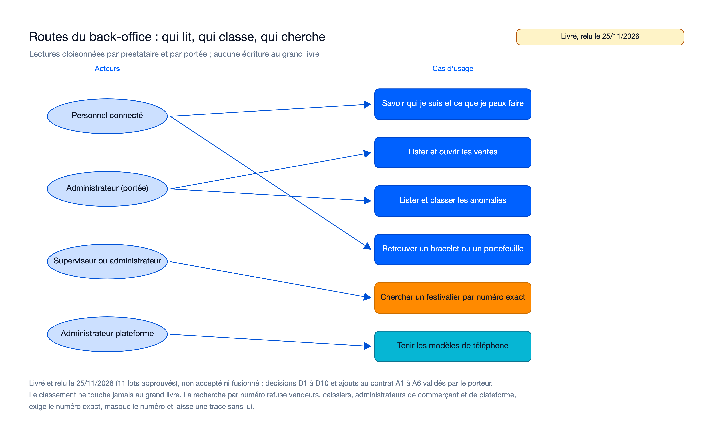

# Cas d'usage : mission routes-backoffice-01M86KT6

> État : **relue le 25/11/2026 (11 lots sur 11 approuvés ; WP11 au cycle 2, `e32df355`, code réuni dans la lane k), non acceptée, non fusionnée**.
> Recalé sur le code livré (`apps/api/src/{staff-profile,sales,anomalies,search}`, `devices/phone-models`) et sur `docs/passation-11b/` (preuves, note aux équipes). Décisions D1 à D10 et ajouts au contrat A1 à A6
> validés par le porteur les 24 et 25/11/2026. Diagrammes `/illustre` régénérés le 25/11/2026 (police sans empattement, rendus relus), sources et générateur dans [`diagrams/`](diagrams/) (`generate.py`).

## Cas d'usage propres à cette mission

Sources : [`usecase-routes-backoffice.excalidraw`](diagrams/usecase-routes-backoffice.excalidraw), [`usecase-routes-backoffice.svg`](diagrams/usecase-routes-backoffice.svg).

| Cas d'usage | Acteur | Règle livrée | Opération livrée |
|---|---|---|---|
| Savoir qui je suis et ce que je peux faire | Personnel connecté | Profil : identité, rôles et portées, rien d'autre ; sans rôle actif : profil vide, pas d'erreur ; festivalier et terminal refusés ; chaque opération du contrat déclare ses rôles, un contrôle automatique échoue si la déclaration dérive (matrice échantillon, D3) | `GET /staff/me` (A1), extension `x-roles` sur les 227 opérations (A2, tranché : sur chaque opération ; 226 annotées, 8 opérations sans route restent sans `x-roles`, OP-N188 ; matrice de fidélité de 1 281 appels, 3 dérives alignées sur le code) |
| Lister et ouvrir les ventes | Administrateur dans sa portée (organisateur, événement, commerçant) | Filtres point de vente, commerçant, vendeur, période, statut ; curseur, 200 maximum ; vente annulée marquée avec la référence de l'annulation ; administrateur de commerçant : ses ventes seulement (filtre en requête, D6) ; hors portée : 404 ; les ventes sans attribution (canal inconnu) sont exclues de la liste et rendent 404 au détail (OP-N192) | `GET /events/{event_id}/sales`, `GET /sales/{transaction_id}` (A3) |
| Lister et classer les anomalies | Administrateur de prestataire ou d'organisateur | Liste filtrée (type, statut, événement, période) ; classement « traitée » avec motif obligatoire, **sans aucune écriture au grand livre**, seulement pour 10 types (D1) ; les autres : `422 VALIDATION_FAILED`, `reason ANOMALY_KIND_NOT_CLASSIFIABLE` ; déjà traitée : `409 CONFLICT_STATE` ; classement par fonction de la base, droit direct de clore retiré à l'application (D4, livré, `REVOKE` testé) ; une anomalie sans grand livre n'est vue et classée que de `OPERATOR_ADMIN` | `GET /anomalies`, `POST /anomalies/{anomaly_id}/classification` (A4) |
| Retrouver un bracelet ou un portefeuille | Personnel dans sa portée | Par UID ou code imprimé, ou par portefeuille ; statut, événement, soldes ; hors portée : vide sans indice ; ancien code d'un bracelet réattribué : rien ; `searchMedia` : un seul critère, sinon 400 ; code imprimé mal formé : liste vide | `GET /search/media`, `GET /search/wallets/{wallet_id}` (A5) |
| Chercher un festivalier par numéro exact | Administrateur dans sa portée, superviseur | `POST`, numéro E.164 exact, jamais dans l'URL ; vendeur, caissier, administrateur de commerçant et `PLATFORM_ADMIN` refusés (403, sans audit) ; aucune recherche partielle ; numéro masqué en réponse ; 20 par minute et par personne (D8) ; audit sans le numéro, ni en clair ni en empreinte (D7, livré) | `POST /search/customers` (A5) |
| Tenir les modèles de téléphone | Administrateur plateforme (écriture), autres administrateurs (lecture) | Table de plateforme, niveau `RECOMMENDED` ou `TOLERATED`, date de mesure ; sur la fiche et la liste des terminaux : `RECOMMENDED`, `TOLERATED` ou `UNTESTED` ; **aucun refus d'enrôlement** ; modèle déclaré par le terminal, donc informatif (D2, accordé ; D9, livré) | `GET /phone-models`, `PUT` et `DELETE /phone-models/{manufacturer}/{model}` (A6), `device_model` facultatif sur l'enrôlement et le signal de vie (accordé), `device_model` et `nfc_level` facultatifs sur les réponses des terminaux (livré, confirmé) |

## Écarts entre le plan et le code livré

- Deux migrations (`0101`, `0102`) au lieu d'une seule `0101_backoffice_reads.sql` ; l'enrôlement et le signal de vie appellent `set_device_model` sous `SAVEPOINT` (jamais de refus).
- `x-roles` : 226 opérations annotées (et non 227), 8 sans route ; trois dérives du contrat alignées sur le code (renforcement : `CASHIER` retiré de `listCashSessions`, `OPERATOR_ADMIN` de deux politiques hors ligne).
- Renforcement non prévu : `PLATFORM_ADMIN` retiré de la recherche par numéro.
- Droits nouveaux de `cashless_app` (lecture des deux vues et de `phone_model`, exécution de 4 fonctions), nommés dans ADR-235 : le plan disait « aucun droit nouveau ».
- Nom affiché fixe « Administration de la plateforme » (OP-N191) ; ventes sans attribution invisibles (OP-N192).

Hors périmètre : écrans (mission 11), résolutions d'anomalie qui écrivent de l'argent (mission suivante, type par type, à consigner), nouveaux types d'anomalie (C-005).

## Lien avec la synthèse globale

Contribue à : `docs/02-use-case-diagram.md`, domaines « Administration et exploitation » (lectures, classement, recherche) et « Terminaux et encaissement » (niveau NFC des modèles) ; aucun domaine nouveau, aucun renommage ni fusion de cas d'usage globaux.

## Nécessaire pour cette mission ? Oui : six cas d'usage nouveaux et quatre acteurs (réponse proposée par l'Agent le 24/11/2026, validée par le porteur le 24/11/2026).
## Complet ? Oui, recalé à la review (25/11/2026) : six cas d'usage, quatre acteurs, refus et motifs distincts, écarts plan vers livré listés ci-dessus ; diagramme régénéré et relu (réponse proposée par l'Agent le 25/11/2026, en attente de confirmation du porteur).
## Validé par : plan validé par le porteur le 24/11/2026 ; recalage post-review proposé par l'Agent le 25/11/2026, en attente de confirmation du porteur.
