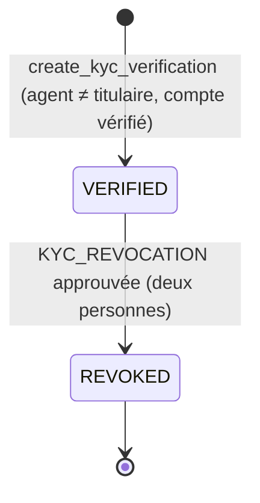

# Data Model — Serveur de l'app festivalier (mission 10a)

## Existant réutilisé (non modifié)

- `kyc_verification` (S24, schéma de référence) : ajout seul, seule la révocation la modifie (déclencheur
  `kyc_verification_append_only`) ; RLS par prestataire.
- `customer_kyc_level`, `wallet_kyc_level`, `check_wallet_limits` : niveau calculé à la date de l'opération.
- `customer_identity (customer_id, operator_id, phone, verified_at)` (0080) ; `app_user.phone` (0003).
- `approval_request.action` contient déjà `KYC_REVOCATION`.

## Changements

### Migration 0096 — fonctions KYC

| Objet | Rôle |
|---|---|
| `create_kyc_verification(p_wallet uuid, p_id_type text, p_id_country char(2), p_id_last4 text, p_id_expires_on date, p_agent uuid) RETURNS kyc_verification` | `SECURITY DEFINER` ; verrou du portefeuille ; erreurs : `no_data_found` (portefeuille), `ACCOUNT_REQUIRED` (sans client ou sans `customer_identity`), `FORBIDDEN` (numéro identique à `app_user.phone` de l'agent), `VALIDATION` (pièce expirée) |
| `revoke_kyc_verification(p_id uuid, p_by uuid, p_reason text) RETURNS kyc_verification` | `SECURITY DEFINER` ; `VERIFIED` → `REVOKED` ; déjà révoquée → `CONFLICT_STATE` ; motif ≥ 10 caractères |

Invariants : une identification ne change que de `VERIFIED` à `REVOKED` ; `id_last4` ≤ 4 caractères ; méthode `DESK`.

### Migration 0097 — version du secret des codes

| Table | Colonne | Règle |
|---|---|---|
| `media` | `claim_key_version smallint` | NULL si pas de code ; sinon version du secret de `claim_code_hash` |
| `claim_code` | `key_version smallint NOT NULL DEFAULT 1` | version du secret de `code_hash` |
| `media_claim` | `key_version smallint NOT NULL DEFAULT 1` | version du secret de `confirmation_hash` |

Fonctions : les fonctions de rattachement, de confirmation et d'association reçoivent la version courante et ignorent
toute empreinte d'une autre version. `reissue_claim_codes(p_batch uuid, p_media uuid[], p_hashes bytea[], p_version
smallint) RETURNS int` : exécutable par `cashless_claimadmin` seulement ; lot `PUBLIC` ; ne touche qu'un bracelet sans
code, ou au code d'une version antérieure jamais utilisé ; journalise le nombre.

### Migration 0098 — numéro imprimé et avis hors ligne

- `media.printed_number text` : `CHECK (printed_number ~ '^[A-Z0-9-]{1,32}$')`, unique par `(operator_id,
  printed_number)` quand non NULL ; posé par `associate_claim_code` étendue (paramètre facultatif).
- `wallet_pending_offline_notice(p_wallet uuid) RETURNS boolean` (`STABLE`) : événement non `CLOSED` et au moins un
  terminal non révoqué avec un `offline_snapshot_ack` sur le grand livre postérieur à son dernier `offline_batch`.

### Migration 0099 — canaux essayés d'un défi

`otp_channel_attempt (id, operator_id, challenge_id → otp_challenge, channel ∈ {WHATSAPP, SMS_PRIMARY, SMS_FALLBACK},
provider text, sent_at, confirmed_at NULL, failed_reason NULL)` : jamais de code ni d'empreinte ; RLS par prestataire.

### `post-roles.sql` §14

- rôle `cashless_claimadmin` (connexion, aucun droit de table) : `EXECUTE` sur `reissue_claim_codes` seulement ;
- `cashless_app` : `EXECUTE` sur `create_kyc_verification`, `revoke_kyc_verification`, `wallet_pending_offline_notice` ;
  aucun droit sur `reissue_claim_codes` (test de droits) ; `INSERT` sur `otp_channel_attempt`, `UPDATE OF
  confirmed_at, failed_reason`.

## Transitions

Niveau calculé : `VERIFIED` tant qu'une identification `VERIFIED` existe avec `id_expires_on` ≥ date de l'opération.
