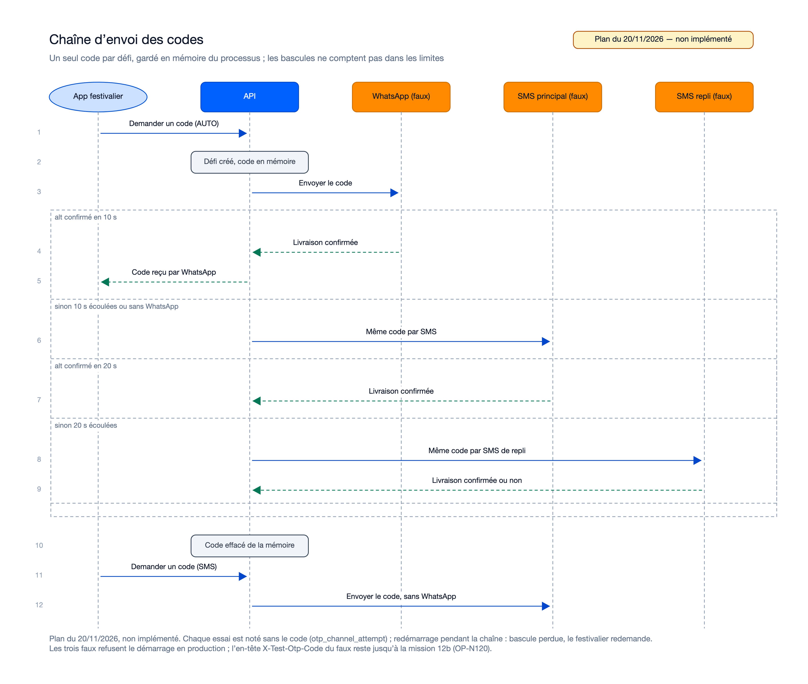
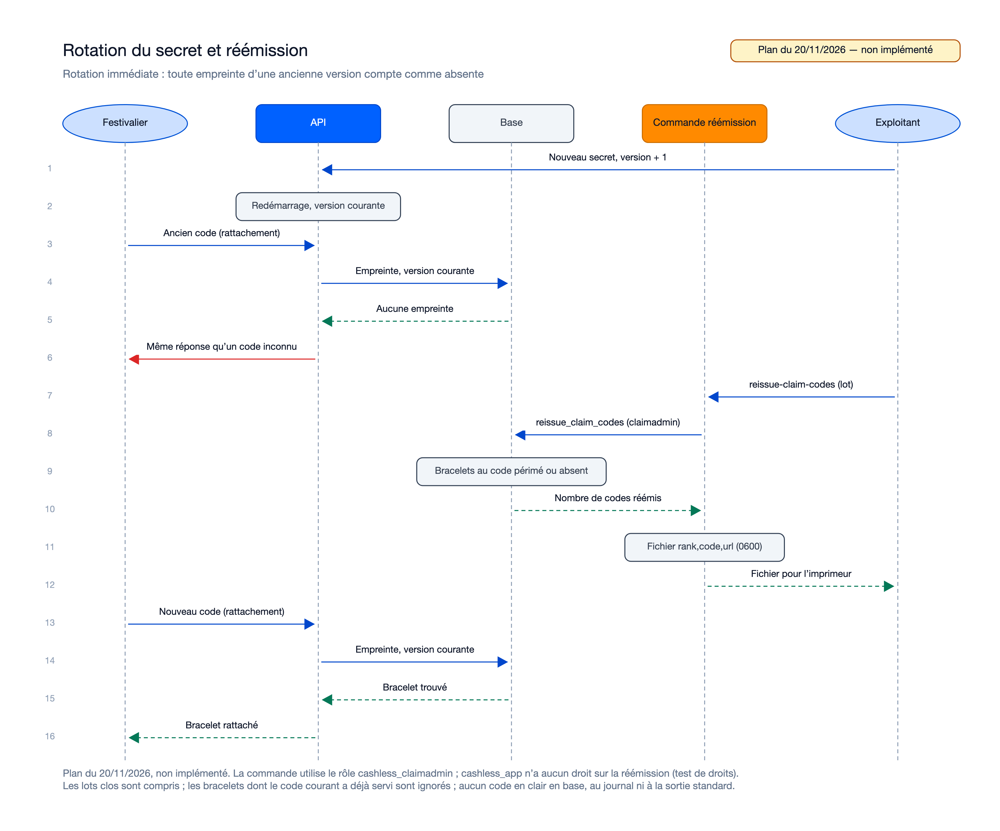

# Séquences : mission serveur-app-festivalier-01M7WB69

> État : **plan finalisé le 20/11/2026, non implémentée**. Trois diagrammes `/illustre` relus ; sources
> dans [`diagrams/`](diagrams/) (`generate.py`).

## Flux internes propres à cette mission

### Identification et révocation à deux

Sources : [`sequence-kyc.excalidraw`](diagrams/sequence-kyc.excalidraw),
[`sequence-kyc.svg`](diagrams/sequence-kyc.svg).
Le caissier appelle `POST /kyc-verifications` ; l'API appelle `create_kyc_verification`, qui refuse un
portefeuille sans client, une pièce expirée ou l'agent titulaire (rien n'est écrit), sinon écrit une
ligne `VERIFIED`. La révocation est demandée avec un motif (`202`, `KYC_REVOCATION` `PENDING`), puis
approuvée par une autre personne : `revoke_kyc_verification` passe l'identification à `REVOKED`.

### Chaîne d'envoi des codes

Sources : [`sequence-chaine-codes.excalidraw`](diagrams/sequence-chaine-codes.excalidraw),
[`sequence-chaine-codes.svg`](diagrams/sequence-chaine-codes.svg).
Un seul défi et un seul code, gardé en mémoire du processus (30 s au plus). WhatsApp d'abord ; sans
confirmation en 10 s ou sans WhatsApp, le même code part par le SMS principal ; sans confirmation en
20 s, par le SMS de repli. Le canal `SMS` saute WhatsApp. Les bascules ne comptent pas dans les limites.

### Rotation du secret et réémission

Sources : [`sequence-rotation.excalidraw`](diagrams/sequence-rotation.excalidraw),
[`sequence-rotation.svg`](diagrams/sequence-rotation.svg).
Après le redémarrage avec la version suivante du secret, un ancien code reçoit la réponse d'un code
inconnu. L'exploitant lance `reissue-claim-codes` (rôle `cashless_claimadmin`) ; le fichier
`rank,code,url` (mode 0600) va à l'imprimeur ; un code réémis rattache le bracelet.

## Flux transverses auxquels cette mission participe (référence, pas dupliqué)
Voir `docs/05-sequence-diagrams.md`, flux : « Double validation au back-office » (révocation
`KYC_REVOCATION`) et le flux de rattachement d'un bracelet (code de rattachement).

## Nécessaire pour cette mission ? Oui : trois interactions entre composants sont introduites ; réponse proposée par l'Agent, à confirmer par le porteur.
## Complet ? Oui pour le plan ; `/me` (lectures) reste en prose. Réponse proposée par l'Agent.
## Validé par : en attente du porteur.
