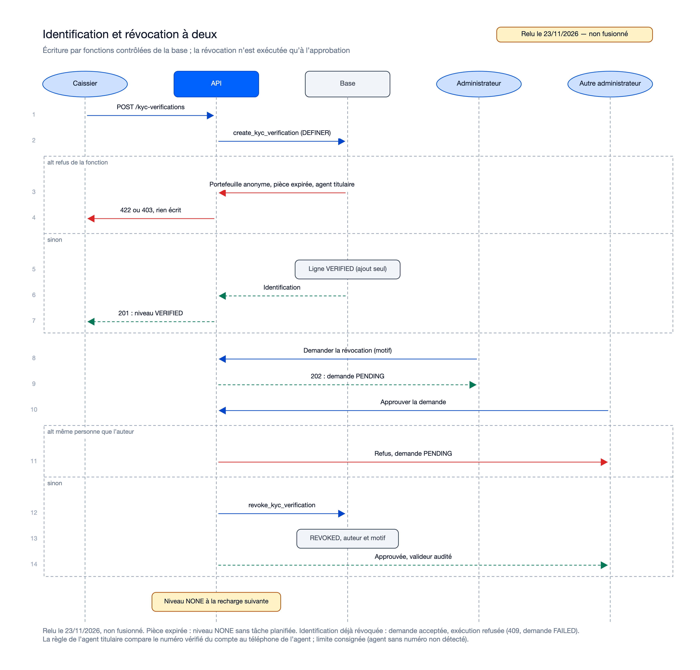

# Séquences : mission serveur-app-festivalier-01M7WB69

> État : **relue le 23/11/2026, non fusionnée** (recalée sur la lane `k`). Trois diagrammes `/illustre`
> régénérés et relus le 23/11/2026 ; sources dans [`diagrams/`](diagrams/) (`generate.py`).

## Flux internes propres à cette mission

### Identification et révocation à deux

Sources : [`sequence-kyc.excalidraw`](diagrams/sequence-kyc.excalidraw),
[`sequence-kyc.svg`](diagrams/sequence-kyc.svg).
Le caissier appelle `POST /kyc-verifications` ; l'API appelle `create_kyc_verification`, qui refuse un
portefeuille sans client, une pièce expirée ou l'agent titulaire (rien n'est écrit), sinon écrit une
ligne `VERIFIED`. La révocation est demandée avec un motif (`202`, `KYC_REVOCATION` `PENDING`), puis
approuvée par une autre personne : `revoke_kyc_verification` passe l'identification à `REVOKED`. Une
identification déjà révoquée ne bloque pas la demande (`guardDecision` ne teste pas l'état) : l'exécution échoue
(`CL063`, `409`, demande `FAILED`). Un motif de moins de 10 caractères donne `422`.

### Chaîne d'envoi des codes

Sources : [`sequence-chaine-codes.excalidraw`](diagrams/sequence-chaine-codes.excalidraw),
[`sequence-chaine-codes.svg`](diagrams/sequence-chaine-codes.svg).
Un seul défi et un seul code, gardé en mémoire du processus (35 s au plus, `OTP_CODE_HARD_CAP_MS`). WhatsApp d'abord ; sans
confirmation en 10 s ou sans WhatsApp, le même code part par le SMS principal ; sans confirmation en
20 s, par le SMS de repli. Le canal `SMS` saute WhatsApp. Les bascules ne comptent pas dans les limites. **Écart au plan :** quand le plafond de 35 s tombe avant l'étape
suivante (délais réglés au maximum, fournisseur lent), la chaîne s'arrête sans repli et sans essai noté (OP-N166,
ADR-229).

### Rotation du secret et réémission

Sources : [`sequence-rotation.excalidraw`](diagrams/sequence-rotation.excalidraw),
[`sequence-rotation.svg`](diagrams/sequence-rotation.svg).
Après le redémarrage avec la version suivante du secret, un ancien code reçoit la réponse d'un code
inconnu. L'exploitant lance `reissue-claim-codes` (rôle `cashless_claimadmin`) ; le fichier
`rank,code,url,uid,printed_number` (mode 0600, écrit avant la base, jamais écrasé) va à l'imprimeur, qui pose chaque
étiquette sur le bracelet de l'UID indiqué : **écart au plan** (trois colonnes prévues, décision du porteur du 20/11/2026
au soir), aucun import après réémission. Un code réémis rattache le bracelet de sa ligne.

## Flux transverses auxquels cette mission participe (référence, pas dupliqué)
Voir `docs/05-sequence-diagrams.md`, flux : « Double validation au back-office » (révocation
`KYC_REVOCATION`) et le flux de rattachement d'un bracelet (code de rattachement).

## Nécessaire pour cette mission ? Oui : trois interactions entre composants sont introduites ; réponse proposée par l'Agent, en attente du porteur (reconduite le 23/11/2026).
## Complet ? Oui, recalé à la review ; `/me` (lectures) reste en prose. Réponse proposée par l'Agent, en attente du porteur.
## Validé par : en attente du porteur.
