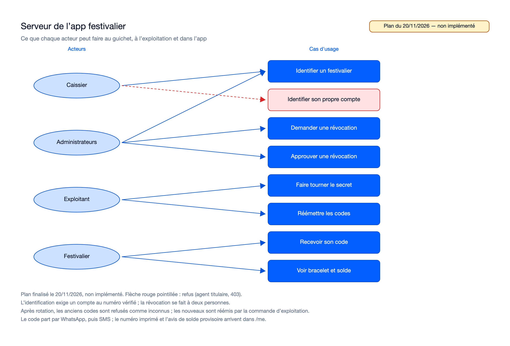

# Cas d'usage : mission serveur-app-festivalier-01M7WB69

> État : **plan finalisé le 20/11/2026, non implémentée** (mission 10a « Serveur de l'app festivalier »).
> Source : `spec.md`, `plan.md`, `data-model.md`, `contracts/`. Diagramme `/illustre` (police sans
> empattement, rendu relu le 20/11/2026) ; source et générateur dans [`diagrams/`](diagrams/)
> (`generate.py`).

## Cas d'usage propres à cette mission

Sources : [`usecase-festivalier-serveur.excalidraw`](diagrams/usecase-festivalier-serveur.excalidraw),
[`usecase-festivalier-serveur.svg`](diagrams/usecase-festivalier-serveur.svg).

| Cas d'usage | Acteur | Règle prévue | Point ouvert |
|---|---|---|---|
| Identifier un festivalier | Caissier, `ORGANIZER_ADMIN` | Compte au numéro vérifié exigé ; pièce (type, pays, 4 derniers caractères, expiration) ; écriture par `create_kyc_verification` seule ; niveau calculé à l'usage | C-005 (limite de l'agent titulaire) |
| Identifier son propre compte (refusé) | Caissier titulaire | Numéro vérifié du compte égal au téléphone de l'agent : `403` | C-005 |
| Demander une révocation | `OPERATOR_ADMIN`, `ORGANIZER_ADMIN` | Motif d'au moins 10 caractères ; demande `KYC_REVOCATION` `202` | Contradiction §6.3 (contrat prime) |
| Approuver une révocation | Autre personne habilitée | Auteur et valideur distincts ; identification `REVOKED` | |
| Faire tourner le secret | Exploitant | Version du secret sur chaque empreinte ; ancien code refusé comme inconnu | OP-N47 |
| Réémettre les codes | Exploitant | Commande d'exploitation, rôle `cashless_claimadmin`, nouveau fichier de commande | OP-N47 |
| Recevoir son code | Festivalier | WhatsApp, SMS principal (10 s), SMS de repli (20 s) ; code en mémoire | OP-N120 (faux jusqu'à la 12b) |
| Voir bracelet et solde | Festivalier | `printed_number` (colonne facultative du fichier de l'imprimeur) et `pending_offline_notice` | |

## Lien avec la synthèse globale

Contribue à : `docs/02-use-case-diagram.md`, domaines « Argent réel : PSP, caisses, rapprochements,
versements » (identification et plafonds), « Bracelets NFC : format, clés, lots, cycle de vie »
(rotation, réémission, numéro imprimé) et « App festivalier » (code d'envoi, lectures `/me`). Pas de
renommage ni de fusion de cas d'usage globaux. Références par nom de domaine, jamais par numéro.

## Nécessaire pour cette mission ? Oui : sept cas d'usage nouveaux ou servis pour la première fois et un refus (agent titulaire) ; réponse proposée par l'Agent, à confirmer par le porteur.
## Complet ? Oui pour le plan ; à recaler à la review (acteurs réels, codes d'erreur). Réponse proposée par l'Agent.
## Validé par : en attente du porteur.
