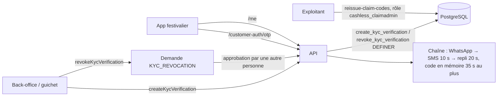

# Implementation Plan: Serveur de l'app festivalier

**Branch**: `feat/serveur-app-festivalier` | **Date**: 2026-11-20 | **Spec**: [spec.md](spec.md)
**Input**: Mission specification from `kitty-specs/serveur-app-festivalier-01M7WB69/spec.md`

## Summary

Compléter le serveur de l'app festivalier servi en avance le 10/11/2026 : identification au guichet (routes
`createKycVerification` et `revokeKycVerification`, déclarées au contrat depuis la 5b et répondant `404`), rotation
immédiate du secret des codes de rattachement avec version du secret sur chaque empreinte et réémission par une commande
d'exploitation (OP-N47), `printed_number` et `pending_offline_notice` dans `/me`, chaîne d'envoi des codes WhatsApp puis
SMS principal puis SMS de repli, le code restant en mémoire du processus seulement. Écritures sensibles par fonctions
contrôlées de la base ; faux fournisseurs refusés en production.

## Technical Context

**Language/Version**: TypeScript 5.9.3, Node.js 22 LTS (`engines: >=22 <23`), SQL PostgreSQL 17
**Primary Dependencies**: NestJS 11, `pg`, `node:crypto` ; tous déjà épinglés (`docs/08-pile-logicielle.md`, ADR-78).
**Aucune dépendance nouvelle** (DIRECTIVE_051 sans objet ; pas de passe adversariale de dépendance à faire).
**Storage**: PostgreSQL 17 au central ; migrations nouvelles à partir de `0096` ; section nouvelle de `post-roles.sql`
(rôle `cashless_claimadmin`, droits KYC) ; migrations existantes, schéma de référence et `.sql` générés non modifiés
(C-007).
**Testing**: pgTAP (fonctions contrôlées KYC et codes, droits par rôle, liste figée des `EXECUTE`, tests de borne) ;
Jest intégration sur base recréée (KYC, révocation à deux, rotation et réémission, `/me`, chaîne d'envoi avec faux et
horloge simulée) ; Jest unitaire (expéditeur composite, horloges) ; garde du contrat (`tools/contract-stability`) ;
`production-refusals.spec.ts` (COVERAGE des trois faux nouveaux). Avant la PR : `npm run lint && npm run typecheck`
(piège de la PR #20).
**Target Platform**: API centrale (processus `api`), commande d'exploitation de réémission (Linux) ; CI GitHub Actions
(jobs `ledger` et `gateway-e2e`) ; preuves locales sur macOS.
**Project Type**: monorepo npm (`apps/`, `packages/`, `tools/`).
**Performance Goals**:
- `getMe` et `listMyWallets` p95 < 300 ms pour un client de 5 portefeuilles (NFR-004) ;
- bascules de la chaîne à 10 s et 20 s, tolérance 1 s (NFR-001), mesurées avec horloge simulée et une passe réelle.

**Constraints**:
- C-001 à C-007 de la spec ;
- contrat : un seul ajout, la colonne facultative `printed_number` du fichier de l'imprimeur (`importClaimCodeAssociations`,
  description du corps `text/csv`), validé par le porteur le 20/11/2026 et inscrit dans `contract-baseline.json` ;
  les routes KYC sont servies telles que déclarées ;
- aucun code (OTP ou rattachement) en clair hors mémoire du processus, jamais en base ni dans les journaux (NFR-002) ;
- un rôle par processus ; la réémission des codes n'est **pas** ouverte à `cashless_app`.

**Scale/Scope**: 13 FR, 5 NFR, 7 contraintes ; 4 migrations ; 1 rôle de base nouveau ; 1 commande d'exploitation ;
0 route ajoutée ; 1 ajout au contrat (colonne facultative).

## Charter Check

Pas de charte Spec Kitty (`.kittify/charter/charter.yaml` absent) : section sans objet. Les règles normatives du projet
(`CLAUDE.md` : écarts de sécurité, aucun faux en production, dette nommée, revue ; `SPECIFICATION.md` §0.3) s'appliquent
et sont reprises ci-dessous.

### Décisions du porteur

- **Specify (20/11/2026)** : périmètre = KYC, OP-N47, `printed_number` et `pending_offline_notice`, chaîne d'envoi ;
  agent titulaire détecté par égalité du numéro vérifié et de `app_user.phone` (limite consignée) ; OP-N47 en rotation
  immédiate, sans période de double empreinte.
- **Plan (20/11/2026)** :
  1. code en attente de bascule gardé **en mémoire du processus seulement**, jusqu'au dernier envoi, 35 s au plus (« fais ce qui est le plus
     secure ») ; bascule perdue au redémarrage ;
  2. chaque empreinte porte la **version du secret** ; une empreinte d'une ancienne version compte comme absente ;
  3. réémission après rotation par une **commande d'exploitation**, contrat inchangé, lots clos compris ;
  4. `printed_number` par une **troisième colonne facultative** du fichier de l'imprimeur (ajout au contrat validé).

### Écarts de sécurité

- **Aucun écart qui affaiblit la sécurité n'est prévu.** Limite consignée par décision du porteur : la règle de l'agent
  titulaire (C-005) ne détecte ni un agent sans téléphone ni un agent avec un autre numéro ; point ouvert, ADR et test
  de borne (l'agent sans numéro passe, le test échoue si la règle s'élargit ou se resserre en silence).
- **Renforcements** (faits puis consignés) : réémission réservée à un rôle d'exploitation `cashless_claimadmin` (une
  connexion de l'API compromise ne peut pas remplacer les codes de bracelets non rattachés) ; identification et
  révocation par fonctions `DEFINER` seules ; refus d'une pièce déjà expirée à la saisie.
- Faux nouveaux (WhatsApp, SMS principal, SMS de repli) : refus du démarrage en production, prouvé par test et recensé
  dans `production-refusals.spec.ts` ; l'en-tête `X-Test-Otp-Code` (OP-N120, ADR-180) reste jusqu'à la 12b.

### Contradiction signalée

SPECIFICATION §6.3 point 5 (« un administrateur PEUT révoquer ») contre `openapi.yaml` (`revokeKycVerification` : deux
personnes, `KYC_REVOCATION`). Le contrat prime (§0.3) ; la contradiction reste signalée au porteur et consignée.

## Project Structure

### Documentation (this mission)

```
kitty-specs/serveur-app-festivalier-01M7WB69/
├── spec.md
├── plan.md              # ce fichier
├── research.md          # Phase 0
├── data-model.md        # Phase 1
├── quickstart.md        # Phase 1
├── contracts/           # Phase 1
│   ├── kyc.md
│   ├── claim-code-rotation.md
│   ├── printer-file-printed-number.md
│   └── otp-sender-chain.md
├── decisions/           # Decision Moments du specify et du plan
└── tasks.md             # Phase 2 (/spec-kitty.tasks)
```

### Source Code (repository root)

```
packages/ledger-sql/
├── migrations/0096_kyc_functions.sql            # create_kyc_verification, revoke_kyc_verification (DEFINER)
├── migrations/0097_claim_code_key_version.sql   # version du secret, reissue_claim_codes, printed_number
├── migrations/0098_pending_offline_notice.sql   # wallet_pending_offline_notice
├── migrations/0099_otp_channel_attempt.sql      # canaux essayés d'un défi (sans code)
├── post-roles.sql                               # section 14 : cashless_claimadmin, EXECUTE KYC, retraits
└── tests/tests_10a_*.sql                        # fonctions, droits, bornes

apps/api/src/
├── kyc/                                         # module KYC : contrôleur, service, action d'approbation KYC_REVOCATION
├── kms/claim-hash.ts                            # version du secret (CLAIM_CODE_HMAC_KEY_VERSION)
├── config/config.ts                             # version du secret, délais de bascule
├── media/batches/claim-codes.service.ts         # colonne printed_number, version
├── media/claims/claims.service.ts               # recherche limitée à la version courante
├── customer-app/me.service.ts                   # printed_number, pending_offline_notice
├── customer-auth/otp-sender.ts                  # port inchangé ; expéditeur composite + trois faux
├── customer-auth/otp-chain.ts                   # chaîne : délais, mémoire bornée, journal des canaux
└── cli/reissue-claim-codes.ts                   # commande d'exploitation (rôle cashless_claimadmin)

apps/api/test/{unit,integration}/…               # kyc/, media/claim-rotation, customer-app/, customer-auth/otp-chain
apps/gateway/test/e2e/production-refusals.spec.ts  # COVERAGE des faux nouveaux
tools/contract-stability/contract-baseline.json    # ajout de la colonne printed_number
packages/contracts/openapi.yaml                    # description du corps text/csv de importClaimCodeAssociations
docs/procedure-rotation-codes-rattachement.md      # procédure d'exploitation (FR-007)
```

**Structure Decision**: monorepo existant ; un module `kyc/` nouveau dans l'API, la commande d'exploitation dans
`apps/api/src/cli/` pour réutiliser `ClaimHasher` (seul lecteur du secret) sans le copier dans `tools/`.

### Architecture



## Complexity Tracking

| Violation | Why Needed | Simpler Alternative Rejected Because |
|-----------|------------|-------------------------------------|
| Rôle de base nouveau `cashless_claimadmin` | La réémission remplace les codes de bracelets non rattachés : ouverte à `cashless_app`, une API compromise pourrait s'approprier ces bracelets | Réutiliser `cashless_app` : affaiblit la sécurité (règle 1 de `CLAUDE.md`) ; réutiliser `cashless_maint` : mélange deux usages et élargit un rôle limité à deux purges |

## Implementation Concern Map

### IC-01 — Identification au guichet (KYC)

- **Purpose**: écrire et lire les identifications par fonctions contrôlées, servir `createKycVerification`.
- **Relevant requirements**: FR-001, FR-002, FR-003, FR-004, FR-006, NFR-003, C-005, C-006.
- **Affected surfaces**: `0096_kyc_functions.sql`, `post-roles.sql` §14, `apps/api/src/kyc/`, `errors/sqlstate-map.ts`,
  tests pgTAP et intégration.
- **Sequencing/depends-on**: none.
- **Risks**: rôle de l'agent sur la portée de l'événement du portefeuille (`CASHIER` ou `ORGANIZER_ADMIN`) ; égalité de
  numéro en E.164 normalisé ; `wallet_kyc_level` déjà utilisé par `check_wallet_limits` (ne pas le modifier) ; test de
  borne de C-005.

### IC-02 — Révocation à deux personnes

- **Purpose**: action d'approbation `KYC_REVOCATION` (déjà dans l'énumération de la base) et route
  `revokeKycVerification` (`202`, exécution à l'approbation).
- **Relevant requirements**: FR-005, FR-006, C-002.
- **Affected surfaces**: `apps/api/src/kyc/kyc-revocation-action.ts`, registre des actions (`approval/action-registry.ts`),
  `0096_kyc_functions.sql` (`revoke_kyc_verification`).
- **Sequencing/depends-on**: IC-01.
- **Risks**: `409 CONFLICT_STATE` à la demande et à l'exécution ; auteur ≠ valideur ; contradiction §6.3 consignée.

### IC-03 — Version du secret des codes de rattachement

- **Purpose**: chaque empreinte porte la version du secret ; une ancienne version compte comme absente.
- **Relevant requirements**: FR-007, NFR-002.
- **Affected surfaces**: `0097_claim_code_key_version.sql`, `kms/claim-hash.ts`, `config/config.ts`,
  `media/claims/claims.service.ts`, `media/batches/claim-codes.service.ts`, consultation anonyme.
- **Sequencing/depends-on**: none.
- **Risks**: toutes les lectures d'empreinte (rattachement, confirmation, consultation anonyme, import) doivent filtrer
  la version courante ; défaut de version = 1 pour l'existant ; la référence d'adresse (limites par IP) utilise aussi ce
  secret : remise à zéro des compteurs acceptée.

### IC-04 — Réémission après rotation et procédure d'exploitation

- **Purpose**: commande d'exploitation qui produit le nouveau fichier de commande d'un lot pour ses bracelets au code
  non utilisé ou d'ancienne version, lots clos compris ; procédure documentée et testée.
- **Relevant requirements**: FR-007, FR-008, SC-003.
- **Affected surfaces**: `apps/api/src/cli/reissue-claim-codes.ts`, `reissue_claim_codes` (`0097`), rôle
  `cashless_claimadmin`, `docs/procedure-rotation-codes-rattachement.md`.
- **Sequencing/depends-on**: IC-03.
- **Risks**: le fichier rendu contient des codes en clair : sortie vers un fichier local seulement, jamais journalisée ;
  aucune exécution par `cashless_app` (test de droits).

### IC-05 — `/me` : numéro imprimé et avis de solde provisoire

- **Purpose**: `printed_number` importé (colonne facultative) et `pending_offline_notice` calculé.
- **Relevant requirements**: FR-009, FR-010, NFR-004, C-001.
- **Affected surfaces**: `0097` (`printed_number`), `0098_pending_offline_notice.sql`, `claim-codes.service.ts` (import), `customer-app/me.service.ts`,
  `openapi.yaml` (description), `contract-baseline.json`.
- **Sequencing/depends-on**: IC-03 (même fichier d'import).
- **Risks**: le calcul de l'avis lit `offline_snapshot_ack` et `offline_batch` sous RLS ; index pour tenir NFR-004.

### IC-06 — Chaîne d'envoi des codes

- **Purpose**: expéditeur composite WhatsApp → SMS principal → SMS de repli, délais réglables (10 s et 20 s), code en
  mémoire jusqu'au dernier envoi (35 s au plus), canaux essayés notés sans le code, trois faux refusés en production.
- **Relevant requirements**: FR-011, FR-012, FR-013, NFR-001, NFR-002, NFR-005, C-003.
- **Affected surfaces**: `customer-auth/otp-sender.ts`, `customer-auth/otp-chain.ts`, `customer-auth.service.ts`,
  `0099_otp_channel_attempt.sql`, `config/config.ts`, `production-refusals.spec.ts`.
- **Sequencing/depends-on**: none.
- **Risks**: minuteries sans fuite au test ni à l'arrêt ; un seul code par défi ; les bascules ne comptent pas dans les
  limites ; le code d'un titulaire (remboursements, mission 9a) suit la même chaîne sans sortir dans une réponse.

### IC-07 — Consignation, documentation et preuves

- **Purpose**: points ouverts (C-005, contradiction §6.3, OP-N47 levé), ADR, tests de borne, reports dans
  `PROMPTS-A-ENVOYER.md` et `PRD.md`, matrice d'acceptation.
- **Relevant requirements**: C-002, C-004, C-005 ; toutes les SC.
- **Affected surfaces**: `docs/POINTS_OUVERTS.md`, `docs/DECISIONS_ADR.md`, `PROMPTS-A-ENVOYER.md`, `PRD.md`.
- **Sequencing/depends-on**: IC-01 à IC-06.
- **Risks**: fichiers modifiés à la fois sur feat et dans une lane (piège de consolidation) : les réserver à la lane
  de consignation.
