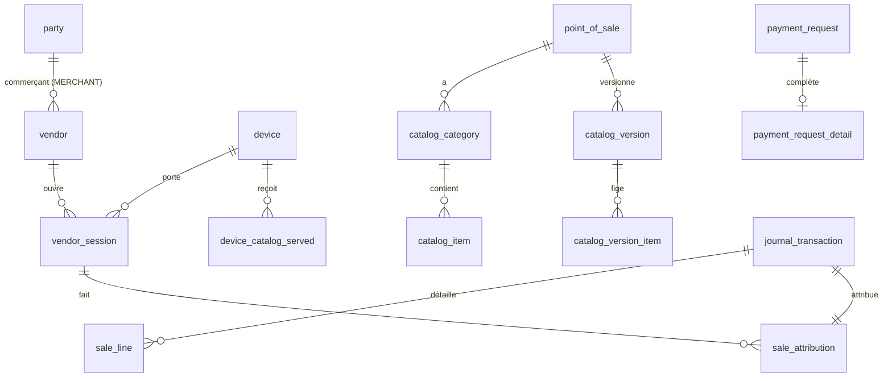

# Data Model: Encaissement en ligne

Tables nouvelles par migration (`0031` et suivantes) ; schéma de référence inchangé. Toutes portent `operator_id`, sont
sous RLS forcée (`tenant_isolation`) et ne s'écrivent que par fonctions `SECURITY DEFINER` (`search_path = public,
pg_temp`, `EXECUTE` retiré à `PUBLIC`, accordé nommément à `cashless_app` dans `post-roles.sql`).

## vendor (S2)

| Colonne | Type | Règle |
|---|---|---|
| id | uuid PK | |
| operator_id | uuid → party | prestataire du commerçant |
| merchant_id | uuid → party | `kind = 'MERCHANT'`, même prestataire (garde) |
| display_name | text | non vide, 80 caractères au plus |
| pin_hash | text | format PHC argon2id (`$argon2id$v=19$…`), jamais renvoyé par une route |
| status | text | `ACTIVE`, `DISABLED` |
| failed_attempts | int | 0 à 5 ; remis à 0 par un succès ou un nouveau PIN |
| locked_at | timestamptz | posé au 5e échec ; levé seulement par un nouveau PIN |
| created_by, created_at, updated_at | | auteur : `MERCHANT_ADMIN` du commerçant (contrôlé par l'API, auteur passé à la fonction) |

Invariants : `locked_at IS NOT NULL` ⇔ `failed_attempts = 5` (le compteur ne dépasse jamais 5 : un vendeur bloqué n'est plus compté) ; un vendeur `DISABLED` ou bloqué n'ouvre pas de session ;
sa désactivation ou son blocage ferme ses sessions ouvertes.

Transitions : `ACTIVE` ⇄ `DISABLED` (commerçant) ; bloqué → débloqué par `set_vendor_pin` (nouveau PIN).

## vendor_public (vue)

`id`, `operator_id`, `merchant_id`, `display_name`, `status`, `locked` (`locked_at IS NOT NULL`) : seule lecture des
vendeurs ouverte à `cashless_app` (A20).

## vendor_pin_check

`(id, operator_id, vendor_id, device_id, created_at, expires_at = created_at + 30 s, used_at)` : un essai de PIN
compté (transaction A) ; `open_vendor_session` exige un essai de ce vendeur et de ce terminal, non expiré, non utilisé
(contracts/vendors.md). Purgé avec les essais d'enrôlement (plus de 24 h).

## vendor_session

| Colonne | Type | Règle |
|---|---|---|
| id | uuid PK | renvoyé au terminal (non secret) |
| operator_id, vendor_id, device_id | | terminal affecté à un point de vente du commerçant du vendeur |
| opened_at | timestamptz | heure de la base |
| expires_at | timestamptz | `opened_at + 12 h` |
| closed_at, closed_reason | | `LOGOUT`, `REPLACED`, `VENDOR_DISABLED`, `VENDOR_LOCKED`, `DEVICE_SUSPENDED`, `DEVICE_REVOKED`, `PIN_CHANGED` |

Index unique partiel `(device_id) WHERE closed_at IS NULL` : une session ouverte par terminal. Une session est
**utilisable** si `closed_at IS NULL`, `expires_at > now()`, le vendeur est `ACTIVE` et non bloqué, et le terminal
`ACTIVE` (relu par `assert_device_active`). L'expiration n'a pas besoin de tâche : elle est relue à chaque vente.

## catalog_category, catalog_item (S18, état courant)

- `catalog_category` : `pos_id`, `label_fr`, `label_en`, `position` (ordre), `active`.
- `catalog_item` : `category_id`, `label_fr`, `label_en`, `unit_price` (bigint > 0, unités mineures de la devise de
  l'événement), `vat_rate_bps` (0 à 10 000), `active`.
- Réglage `point_of_sale_catalog_policy (pos_id, merchant_manages bool)` : l'organisateur autorise le commerçant à gérer
  le catalogue de ce point de vente.

## catalog_version, catalog_version_item (versions immuables)

- `catalog_version (pos_id, version int, created_by, created_at)`, unique `(pos_id, version)`, version croissante
  à partir de 1.
- `catalog_version_item (pos_id, version, item_id, category_id, label_fr, label_en, unit_price, vat_rate_bps)` : copie
  des articles **actifs** au moment de la version.
- Toute modification du catalogue d'un point de vente (fonction de la base) crée la version suivante dans la même
  transaction. Les deux tables sont en ajout seul (`forbid_mutation`).

## device_catalog_served

`(device_id, pos_id, version, served_at)`, en ajout seul, unique `(device_id, pos_id, version)` (renforcement de WP03, relecture du cycle 1 : un terminal
ramené sur un point de vente ne réutilise pas une version servie ailleurs) : écrite par la construction de
la configuration d'un terminal `CATALOG_POS`. Sert au contrôle des prix (contracts/catalog.md).

## sale_line (S18)

| Colonne | Type | Règle |
|---|---|---|
| transaction_id | uuid → journal_transaction | vente `PURCHASE` |
| line_no | int | 1 à n, unique par vente |
| item_id | uuid | article du catalogue |
| catalog_version | int | version dont viennent prix et taux |
| label_fr, label_en | text | copiés |
| quantity | int | ≥ 1 |
| unit_price | bigint | copié de la version |
| vat_rate_bps | int | copié de la version |
| line_total | bigint | `quantity × unit_price` (contrainte) |

En ajout seul. Σ `line_total` = montant de la vente (contrôlé par `record_sale_lines`).

## sale_attribution

`(transaction_id PK, operator_id, vendor_id, vendor_session_id, device_id, channel)` — `channel` : `NFC`, `MERCHANT_QR`,
`CUSTOMER_QR`. En ajout seul ; une ligne par vente et par annulation (l'annulation porte son auteur : vendeur ou
`SUPERVISOR`, colonne `actor_user_id` pour ce dernier).

## payment_request (schéma de référence) et payment_request_detail

`payment_request` est inchangée. `payment_request_detail (payment_request_id PK, vendor_session_id, idempotency_key,
lines jsonb, catalog_version)` complète une demande `MERCHANT_QR` créée par un terminal. Statuts : `PENDING` →
`CONFIRMED` (payée), `CANCELLED` (terminal ou festivalier), `EXPIRED` (relue à l'heure de la base, sans tâche).
`nonce_hash` = SHA-256 du jeton.

## journal_transaction (schéma de référence) : renforcement

Index unique partiel `journal_transaction_reverses_once` sur `(reverses_id) WHERE reverses_id IS NOT NULL` : une vente
ne s'annule qu'une fois ; la violation est traduite en `409 ALREADY_REVERSED` par le nom de la contrainte.

## approval_token_use (mission 2) : appelant terminal

Colonnes `caller_device_id`, `caller_vendor_session_id` ajoutées ; `caller_id` (personne) devient nul quand l'appelant
est un terminal ; contrainte : exactement un appelant (personne, ou terminal et session) ; le contrôle « valideur ≠
appelant » reste pour l'appelant personne (un vendeur n'est pas une personne). Usage unique inchangé.

## device_seq_registry (schéma de référence, S6)

Écrit par `record_device_seq` pour chaque réponse finale d'une route de terminal à clé `<serial>:<seq>` (2xx et 4xx ;
contracts/payments.md) ; fonction accordée à `cashless_app` pour la première fois.

## set_device_status (0022) : remplacée

Même contrôles qu'en 0022 ; ferme en plus les sessions de vendeur ouvertes du terminal au passage à `SUSPENDED`
(`DEVICE_SUSPENDED`) et à `REVOKED` (`DEVICE_REVOKED`), dans l'ordre global des verrous (terminal, puis sessions).

## Codes d'erreur nouveaux (base → API)

| SQLSTATE | Problème | HTTP | Cas |
|---|---|---|---|
| CL031 | `ENROLLMENT_EVENT_CLOSED` | 422 | OP-N74 : événement clos, ou en clôture pour une caisse |
| CL032 | `VENDOR_SESSION_INVALID` | 409 | session absente, close, expirée ou autre que celle désignée |
| CL033 | `VENDOR_PIN_INVALID` | 401 | PIN faux, vendeur inconnu, bloqué, désactivé ou d'un autre commerçant (même réponse) |
| CL034 | `SALE_LINES_INVALID` | 422 | article inconnu, inactif, d'un autre point de vente, prix ou taux non servi, somme fausse |
| CL035 | `ALREADY_REVERSED` | 409 | annulation déjà écrite |
| CL036 | `REVERSAL_NOT_ALLOWED` | 422 | autre vendeur, autre terminal, vente non `PURCHASE` (ADR-123) |
| CL040 | `REVERSAL_WINDOW_EXPIRED` | 409 | hors fenêtre, contrôlé après terminal et vendeur (ADR-123) |
| CL037 | `PAYMENT_REQUEST_NOT_PENDING` | 409 | demande payée, annulée ou expirée ; jeton inconnu ; sur `POST /payments` avec un QR client : `422 QR_TOKEN_INVALID` (ADR-123) |
| — | `422 MEDIA_BLOCKED`, `422 WALLET_BLOCKED`, `409 TAP_UNUSABLE` | | existants ; levés aussi par `assert_tap_payable` et `assert_wallet_payable` |

Les noms de problème sont arrêtés avec le contrat (contracts/openapi-additions.md) ; ceux qui existent déjà au contrat
sont repris tels quels.
