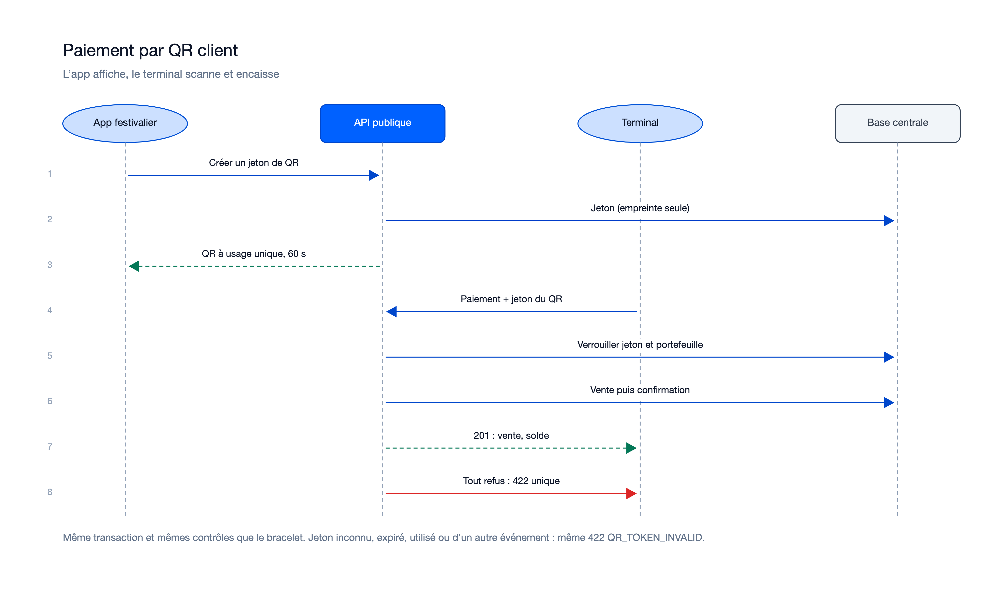

# Séquences — mission terminaux-paiement-en-ligne-01M52QB9

> État : **relue, 14 lots approuvés (26/10/2026) ; accept/merge à venir**. Diagrammes refaits le 26/10/2026 d'après le
> code livré (lane `n` : `payments.service.ts`, `reversal.service.ts`, `vendor-sessions.service.ts`, `payment-requests/`).

## Flux internes propres à cette mission

### Session de vendeur

Sources : [`sequence-session-vendeur.excalidraw`](diagrams/sequence-session-vendeur.excalidraw), [`sequence-session-vendeur.svg`](diagrams/sequence-session-vendeur.svg).

### Paiement par bracelet

Sources : [`sequence-paiement-bracelet.excalidraw`](diagrams/sequence-paiement-bracelet.excalidraw), [`sequence-paiement-bracelet.svg`](diagrams/sequence-paiement-bracelet.svg).

### Annulation d'une vente, au terminal

Sources : [`sequence-annulation.excalidraw`](diagrams/sequence-annulation.excalidraw), [`sequence-annulation.svg`](diagrams/sequence-annulation.svg).

### Annulation d'une vente, au back-office

Sources : [`sequence-annulation-backoffice.excalidraw`](diagrams/sequence-annulation-backoffice.excalidraw), [`sequence-annulation-backoffice.svg`](diagrams/sequence-annulation-backoffice.svg).

### Paiement par QR commerçant

Sources : [`sequence-qr-commercant.excalidraw`](diagrams/sequence-qr-commercant.excalidraw), [`sequence-qr-commercant.svg`](diagrams/sequence-qr-commercant.svg).

### Paiement par QR client

Sources : [`sequence-qr-client.excalidraw`](diagrams/sequence-qr-client.excalidraw), [`sequence-qr-client.svg`](diagrams/sequence-qr-client.svg).

Régénération : `python3.14 diagrams/generate.py diagrams ~/.claude/skills/illustre/references/render_excalidraw.py`
(police sans-serif imposée, rendus relus).

## Lien avec la synthèse globale
Contribue à : `docs/05-sequence-diagrams.md` — le flux « Paiement en ligne par bracelet » y existe (mission 4, lecture
seule) ; il est complété par une section « Encaissement en ligne » (vente attribuée au vendeur, annulation, QR) remontée
le 26/10/2026.

## Nécessaire pour cette mission ? Oui — six flux nouveaux entre terminal, back-office, API, moteur, base et app.
## Complet ? Oui — refaits d'après le code livré le 26/10/2026 (à confirmer par le porteur).
## Validé par : en attente du porteur (proposition de l'Agent, 26/10/2026)
